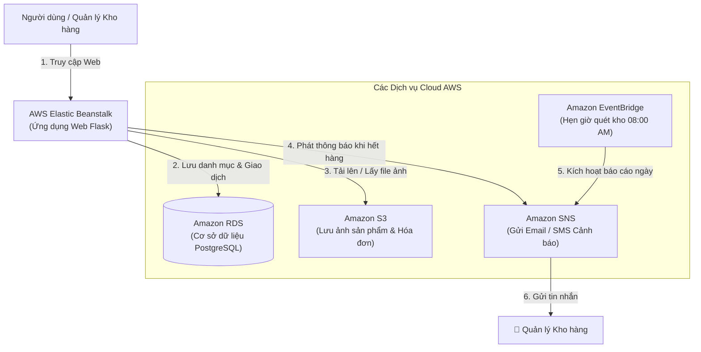

# BÁO CÁO - TUẦN 1
## HỆ THỐNG QUẢN LÝ KHO HÀNG & CẢNH BÁO TỒN KHO (`inventory-app`)

**Môn học:** Điện toán đám mây (Cloud Computing)  
**Sinh viên thực hiện:** 
- Nguyễn Đình Khanh (MSSV: 24110244)
- Võ Minh Quân (MSSV: 24110312)  
**Giảng viên hướng dẫn:** ThS. Huỳnh Xuân Phụng  

---

## 1. BẢNG TỔNG HỢP GIỚI HẠN & QUY ĐỊNH HẠ TẦNG TRÊN AWS LEARNER LAB

| Tiêu chí / Tài nguyên | Quy định & Giới hạn của AWS Learner Lab | Giải pháp & Ứng dụng cho dự án Inventory App |
| :--- | :--- | :--- |
| **Budget / Chi phí** | Cấp tối đa **$100 USD** credit cho cả học kỳ. Nếu hết budget, Lab sẽ bị khóa vĩnh viễn. | Dùng các gói cấu hình nhỏ nhất (t2.micro / db.t3.micro), bật/tắt EC2/RDS hợp lý, dọn tài nguyên không dùng. |
| **Region cho phép** | Chỉ được hoạt động trên **`us-east-1` (N. Virginia)** hoặc **`us-west-2` (Oregon)**. Các region khác bị chặn (Access Denied). | Nhóm thống nhất cố định 100% tài nguyên ở Region **`us-east-1`**. |
| **Quyền hạn IAM** | • **Không có quyền** tạo IAM User, IAM Role mới, hoặc chỉnh sửa IAM Policy.<br>• Phải dùng IAM Role tạo sẵn: **`LabRole`**.<br>• EC2/Beanstalk chỉ được dùng **`LabInstanceProfile`**. | Mọi cấu hình kết nối giữa EC2/Beanstalk với RDS/S3/SNS đều tận dụng trực tiếp `LabRole` & `LabInstanceProfile`. |
| **Quy định Tagging** | Bắt buộc phải gắn thẻ (Tags) tài nguyên theo hướng dẫn của môn học để kiểm soát chi phí và điểm danh. | Đính kèm đồng bộ 2 Tag bắt buộc cho mọi tài nguyên:<br>• `Project`: `inventory-app`<br>• `Owner`: `Khanh-Quan` |
| **Compute (EC2 / Beanstalk)** | • Tối đa 9 EC2 instances chạy đồng thời (vCPU limits).<br>• Instance type hỗ trợ: **t2.micro**, **t3.micro**, **t2.small**, **t3.small**.<br>• EBS Volume tối đa 30GB/volume. | Triển khai Backend Web trên **t2.micro** hoặc Elastic Beanstalk (cấu hình Single Instance) để tiết kiệm chi phí. |
| **Database (Amazon RDS)** | • Chỉ hỗ trợ các instance type: **db.t3.micro**, **db.t2.micro**.<br>• Hỗ trợ Multi-AZ nhưng tốn chi phí gấp đôi. | Sử dụng **RDS PostgreSQL** phiên bản mới nhất, cấu hình Single-AZ, instance type `db.t3.micro`, Storage 20GB gp2/gp3. |
| **Storage (Amazon S3)** | Hỗ trợ đầy đủ chức năng S3 Standard. Không giới hạn số bucket nhưng cần đặt tên duy nhất trên toàn cầu. | Tạo bucket riêng tư lưu báo cáo: `inventory-reports-us-east-1-24110244`. |
| **Dịch vụ Serverless / Tích hợp** | AWS Lambda, Amazon EventBridge, AWS SNS đều được hỗ trợ trong phạm vi lab. | Dùng EventBridge kích hoạt Lambda định kỳ kiểm tra tồn kho và bắn thông báo qua SNS Topic. |

---

## 2. THỐNG NHẤT SƠ ĐỒ PHÂN VÙNG MẠNG VỚI SV1 (VPC & SUBNETS ARCHITECTURE)

Sau khi thảo luận cùng Nguyễn Đình Khanh (SV1), hai thành viên đã thống nhất mô hình mạng phân tầng (2-Tier Architecture) bảo mật cao như sau:

### A. Quy hoạch địa chỉ IP (CIDR Block):
* **VPC CIDR:** `10.0.0.0/16` (Tên: `inventory-vpc`)
* **Số lượng Availability Zones (AZ):** Sử dụng tối thiểu 2 AZs (`us-east-1a` và `us-east-1b`) để đáp ứng điều kiện tạo DB Subnet Group cho Amazon RDS:

| Tên Subnet | CIDR Block | Availability Zone | Phân loại | Mục đích sử dụng |
| :--- | :---: | :---: | :---: | :--- |
| `public-subnet-1` | `10.0.1.0/24` | `us-east-1a` | Public | Triển khai Web App / Elastic Beanstalk (có Internet Gateway) |
| `public-subnet-2` | `10.0.2.0/24` | `us-east-1b` | Public | Dự phòng mở rộng / Multi-AZ Web Tier |
| `private-db-subnet-1` | `10.0.11.0/24` | `us-east-1a` | Private | Chứa RDS PostgreSQL Instance (không có Public IP) |
| `private-db-subnet-2` | `10.0.12.0/24` | `us-east-1b` | Private | Cung cấp AZ thứ 2 bắt buộc cho RDS DB Subnet Group |

### B. Định tuyến (Routing Table) & Cổng kết nối (Gateway):
* **Internet Gateway (IGW):** `inventory-igw` đính kèm vào `inventory-vpc`.
* **Public Route Table:** Định tuyến `0.0.0.0/0` trỏ tới `inventory-igw`, liên kết với `public-subnet-1` và `public-subnet-2`.
* **Private Route Table:** Chỉ định tuyến nội bộ `10.0.0.0/16 local`, không mở đường ra Internet trực tiếp, liên kết với `private-db-subnet-1` và `private-db-subnet-2` để bảo vệ cơ sở dữ liệu.

### C. Chiến lược Security Groups (Nhóm bảo mật):
1. **`inventory-web-sg` (Dành cho Web Tier):**
   * Inbound: Cho phép Port `80` (HTTP), Port `5000` (Flask) từ mọi nguồn (`0.0.0.0/0`).
   * Outbound: Toàn quyền truy cập.
2. **`inventory-db-sg` (Dành cho Database Tier):**
   * Inbound: Chỉ cho phép Port `5432` (PostgreSQL) với Source là Security Group ID của `inventory-web-sg` (Không mở public IP).
   * Outbound: Mặc định.

---

## 3. NGHIÊN CỨU TÀI LIỆU CÁC DỊCH VỤ AWS

### 3.1. AWS Elastic Beanstalk (Máy chủ ứng dụng Web)
- **Tổng quan:** Dịch vụ đám mây giúp triển khai và vận hành ứng dụng web (Flask Python) tự động trên mây mà không cần quản lý máy chủ thủ công.
- **Thành phần chính:** Application (Ứng dụng), Application Version (Mã nguồn Flask), Environment (Môi trường chạy web).
- **Vai trò trong dự án:** Nơi chứa và chạy mã nguồn chính của ứng dụng web `inventory-app`, tự động cân bằng tải và tự động mở rộng khi số lượng người truy cập tăng cao.

### 3.2. Amazon RDS (Cơ sở dữ liệu quan hệ PostgreSQL)
- **Tổng quan:** Dịch vụ quản lý cơ sở dữ liệu quan hệ hoàn toàn tự động trên Cloud, hỗ trợ bảo mật cao và tự động sao lưu dữ liệu.
- **Thành phần chính:** DB Instance (Máy chủ database), Automated Backups (Sao lưu tự động).
- **Vai trò trong dự án:** Thay thế cho cơ sở dữ liệu chạy trên máy cá nhân (`localhost`). Lưu trữ danh mục sản phẩm, số lượng tồn kho và nhật ký chi tiết các giao dịch nhập/xuất kho.

### 3.3. Amazon S3 (Kho lưu trữ tệp tin)
- **Tổng quan:** Dịch vụ lưu trữ đối tượng (Object Storage) an toàn với dung lượng không giới hạn và độ tin cậy dữ liệu cực cao.
- **Thành phần chính:** Bucket (Thùng chứa file), Object (Các tệp tin ảnh, tài liệu).
- **Vai trò trong dự án:** Cất giữ hình ảnh thực tế của từng sản phẩm và lưu trữ các tệp hóa đơn, chứng từ nhập/xuất kho dưới dạng PDF.

### 3.4. Amazon SNS (Hệ thống phát thông báo tự động)
- **Tổng quan:** Dịch vụ phát tin nhắn và thông báo theo thời gian thực (Pub/Sub Notification).
- **Thành phần chính:** Topic (Kênh phát thông báo), Subscriber (Người nhận tin nhắn via Email/SMS).
- **Vai trò trong dự án:** Tự động gửi tin nhắn **Email / SMS cảnh báo** tức thì tới Quản lý kho ngay khi phát hiện số lượng sản phẩm trong kho giảm xuống dưới ngưỡng an toàn (`quantity <= min_threshold`).

### 3.5. Amazon EventBridge (Bộ hẹn giờ & Quản lý sự kiện)
- **Tổng quan:** Dịch vụ kết nối sự kiện và lập lịch tự động chạy công việc (Scheduler).
- **Thành phần chính:** EventBridge Scheduler (Bộ đặt lịch Cron).
- **Vai trò trong dự án:** Đặt lịch tự động **08:00 AM mỗi ngày** để hệ thống tự động kiểm tra toàn bộ dữ liệu kho và phát báo cáo danh sách các mặt hàng sắp hết về cho ban quản lý.

---

## 4. SƠ ĐỒ KIẾN TRÚC TỔNG THỂ HỆ THỐNG (ARCHITECTURE DIAGRAM)

### 4.1. Sơ đồ Trực quan Mermaid (Render trên GitHub / Markdown)



---

### 4.2. Sơ đồ Khối Dạng Văn bản (ASCII Block Diagram)

```text
                       +-----------------------+
                        |    Người dùng (Web)   |
                       +-----------+-----------+
                                   |
                              (Gửi yêu cầu)
                                   v
                 +-----------------------------------+
                 |    AWS Elastic Beanstalk (Flask)  |
                 |         (Web Server chính)        |
                 +----+------------+------------+----+
                      |            |            |
     (Đọc/Ghi dữ liệu)|            |            | (Gửi cảnh báo tồn kho)
                      v            v            v
             +----------------+  +------------+  +----------------+
             |   Amazon RDS   |  |   AWS S3   |  |   Amazon SNS   | ➔   Email/SMS
             | (PostgreSQL DB)|  | (Lưu Ảnh   |  | (Gửi Cảnh Báo) |    cho Quản lý
             +----------------+  |  & PDF)    |  +----------------+
                                 +------------+          ^
                                                         | (Tự động nhắc mỗi sáng)
                                                 +-------+--------+
                                                 |    EventBridge |
                                                 | (Đồng Hồ Hẹn)  |
                                                 +----------------+
```

---

### 4.3. Bảng Tóm tắt Chức năng các Dịch vụ AWS

| Dịch vụ AWS | Chức năng trong ứng dụng | Ý nghĩa đơn giản |
| :--- | :--- | :--- |
| **Elastic Beanstalk** | Hosting ứng dụng web Flask | Bộ não vận hành trang web quản lý kho. |
| **Amazon RDS** | Cơ sở dữ liệu PostgreSQL | Nơi lưu danh sách hàng hóa và lịch sử nhập/xuất. |
| **Amazon S3** | Lưu trữ tệp tin | Nơi cất giữ hình ảnh sản phẩm và tệp hóa đơn PDF. |
| **Amazon SNS** | Gửi thông báo tự động | Gửi Email / SMS thông báo khi hàng hóa sắp hết. |
| **Amazon EventBridge**| Lập lịch tự động | Đặt lịch quét kho tự động vào 08:00 sáng mỗi ngày. |

