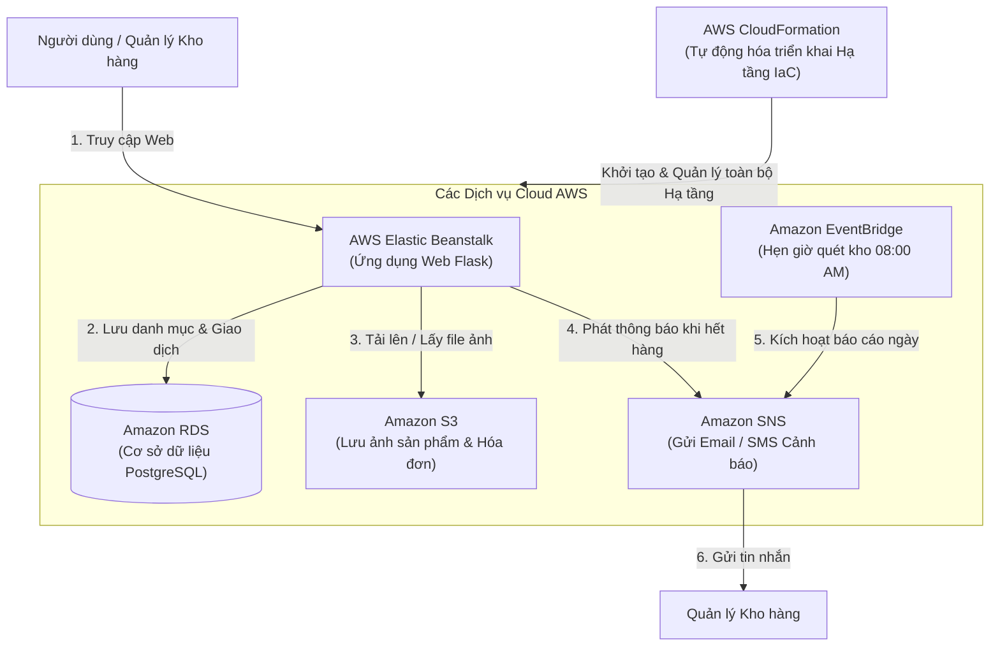
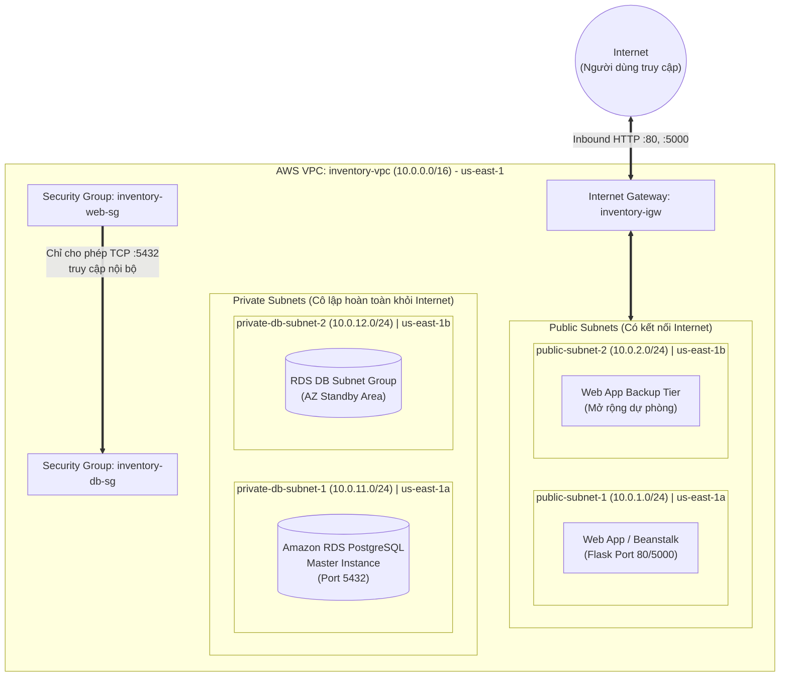

# BÁO CÁO - TUẦN 1
## HỆ THỐNG QUẢN LÝ KHO HÀNG & CẢNH BÁO TỒN KHO (`inventory-app`)

**Môn học:** Điện toán đám mây (Cloud Computing)  
**Sinh viên thực hiện:** 
- Nguyễn Đình Khanh (MSSV: 24110244)
- Võ Minh Quân (MSSV: 24110312)  
**Giảng viên hướng dẫn:** ThS. Huỳnh Xuân Phụng  

---

## 1. BẢNG TỔNG HỢP GIỚI HẠN & QUY ĐỊNH HẠ TẦNG TRÊN AWS LEARNER LAB

| Tiêu chí / Tài nguyên | Quy định & Giới hạn của AWS Learner Lab | Giải pháp & Ứng dụng cho dự án Inventory App |
| :--- | :--- | :--- |
| **Budget / Chi phí** | Cấp tối đa **$100 USD** credit cho cả học kỳ. Nếu hết budget, Lab sẽ bị khóa vĩnh viễn. | Dùng gói nhỏ nhất (t2.micro / db.t3.micro). Dùng CloudFormation để xóa/khôi phục Stack tiết kiệm chi phí. |
| **Region cho phép** | Chỉ được hoạt động trên **`us-east-1` (N. Virginia)** hoặc **`us-west-2` (Oregon)**. Các region khác bị chặn (Access Denied). | Nhóm thống nhất cố định 100% tài nguyên ở Region **`us-east-1`**. |
| **Quyền hạn IAM** | • **Không có quyền** tạo IAM User, IAM Role mới, hoặc chỉnh sửa IAM Policy.<br>• Phải dùng IAM Role tạo sẵn: **`LabRole`**.<br>• EC2/Beanstalk chỉ được dùng **`LabInstanceProfile`**. | Mọi cấu hình kết nối giữa EC2/Beanstalk với RDS/S3/SNS đều tận dụng trực tiếp `LabRole` & `LabInstanceProfile`. |
| **Quy định Tagging** | Bắt buộc phải gắn thẻ (Tags) tài nguyên theo hướng dẫn của môn học để kiểm soát chi phí và điểm danh. | Đính kèm đồng bộ 2 Tag bắt buộc cho mọi tài nguyên:<br>• `Project`: `inventory-app`<br>• `Owner`: `Khanh-Quan` |
| **Compute (EC2 / Beanstalk)** | • Tối đa 9 EC2 instances chạy đồng thời (vCPU limits).<br>• Instance type hỗ trợ: **t2.micro**, **t3.micro**, **t2.small**, **t3.small**.<br>• EBS Volume tối đa 30GB/volume. | Triển khai Backend Web trên **t2.micro** hoặc Elastic Beanstalk (cấu hình Single Instance) để tiết kiệm chi phí. |
| **Database (Amazon RDS)** | • Chỉ hỗ trợ các instance type: **db.t3.micro**, **db.t2.micro**.<br>• Hỗ trợ Multi-AZ nhưng tốn chi phí gấp đôi. | Sử dụng **RDS PostgreSQL** phiên bản mới nhất, cấu hình Single-AZ, instance type `db.t3.micro`, Storage 20GB gp2/gp3. |
| **Storage (Amazon S3)** | Hỗ trợ đầy đủ chức năng S3 Standard. Không giới hạn số bucket nhưng cần đặt tên duy nhất trên toàn cầu. | Tạo bucket riêng tư lưu báo cáo: `inventory-reports-us-east-1-24110244`. |
| **Hạ tầng dưới dạng Mã (IaC)** | **AWS CloudFormation** hỗ trợ đầy đủ việc tạo Stack trong Learner Lab. | Dùng CloudFormation Kịch bản YAML (`template.yaml`) để tự động hóa khởi tạo toàn bộ hạ tầng chỉ trong 1 bấm nút. |

---

## 2. THỐNG NHẤT SƠ ĐỒ PHÂN VÙNG MẠNG VỚI SV1 (VPC & SUBNETS ARCHITECTURE)

Sau khi thảo luận cùng Nguyễn Đình Khanh (SV1), hai thành viên đã thống nhất mô hình mạng phân tầng (2-Tier Architecture) bảo mật cao như sau:

### A. Quy hoạch địa chỉ IP (CIDR Block):
* **VPC CIDR:** `10.0.0.0/16` (Tên: `inventory-vpc`)
* **Số lượng Availability Zones (AZ):** Sử dụng tối thiểu 2 AZs (`us-east-1a` và `us-east-1b`) để đáp ứng điều kiện tạo DB Subnet Group cho Amazon RDS:

| Tên Subnet | CIDR Block | Availability Zone | Phân loại | Mục đích sử dụng |
| :--- | :---: | :---: | :---: | :--- |
| `public-subnet-1` | `10.0.1.0/24` | `us-east-1a` | Public | Triển khai Web App / Elastic Beanstalk (có Internet Gateway) |
| `public-subnet-2` | `10.0.2.0/24` | `us-east-1b` | Public | Dự phòng mở rộng / Multi-AZ Web Tier |
| `private-db-subnet-1` | `10.0.11.0/24` | `us-east-1a` | Private | Chứa RDS PostgreSQL Instance (không có Public IP) |
| `private-db-subnet-2` | `10.0.12.0/24` | `us-east-1b` | Private | Cung cấp AZ thứ 2 bắt buộc cho RDS DB Subnet Group |

### B. Định tuyến (Routing Table) & Cổng kết nối (Gateway):
* **Internet Gateway (IGW):** `inventory-igw` đính kèm vào `inventory-vpc`.
* **Public Route Table:** Định tuyến `0.0.0.0/0` trỏ tới `inventory-igw`, liên kết với `public-subnet-1` và `public-subnet-2`.
* **Private Route Table:** Chỉ định tuyến nội bộ `10.0.0.0/16 local`, không mở đường ra Internet trực tiếp, liên kết với `private-db-subnet-1` và `private-db-subnet-2` để bảo vệ cơ sở dữ liệu.

### C. Chiến lược Security Groups (Nhóm bảo mật):
1. **`inventory-web-sg` (Dành cho Web Tier):**
   * Inbound: Cho phép Port `80` (HTTP), Port `5000` (Flask) từ mọi nguồn (`0.0.0.0/0`).
   * Outbound: Toàn quyền truy cập.
2. **`inventory-db-sg` (Dành cho Database Tier):**
   * Inbound: Chỉ cho phép Port `5432` (PostgreSQL) với Source là Security Group ID của `inventory-web-sg` (Không mở public IP).
   * Outbound: Mặc định.

---

## 3. NGHIÊN CỨU TÀI LIỆU CÁC DỊCH VỤ AWS

### 3.1. AWS Elastic Beanstalk (Máy chủ ứng dụng Web)
- **Tổng quan:** Dịch vụ đám mây giúp triển khai và vận hành ứng dụng web (Flask Python) tự động trên mây mà không cần quản lý máy chủ thủ công.
- **Thành phần chính:** Application (Ứng dụng), Application Version (Mã nguồn Flask), Environment (Môi trường chạy web).
- **Vai trò trong dự án:** Nơi chứa và chạy mã nguồn chính của ứng dụng web `inventory-app`, tự động cân bằng tải và tự động mở rộng khi số lượng người truy cập tăng cao.

### 3.2. Amazon RDS (Cơ sở dữ liệu quan hệ PostgreSQL)
- **Tổng quan:** Dịch vụ quản lý cơ sở dữ liệu quan hệ hoàn toàn tự động trên Cloud, hỗ trợ bảo mật cao và tự động sao lưu dữ liệu.
- **Thành phần chính:** DB Instance (Máy chủ database), Automated Backups (Sao lưu tự động).
- **Vai trò trong dự án:** Thay thế cho cơ sở dữ liệu chạy trên máy cá nhân (`localhost`). Lưu trữ danh mục sản phẩm, số lượng tồn kho và nhật ký chi tiết các giao dịch nhập/xuất kho.

### 3.3. Amazon S3 (Kho lưu trữ tệp tin)
- **Tổng quan:** Dịch vụ lưu trữ đối tượng (Object Storage) an toàn với dung lượng không giới hạn và độ tin cậy dữ liệu cực cao.
- **Thành phần chính:** Bucket (Thùng chứa file), Object (Các tệp tin ảnh, tài liệu).
- **Vai trò trong dự án:** Cất giữ hình ảnh thực tế của từng sản phẩm và lưu trữ các tệp hóa đơn, chứng từ nhập/xuất kho dưới dạng PDF.

### 3.4. Amazon SNS (Hệ thống phát thông báo tự động)
- **Tổng quan:** Dịch vụ phát tin nhắn và thông báo theo thời gian thực (Pub/Sub Notification).
- **Thành phần chính:** Topic (Kênh phát thông báo), Subscriber (Người nhận tin nhắn via Email/SMS).
- **Vai trò trong dự án:** Tự động gửi tin nhắn **Email / SMS cảnh báo** tức thì tới Quản lý kho ngay khi phát hiện số lượng sản phẩm trong kho giảm xuống dưới ngưỡng an toàn (`quantity <= min_threshold`).

### 3.5. Amazon EventBridge (Bộ hẹn giờ & Quản lý sự kiện)
- **Tổng quan:** Dịch vụ kết nối sự kiện và lập lịch tự động chạy công việc (Scheduler).
- **Thành phần chính:** EventBridge Scheduler (Bộ đặt lịch Cron).
- **Vai trò trong dự án:** Đặt lịch tự động **08:00 AM mỗi ngày** để hệ thống tự động kiểm tra toàn bộ dữ liệu kho và phát báo cáo danh sách các mặt hàng sắp hết về cho ban quản lý.

### 3.6. AWS CloudFormation (Tự động hóa Quản lý Hạ tầng bằng Mã - IaC)
- **Tổng quan:** Dịch vụ Hạ tầng dưới dạng Mã (Infrastructure as Code - IaC) cho phép định nghĩa, triển khai và quản lý toàn bộ tài nguyên AWS tự động thông qua file cấu hình mẫu (Template dạng YAML/JSON).
- **Thành phần chính:** CloudFormation Template (Mẫu cấu hình YAML), Stack (Tập hợp tài nguyên AWS được tạo đồng bộ).
- **Vai trò trong dự án:** Tự động hóa quá trình dựng lại toàn bộ hạ tầng (VPC, Subnet, RDS, Elastic Beanstalk, S3, SNS, EventBridge) chỉ bằng 1 thao tác hoặc 1 câu lệnh CLI. Giúp tiết kiệm ngân sách `$100 USD` trên AWS Learner Lab bằng cách dễ dàng xóa Stack khi dừng làm việc và dựng lại Stack trong 5 phút khi tiếp tục đồ án.

---

## 4. SƠ ĐỒ KIẾN TRÚC TỔNG THỂ HỆ THỐNG (ARCHITECTURE DIAGRAM)

### 4.1. Sơ đồ Trực quan Mermaid



---

### 4.2. Sơ đồ Khối

```text
               +-------------------------------------------------------+
               |   AWS CloudFormation (Template YAML / IaC Automation)  |
               | (Tự động hóa dựng & quản lý toàn bộ các dịch vụ dưới)  |
               +---------------------------+---------------------------+
                                           |
                                           v
                       +-----------------------+
                       |    Người dùng (Web)   |
                       +-----------+-----------+
                                   |
                              (Gửi yêu cầu)
                                   v
                 +-----------------------------------+
                 |    AWS Elastic Beanstalk (Flask)  |
                 |         (Web Server chính)        |
                 +----+------------+------------+----+
                      |            |            |
     (Đọc/Ghi dữ liệu)|            |            | (Gửi cảnh báo tồn kho)
                      v            v            v
             +----------------+  +------------+  +----------------+
             |   Amazon RDS   |  |   AWS S3   |  |   Amazon SNS   | ➔   Email/SMS
             | (PostgreSQL DB)|  | (Lưu Ảnh   |  | (Gửi Cảnh Báo) |    cho Quản lý
             +----------------+  |  & PDF)    |  +----------------+
                                 +------------+          ^
                                                         | (Tự động nhắc mỗi sáng)
                                                 +-------+--------+
                                                 |   EventBridge  |
                                                 | (Đồng Hồ Hẹn)  |
                                                 +----------------+
```

---

### 4.3. Bảng Tóm tắt Chức năng các Dịch vụ AWS

| Dịch vụ AWS | Chức năng trong ứng dụng | Ý nghĩa đơn giản |
| :--- | :--- | :--- |
| **CloudFormation** | Tự động hóa hạ tầng (IaC) | Bản thiết kế tự động dựng và xóa toàn bộ hệ thống bằng 1 click. |
| **Elastic Beanstalk** | Hosting ứng dụng web Flask | Bộ nào vận hành trang web quản lý kho. |
| **Amazon RDS** | Cơ sở dữ liệu PostgreSQL | Nơi lưu danh sách hàng hóa và lịch sử nhập/xuất. |
| **Amazon S3** | Lưu trữ tệp tin | Nơi cất giữ hình ảnh sản phẩm và tệp hóa đơn PDF. |
| **Amazon SNS** | Gửi thông báo tự động | Gửi Email / SMS thông báo khi hàng hóa sắp hết. |
| **Amazon EventBridge**| Lập lịch tự động | Đặt lịch quét kho tự động vào 08:00 sáng mỗi ngày. |

---

## 5. THIẾT KẾ CHI TIẾT HẠ TẦNG MẠNG VPC VÀ SECURITY GROUPS 

### 5.1. Mục tiêu & Yêu cầu Kỹ thuật

- **Phân tách ranh giới an toàn (Network Isolation):** Tầng Web/App giao tiếp với Internet được đặt ở Public Subnets; Tầng Database lưu trữ dữ liệu nhạy cảm được cô lập tuyệt đối ở Private Subnets.
- **Tuân thủ quy chuẩn Amazon RDS:** Cơ sở dữ liệu RDS PostgreSQL yêu cầu một DB Subnet Group chứa tối thiểu 2 Availability Zones (AZ) khác nhau để đảm bảo dự phòng và tương thích cấu hình AWS.
- **Nguyên tắc đặc quyền tối thiểu (Least Privilege):** Thiết kế Security Group kiểm soát chặt chẽ từng cổng giao tiếp (port), hạn chế tối đa rủi ro quét cổng hoặc tấn công trái phép.

---

### 5.2. Kế hoạch Phân bổ Địa chỉ IP Chi tiết (VPC & Subnet IP Addressing)

#### A. Tổng quan Không gian Địa chỉ IP của VPC:
* **Tên VPC:** `inventory-vpc`
* **VPC CIDR Block:** `10.0.0.0/16`
* **Tổng số địa chỉ IP:** $2^{16} = 65,536$ IP.
* **DNS Hostnames / DNS Resolution:** Kích hoạt `enableDnsHostnames = true` và `enableDnsSupport = true` nhằm hỗ trợ sinh tên miền công khai cho các dịch vụ web và phân giải tên miền nội bộ của RDS PostgreSQL.

#### B. Bảng Phân bổ Dải Mạng con (Subnet IP Allocation Table):
Mỗi Subnet được cấp phát dải CIDR `/24` cung cấp 256 địa chỉ IP, trong đó:
* **5 địa chỉ IP được AWS giữ lại (AWS Reserved IPs):**
  1. `10.0.x.0`: Địa chỉ mạng (Network Address).
  2. `10.0.x.1`: Địa chỉ AWS VPC Router (Default Gateway nội bộ).
  3. `10.0.x.2`: Địa chỉ máy chủ DNS Server của Amazon.
  4. `10.0.x.3`: Địa chỉ dành cho việc mở rộng tính năng trong tương lai của AWS.
  5. `10.0.x.255`: Địa chỉ Broadcast mạng.
* **Số địa chỉ IP khả dụng cho người dùng:** $256 - 5 = 251$ IP khả dụng/subnet.

| STT | Tên Subnet | CIDR Block | Availability Zone | Phân loại | Số IP khả dụng | Dải IP khả dụng thực tế | Mục đích sử dụng |
| :-: | :--- | :---: | :---: | :---: | :-: | :---: | :--- |
| 1 | `public-subnet-1` | `10.0.1.0/24` | `us-east-1a` | Public | 251 | `10.0.1.4` – `10.0.1.254` | Máy chủ Web Flask / Elastic Beanstalk (có gán Public IPv4) |
| 2 | `public-subnet-2` | `10.0.2.0/24` | `us-east-1b` | Public | 251 | `10.0.2.4` – `10.0.2.254` | Subnet công khai dự phòng mở rộng đa vùng cho Web Tier |
| 3 | `private-db-subnet-1` | `10.0.11.0/24` | `us-east-1a` | Private | 251 | `10.0.11.4` – `10.0.11.254` | Chứa Amazon RDS PostgreSQL Instance (chỉ dùng Private IP) |
| 4 | `private-db-subnet-2` | `10.0.12.0/24` | `us-east-1b` | Private | 251 | `10.0.12.4` – `10.0.12.254` | Đáp ứng điều kiện bắt buộc đa AZ cho RDS DB Subnet Group |

---

### 5.3. Thiết kế Cổng Kết nối (Gateways) & Bảng Định tuyến (Route Tables)

#### A. Cổng Internet Gateway (IGW):
* **Tên tài nguyên:** `inventory-igw`
* **Cơ chế hoạt động:** Đính kèm trực tiếp vào `inventory-vpc`, cho phép phiên dịch địa chỉ mạng (1-to-1 NAT) giữa địa chỉ Public IPv4 và Private IPv4 của máy chủ trong Public Subnets.

#### B. Cấu hình Bảng Định tuyến (Route Table Configuration):

1. **`inventory-public-rt` (Bảng định tuyến Công cộng):**
   * **Liên kết Subnet (Subnet Associations):** `public-subnet-1`, `public-subnet-2`.
   * **Bảng quy tắc định tuyến:**
     | Destination | Target | Mục đích |
     | :--- | :--- | :--- |
     | `10.0.0.0/16` | `local` | Cho phép giao tiếp nội bộ giữa mọi Subnet trong toàn bộ VPC |
     | `0.0.0.0/0` | `inventory-igw` | Điều hướng toàn bộ lưu lượng truy cập Internet qua Internet Gateway |

2. **`inventory-private-rt` (Bảng định tuyến Riêng tư):**
   * **Liên kết Subnet (Subnet Associations):** `private-db-subnet-1`, `private-db-subnet-2`.
   * **Bảng quy tắc định tuyến:**
     | Destination | Target | Mục đích |
     | :--- | :--- | :--- |
     | `10.0.0.0/16` | `local` | Chỉ cho phép lưu lượng mạng luân chuyển nội bộ trong VPC |
   * **Đặc tính an toàn:** Hoàn toàn **không** có dòng định tuyến `0.0.0.0/0` đi ra Internet. Do đó, các tài nguyên nằm trong Subnet này (RDS Database) không thể bị dò quét hay truy cập trái phép từ Internet.

---

### 5.4. Thiết kế Chi tiết Quy tắc Security Groups (SG Rules Design)

Hệ thống bảo mật tường lửa ảo (Security Group) hoạt động theo nguyên tắc **Stateful** (nếu gói tin gửi đi được cấp phép thì gói tin phản hồi về tự động được chấp nhận). Để đảm bảo an toàn tối đa, nhóm áp dụng kỹ thuật **Security Group Chaining** (tham chiếu định danh Security Group thay vì gán dải IP tĩnh).

#### A. `inventory-web-sg` (Dành cho Web Application Tier):
* **Mô tả:** Kiểm soát lưu lượng truy cập vào/ra của máy chủ Web Flask và Elastic Beanstalk.
* **Quy tắc Inbound (Chiều vào):**
  | Type | Protocol | Port Range | Source | Mô tả chi tiết |
  | :--- | :---: | :---: | :--- | :--- |
  | **HTTP** | TCP | `80` | `0.0.0.0/0` | Cho phép người dùng truy cập giao diện web chuẩn HTTP |
  | **Custom TCP** | TCP | `5000` | `0.0.0.0/0` | Hỗ trợ truy cập trực tiếp cổng phát triển mặc định của Flask App |
  | **HTTPS** | TCP | `443` | `0.0.0.0/0` | Dự phòng cho việc cấu hình bảo mật SSL/TLS trong tương lai |
* **Quy tắc Outbound (Chiều ra):**
  | Type | Protocol | Port Range | Destination | Mô tả chi tiết |
  | :--- | :---: | :---: | :--- | :--- |
  | **PostgreSQL**| TCP | `5432` | `inventory-db-sg` | Gửi truy vấn đọc/ghi dữ liệu tới Database Tier |
  | **HTTPS** | TCP | `443` | `0.0.0.0/0` | Kết nối tới các AWS API Endpoints (S3 lưu ảnh, SNS gửi tin) |
  | **All traffic**| ALL | ALL | `0.0.0.0/0` | Mặc định cho phép các gói tin phản hồi và cập nhật hệ điều hành |

#### B. `inventory-db-sg` (Dành cho Database Tier):
* **Mô tả:** Bảo vệ cơ sở dữ liệu Amazon RDS PostgreSQL, chỉ tiếp nhận kết nối nội bộ từ Web Tier.
* **Quy tắc Inbound (Chiều vào):**
  | Type | Protocol | Port Range | Source | Mô tả chi tiết |
  | :--- | :---: | :---: | :--- | :--- |
  | **PostgreSQL**| TCP | `5432` | `inventory-web-sg` | **Chỉ cho phép** các máy chủ thuộc nhóm `inventory-web-sg` kết nối. Chặn tuyệt đối IP công cộng và mọi nguồn lạ khác. |
* **Quy tắc Outbound (Chiều ra):**
  | Type | Protocol | Port Range | Destination | Mô tả chi tiết |
  | :--- | :---: | :---: | :--- | :--- |
  | **All traffic**| ALL | ALL | `0.0.0.0/0` | Mặc định phản hồi các kết nối hợp lệ |

---

### 5.5. Sơ đồ Cấu trúc Hạ tầng Mạng Chi tiết (VPC Network Topology Diagram)



---

### 5.6. Ma trận Phân luồng Lưu lượng Mạng (Network Traffic Flow Matrix)

| Chiều giao tiếp | Nguồn (Source) | Đích (Destination) | Cổng & Giao thức | Trạng thái | Đánh giá & Cơ chế Bảo vệ |
| :--- | :--- | :--- | :---: | :---: | :--- |
| **Internet ➔ Web** | `0.0.0.0/0` | `inventory-web-sg` | TCP `80`, `5000` | **Cho phép** (ALLOW) | Người dùng truy cập dịch vụ quản lý kho bình thường. |
| **Internet ➔ Database** | `0.0.0.0/0` | `inventory-db-sg` | Bất kỳ cổng nào | **CHẶN** (DENY) | RDS nằm ở Private Subnet, không có Public IP và không có Route ra IGW. |
| **Web ➔ Database** | `inventory-web-sg` | `inventory-db-sg` | TCP `5432` | **Cho phép** (ALLOW) | Web App đọc/ghi danh mục sản phẩm và lịch sử giao dịch kho. |
| **Nguồn lạ trong VPC ➔ DB** | Dải IP khác / SG khác | `inventory-db-sg` | TCP `5432` | **CHẶN** (DENY) | `inventory-db-sg` chỉ cấp quyền cho nguồn có nhãn `inventory-web-sg`. |
| **Web Tier ➔ AWS Services** | `inventory-web-sg` | S3, SNS, EventBridge | TCP `443` (HTTPS) | **Cho phép** (ALLOW) | Tải ảnh lên S3 Bucket và gửi email cảnh báo tồn kho qua SNS Topic. |

---

## 6. CẬP NHẬT TRIỂN KHAI BACKEND FLASK API

### 6.1. Các hạng mục đã hoàn thành

Backend Flask đã được mở rộng để cung cấp API JSON phục vụ quản lý sản phẩm và nhập/xuất kho. Các route giao diện HTML hiện có (`/`, `/add`, `/transaction`) vẫn được giữ lại để không làm gián đoạn chức năng hiện tại.

| Hạng mục | Nội dung đã triển khai |
| :--- | :--- |
| **CRUD sản phẩm** | `GET /api/products` liệt kê; `POST /api/products` tạo; `GET /api/products/<id>` đọc chi tiết; `PUT` và `PATCH /api/products/<id>` cập nhật thông tin; `DELETE /api/products/<id>` xóa sản phẩm. |
| **Lịch sử giao dịch kho** | `GET /api/transactions` trả về lịch sử nhập/xuất, gồm mã và tên sản phẩm, loại giao dịch, số lượng và thời điểm phát sinh. |
| **Nhập/xuất kho** | `POST /api/transactions` nhận `product_id`, `type` (`IN` hoặc `OUT`) và `quantity`; API cập nhật tồn kho đồng thời ghi lịch sử giao dịch. |
| **Kiểm tra dữ liệu** | Kiểm tra JSON hợp lệ, trường bắt buộc, chuỗi không rỗng, số lượng nguyên không âm/dương phù hợp và loại giao dịch hợp lệ. API từ chối thay đổi tồn kho qua endpoint cập nhật sản phẩm để đảm bảo giao dịch luôn có lịch sử. |
| **An toàn giao dịch đồng thời** | Xuất kho dùng câu lệnh cập nhật có điều kiện `quantity >= số lượng xuất`; cập nhật tồn và ghi lịch sử trong cùng transaction PostgreSQL, rollback nếu thao tác thất bại. |
| **Mã phản hồi API** | Dữ liệu sai: `400`; không tìm thấy sản phẩm: `404`; SKU trùng hoặc tồn kho không đủ: `409`; tạo sản phẩm/giao dịch thành công: `201`. |
| **Tài liệu và kiểm thử** | Bổ sung mô tả endpoint, ví dụ gọi API trong `README.md` và bộ kiểm thử tự động tại `tests/test_app.py`. |

### 6.2. Ví dụ gọi API nhập kho

```bash
curl -X POST http://127.0.0.1:5000/api/transactions \
  -H "Content-Type: application/json" \
  -d '{"product_id": 1, "type": "IN", "quantity": 10}'
```

Khi yêu cầu thành công, API trả thông tin sản phẩm sau khi cập nhật cùng bản ghi giao dịch vừa tạo. Tồn kho được cập nhật ngay trong database; việc đẩy dữ liệu tức thời tới các trình duyệt đang mở (WebSocket/push) chưa nằm trong phạm vi phần triển khai này.

### 6.3. Kết quả kiểm tra

- **Kiểm thử tự động:** 12/12 test đạt; các trường hợp được kiểm tra gồm giao diện danh sách và trạng thái kho trống, hiển thị thông báo, gửi giao dịch từ form, tạo sản phẩm và giá trị mặc định, từ chối dữ liệu không hợp lệ, nhập kho, xuất vượt tồn, SKU trùng, cập nhật thông tin sản phẩm và xóa sản phẩm.
- **Kiểm tra mã nguồn:** Pylance không phát hiện lỗi trong `app.py` và `tests/test_app.py`; `git diff --check` hoàn tất không có lỗi định dạng.
- **Giới hạn xác nhận:** Bộ test hiện giả lập kết nối cơ sở dữ liệu. Chưa xác nhận kết nối, khởi tạo schema hoặc giao dịch trên một PostgreSQL server thực tế.

### 6.4. Việc cần tiếp tục

1. Cấu hình thông tin kết nối PostgreSQL bằng biến môi trường và chạy ứng dụng với database thật.
2. Kiểm tra thủ công các endpoint bằng `curl` hoặc Postman sau khi database hoạt động.
3. Nếu yêu cầu giao diện cập nhật tức thời trên nhiều trình duyệt, bổ sung WebSocket/Flask-SocketIO; API hiện chỉ đảm bảo tồn kho được ghi nhận ngay và chính xác trong PostgreSQL.
4. Tích hợp thông báo AWS SNS và các hạng mục triển khai AWS sau khi cấu hình hạ tầng được thiết lập.

### 6.5. Hoàn thiện giao diện HTML5 / Bootstrap 5

Kiểm tra ban đầu cho thấy trang `templates/index.html` đã có Bootstrap, biểu mẫu thêm sản phẩm và bảng tồn kho kèm thao tác nhập/xuất. Tuy nhiên, cú pháp Jinja hiển thị flash message chưa hợp lệ, nên phần thông báo thành công/lỗi không được dựng đúng. Template đã được hoàn thiện với các nội dung:

- Bố cục responsive cho màn hình nhỏ và lớn, tiêu đề trang và liên kết tới biểu mẫu thêm sản phẩm.
- Form thêm sản phẩm với nhãn liên kết tới input, kiểm tra bắt buộc và giới hạn số lượng/ngưỡng không âm.
- Bảng tồn kho responsive hiển thị SKU, tên, số lượng, ngưỡng tối thiểu và trạng thái cảnh báo khi tồn kho chạm ngưỡng.
- Mỗi sản phẩm có ô nhập số lượng cùng hai nút **Nhập** và **Xuất** riêng, gửi loại giao dịch tới route `/transaction`.
- Hiển thị flash message bằng cú pháp Jinja chuẩn và trạng thái hướng dẫn khi kho chưa có sản phẩm.

Đã bổ sung test cho việc render danh sách và cảnh báo tồn kho thấp, trạng thái kho trống, hiển thị flash message và gửi giao dịch nhập qua form. Giao diện dùng Bootstrap 5 từ CDN nên khi chạy cần kết nối Internet để tải stylesheet và JavaScript của Bootstrap.

### 6.6. Cơ sở dữ liệu PostgreSQL và môi trường Flask

Ứng dụng sử dụng PostgreSQL làm cơ sở dữ liệu quan hệ và Flask làm backend. Schema được định nghĩa trong `database/schema.sql`; kết nối database được cấu hình trong `init_db.py` và hỗ trợ đọc thông tin kết nối từ các biến môi trường `DB_HOST`, `DB_NAME`, `DB_USER`, `DB_PASS`, `DB_PORT`.

Schema gồm hai bảng chính:

| Bảng | Dữ liệu và ràng buộc |
| :--- | :--- |
| `products` | Lưu mã SKU duy nhất, tên sản phẩm, số lượng tồn kho không âm, ngưỡng cảnh báo `min_threshold` không âm, cùng thời điểm tạo và cập nhật. |
| `transactions` | Lưu sản phẩm liên quan, loại giao dịch chỉ nhận `IN` hoặc `OUT`, số lượng giao dịch phải lớn hơn 0 và thời điểm phát sinh. Khóa ngoại liên kết tới `products`; xóa sản phẩm sẽ xóa các giao dịch liên quan. |

Các chỉ mục trên SKU, mã sản phẩm của giao dịch và thời điểm giao dịch hỗ trợ tra cứu sản phẩm, lịch sử theo sản phẩm và sắp xếp giao dịch. Hàm `init_db()` đọc schema và khởi tạo các bảng; ứng dụng gọi hàm này khi chạy trực tiếp bằng `python app.py`.

Môi trường phát triển gồm Flask, `psycopg2-binary` và PostgreSQL local. Cơ sở dữ liệu được cấu hình mặc định là `inventory_db`; thông tin kết nối có thể điều chỉnh qua biến môi trường mà không cần sửa mã nguồn.
###7. KHỞI TẠO HẠ TẦNG MẠNG NỀN TẢNG (VPC, SUBNETS, IGW, ROUTE TABLES) VÀ THỰC THI QUY ĐỊNH TAGGING TRÊN AWS CONSOLE
* **Nhiệm vụ trọng tâm:** Khởi tạo và thiết lập hạ tầng mạng VPC, Subnets, Internet Gateway, Route Tables trên AWS Learner Lab Console (`us-east-1`) và gắn Tag theo quy định.
* **Thời gian thực hiện:** 3.0 giờ.
* **Môi trường thao tác:** AWS Management Console / Region `us-east-1` (N. Virginia) trên tài khoản AWS Learner Lab.

#### A. Các bước triển khai chi tiết:
7.1 **Khởi tạo Virtual Private Cloud (VPC):**
   * Đăng nhập AWS Management Console và truy cập dịch vụ **VPC**.
   * Nhấn **Create VPC** (chọn chế độ cấu hình thủ công *VPC only* để kiểm soát chính xác từng thành phần):
     * **Name tag:** `inventory-vpc`
     * **IPv4 CIDR block:** `10.0.0.0/16` (cung cấp tối đa 65,536 địa chỉ IP).
     * **Tenancy:** `Default`.
   * Bật cài đặt DNS cho VPC sau khi tạo:
     * `Enable DNS resolution`: **Enabled**.
     * `Enable DNS hostnames`: **Enabled** (bắt buộc để các instance EC2/Beanstalk nhận DNS public và RDS phân giải endpoint nội bộ).

7.2 **Khởi tạo 4 Subnets (Phân vùng theo 2 Availability Zones `us-east-1a` và `us-east-1b`):**
   * **`public-subnet-1`:**
     * VPC: `inventory-vpc` | AZ: `us-east-1a` | CIDR: `10.0.1.0/24` (251 IP khả dụng).
     * Bật tính năng **Enable auto-assign public IPv4 address** để máy chủ Web/App tự nhận IP công khai.
   * **`public-subnet-2`:**
     * VPC: `inventory-vpc` | AZ: `us-east-1b` | CIDR: `10.0.2.0/24` (251 IP khả dụng).
     * Bật tính năng **Enable auto-assign public IPv4 address** (dự phòng đa vùng).
   * **`private-db-subnet-1`:**
     * VPC: `inventory-vpc` | AZ: `us-east-1a` | CIDR: `10.0.11.0/24` (251 IP khả dụng).
     * Tắt gán public IPv4 (cô lập cho tầng Database RDS).
   * **`private-db-subnet-2`:**
     * VPC: `inventory-vpc` | AZ: `us-east-1b` | CIDR: `10.0.12.0/24` (251 IP khả dụng).
     * Tắt gán public IPv4 (đáp ứng điều kiện tối thiểu 2 AZs cho RDS DB Subnet Group).

7.3 **Tạo và gắn kết Internet Gateway (IGW):**
   * Khởi tạo **Internet Gateway**: `inventory-igw`.
   * Thao tác **Attach to VPC** và chọn `inventory-vpc` để mở cổng kết nối Internet cho các Public Subnet.

7.4 **Cấu hình bảng định tuyến (Route Tables):**
   * **Public Route Table (`inventory-public-rt`):**
     * Thêm rule: Destination `0.0.0.0/0` ➔ Target `inventory-igw`.
     * **Subnet Associations:** Liên kết với `public-subnet-1` và `public-subnet-2`.
   * **Private Route Table (`inventory-private-rt`):**
     * Chỉ giữ rule mặc định: Destination `10.0.0.0/16` ➔ Target `local`.
     * Không gắn route đi ra Internet, đảm bảo an toàn cho cơ sở dữ liệu.
     * **Subnet Associations:** Liên kết với `private-db-subnet-1` và `private-db-subnet-2`.

7.5 **Thực thi quy định gắn thẻ (Resource Tagging):**
   * Kiểm tra toàn bộ 100% tài nguyên mạng vừa khởi tạo (VPC, 4 Subnets, IGW, 2 Route Tables).
   * Đảm bảo đính kèm đầy đủ cặp Tag chuẩn:
     * `Project`: `inventory-app`
     * `Owner`: `Khanh-Quan`

#### B. Kết quả & Minh chứng đạt được:
* Toàn bộ hạ tầng mạng phân tầng 2-Tier trên AWS Learner Lab (`us-east-1`) đã sẵn sàng.
* Sẵn sàng các dải Subnet cô lập để bước tiếp theo (Thứ Bảy) thiết lập Security Groups và triển khai RDS Database Group.
* Ảnh chụp minh chứng trên AWS Management Console hiển thị rõ `VPC ID`, bảng Subnet list, Route Table associations cùng thông tin User/Account ID và Region `us-east-1`.
