# BÁO CÁO KỸ THUẬT VÀ KẾT QUẢ TRIỂN KHAI - TUẦN 1
## HỆ THỐNG QUẢN LÝ KHO HÀNG & CẢNH BÁO TỒN KHO (`inventory-app`)

**Môn học:** Điện toán đám mây (Cloud Computing)  
**Sinh viên thực hiện:** 
- Nguyễn Đình Khanh (MSSV: 24110244)
- Võ Minh Quân (MSSV: 24110312)  
**Giảng viên hướng dẫn:** ThS. Huỳnh Xuân Phụng  

---

> **Phạm vi báo cáo:** Tuần 1 đã hoàn thành ứng dụng Flask/API ở mức mã nguồn và tạo một số tài nguyên nền tảng trên AWS. Amazon RDS, EC2/Elastic Beanstalk, Lambda, SNS, EventBridge và CloudFormation vẫn là kiến trúc/kế hoạch cho tuần tiếp theo, chưa được xác nhận là đã triển khai. Các kết quả kiểm thử mạng và chi phí chỉ được kết luận khi có minh chứng tương ứng.

[Bảng phân công công việc](../../logs/week1.md)

---

## 1. BẢNG TỔNG HỢP GIỚI HẠN & QUY ĐỊNH HẠ TẦNG TRÊN AWS LEARNER LAB

| Tiêu chí / Tài nguyên | Quy định & Giới hạn của AWS Learner Lab | Giải pháp & Ứng dụng cho dự án Inventory App |
| :--- | :--- | :--- |
| **Budget / Chi phí** | Learner Lab cấp credit theo cấu hình của lớp; số dư cần kiểm tra trực tiếp trong giao diện Lab. | Ưu tiên cấu hình nhỏ, dừng/xóa tài nguyên tính phí khi không dùng và theo dõi Billing/Cost Explorer. |
| **Region cho phép** | Các Region được phép phụ thuộc cấu hình Learner Lab của lớp. | Các lệnh và tài nguyên trong báo cáo này sử dụng `us-east-1` (N. Virginia). |
| **Quyền hạn IAM** | Session xác minh được sử dụng role `voclabs`; `LabRole` và `LabInstanceProfile` có sẵn trong tài khoản. | EC2/Elastic Beanstalk dự kiến gắn `LabInstanceProfile`; Lambda cần execution role phù hợp. Quyền thực tế phải được kiểm tra khi triển khai từng dịch vụ. |
| **Quy định Tagging** | Bắt buộc phải gắn thẻ (Tags) tài nguyên theo hướng dẫn của môn học để kiểm soát chi phí và điểm danh. | Đính kèm đồng bộ 2 Tag bắt buộc cho mọi tài nguyên:<br>• `Project`: `inventory-app`<br>• `Owner`: `Khanh-Quan` |
| **Compute (EC2 / Beanstalk)** | Instance type, vCPU quota và giới hạn EBS phụ thuộc hạn mức đang áp dụng cho tài khoản/Region; xác minh trong Service Quotas và Learner Lab trước khi tạo. | Ưu tiên EC2 nhỏ hoặc Elastic Beanstalk Single Instance nếu được cấp phép; chưa triển khai trong tuần 1. |
| **Database (Amazon RDS)** | Loại instance và storage được phép phụ thuộc Region, engine, cấu hình lớp học và hạn mức tài khoản; cần xác minh trước khi tạo. | Dự kiến dùng PostgreSQL Single-AZ, `db.t3.micro` nếu Learner Lab cho phép; chưa tạo DB trong tuần 1. |
| **Storage (Amazon S3)** | Bucket name phải duy nhất toàn cầu; cấu hình bảo mật và chi phí cần được xác minh riêng. | Đã tạo bucket `inventory-reports-us-east-1-24110244` và gắn tags; trạng thái Block Public Access cần xác minh. |
| **Hạ tầng dưới dạng Mã (IaC)** | Khả năng tạo tài nguyên qua CloudFormation phụ thuộc quyền IAM của Learner Lab. | CloudFormation là phương án dự kiến; tuần 1 chưa ghi nhận việc tạo Stack hoặc template triển khai. |

---

## 2. THỐNG NHẤT SƠ ĐỒ PHÂN VÙNG MẠNG VỚI SV1 (VPC & SUBNETS ARCHITECTURE)

Sau khi thảo luận cùng Nguyễn Đình Khanh, hai thành viên thống nhất thiết kế mạng phân tầng như sau. Đây là thiết kế mục tiêu; trạng thái triển khai được ghi riêng ở các mục kết quả.

### A. Quy hoạch địa chỉ IP (CIDR Block):
* **VPC CIDR:** `10.0.0.0/16` (Tên: `inventory-vpc`)
* **Availability Zones (AZ):** DB Subnet Group cần các subnet ở ít nhất hai AZ. Điều này không đồng nghĩa DB Single-AZ có standby instance hoặc tự động có tính sẵn sàng cao.

| Tên Subnet | CIDR Block | Availability Zone | Phân loại | Mục đích sử dụng |
| :--- | :---: | :---: | :---: | :--- |
| `public-subnet-1` | `10.0.1.0/24` | `us-east-1a` | Public | Triển khai Web App / Elastic Beanstalk (có Internet Gateway) |
| `public-subnet-2` | `10.0.2.0/24` | `us-east-1b` | Public | Subnet thứ hai để có thể phân bố Web Tier đa AZ khi cấu hình triển khai hỗ trợ |
| `private-db-subnet-1` | `10.0.11.0/24` | `us-east-1a` | Private | Subnet dự kiến đặt RDS PostgreSQL, không có public IPv4 |
| `private-db-subnet-2` | `10.0.12.0/24` | `us-east-1b` | Private | Subnet ở AZ thứ hai cho DB Subnet Group; không phải standby instance |

### B. Định tuyến (Routing Table) & Cổng kết nối (Gateway):
* **Internet Gateway (IGW):** `inventory-igw` đính kèm vào `inventory-vpc`.
* **Public Route Table:** Định tuyến `0.0.0.0/0` trỏ tới `inventory-igw`, liên kết với `public-subnet-1` và `public-subnet-2`.
* **Private Route Table:** Chỉ định tuyến nội bộ `10.0.0.0/16 local`, không mở đường ra Internet trực tiếp, liên kết với `private-db-subnet-1` và `private-db-subnet-2` để bảo vệ cơ sở dữ liệu.

### C. Chiến lược Security Groups (Nhóm bảo mật):
1. **`inventory-web-sg` (Dành cho Web Tier):**
   * Inbound dự kiến: Chỉ mở cổng cần thiết cho người dùng. Cổng `5000` là cổng development của Flask, không nên mở ra Internet trong môi trường triển khai.
   * Outbound hiện theo mặc định AWS là cho phép toàn bộ; nên thu hẹp khi xác định được các luồng cần thiết và cách truy cập AWS APIs.
2. **`inventory-db-sg` (Dành cho Database Tier):**
   * Inbound: Chỉ cho phép Port `5432` (PostgreSQL) với Source là Security Group ID của `inventory-web-sg` (Không mở public IP).
   * Outbound: Mặc định.

---

## 3. KIẾN TRÚC DỰ KIẾN VÀ VAI TRÒ CÁC DỊCH VỤ AWS

### 3.1. AWS Elastic Beanstalk (Máy chủ ứng dụng Web)
- **Tổng quan:** Dịch vụ đám mây giúp triển khai và vận hành ứng dụng web (Flask Python) tự động trên mây mà không cần quản lý máy chủ thủ công.
- **Thành phần chính:** Application (Ứng dụng), Application Version (Mã nguồn Flask), Environment (Môi trường chạy web).
- **Vai trò dự kiến:** Nền tảng triển khai ứng dụng web `inventory-app`. Cân bằng tải và tự động mở rộng phụ thuộc cấu hình Environment; chưa triển khai trong tuần 1.

### 3.2. Amazon RDS (Cơ sở dữ liệu quan hệ PostgreSQL)
- **Tổng quan:** Dịch vụ quản lý cơ sở dữ liệu quan hệ; các tùy chọn bảo mật, backup và retention cần được cấu hình/xác minh.
- **Thành phần chính:** DB Instance (Máy chủ database), Automated Backups (Sao lưu tự động).
- **Vai trò dự kiến:** Thay thế cơ sở dữ liệu cục bộ khi triển khai; lưu danh mục sản phẩm, tồn kho và lịch sử nhập/xuất. Chưa tạo DB instance trong tuần 1.

### 3.3. Amazon S3 (Kho lưu trữ tệp tin)
- **Tổng quan:** Dịch vụ lưu trữ đối tượng (Object Storage) có khả năng mở rộng; cần cấu hình kiểm soát truy cập phù hợp.
- **Thành phần chính:** Bucket (Thùng chứa file), Object (Các tệp tin ảnh, tài liệu).
- **Vai trò dự kiến:** Lưu trữ báo cáo xuất ra (CSV/PDF). Tuần 1 đã tạo bucket; chưa có minh chứng trong báo cáo rằng ứng dụng đã tải báo cáo hoặc ảnh sản phẩm lên bucket.

### 3.4. Amazon SNS (Hệ thống phát thông báo tự động)
- **Tổng quan:** Dịch vụ phát tin nhắn và thông báo theo thời gian thực (Pub/Sub Notification).
- **Thành phần chính:** Topic (kênh phát thông báo), Subscriber (người nhận thông báo qua email/SMS).
- **Vai trò dự kiến:** Nhận thông báo từ Lambda và phân phối tới người quản lý khi tồn kho chạm ngưỡng (`quantity <= min_threshold`). Chưa tạo Topic/Subscription trong tuần 1.

### 3.5. Amazon EventBridge (Bộ hẹn giờ & Quản lý sự kiện)
- **Tổng quan:** Dịch vụ kết nối sự kiện và lập lịch tự động chạy công việc (Scheduler).
- **Thành phần chính:** EventBridge Scheduler (Bộ đặt lịch Cron).
- **Vai trò dự kiến:** Lập lịch gọi Lambda quét tồn kho và gửi thông báo/báo cáo. Giờ chạy và múi giờ cần được cấu hình rõ trong Scheduler; EventBridge không tự quét DB hoặc gửi email nếu chưa có target và quyền cần thiết.

### 3.6. AWS CloudFormation (Tự động hóa Quản lý Hạ tầng bằng Mã - IaC)
- **Tổng quan:** Dịch vụ Hạ tầng dưới dạng Mã (Infrastructure as Code - IaC) cho phép định nghĩa, triển khai và quản lý toàn bộ tài nguyên AWS tự động thông qua file cấu hình mẫu (Template dạng YAML/JSON).
- **Thành phần chính:** CloudFormation Template (Mẫu cấu hình YAML), Stack (Tập hợp tài nguyên AWS được tạo đồng bộ).
- **Vai trò dự kiến:** Quản lý hạ tầng bằng template nếu quyền Learner Lab cho phép. Chưa có template/Stack CloudFormation nào được xác nhận trong tuần 1; xóa Stack cũng không đảm bảo xóa các tài nguyên giữ lại hoặc không thuộc Stack.
---

## 4. SƠ ĐỒ KIẾN TRÚC DỰ KIẾN (ARCHITECTURE DIAGRAM)

### 4.1. Sơ đồ Trực quan Mermaid

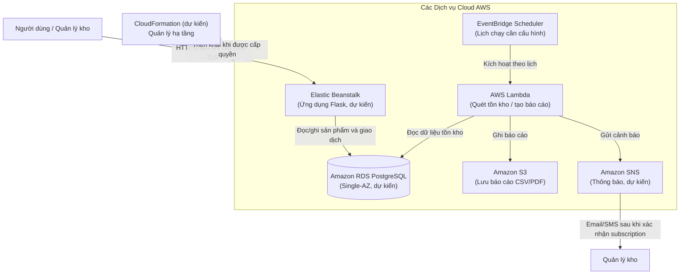

---

### 4.2. Sơ đồ Khối

```text
               +-------------------------------------------------------+
               | CloudFormation (dự kiến, nếu đủ IAM permissions)       |
               |        Quản lý tài nguyên hạ tầng                     |
               +---------------------------+---------------------------+
                                           |
                                           v
                       +-----------------------+
                       |    Người dùng (Web)   |
                       +-----------+-----------+
                                   |
                              (Gửi yêu cầu)
                                   v
                 +-----------------------------------+
                 | Elastic Beanstalk (Flask)      |
                 |       (dự kiến)                |
                 +---------------+----------------+
                                 |
                                 v
                       +--------------------+
                       | Amazon RDS         |
                       | PostgreSQL (dự kiến)|
                       +--------------------+

             +-----------------------+
             | EventBridge Scheduler |
             |      (dự kiến)        |
             +-----------+-----------+
                         | kích hoạt
                         v
                  +--------------+
                  | AWS Lambda   |
                  |  (dự kiến)   |
                  +---+------+---+
                      |      |
             cảnh báo |      | lưu báo cáo
                      v      v
               +---------+  +---------+
               |   SNS   |  |   S3    |
               +----+----+  +---------+
                    |
                 Email/SMS
```

Ở thiết kế đầy đủ, Lambda cũng cần đọc dữ liệu từ RDS. Luồng này chỉ hoạt động khi cấu hình VPC/subnet, Security Group và network path tới các dịch vụ AWS phù hợp.

---

### 4.3. Bảng Tóm tắt Chức năng các Dịch vụ AWS

| Dịch vụ AWS | Chức năng trong ứng dụng | Ý nghĩa đơn giản |
| :--- | :--- | :--- |
| **CloudFormation** | Quản lý hạ tầng dưới dạng mã, nếu quyền cho phép | Template mô tả tài nguyên; chưa triển khai trong tuần 1. |
| **Elastic Beanstalk** | Dự kiến hosting ứng dụng Flask | Môi trường triển khai ứng dụng; chưa tạo trong tuần 1. |
| **Amazon RDS** | Dự kiến lưu dữ liệu PostgreSQL | DB cho sản phẩm và giao dịch; chưa tạo instance trong tuần 1. |
| **Amazon S3** | Lưu trữ object | Đã tạo bucket; cần xác minh Block Public Access và chưa có minh chứng ứng dụng đã ghi file. |
| **Amazon SNS** | Phân phối thông báo | Dự kiến gửi email/SMS sau khi tạo Topic và xác nhận Subscriber. |
| **Amazon EventBridge** | Lập lịch gọi tác vụ | Dự kiến kích hoạt Lambda; lịch và múi giờ chưa được cấu hình. |

---

## 5. THIẾT KẾ CHI TIẾT HẠ TẦNG MẠNG VPC VÀ SECURITY GROUPS 

### 5.1. Mục tiêu & Yêu cầu Kỹ thuật

- **Phân tách ranh giới an toàn (Network Isolation):** Web/App được đặt theo cấu hình triển khai phù hợp; Database nằm trong Private Subnets và chỉ nhận kết nối từ các Security Group được cho phép.
- **Yêu cầu Amazon RDS:** DB Subnet Group phải bao phủ tối thiểu 2 Availability Zones. Yêu cầu này không tự bật chế độ Multi-AZ hay tạo standby instance cho DB Single-AZ.
- **Nguyên tắc đặc quyền tối thiểu (Least Privilege):** Thiết kế Security Group kiểm soát chặt chẽ từng cổng giao tiếp (port), hạn chế tối đa rủi ro quét cổng hoặc tấn công trái phép.

---

### 5.2. Kế hoạch Phân bổ Địa chỉ IP Chi tiết (VPC & Subnet IP Addressing)

#### A. Tổng quan Không gian Địa chỉ IP của VPC:
* **Tên VPC:** `inventory-vpc`
* **VPC CIDR Block:** `10.0.0.0/16`
* **Tổng số địa chỉ IP:** $2^{16} = 65,536$ IP.
* **DNS Hostnames / DNS Resolution:** Bật `enableDnsHostnames` và `enableDnsSupport` để hỗ trợ phân giải DNS trong VPC; public DNS của EC2 còn phụ thuộc cấu hình địa chỉ IP công khai.

#### B. Bảng Phân bổ Dải Mạng con (Subnet IP Allocation Table):
Mỗi Subnet được cấp phát dải CIDR `/24` cung cấp 256 địa chỉ IP, trong đó:
* **5 địa chỉ IP được AWS giữ lại (AWS Reserved IPs):**
  1. `10.0.x.0`: Địa chỉ mạng (Network Address).
  2. `10.0.x.1`: Địa chỉ AWS VPC Router (Default Gateway nội bộ).
  3. `10.0.x.2`: Địa chỉ máy chủ DNS Server của Amazon.
  4. `10.0.x.3`: Địa chỉ dành cho việc mở rộng tính năng trong tương lai của AWS.
  5. `10.0.x.255`: Địa chỉ Broadcast mạng.
* **Số địa chỉ IP khả dụng cho người dùng:** $256 - 5 = 251$ IP khả dụng/subnet.

| STT | Tên Subnet | CIDR Block | Availability Zone | Phân loại | Số IP khả dụng | Dải IP khả dụng thực tế | Mục đích sử dụng |
| :-: | :--- | :---: | :---: | :---: | :-: | :---: | :--- |
| 1 | `public-subnet-1` | `10.0.1.0/24` | `us-east-1a` | Public | 251 | `10.0.1.4` – `10.0.1.254` | Máy chủ Web Flask / Elastic Beanstalk (có gán Public IPv4) |
| 2 | `public-subnet-2` | `10.0.2.0/24` | `us-east-1b` | Public | 251 | `10.0.2.4` – `10.0.2.254` | Subnet công khai dự phòng mở rộng đa vùng cho Web Tier |
| 3 | `private-db-subnet-1` | `10.0.11.0/24` | `us-east-1a` | Private | 251 | `10.0.11.4` – `10.0.11.254` | Subnet dự kiến đặt RDS PostgreSQL, không gán public IPv4 |
| 4 | `private-db-subnet-2` | `10.0.12.0/24` | `us-east-1b` | Private | 251 | `10.0.12.4` – `10.0.12.254` | Subnet ở AZ thứ hai cho DB Subnet Group; không phải standby instance |

---

### 5.3. Thiết kế Cổng Kết nối (Gateways) & Bảng Định tuyến (Route Tables)

#### A. Cổng Internet Gateway (IGW):
* **Tên tài nguyên:** `inventory-igw`
* **Cơ chế hoạt động:** Đính kèm vào `inventory-vpc`; để instance truy cập Internet cần route tới IGW và địa chỉ IPv4 công khai phù hợp. Chỉ có route tới IGW không tự cấp public IPv4 cho instance.

#### B. Cấu hình Bảng Định tuyến (Route Table Configuration):

1. **`inventory-public-rt` (Bảng định tuyến Công cộng):**
   * **Liên kết Subnet (Subnet Associations):** `public-subnet-1`, `public-subnet-2`.
   * **Bảng quy tắc định tuyến:**
     | Destination | Target | Mục đích |
     | :--- | :--- | :--- |
     | `10.0.0.0/16` | `local` | Cho phép giao tiếp nội bộ giữa mọi Subnet trong toàn bộ VPC |
     | `0.0.0.0/0` | `inventory-igw` | Điều hướng toàn bộ lưu lượng truy cập Internet qua Internet Gateway |

2. **`inventory-private-rt` (Bảng định tuyến Riêng tư):**
   * **Liên kết Subnet (Subnet Associations):** `private-db-subnet-1`, `private-db-subnet-2`.
   * **Bảng quy tắc định tuyến:**
     | Destination | Target | Mục đích |
     | :--- | :--- | :--- |
     | `10.0.0.0/16` | `local` | Chỉ cho phép lưu lượng mạng luân chuyển nội bộ trong VPC |
   * **Đặc tính:** Không có route `0.0.0.0/0` tới Internet Gateway/NAT Gateway. RDS cũng cần đặt `PubliclyAccessible=false` và được bảo vệ bằng Security Group; route table riêng tư một mình không thay thế các cấu hình này.

---

### 5.4. Thiết kế Chi tiết Quy tắc Security Groups (SG Rules Design)

Hệ thống bảo mật tường lửa ảo (Security Group) hoạt động theo nguyên tắc **Stateful** (nếu gói tin gửi đi được cấp phép thì gói tin phản hồi về tự động được chấp nhận). Để đảm bảo an toàn tối đa, nhóm áp dụng kỹ thuật **Security Group Chaining** (tham chiếu định danh Security Group thay vì gán dải IP tĩnh).

#### A. `inventory-web-sg` (Dành cho Web Application Tier):
* **Mô tả:** Kiểm soát lưu lượng truy cập vào/ra của máy chủ Web Flask và Elastic Beanstalk.
* **Quy tắc Inbound (Chiều vào):**
  | Type | Protocol | Port Range | Source | Mô tả chi tiết |
  | :--- | :---: | :---: | :--- | :--- |
  | **HTTP** | TCP | `80` | Chỉ nguồn cần thiết (ví dụ `0.0.0.0/0` cho ứng dụng public) | HTTP không mã hóa; chỉ dùng khi phù hợp với thiết kế triển khai. |
  | **HTTPS** | TCP | `443` | Chỉ nguồn cần thiết (ví dụ `0.0.0.0/0` cho endpoint public) | Chỉ mở khi đã cấu hình TLS/HTTPS tại load balancer hoặc web server. |
  | **Flask development** | TCP | `5000` | Không mở cho Internet | Flask development server không phù hợp để public; dùng web server/reverse proxy ở môi trường triển khai. |
* **Quy tắc Outbound (Chiều ra):**
  | Type | Protocol | Port Range | Destination | Mô tả chi tiết |
  | :--- | :---: | :---: | :--- | :--- |
  | **Egress** | Theo cấu hình | Theo cấu hình | Chỉ các đích cần thiết | Security Group mới mặc định cho phép outbound all; nếu áp dụng least privilege, chỉ khai báo các luồng thực sự cần dùng. Security Group có tính stateful nên không cần mở rule riêng chỉ để nhận gói phản hồi của kết nối hợp lệ. |

#### B. `inventory-db-sg` (Dành cho Database Tier):
* **Mô tả:** Bảo vệ Amazon RDS PostgreSQL khi được tạo; hiện mới cấu hình rule từ Web Tier.
* **Quy tắc Inbound (Chiều vào):**
  | Type | Protocol | Port Range | Source | Mô tả chi tiết |
  | :--- | :---: | :---: | :--- | :--- |
  | **PostgreSQL**| TCP | `5432` | `inventory-web-sg` | **Chỉ cho phép** các máy chủ thuộc nhóm `inventory-web-sg` kết nối. Chặn tuyệt đối IP công cộng và mọi nguồn lạ khác. |
* **Quy tắc Outbound (Chiều ra):**
  | Type | Protocol | Port Range | Destination | Mô tả chi tiết |
  | :--- | :---: | :---: | :--- | :--- |
  | **Egress** | Theo cấu hình | Theo cấu hình | Chỉ các đích cần thiết | Rule mặc định của Security Group cho phép outbound; cân nhắc thu hẹp theo nhu cầu thực tế. |

> Nếu Lambda được dùng để quét RDS hoặc tạo báo cáo, cần đặt Lambda trong VPC khi phù hợp và bổ sung quyền inbound PostgreSQL từ Security Group của Lambda vào `inventory-db-sg`. Rule chỉ cho Web SG hiện tại chưa cho phép Lambda truy cập DB. Lambda trong subnet riêng cũng cần network path tới dịch vụ AWS (ví dụ VPC endpoint hoặc NAT Gateway phù hợp) để gọi S3/SNS; NAT Gateway có thể phát sinh chi phí.

---

### 5.5. Sơ đồ Cấu trúc Hạ tầng Mạng Chi tiết (VPC Network Topology Diagram)

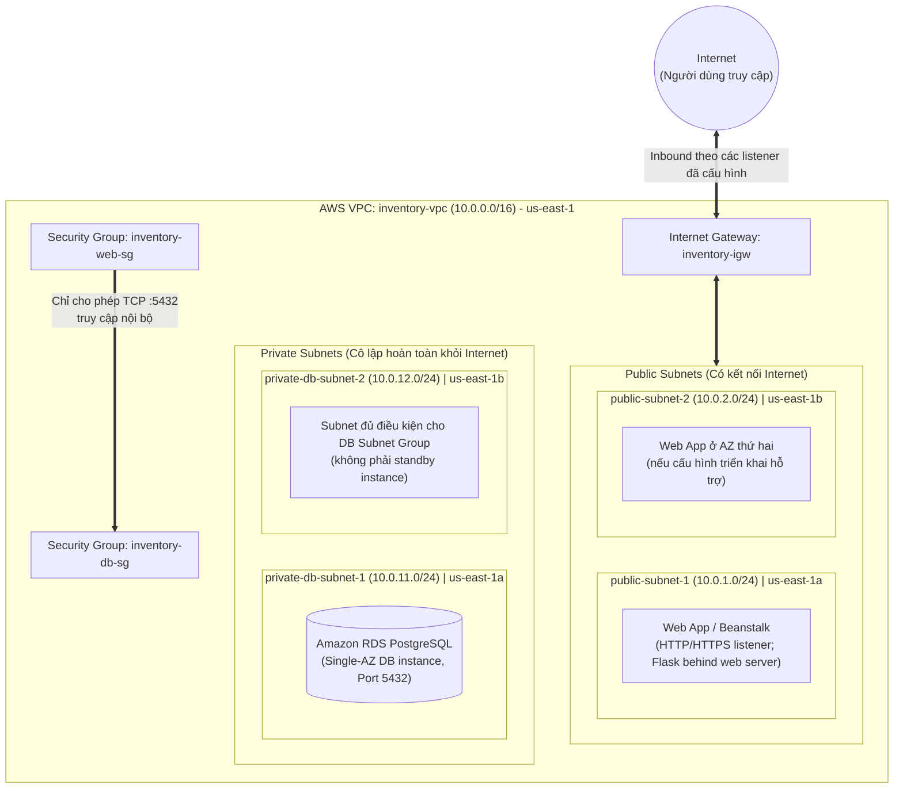

---

### 5.6. Ma trận Phân luồng Lưu lượng Mạng (Network Traffic Flow Matrix)

| Chiều giao tiếp | Nguồn (Source) | Đích (Destination) | Cổng & Giao thức | Trạng thái | Đánh giá & Cơ chế Bảo vệ |
| :--- | :--- | :--- | :---: | :---: | :--- |
| **Internet ➔ Web** | `0.0.0.0/0` | `inventory-web-sg` | TCP `80`, `5000`, `443` (theo rule đã cấu hình) | **Rule đang cho phép** | Rule đã mở trên SG; cổng 5000 là development và 443 chỉ dùng được khi TLS đã cấu hình. Chưa kiểm thử truy cập ứng dụng. |
| **Internet ➔ Database** | `0.0.0.0/0` | `inventory-db-sg` | TCP `5432` | **Không có rule cho phép** | DB chưa được tạo. Khi tạo, đặt `PubliclyAccessible=false`, dùng subnet riêng và kiểm chứng SG. |
| **Web ➔ Database** | `inventory-web-sg` | `inventory-db-sg` | TCP `5432` | **Đã cấu hình rule; chưa kiểm thử** | RDS/Web chưa triển khai nên chưa thể xác nhận kết nối thực tế. |
| **Nguồn khác ➔ Database** | Security Group khác | `inventory-db-sg` | TCP `5432` | **Không có rule cho phép** | Security Group không có rule cho phép luồng này; gói tin không khớp rule sẽ bị loại bỏ. |
| **Ứng dụng ➔ AWS APIs** | Web/Lambda role phù hợp | S3, SNS, dịch vụ cần dùng | HTTPS `443` | **Chưa xác minh** | Cần egress, IAM permission và endpoint/network path phù hợp; S3/SNS chưa được tích hợp trong ứng dụng hiện tại. |

---

## 6. ỨNG DỤNG BACKEND FLASK VÀ API

Backend được xây dựng bằng Flask, kết nối PostgreSQL qua `psycopg2` và phục vụ các chức năng quản lý sản phẩm, theo dõi tồn kho, ghi nhận giao dịch nhập/xuất. Schema trong `database/schema.sql` định nghĩa hai bảng `products` và `transactions`, có ràng buộc số lượng không âm/dương, loại giao dịch `IN`/`OUT`, khóa ngoại xóa cascade và thời gian `TIMESTAMP WITH TIME ZONE`. Cấu hình kết nối trong `init_db.py` nhận các biến môi trường `DB_HOST`, `DB_NAME`, `DB_USER`, `DB_PASS`, `DB_PORT`.

Các route giao diện hiện có vẫn được duy trì: `/` hiển thị danh sách tồn kho, `/add` thêm sản phẩm và `/transaction` xử lý giao dịch nhập/xuất. Giao diện HTML5/Bootstrap 5 hỗ trợ nhập thông tin sản phẩm, cập nhật số lượng, hiển thị cảnh báo khi tồn kho chạm ngưỡng `min_threshold` và thông báo kết quả giao dịch.

Bên cạnh giao diện, Flask cung cấp API JSON để quản lý sản phẩm và giao dịch:

| Nhóm chức năng | Endpoint và nội dung |
| :--- | :--- |
| **Quản lý sản phẩm** | `GET /api/products` liệt kê; `POST /api/products` tạo; `GET /api/products/<id>` xem chi tiết; `PUT`/`PATCH /api/products/<id>` cập nhật thông tin; `DELETE /api/products/<id>` xóa sản phẩm. |
| **Giao dịch kho** | `GET /api/transactions` xem lịch sử; `POST /api/transactions` ghi nhận giao dịch `IN` hoặc `OUT`, cập nhật tồn kho và lưu lịch sử giao dịch. |
| **Kiểm tra nghiệp vụ** | Kiểm tra dữ liệu JSON, trường bắt buộc, SKU, số lượng và loại giao dịch; không cho phép xuất vượt tồn kho hoặc cập nhật tồn kho trực tiếp qua API sản phẩm. |

Khi xuất kho, ứng dụng chỉ cập nhật sản phẩm nếu số lượng tồn đủ; việc cập nhật tồn kho và ghi lịch sử được thực hiện trong cùng transaction PostgreSQL. API trả mã `400` khi dữ liệu không hợp lệ, `404` khi không tìm thấy sản phẩm, `409` khi SKU bị trùng hoặc tồn kho không đủ và `201` khi tạo sản phẩm/giao dịch thành công. `tests/test_app.py` hiện có 12 test case bao gồm giao diện, CRUD sản phẩm, kiểm tra dữ liệu và giao dịch nhập/xuất; báo cáo tuần 1 chưa ghi nhận kết quả chạy test có thể đối chiếu.

---
##  7. KHỞI TẠO HẠ TẦNG MẠNG NỀN TẢNG (VPC, SUBNETS, IGW, ROUTE TABLES) VÀ THỰC THI QUY ĐỊNH TAGGING TRÊN AWS CONSOLE
* **Nhiệm vụ trọng tâm:** Khởi tạo và thiết lập hạ tầng mạng VPC, Subnets, Internet Gateway, Route Tables trên AWS Learner Lab Console (`us-east-1`) và gắn Tag theo quy định.
* **Môi trường thao tác:** AWS Management Console / Region `us-east-1` (N. Virginia) trên tài khoản AWS Learner Lab.

### 7.1 Khởi tạo Virtual Private Cloud (VPC):
   * Đăng nhập AWS Management Console và truy cập dịch vụ **VPC**.
   * Nhấn **Create VPC** (chọn chế độ cấu hình thủ công *VPC only* để kiểm soát chính xác từng thành phần):
     * **Name tag:** `inventory-vpc`
     * **IPv4 CIDR block:** `10.0.0.0/16` (cung cấp tối đa 65,536 địa chỉ IP).
     * **Tenancy:** `Default`.
   * Bật cài đặt DNS cho VPC sau khi tạo:
     * `Enable DNS resolution`: **Enabled**.
     * `Enable DNS hostnames`: **Enabled** (bắt buộc để các instance EC2/Beanstalk nhận DNS public và RDS phân giải endpoint nội bộ).

### 7.2 Khởi tạo 4 Subnets (Phân vùng theo 2 Availability Zones `us-east-1a` và `us-east-1b`):
   * **`public-subnet-1`:**
     * VPC: `inventory-vpc` | AZ: `us-east-1a` | CIDR: `10.0.1.0/24` (251 IP khả dụng).
     * Bật tính năng **Enable auto-assign public IPv4 address** để máy chủ Web/App tự nhận IP công khai.
   * **`public-subnet-2`:**
     * VPC: `inventory-vpc` | AZ: `us-east-1b` | CIDR: `10.0.2.0/24` (251 IP khả dụng).
     * Bật tính năng **Enable auto-assign public IPv4 address** (dự phòng đa vùng).
   * **`private-db-subnet-1`:**
     * VPC: `inventory-vpc` | AZ: `us-east-1a` | CIDR: `10.0.11.0/24` (251 IP khả dụng).
     * Tắt gán public IPv4 (cô lập cho tầng Database RDS).
   * **`private-db-subnet-2`:**
     * VPC: `inventory-vpc` | AZ: `us-east-1b` | CIDR: `10.0.12.0/24` (251 IP khả dụng).
     * Tắt gán public IPv4 (đáp ứng điều kiện tối thiểu 2 AZs cho RDS DB Subnet Group).

### 7.3 Tạo và gắn kết Internet Gateway (IGW):
   * Khởi tạo **Internet Gateway**: `inventory-igw`.
   * Thao tác **Attach to VPC** và chọn `inventory-vpc` để mở cổng kết nối Internet cho các Public Subnet.

### 7.4 Cấu hình bảng định tuyến (Route Tables):
   * **Public Route Table (`inventory-public-rt`):**
     * Thêm rule: Destination `0.0.0.0/0` ➔ Target `inventory-igw`.
     * **Subnet Associations:** Liên kết với `public-subnet-1` và `public-subnet-2`.
   * **Private Route Table (`inventory-private-rt`):**
     * Chỉ giữ rule mặc định: Destination `10.0.0.0/16` ➔ Target `local`.
     * Không gắn route đi ra Internet, đảm bảo an toàn cho cơ sở dữ liệu.
     * **Subnet Associations:** Liên kết với `private-db-subnet-1` và `private-db-subnet-2`.

### 7.5 Thực thi quy định gắn thẻ (Resource Tagging):
   * Kiểm tra toàn bộ tài nguyên mạng đã tạo tại `us-east-1` (VPC, 4 Subnets, IGW, 2 Route Tables).
   * Đảm bảo đính kèm đầy đủ cặp Tag chuẩn:
     * `Project`: `inventory-app`
     * `Owner`: `Khanh-Quan`

#### 7.6 Kết quả & Minh chứng đạt được:
* Các tài nguyên mạng nền tảng được ghi nhận đã tạo trong Learner Lab (`us-east-1`); chưa có RDS/Web Tier để xác nhận tích hợp đầu cuối.
* Các subnet riêng được quy hoạch cho DB Subnet Group; DB Subnet Group và RDS chưa được tạo trong tuần 1.
* Ảnh chụp minh chứng được lưu trong `screenshots/`; cần đối chiếu từng ảnh để xác nhận ID, Region, tags và associations.


---

## 8. TRIỂN KHAI HẠ TẦNG AWS THỰC TẾ TRÊN LEARNER LAB
  
**Môi trường:** AWS Learner Lab – Region `us-east-1`

---

### 8.1. Đăng nhập & Xác minh AWS Learner Lab

Thực hiện đăng nhập vào AWS Academy Learner Lab và xác minh identity của session đang hoạt động bằng lệnh:

```bash
aws sts get-caller-identity --no-cli-pager
```

**Kết quả thực tế:**

```json
{
    "UserId": "AROAQTEW4QKAWCT3QSKEZ:user5470815=24110244@student.hcmute.edu.vn",
    "Account": "041118630529",
    "Arn": "arn:aws:sts::041118630529:assumed-role/voclabs/user5470815=24110244@student.hcmute.edu.vn"
}
```
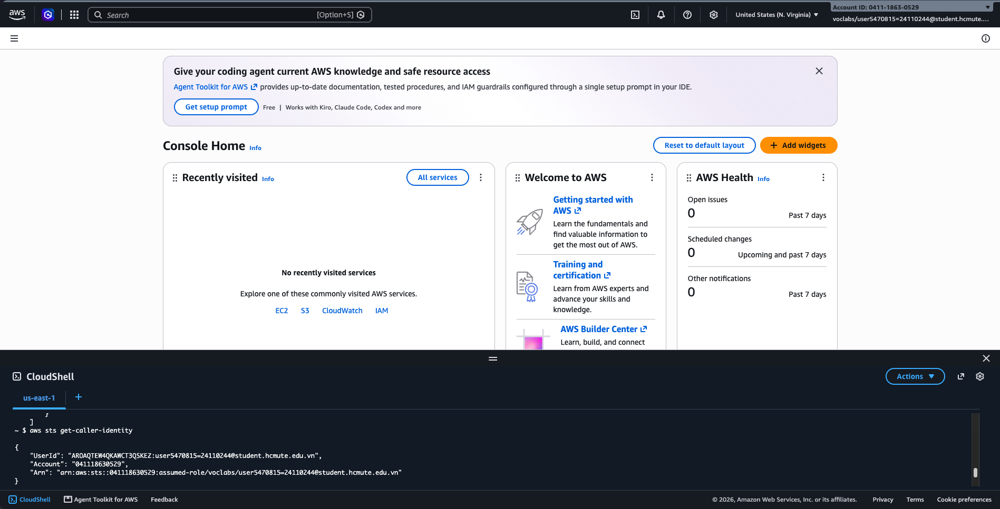

> **Nhận xét:** Session sử dụng role `voclabs` — đây là role mặc định của Learner Lab, cho phép thao tác AWS thông qua credentials tạm thời được cấp tự động mỗi khi khởi động Lab.

---

### 8.2. Xác minh Quyền hạn IAM Role `LabRole`

#### A. Thông tin Role

```bash
aws iam get-role --role-name LabRole --no-cli-pager
```

**Kết quả:**

| Thuộc tính | Giá trị |
| :--- | :--- |
| **RoleName** | `LabRole` |
| **RoleId** | `AROAQTEW4QKAXDETP2WOD` |
| **ARN** | `arn:aws:iam::041118630529:role/LabRole` |
| **CreateDate** | `2026-10-10T11:35:11+00:00` |

Trust Policy xác định principal nào được phép giả định role. Báo cáo chưa kèm nội dung Trust Policy, vì vậy chưa thể kết luận những dịch vụ nào được phép dùng role này; cần kiểm tra chính sách và quyền hiệu lực trước khi triển khai từng dịch vụ.

#### B. Các Policy gắn với LabRole

```bash
aws iam list-attached-role-policies --role-name LabRole --no-cli-pager
```
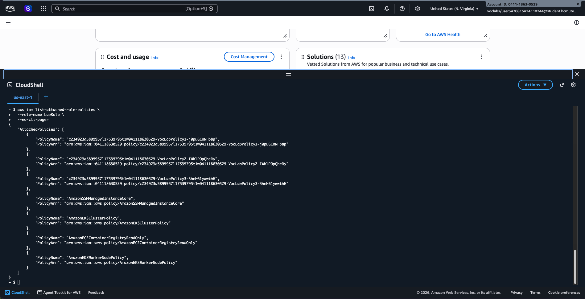

**Kết quả:**

| # | PolicyName | Loại |
| :-: | :--- | :--- |
| 1 | `c234923a5899957l17539795t1w041118630529-VocLabPolicy1-j0puGCnNFb8p` | Custom (VocLab) |
| 2 | `c234923a5899957l17539795t1w041118630529-VocLabPolicy2-IWblPOpQheRy` | Custom (VocLab) |
| 3 | `c234923a5899957l17539795t1w041118630529-VocLabPolicy3-3hnH61ywwtbH` | Custom (VocLab) |
| 4 | `AmazonSSMManagedInstanceCore` | AWS Managed |
| 5 | `AmazonEKSClusterPolicy` | AWS Managed |
| 6 | `AmazonEC2ContainerRegistryReadOnly` | AWS Managed |
| 7 | `AmazonEKSWorkerNodePolicy` | AWS Managed |

> **Nhận xét:** Danh sách có ba policy tùy chỉnh `VocLab` và bốn AWS managed policies. Chỉ tên policy và số lượng policy không chứng minh quyền hiệu lực cho từng dịch vụ; cần kiểm tra quyền cụ thể và thử triển khai khi thực hiện tuần 2.

---

### 8.3. Khởi tạo Amazon S3 Bucket lưu trữ báo cáo

#### A. Tạo Bucket

```bash
aws s3api create-bucket \
  --bucket inventory-reports-us-east-1-24110244 \
  --region us-east-1 \
  --no-cli-pager
```

**Kết quả:**

```json
{
    "Location": "/inventory-reports-us-east-1-24110244",
    "BucketArn": "arn:aws:s3:::inventory-reports-us-east-1-24110244"
}
```

| Thuộc tính | Giá trị |
| :--- | :--- |
| **Bucket Name** | `inventory-reports-us-east-1-24110244` |
| **Region** | `us-east-1` |
| **ARN** | `arn:aws:s3:::inventory-reports-us-east-1-24110244` |
| **Account ID** | `041118630529` |

#### B. Gắn Tag chuẩn cho Bucket

```bash
aws s3api put-bucket-tagging \
  --bucket inventory-reports-us-east-1-24110244 \
  --tagging 'TagSet=[{Key=Project,Value=inventory-app},{Key=Owner,Value=Khanh-Quan}]' \
  --region us-east-1 \
  --no-cli-pager
```

#### C. Xác minh Tag đã gắn thành công

```bash
aws s3api get-bucket-tagging \
  --bucket inventory-reports-us-east-1-24110244 \
  --region us-east-1 \
  --no-cli-pager
```

**Kết quả:**

```json
{
    "TagSet": [
        { "Key": "Project", "Value": "inventory-app" },
        { "Key": "Owner",   "Value": "Khanh-Quan"   }
    ]
}
```

#### D. Cấu hình và xác minh Block Public Access

Kết quả `get-bucket-tagging` chỉ xác minh tags, không chứng minh bucket đã chặn truy cập công khai. Cấu hình và kiểm tra riêng:

```bash
aws s3api put-public-access-block \
  --bucket inventory-reports-us-east-1-24110244 \
  --public-access-block-configuration \
  BlockPublicAcls=true,IgnorePublicAcls=true,BlockPublicPolicy=true,RestrictPublicBuckets=true \
  --region us-east-1 \
  --no-cli-pager

aws s3api get-public-access-block \
  --bucket inventory-reports-us-east-1-24110244 \
  --region us-east-1 \
  --no-cli-pager
```

Chỉ đánh dấu đã bật sau khi kết quả `get-public-access-block` xác nhận cả bốn giá trị là `true`.

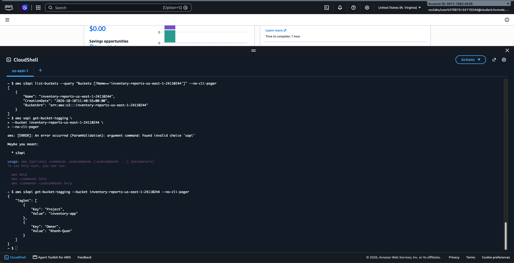

---

### 8.4. Tổng kết kết quả Bước 8

| Hạng mục | Trạng thái | Chi tiết |
| :--- | :---: | :--- |
| Đăng nhập AWS Learner Lab | Hoàn thành | Session `voclabs`, Account `041118630529` |
| Xác minh IAM Role LabRole | Hoàn thành | Xác nhận role và 7 policy đính kèm; quyền thực tế từng dịch vụ chưa được kiểm chứng |
| Tạo S3 Bucket báo cáo | Hoàn thành | `inventory-reports-us-east-1-24110244` |
| Gắn Tag `Project=inventory-app` | Hoàn thành | Xác minh qua `get-bucket-tagging` |
| Gắn Tag `Owner=Khanh-Quan` | Hoàn thành | Xác minh qua `get-bucket-tagging` |

---

## 9. CẤU HÌNH THỰC TẾ SECURITY GROUPS VÀ XÁC MINH IAM INSTANCE PROFILE TRÊN AWS LEARNER LAB
* **Môi trường thao tác:** AWS Management Console & AWS CLI – Region `us-east-1` (N. Virginia) trên AWS Learner Lab

---

### 9.1. Khởi tạo Security Group cho Web Application Tier (`inventory-web-sg`)

#### A. Tạo Security Group trên `inventory-vpc`:

Security Group `inventory-web-sg` đóng vai trò là lớp tường lửa ảo bảo vệ các máy chủ Web App / Elastic Beanstalk trong Public Subnets.
Security Group mới thường có outbound mặc định cho phép toàn bộ lưu lượng; các lệnh trong mục này không thu hẹp egress. Cần rà soát rule thực tế và chỉ hạn chế khi đã xác định các luồng cần thiết.

```bash
# 1. Lấy VPC ID của inventory-vpc
VPC_ID=$(aws ec2 describe-vpcs \
  --filters "Name=tag:Name,Values=inventory-vpc" \
  --query "Vpcs[0].VpcId" \
  --output text \
  --region us-east-1)

# 2. Tạo Security Group inventory-web-sg
aws ec2 create-security-group \
  --group-name inventory-web-sg \
  --description "Security Group cho Web Tier (Flask App / Elastic Beanstalk)" \
  --vpc-id $VPC_ID \
  --tag-specifications 'ResourceType=security-group,Tags=[{Key=Name,Value=inventory-web-sg},{Key=Project,Value=inventory-app},{Key=Owner,Value=Khanh-Quan}]' \
  --region us-east-1 \
  --no-cli-pager
```

**Kết quả thực tế:**

```json
{
    "GroupId": "sg-0bb46c5bbb3ba364b"
}
```

| Thuộc tính | Giá trị |
| :--- | :--- |
| **Security Group Name** | `inventory-web-sg` |
| **Group ID** | `sg-0bb46c5bbb3ba364b` |
| **VPC ID** | `vpc-08899e1e1656f5f73` (`inventory-vpc`) |
| **Tags** | `Project=inventory-app`, `Owner=Khanh-Quan`, `Name=inventory-web-sg` |

#### B. Cấu hình Quy tắc Inbound (Chiều vào):

Các lệnh dưới đây ghi lại rule đã mở trong tuần 1. Lưu ý: cổng `5000` là Flask development server, không nên để mở từ Internet; cổng `443` chỉ có ý nghĩa khi đã cấu hình TLS. Chưa có Web App chạy trên AWS để xác minh truy cập.

```bash
WEB_SG_ID="sg-0bb46c5bbb3ba364b"

# Mở Port 80 (HTTP)
aws ec2 authorize-security-group-ingress \
  --group-id $WEB_SG_ID \
  --protocol tcp --port 80 --cidr 0.0.0.0/0 \
  --region us-east-1 --no-cli-pager

# Mở Port 5000 (Flask Development Server)
aws ec2 authorize-security-group-ingress \
  --group-id $WEB_SG_ID \
  --protocol tcp --port 5000 --cidr 0.0.0.0/0 \
  --region us-east-1 --no-cli-pager

# Mở Port 443 (HTTPS - Dự phòng bảo mật SSL/TLS)
aws ec2 authorize-security-group-ingress \
  --group-id $WEB_SG_ID \
  --protocol tcp --port 443 --cidr 0.0.0.0/0 \
  --region us-east-1 --no-cli-pager
```

Trước khi triển khai, thu hồi rule public của cổng development. Chỉ giữ cổng 443 nếu TLS đã được cấu hình; nếu chưa dùng HTTPS, không công bố listener này:

```bash
aws ec2 revoke-security-group-ingress \
  --group-id "$WEB_SG_ID" \
  --protocol tcp --port 5000 --cidr 0.0.0.0/0 \
  --region us-east-1 \
  --no-cli-pager
```

---

### 9.2. Khởi tạo Security Group cho Database Tier (`inventory-db-sg`) với Security Group Chaining

#### A. Tạo Security Group trên `inventory-vpc`:

`inventory-db-sg` được chuẩn bị để bảo vệ Amazon RDS PostgreSQL khi DB được tạo trong Private Subnets. Tuần 1 chưa có RDS instance.
Security Group này cũng giữ outbound mặc định nếu chưa được sửa; rule đó không chứng minh rằng DB đã kết nối ra ngoài.

```bash
# Tạo Security Group inventory-db-sg
aws ec2 create-security-group \
  --group-name inventory-db-sg \
  --description "Security Group cho Amazon RDS PostgreSQL Database Tier" \
  --vpc-id $VPC_ID \
  --tag-specifications 'ResourceType=security-group,Tags=[{Key=Name,Value=inventory-db-sg},{Key=Project,Value=inventory-app},{Key=Owner,Value=Khanh-Quan}]' \
  --region us-east-1 \
  --no-cli-pager
```

**Kết quả thực tế:**

```json
{
    "GroupId": "sg-0f5e8348f198a9f97"
}
```

| Thuộc tính | Giá trị |
| :--- | :--- |
| **Security Group Name** | `inventory-db-sg` |
| **Group ID** | `sg-0f5e8348f198a9f97` |
| **VPC ID** | `vpc-08899e1e1656f5f73` (`inventory-vpc`) |
| **Tags** | `Project=inventory-app`, `Owner=Khanh-Quan`, `Name=inventory-db-sg` |

#### B. Áp dụng kỹ thuật Security Group Chaining cho Inbound Rule:

Thay vì cấu hình dải CIDR IP tĩnh (kém linh hoạt và dễ rò rỉ nếu IP thay đổi), quy tắc cho phép kết nối Port `5432` (PostgreSQL) chỉ định trực tiếp Source là **Group ID của `inventory-web-sg`**:

```bash
DB_SG_ID="sg-0f5e8348f198a9f97"

aws ec2 authorize-security-group-ingress \
  --group-id $DB_SG_ID \
  --protocol tcp --port 5432 \
  --source-group $WEB_SG_ID \
  --region us-east-1 --no-cli-pager
```

> **Ưu điểm kỹ thuật:** Khi Web Tier được cấu hình Auto Scaling, các instance gắn `inventory-web-sg` sẽ khớp rule nguồn của DB SG mà không cần cập nhật rule cho từng IP. Tính năng Auto Scaling chưa được triển khai trong tuần 1.

---

### 9.3. Thử nghiệm Kiểm chứng Luồng Truy cập & An ninh Mạng (Security Testing)

Các luồng dưới đây là kế hoạch kiểm thử. Do RDS và Web Tier chưa được triển khai, chưa có kết quả kiểm thử kết nối thực tế trong tuần 1.

| Kịch bản thử nghiệm | Nguồn (Source) | Đích (Destination) | Cổng & Giao thức | Kỳ vọng | Kết quả thực nghiệm | Đánh giá |
| :---: | :--- | :--- | :---: | :---: | :---: | :--- |
| **1** | Người dùng Internet | `inventory-web-sg` | TCP `80`, `5000`, `443` (rule hiện tại) | Chỉ mở listener cần thiết; không public port `5000` | Chưa kiểm thử — chưa triển khai Web Tier | Port `5000` đang mở trên SG nhưng cần thu hồi; port `443` chỉ dùng sau khi cấu hình TLS. |
| **2** | Web Server (`inventory-web-sg`) | RDS PostgreSQL (`inventory-db-sg`) | TCP `5432` | Dự kiến cho phép nội bộ | Chưa kiểm thử — RDS/Web Tier chưa được triển khai | Rule SG đã cấu hình, nhưng chưa chứng minh được kết nối. |
| **3** | Internet bên ngoài | RDS PostgreSQL (`inventory-db-sg`) | TCP `5432` | Dự kiến không cho phép | Chưa kiểm thử — chưa có RDS instance | Khi tạo DB cần đặt `PubliclyAccessible=false` và kiểm tra subnet/SG. |
| **4** | Tài nguyên khác trong VPC (không mang `inventory-web-sg`) | RDS PostgreSQL (`inventory-db-sg`) | TCP `5432` | Dự kiến không cho phép | Chưa kiểm thử — chưa có RDS instance | Không có inbound rule phù hợp; chưa xác nhận bằng runtime test. |

---

### 9.4. Xác minh IAM Instance Profile `LabInstanceProfile`

Learner Lab cung cấp profile có sẵn **`LabInstanceProfile`** liên kết với `LabRole`. Dùng profile này cho EC2/Elastic Beanstalk nếu được phép; khả năng tạo hoặc sửa IAM role phụ thuộc policy của lớp.

#### A. Lệnh kiểm tra cấu hình Instance Profile:

```bash
aws iam get-instance-profile \
  --instance-profile-name LabInstanceProfile \
  --region us-east-1 \
  --no-cli-pager
```

#### B. Kết quả thực tế:

```json
{
  "ProfileName": "LabInstanceProfile",
  "ProfileArn": "arn:aws:iam::041118630529:instance-profile/LabInstanceProfile",
  "Roles": [
    {
      "RoleName": "LabRole",
      "RoleArn": "arn:aws:iam::041118630529:role/LabRole"
    }
  ]
}
```

**Nhận xét:**
- `LabInstanceProfile` liên kết với role `LabRole`.
- Có thể gắn profile này vào EC2/Elastic Beanstalk nếu dịch vụ cho phép; quyền hiệu lực cần được xác minh khi triển khai.
---

### 9.5. Tổng kết Kết quả Công việc Thứ Bảy của Võ Minh Quân

| Hạng mục công việc | Trạng thái | Minh chứng / Ghi chú |
| :--- | :---: | :--- |
| Khởi tạo `inventory-web-sg` | Hoàn thành | ID: `sg-0bb46c5bbb3ba364b`; hiện có rule public cho 80, 5000, 443; cần thu hồi 5000 trước khi triển khai |
| Khởi tạo `inventory-db-sg` | Hoàn thành | ID: `sg-0f5e8348f198a9f97`, Inbound TCP 5432 từ Web SG |
| Kỹ thuật Security Group Chaining | Hoàn thành | Tham chiếu trực tiếp SG ID, đã cấu hình cổng 5432 tham chiếu Web SG|
| Kiểm thử an ninh luồng mạng | Chưa thực hiện | RDS/Web Tier chưa triển khai; các luồng mới được đối chiếu theo rule |
| Xác minh `LabInstanceProfile` | Hoàn thành | ARN: `arn:aws:iam::041118630529:instance-profile/LabInstanceProfile` |
| Gắn Tag cho tài nguyên | Đã gắn trên các tài nguyên được báo cáo | `Project=inventory-app`, `Owner=Khanh-Quan`; cần kiểm tra từng tài nguyên để xác nhận không còn thiếu |

---

## 10. TỔNG KẾT HẠ TẦNG AWS, MINH CHỨNG TRIỂN KHAI & CHUẨN BỊ TUẦN 2
* **Công cụ / AI hỗ trợ:** AWS CLI, AWS Management Console (`us-east-1`), PowerShell, Git.

---

### 10.1. Kiểm tra Tài nguyên và Theo dõi Chi phí trên AWS Learner Lab

Learner Lab có thể giới hạn credit và quyền sử dụng theo cấu hình khóa học. Hãy kiểm tra số dư/hạn mức trong giao diện Lab; không suy ra số dư chỉ từ danh sách tài nguyên.

#### A. Rà soát danh mục tài nguyên đang hoạt động trong Tuần 1:
Thực hiện các câu lệnh kiểm tra trên AWS CLI (`us-east-1`):

```bash
# 1. Liệt kê các EC2 instance đang chạy hoặc khởi động
aws ec2 describe-instances \
  --filters "Name=instance-state-name,Values=running,pending" \
  --query "Reservations[*].Instances[*].[InstanceId,InstanceType,State.Name]" \
  --region us-east-1 --output table --no-cli-pager

# 2. Liệt kê các RDS instance (tuần 1 chưa tạo DB cho dự án)
aws rds describe-db-instances \
  --query "DBInstances[*].[DBInstanceIdentifier,DBInstanceClass,DBInstanceStatus]" \
  --region us-east-1 --output table --no-cli-pager

# 3. Kiểm tra các dịch vụ mạng nền tảng (VPC, Subnet, Route Table, IGW, Security Groups)
aws ec2 describe-vpcs --filters "Name=tag:Project,Values=inventory-app" --region us-east-1 --output table --no-cli-pager
aws ec2 describe-security-groups --filters "Name=tag:Project,Values=inventory-app" --region us-east-1 --output table --no-cli-pager
```

#### B. Đánh giá phát sinh chi phí:
Các lệnh trên chỉ liệt kê tài nguyên, không tính chi phí hoặc số dư. VPC, subnet, route table và Security Group không có phí giờ sử dụng riêng trong cấu hình thông thường, nhưng public IPv4, lưu trữ S3, truyền dữ liệu, log và các dịch vụ khác có thể phát sinh phí. Báo cáo tuần 1 chưa kèm hóa đơn/Cost Explorer hoặc ảnh số dư nên không kết luận tổng chi phí bằng 0 USD hay số dư còn nguyên. Kiểm tra Cost Explorer/Billing và giao diện Learner Lab để ghi số liệu có thời điểm và phạm vi rõ ràng.

---

### 10.2. Thu thập & Chuẩn hóa Bộ Ảnh Minh chứng (Screenshots) Tuần 1

Để phục vụ báo cáo và bảo vệ đồ án, bộ ảnh minh chứng cần được đối chiếu theo các tiêu chí sau:
1. Hiển thị rõ **AWS Account ID (`041118630529`)** hoặc User ARN góc trên cùng bên phải.
2. Hiển thị đúng **Region: `us-east-1` (N. Virginia)**.
3. Tài nguyên có tiền tố chuẩn `inventory-*` và đầy đủ thẻ **Tag (`Project: inventory-app`, `Owner: Khanh-Quan`)**.

#### Bảng tổng hợp trạng thái các ảnh minh chứng:

| STT | Tên file ảnh | Dịch vụ AWS | Nội dung minh chứng | Sinh viên thực hiện | Trạng thái file |
| :-: | :--- | :---: | :--- | :---: | :---: |
| 1 | `01_aws_sts_identity.png` | AWS STS | Caller Identity, Account ID `041118630529`, ARN sinh viên | Nguyễn Đình Khanh | Đã lưu trữ |
| 2 | `02_labrole_policies.png` | AWS IAM | 7 Policies đính kèm vào `LabRole` | Nguyễn Đình Khanh | Đã lưu trữ |
| 3 | `03_s3_bucket_created.png` | Amazon S3 | Bucket `inventory-reports-us-east-1-24110244` & Tagging | Nguyễn Đình Khanh | Đã lưu trữ |
| 4 | `04_vpc_created.png` | Amazon VPC | VPC `inventory-vpc` (`10.0.0.0/16`), DNS resolution & hostnames | Võ Minh Quân | Đã lưu trữ |
| 5 | `05_subnets_list.png` | Amazon VPC | 4 subnet ở hai AZ (`us-east-1a`, `us-east-1b`); DB Subnet Group đa AZ không đồng nghĩa RDS Multi-AZ | Võ Minh Quân | Đã lưu trữ |
| 6 | `06_a_route_tables.png`<br>`06_b_route_tables.png`<br>`06_c_route_tables.png`<br>`06_d_route_tables.png` | Amazon VPC | Bảng định tuyến chi tiết: Public RT (trỏ ra `inventory-igw`) & Private RT (local) | Võ Minh Quân | Đã lưu trữ |
| 7 | `07_internet_gateway.png` | Amazon VPC | Internet Gateway `inventory-igw` đã attach vào `inventory-vpc` | Võ Minh Quân | Đã lưu trữ |
| 8 | `08_security_group_web.png` | EC2 / SG | `inventory-web-sg` với Inbound Rules (Port 80, 5000, 443) | Võ Minh Quân | Đã lưu trữ |
| 9 | `09_security_group_db.png` | EC2 / SG | `inventory-db-sg` Inbound Port 5432 tham chiếu Web SG ID | Võ Minh Quân | Đã lưu trữ |
| 10 | `10_lab_instance_profile.png` | AWS IAM | Xác minh `LabInstanceProfile` liên kết với `LabRole` | Võ Minh Quân | Đã lưu trữ |

#### Hình ảnh minh chứng thực tế do Võ Minh Quân thu thập & chụp từ AWS Console:

##### 1. VPC `inventory-vpc` (`10.0.0.0/16`) đã tạo thành công:
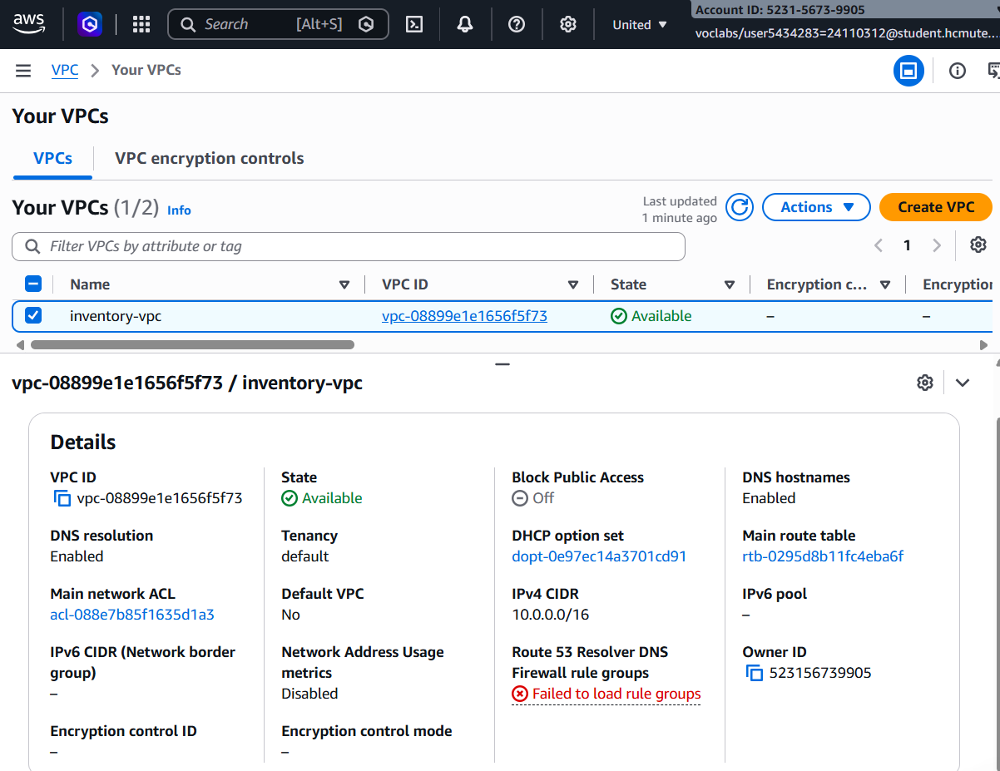
* *Xác minh:* VPC ID: `vpc-08899e1e1656f5f73`, IPv4 CIDR `10.0.0.0/16`, trạng thái `Available`, đầy đủ Tag `Project=inventory-app`, `Owner=Khanh-Quan`.

##### 2. Danh sách 4 Subnets ở hai Availability Zones:
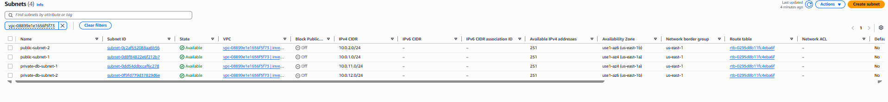
* *Xác minh:* Hai Public Subnets (`10.0.1.0/24`, `10.0.2.0/24`) và hai Private DB Subnets (`10.0.11.0/24`, `10.0.12.0/24`) nằm ở hai Availability Zones. Chưa có RDS instance hay cấu hình RDS Multi-AZ.

##### 3. Bảng định tuyến Route Tables (Public RT & Private RT):
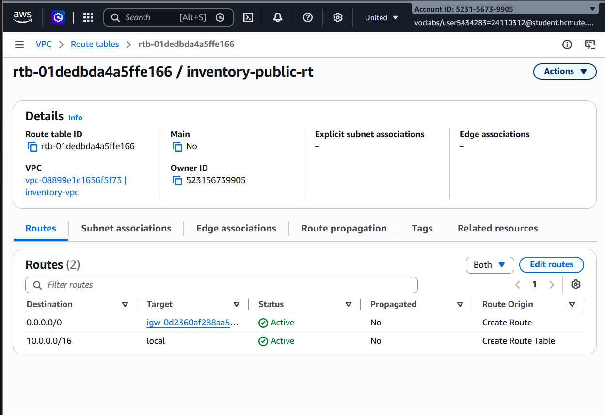
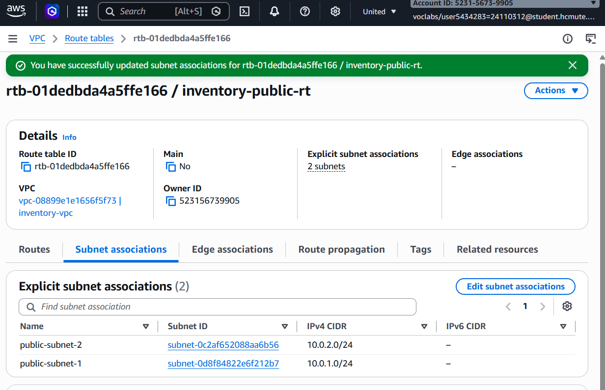
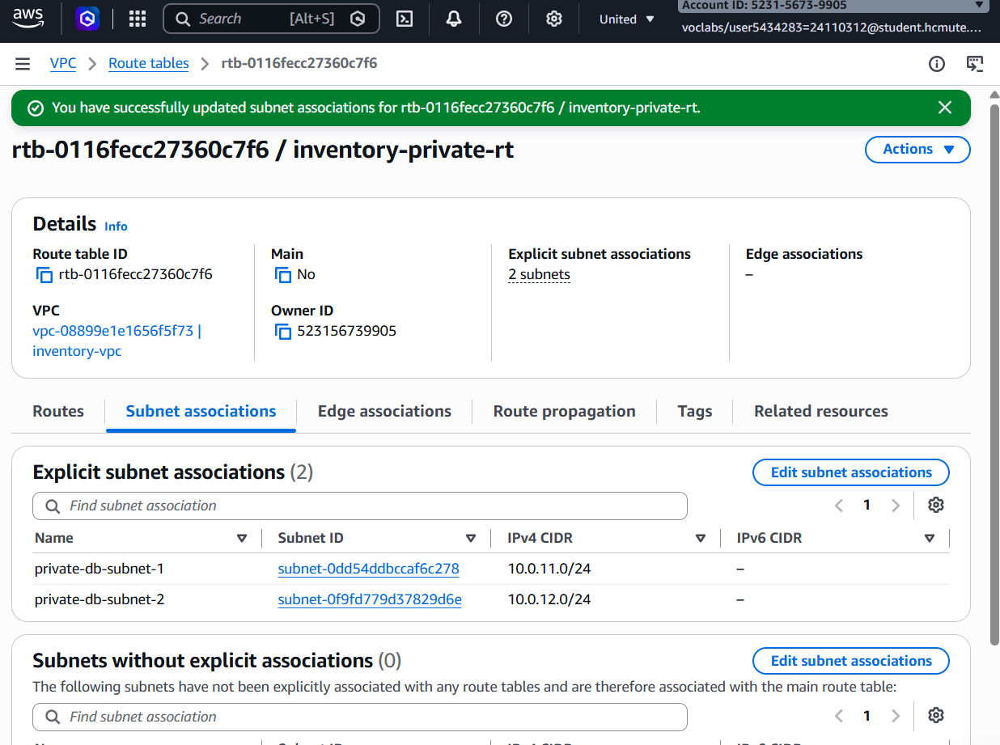
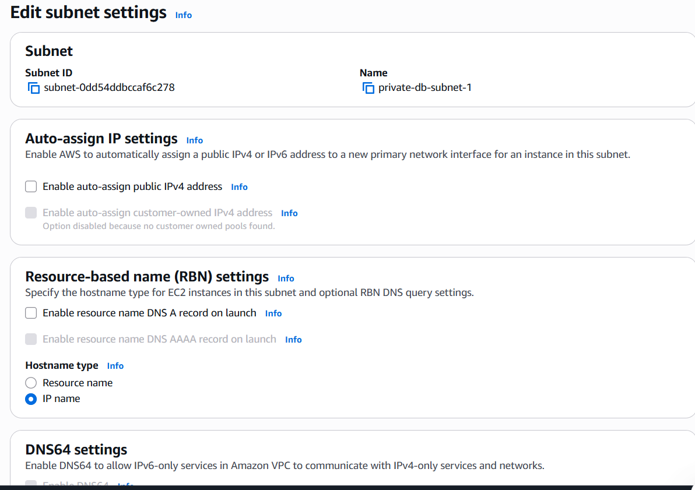
* *Xác minh:* `inventory-public-rt` định tuyến `0.0.0.0/0` trỏ tới `inventory-igw`; `inventory-private-rt` chỉ chứa route nội bộ `10.0.0.0/16 local`.

##### 4. Internet Gateway `inventory-igw`:
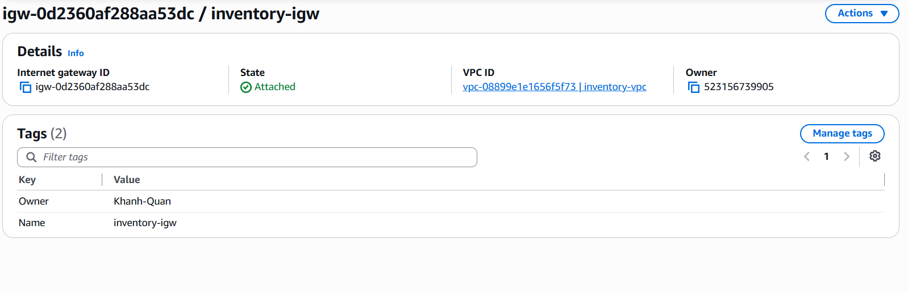
* *Xác minh:* `inventory-igw` ở trạng thái `Attached` vào VPC `inventory-vpc`.

##### 5. Security Group Web Tier (`inventory-web-sg`):
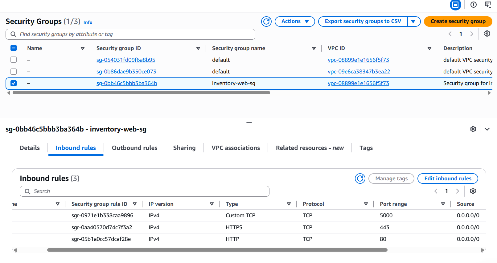
* *Xác minh:* SG có rule inbound public cho port 80, 5000, 443. Port 5000 không an toàn để public; port 443 không bảo đảm HTTPS nếu chưa cấu hình TLS.

##### 6. Security Group Database Tier (`inventory-db-sg`):
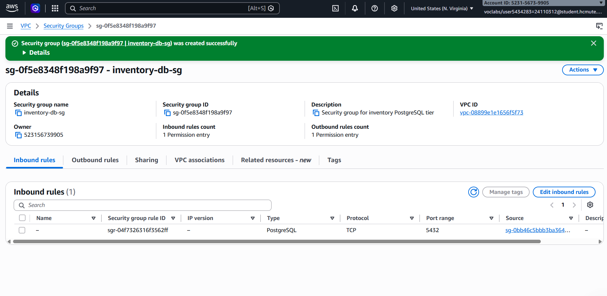
* *Xác minh:* Kỹ thuật Security Group Chaining - Inbound Port 5432 (PostgreSQL) chỉ chấp nhận Source từ `inventory-web-sg`.

##### 7. Xác minh IAM Instance Profile (`LabInstanceProfile`):
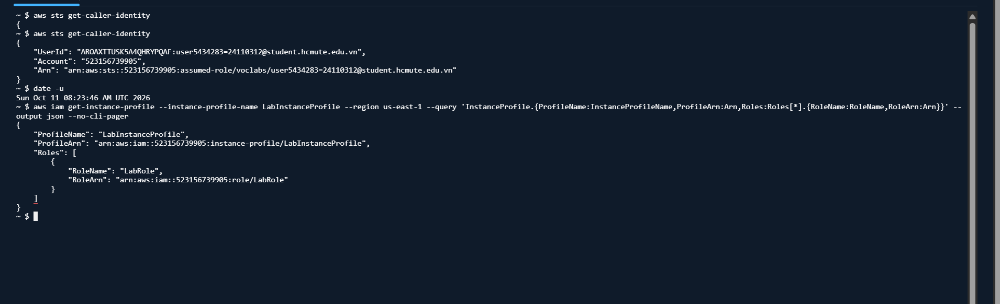
* *Xác minh:* `LabInstanceProfile` liên kết với `LabRole`; quyền sử dụng cần kiểm tra khi triển khai EC2/Elastic Beanstalk.

---

### 10.3. Tổng hợp Báo cáo Hạ tầng Tuần 1 & Họp Giao ban với Nhóm trưởng

Tổng kết tuần 1

1. **Khớp nối thiết kế:** Hạ tầng mạng được thiết kế để phục vụ ứng dụng Flask và PostgreSQL. Tích hợp thực tế với RDS/Web Tier chưa được kiểm thử vì các dịch vụ này chưa triển khai.
2. **Kế hoạch phối hợp Tuần 2:**
   * Nguyễn Đình Khanh phụ trách cấu hình DB Subnet Group trải trên hai AZ và khởi tạo RDS PostgreSQL Single-AZ (`db.t3.micro`, nếu hạn mức cho phép) trong subnet riêng.
   * Võ Minh Quân phụ trách triển khai môi trường Web App (AWS Elastic Beanstalk hoặc EC2) đặt trong Public Subnet, đính kèm `inventory-web-sg` và `LabInstanceProfile`.
   * Cả hai cùng kiểm thử luồng kết nối từ Web App sang RDS PostgreSQL qua Security Group Chaining.
   * Trước khi bật cảnh báo/báo cáo tự động, cần xác nhận IAM execution role, network path tới RDS/S3/SNS, lịch và múi giờ EventBridge, đồng thời hoàn thiện kiểm thử đầu cuối.

---

### 10.4. Đánh giá Kết quả Thực hiện 

| Tiêu chí | Kết quả đạt được | Đánh giá |
| :--- | :--- | :---: |
| **Theo dõi ngân sách** | Đã liệt kê một số tài nguyên; chưa có chứng từ Cost Explorer/Billing để xác nhận tổng chi phí hoặc số dư | Cần kiểm tra lại |
| **Bộ ảnh minh chứng** | Các file ảnh đã được lưu; cần đối chiếu nội dung từng ảnh với Account ID, Region, tags và trạng thái tài nguyên | Đã lưu, chờ rà soát |
| **Kịch bản tự động hóa** | Đóng gói script PowerShell/Bash cho hạ tầng Security Groups | Sẵn sàng tái sử dụng |
| **Bàn giao Tuần 2** | Hoàn thành họp giao ban, chuyển giao thông số VPC ID, Subnet IDs và SG IDs cho SV1 | Sẵn sàng  |
