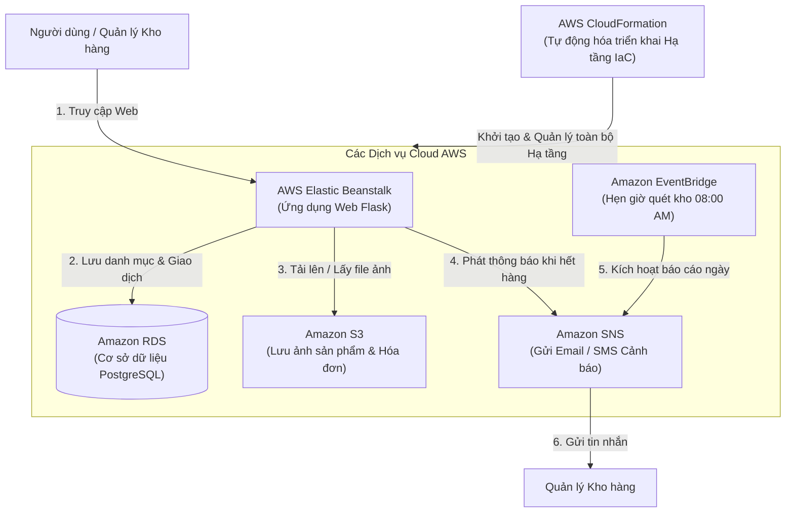
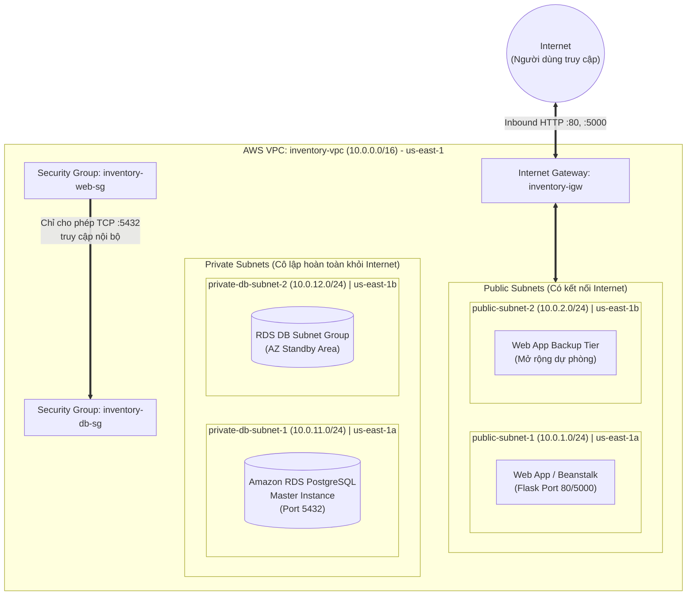

# BÁO CÁO KỸ THUẬT VÀ KẾT QUẢ TRIỂN KHAI - TUẦN 1

---

## I. TỔNG QUAN ĐỀ TÀI & KIẾN TRÚC HỆ THỐNG

### 1. Thông tin đồ án:
* **Tên đề tài:** Xây dựng hệ thống quản lý nhập/xuất kho, cảnh báo tồn kho thấp và báo cáo định kỳ
* **Môn học:** Cloud Computing (Điện toán đám mây - Đợt 1, 2026 - 2027)
* **Giảng viên hướng dẫn (GVHD):** ThS. Huỳnh Xuân Phụng
* **Nhóm thực hiện (2 sinh viên):**
  * **Nguyễn Đình Khanh** - MSSV: `24110244` (Nhóm trưởng / Phụ trách Backend & Database)
  * **Võ Minh Quân** - MSSV: `24110312` (Thành viên / Phụ trách Network & Infrastructure)

### 2. Mô hình kiến trúc tổng thể (Architecture Overview):
Hệ thống được thiết kế theo mô hình Cloud-Native 2-Tier kết hợp kiến trúc hướng sự kiện (Event-Driven Architecture):
1. **Web Tier:** Ứng dụng Flask Web App chạy trên AWS Elastic Beanstalk (hoặc EC2) đặt trong **Public Subnets**, phục vụ người dùng quản lý sản phẩm và thao tác nhập/xuất kho.
2. **Database Tier:** Cơ sở dữ liệu quan hệ **Amazon RDS PostgreSQL** (Single-AZ, `db.t3.micro`) nằm ẩn trong **Private Subnets**, chỉ cho phép truy cập từ Web Tier thông qua Security Group.
3. **Cảnh báo tồn kho tự động (Alerting):**
   * Cơ chế sự kiện thời gian thực / định kỳ: **Amazon EventBridge** kích hoạt **AWS Lambda function** quét các mặt hàng có số lượng $\le$ `min_threshold`.
   * Gửi cảnh báo: Lambda đẩy thông điệp cảnh báo qua **Amazon SNS Topic**, gửi email trực tiếp tới quản lý kho.
4. **Báo cáo định kỳ (Reporting):** AWS Lambda định kỳ hàng tuần tổng hợp dữ liệu giao dịch thành file **PDF / CSV** và lưu trữ an toàn trong **Amazon S3 Bucket**.
5. **Tự động hóa hạ tầng (IaC):** Toàn bộ tài nguyên (VPC, Subnets, SG, S3, RDS, Lambda, SNS, EventBridge) sẽ được mã hóa và triển khai tự động qua **AWS CloudFormation template**.

---

## II. BÁO CÁO CÔNG VIỆC CHI TIẾT - VÕ MINH QUÂN (MSSV: 24110312)

### 1. Phân tích & Tổng hợp Giới hạn của AWS Learner Lab:
Do dự án được triển khai trên môi trường học tập **AWS Academy Learner Lab**, nhóm đã rà soát nghiêm ngặt các điều kiện biên nhằm đảm bảo tài nguyên hoạt động liên tục mà không vi phạm chính sách lab:

| Tài nguyên / Giới hạn | Ràng buộc của Learner Lab | Giải pháp thiết kế cho dự án |
| :--- | :--- | :--- |
| **Ngân sách (Budget)** | Cấp tối đa **$50 USD** credit. Nếu cạn kiệt, tài khoản bị khoá vĩnh viễn và mất dữ liệu. | Tối ưu kích cỡ máy chủ, tắt/dừng các instance khi không thao tác, kiểm tra chi phí sau mỗi buổi lab. |
| **Vùng (Region)** | Chỉ cho phép `us-east-1` hoặc `us-west-2`. | Cố định Toàn bộ tài nguyên triển khai tại us-east-1 tại vùng **`us-east-1` (N. Virginia)**. |
| **IAM Permission** | Không thể tạo User/Role mới; không được sửa Policy. Bắt buộc dùng `LabRole`. | Toàn bộ ứng dụng và Lambda đều tận dụng **`LabRole`** và **`LabInstanceProfile`**. |
| **Quy định Tagging** | Bắt buộc gắn thẻ định danh để kiểm soát tài nguyên. | Mọi tài nguyên khởi tạo đều gắn: `Project=inventory-app`, `Owner=Khanh-Quan`. |
| **Compute (EC2)** | Giới hạn $\le 9$ instance và $\le 32$ vCPU; loại instance từ nano $\rightarrow$ large. | Chỉ sử dụng `t2.micro` hoặc `t3.micro` (1 vCPU, 1 GiB RAM). |
| **Lưu trữ (EBS)** | Tổng dung lượng EBS $\le 50$ GB (gp2 hoặc gp3). | Khởi tạo ổ đĩa hệ thống 20GB - 30GB gp3. |
| **Amazon RDS** | Hỗ trợ `db.t2.micro` / `db.t3.micro`. | Sử dụng RDS PostgreSQL `db.t3.micro` (Single-AZ, 20GB gp2/gp3). |

---

### 2. Thiết kế Hạ tầng Mạng & Bảo mật (Network & Security Design):

#### A. Sơ đồ phân vùng VPC và Subnets:
* **VPC Name:** `inventory-vpc`
* **CIDR Block:** `10.0.0.0/16`
* **Multi-AZ Configuration:** Phân bổ đều trên 2 Availability Zones (`us-east-1a` và `us-east-1b`) nhằm thỏa mãn yêu cầu DB Subnet Group của RDS:
  * `inventory-public-subnet-1`: `10.0.1.0/24` (AZ: `us-east-1a`) $\rightarrow$ Dành cho Web Tier (Public)
  * `inventory-public-subnet-2`: `10.0.2.0/24` (AZ: `us-east-1b`) $\rightarrow$ Dành cho Web Tier (Public)
  * `inventory-private-subnet-1`: `10.0.11.0/24` (AZ: `us-east-1a`) $\rightarrow$ Dành cho Database Tier (Private)
  * `inventory-private-subnet-2`: `10.0.12.0/24` (AZ: `us-east-1b`) $\rightarrow$ Dành cho Database Tier (Private)

#### B. Định tuyến (Route Tables) & Gateways:
* **Internet Gateway (IGW):** `inventory-igw` được đính kèm trực tiếp vào `inventory-vpc`.
* **Public Route Table (`inventory-public-rt`):**
  * Route: `0.0.0.0/0` trỏ tới `inventory-igw`.
  * Liên kết Subnet: Gắn với `inventory-public-subnet-1` và `inventory-public-subnet-2`.
* **Private Route Table (`inventory-private-rt`):**
  * Route: Chỉ chứa route nội bộ `10.0.0.0/16 local`, không có đường dẫn trực tiếp ra ngoài Internet nhằm bảo vệ an toàn cho RDS PostgreSQL.
  * Liên kết Subnet: Gắn với `inventory-private-subnet-1` và `inventory-private-subnet-2`.

#### C. Chiến lược kiểm soát truy cập (Security Groups 2-Tier):
1. **`inventory-web-sg` (Web Application Security Group):**
   * **Inbound:**
     * Port `80` (HTTP) từ `0.0.0.0/0` (Truy cập Web cho người dùng)
     * Port `5000` (Custom TCP) từ `0.0.0.0/0` (Kiểm thử Flask dev server)
   * **Outbound:** All Traffic (hoặc TCP port 5432 đến DB SG)
2. **`inventory-db-sg` (Database Security Group):**
   * **Inbound:**
     * Port `5432` (PostgreSQL) chỉ chấp nhận nguồn là Security Group ID của `inventory-web-sg` (`source: sg-xxxxxx`). Tuyệt đối không mở IP public hoặc `0.0.0.0/0`.
   * **Outbound:** Mặc định.

---

## III. BÁO CÁO CÔNG VIỆC CHI TIẾT - NGUYỄN ĐÌNH KHANH (MSSV: 24110244)

### 1. Thiết kế Cơ sở dữ liệu quan hệ (PostgreSQL Database Schema):
Cơ sở dữ liệu gồm 2 bảng nghiệp vụ cốt lõi:
1. **Bảng `products`:** Quản lý thông tin và số lượng mặt hàng
   * `id`: SERIAL PRIMARY KEY
   * `sku`: VARCHAR(50) UNIQUE NOT NULL (Mã sản phẩm)
   * `name`: VARCHAR(50) NOT NULL (Tên sản phẩm)
   * `quantity`: INT NOT NULL DEFAULT 0 (Số lượng tồn thực tế)
   * `min_threshold`: INT NOT NULL DEFAULT 5 (Định mức tồn tối thiểu để kích hoạt cảnh báo)
2. **Bảng `transactions`:** Lưu trữ toàn bộ lịch sử xuất/nhập kho
   * `id`: SERIAL PRIMARY KEY
   * `product_id`: INT REFERENCES products(id) (Khóa ngoại)
   * `type`: VARCHAR(10) NOT NULL ('IN' - Nhập kho, 'OUT' - Xuất kho)
   * `quantity`: INT NOT NULL (Số lượng giao dịch)
   * `created_at`: TIMESTAMP DEFAULT CURRENT_TIMESTAMP (Thời gian thực hiện)

### 2. Xây dựng Ứng dụng Backend & Giao diện Local:
* Khởi tạo ứng dụng Flask (`app.py`), kết nối PostgreSQL qua thư viện `psycopg2-binary`.
* Cài đặt các API xử lý:
  * Xem danh sách hàng tồn (`/`).
  * Thêm mới mặt hàng với mức cảnh báo tối thiểu (`/add`).
  * Thực hiện giao dịch nhập/xuất kho (`/transaction`), có cơ chế ngăn chặn việc xuất hàng vượt quá số lượng tồn hiện có (`current_qty < trans_qty`).
  * Tự động hiển thị Flash Warning khi `quantity <= min_threshold`.

### 3. Khởi tạo Amazon S3 Bucket lưu trữ báo cáo:
* Tạo thành công S3 Bucket: `inventory-reports-us-east-1-24110244` tại vùng `us-east-1`.
* Cấu hình chế độ Private (Block all public access).
* Gán Tagging đầy đủ: `Project=inventory-app`, `Owner=Khanh-Quan`.

---

## IV. BẢNG TỔNG HỢP MINH CHỨNG & TIÊU CHÍ ĐÁNH GIÁ TUẦN 1

| Tiêu chí yêu cầu của GVHD | Hiện trạng triển khai của nhóm | Minh chứng kiểm tra |
| :--- | :--- | :--- |
| **Kế hoạch thời gian** | Đạt **28.0 giờ** toàn nhóm (Khanh: 14.0h, Quân: 14.0h (8h/SV)). | Chi tiết tại logs/week1.md. |
| **Môi trường & Vùng** | Triển khai trên AWS Learner Lab tại vùng `us-east-1`. | Console / AWS CLI output Region `us-east-1`. |
| **Quyền IAM** | Sử dụng `LabRole` & `LabInstanceProfile`. | Không tạo mới bất kỳ IAM Role/User nào. |
| **Quy chuẩn Tagging** | Toàn bộ tài nguyên triển khai tại us-east-1 có `Project=inventory-app`, `Owner=Khanh-Quan`. | Thể hiện trên VPC, Subnet, SG, S3 Bucket. |
| **Minh chứng mã nguồn** | Toàn bộ mã nguồn, SQL script, tài liệu trên GitHub. | GitHub Repo: `qilskcter/inventory-app`. |
| **Báo cáo sử dụng AI** | Ghi rõ phạm vi hỗ trợ của ChatGPT, Claude, Amazon Q, Antigravity. | Trình bày tại Mục IV trong Worklog Tuần 1. |

# BÁO CÁO - TUẦN 1
## HỆ THỐNG QUẢN LÝ KHO HÀNG & CẢNH BÁO TỒN KHO (`inventory-app`)

**Môn học:** Điện toán đám mây (Cloud Computing)  
**Sinh viên thực hiện:** 
- Nguyễn Đình Khanh (MSSV: 24110244)
- Võ Minh Quân (MSSV: 24110312)  
**Giảng viên hướng dẫn:** ThS. Huỳnh Xuân Phụng  

---

## 1. BẢNG TỔNG HỢP GIỚI HẠN & QUY ĐỊNH HẠ TẦNG TRÊN AWS LEARNER LAB

| Tiêu chí / Tài nguyên | Quy định & Giới hạn của AWS Learner Lab | Giải pháp & Ứng dụng cho dự án Inventory App |
| :--- | :--- | :--- |
| **Budget / Chi phí** | Cấp tối đa **$50 USD** credit cho cả học kỳ.  | Dùng gói nhỏ nhất (t2.micro / db.t3.micro). Dùng CloudFormation để xóa/khôi phục Stack tiết kiệm chi phí. |
| **Region cho phép** | Chỉ được hoạt động trên **`us-east-1` (N. Virginia)** hoặc **`us-west-2` (Oregon)**. Các region khác bị chặn (Access Denied). |  Toàn bộ tài nguyên triển khai tại us-east-1 ở Region **`us-east-1`**. |
| **Quyền hạn IAM** | • **Không có quyền** tạo IAM User, IAM Role mới, hoặc chỉnh sửa IAM Policy.<br>• Phải dùng IAM Role tạo sẵn: **`LabRole`**.<br>• EC2/Beanstalk chỉ được dùng **`LabInstanceProfile`**. | Mọi cấu hình kết nối giữa EC2/Beanstalk với RDS/S3/SNS đều tận dụng trực tiếp `LabRole` & `LabInstanceProfile`. |
| **Quy định Tagging** | Bắt buộc phải gắn thẻ (Tags) tài nguyên theo hướng dẫn của môn học để kiểm soát chi phí và điểm danh. | Đính kèm đồng bộ 2 Tag bắt buộc cho mọi tài nguyên:<br>• `Project`: `inventory-app`<br>• `Owner`: `Khanh-Quan` |
| **Compute (EC2 / Beanstalk)** | • Tối đa 9 EC2 instances chạy đồng thời (vCPU limits).<br>• Instance type hỗ trợ: **t2.micro**, **t3.micro**, **t2.small**, **t3.small**.<br>• EBS Volume tối đa 30GB/volume. | Triển khai Backend Web trên **t2.micro** hoặc Elastic Beanstalk (cấu hình Single Instance) để tiết kiệm chi phí. |
| **Database (Amazon RDS)** | • Chỉ hỗ trợ các instance type: **db.t3.micro**, **db.t2.micro**.<br>• Hỗ trợ Multi-AZ nhưng tốn chi phí gấp đôi. | Sử dụng **RDS PostgreSQL** phiên bản mới nhất, cấu hình Single-AZ, instance type `db.t3.micro`, Storage 20GB gp2/gp3. |
| **Storage (Amazon S3)** | Hỗ trợ đầy đủ chức năng S3 Standard. Không giới hạn số bucket nhưng cần đặt tên duy nhất trên toàn cầu. | Tạo bucket riêng tư lưu báo cáo: `inventory-reports-us-east-1-24110244`. |
| **Hạ tầng dưới dạng Mã (IaC)** | **AWS CloudFormation** hỗ trợ đầy đủ việc tạo Stack trong Learner Lab. | Dùng CloudFormation Kịch bản YAML (`template.yaml`) để tự động hóa khởi tạo toàn bộ hạ tầng chỉ trong 1 bấm nút. |

---

## 2. THỐNG NHẤT SƠ ĐỒ PHÂN VÙNG MẠNG VỚI SV1 (VPC & SUBNETS ARCHITECTURE)

Sau khi thảo luận cùng Nguyễn Đình Khanh (SV1), hai thành viên đã thống nhất mô hình mạng phân tầng (2-Tier Architecture) bảo mật cao như sau:

### A. Quy hoạch địa chỉ IP (CIDR Block):
* **VPC CIDR:** `10.0.0.0/16` (Tên: `inventory-vpc`)
* **Số lượng Availability Zones (AZ):** Sử dụng tối thiểu 2 AZs (`us-east-1a` và `us-east-1b`) để đáp ứng điều kiện tạo DB Subnet Group cho Amazon RDS:

| Tên Subnet | CIDR Block | Availability Zone | Phân loại | Mục đích sử dụng |
| :--- | :---: | :---: | :---: | :--- |
| `public-subnet-1` | `10.0.1.0/24` | `us-east-1a` | Public | Triển khai Web App / Elastic Beanstalk (có Internet Gateway) |
| `public-subnet-2` | `10.0.2.0/24` | `us-east-1b` | Public | Dự phòng mở rộng / Multi-AZ Web Tier |
| `private-db-subnet-1` | `10.0.11.0/24` | `us-east-1a` | Private | Chứa RDS PostgreSQL Instance (không có Public IP) |
| `private-db-subnet-2` | `10.0.12.0/24` | `us-east-1b` | Private | Cung cấp AZ thứ 2 bắt buộc cho RDS DB Subnet Group |

### B. Định tuyến (Routing Table) & Cổng kết nối (Gateway):
* **Internet Gateway (IGW):** `inventory-igw` đính kèm vào `inventory-vpc`.
* **Public Route Table:** Định tuyến `0.0.0.0/0` trỏ tới `inventory-igw`, liên kết với `public-subnet-1` và `public-subnet-2`.
* **Private Route Table:** Chỉ định tuyến nội bộ `10.0.0.0/16 local`, không mở đường ra Internet trực tiếp, liên kết với `private-db-subnet-1` và `private-db-subnet-2` để bảo vệ cơ sở dữ liệu.

### C. Chiến lược Security Groups (Nhóm bảo mật):
1. **`inventory-web-sg` (Dành cho Web Tier):**
   * Inbound: Cho phép Port `80` (HTTP), Port `5000` (Flask) từ mọi nguồn (`0.0.0.0/0`).
   * Outbound: Toàn quyền truy cập.
2. **`inventory-db-sg` (Dành cho Database Tier):**
   * Inbound: Chỉ cho phép Port `5432` (PostgreSQL) với Source là Security Group ID của `inventory-web-sg` (Không mở public IP).
   * Outbound: Mặc định.

---

## 3. NGHIÊN CỨU TÀI LIỆU CÁC DỊCH VỤ AWS

### 3.1. AWS Elastic Beanstalk (Máy chủ ứng dụng Web)
- **Tổng quan:** Dịch vụ đám mây giúp triển khai và vận hành ứng dụng web (Flask Python) tự động trên mây mà không cần quản lý máy chủ thủ công.
- **Thành phần chính:** Application (Ứng dụng), Application Version (Mã nguồn Flask), Environment (Môi trường chạy web).
- **Vai trò trong dự án:** Nơi chứa và chạy mã nguồn chính của ứng dụng web `inventory-app`, tự động cân bằng tải và tự động mở rộng khi số lượng người truy cập tăng cao.

### 3.2. Amazon RDS (Cơ sở dữ liệu quan hệ PostgreSQL)
- **Tổng quan:** Dịch vụ quản lý cơ sở dữ liệu quan hệ hoàn toàn tự động trên Cloud, hỗ trợ bảo mật cao và tự động sao lưu dữ liệu.
- **Thành phần chính:** DB Instance (Máy chủ database), Automated Backups (Sao lưu tự động).
- **Vai trò trong dự án:** Thay thế cho cơ sở dữ liệu chạy trên máy cá nhân (`localhost`). Lưu trữ danh mục sản phẩm, số lượng tồn kho và nhật ký chi tiết các giao dịch nhập/xuất kho.

### 3.3. Amazon S3 (Kho lưu trữ tệp tin)
- **Tổng quan:** Dịch vụ lưu trữ đối tượng (Object Storage) an toàn với dung lượng không giới hạn và độ tin cậy dữ liệu cực cao.
- **Thành phần chính:** Bucket (Thùng chứa file), Object (Các tệp tin ảnh, tài liệu).
- **Vai trò trong dự án:** Cất giữ hình ảnh thực tế của từng sản phẩm và lưu trữ các tệp hóa đơn, chứng từ nhập/xuất kho dưới dạng PDF.

### 3.4. Amazon SNS (Hệ thống phát thông báo tự động)
- **Tổng quan:** Dịch vụ phát tin nhắn và thông báo theo thời gian thực (Pub/Sub Notification).
- **Thành phần chính:** Topic (Kênh phát thông báo), Subscriber (Người nhận tin nhắn via Email/SMS).
- **Vai trò trong dự án:** Tự động gửi tin nhắn **Email / SMS cảnh báo** tức thì tới Quản lý kho ngay khi phát hiện số lượng sản phẩm trong kho giảm xuống dưới ngưỡng an toàn (`quantity <= min_threshold`).

### 3.5. Amazon EventBridge (Bộ hẹn giờ & Quản lý sự kiện)
- **Tổng quan:** Dịch vụ kết nối sự kiện và lập lịch tự động chạy công việc (Scheduler).
- **Thành phần chính:** EventBridge Scheduler (Bộ đặt lịch Cron).
- **Vai trò trong dự án:** Đặt lịch tự động **08:00 AM mỗi ngày** để hệ thống tự động kiểm tra toàn bộ dữ liệu kho và phát báo cáo danh sách các mặt hàng sắp hết về cho ban quản lý.

### 3.6. AWS CloudFormation (Tự động hóa Quản lý Hạ tầng bằng Mã - IaC)
- **Tổng quan:** Dịch vụ Hạ tầng dưới dạng Mã (Infrastructure as Code - IaC) cho phép định nghĩa, triển khai và quản lý toàn bộ tài nguyên AWS tự động thông qua file cấu hình mẫu (Template dạng YAML/JSON).
- **Thành phần chính:** CloudFormation Template (Mẫu cấu hình YAML), Stack (Tập hợp tài nguyên AWS được tạo đồng bộ).
- **Vai trò trong dự án:** Tự động hóa quá trình dựng lại toàn bộ hạ tầng (VPC, Subnet, RDS, Elastic Beanstalk, S3, SNS, EventBridge) chỉ bằng 1 thao tác hoặc 1 câu lệnh CLI. Giúp tiết kiệm ngân sách `$50 USD` trên AWS Learner Lab bằng cách dễ dàng xóa Stack khi dừng làm việc.
---

## 4. SƠ ĐỒ KIẾN TRÚC TỔNG THỂ HỆ THỐNG (ARCHITECTURE DIAGRAM)

### 4.1. Sơ đồ Trực quan Mermaid



---

### 4.2. Sơ đồ Khối

```text
               +-------------------------------------------------------+
               |   AWS CloudFormation (Template YAML / IaC Automation)  |
               | (Tự động hóa dựng & quản lý toàn bộ các dịch vụ dưới)  |
               +---------------------------+---------------------------+
                                           |
                                           v
                       +-----------------------+
                       |    Người dùng (Web)   |
                       +-----------+-----------+
                                   |
                              (Gửi yêu cầu)
                                   v
                 +-----------------------------------+
                 |    AWS Elastic Beanstalk (Flask)  |
                 |         (Web Server chính)        |
                 +----+------------+------------+----+
                      |            |            |
     (Đọc/Ghi dữ liệu)|            |            | (Gửi cảnh báo tồn kho)
                      v            v            v
             +----------------+  +------------+  +----------------+
             |   Amazon RDS   |  |   AWS S3   |  |   Amazon SNS   | ➔   Email/SMS
             | (PostgreSQL DB)|  | (Lưu Ảnh   |  | (Gửi Cảnh Báo) |    cho Quản lý
             +----------------+  |  & PDF)    |  +----------------+
                                 +------------+          ^
                                                         | (Tự động nhắc mỗi sáng)
                                                 +-------+--------+
                                                 |   EventBridge  |
                                                 | (Đồng Hồ Hẹn)  |
                                                 +----------------+
```

---

### 4.3. Bảng Tóm tắt Chức năng các Dịch vụ AWS

| Dịch vụ AWS | Chức năng trong ứng dụng | Ý nghĩa đơn giản |
| :--- | :--- | :--- |
| **CloudFormation** | Tự động hóa hạ tầng (IaC) | Bản thiết kế tự động dựng và xóa toàn bộ hệ thống bằng 1 click. |
| **Elastic Beanstalk** | Hosting ứng dụng web Flask | Bộ nào vận hành trang web quản lý kho. |
| **Amazon RDS** | Cơ sở dữ liệu PostgreSQL | Nơi lưu danh sách hàng hóa và lịch sử nhập/xuất. |
| **Amazon S3** | Lưu trữ tệp tin | Nơi cất giữ hình ảnh sản phẩm và tệp hóa đơn PDF. |
| **Amazon SNS** | Gửi thông báo tự động | Gửi Email / SMS thông báo khi hàng hóa sắp hết. |
| **Amazon EventBridge**| Lập lịch tự động | Đặt lịch quét kho tự động vào 08:00 sáng mỗi ngày. |

---

## 5. THIẾT KẾ CHI TIẾT HẠ TẦNG MẠNG VPC VÀ SECURITY GROUPS 

### 5.1. Mục tiêu & Yêu cầu Kỹ thuật

- **Phân tách ranh giới an toàn (Network Isolation):** Tầng Web/App giao tiếp với Internet được đặt ở Public Subnets; Tầng Database lưu trữ dữ liệu nhạy cảm được cô lập tuyệt đối ở Private Subnets.
- **Tuân thủ quy chuẩn Amazon RDS:** Cơ sở dữ liệu RDS PostgreSQL yêu cầu một DB Subnet Group chứa tối thiểu 2 Availability Zones (AZ) khác nhau để đảm bảo dự phòng và tương thích cấu hình AWS.
- **Nguyên tắc đặc quyền tối thiểu (Least Privilege):** Thiết kế Security Group kiểm soát chặt chẽ từng cổng giao tiếp (port), hạn chế tối đa rủi ro quét cổng hoặc tấn công trái phép.

---

### 5.2. Kế hoạch Phân bổ Địa chỉ IP Chi tiết (VPC & Subnet IP Addressing)

#### A. Tổng quan Không gian Địa chỉ IP của VPC:
* **Tên VPC:** `inventory-vpc`
* **VPC CIDR Block:** `10.0.0.0/16`
* **Tổng số địa chỉ IP:** $2^{16} = 65,536$ IP.
* **DNS Hostnames / DNS Resolution:** Kích hoạt `enableDnsHostnames = true` và `enableDnsSupport = true` nhằm hỗ trợ sinh tên miền công khai cho các dịch vụ web và phân giải tên miền nội bộ của RDS PostgreSQL.

#### B. Bảng Phân bổ Dải Mạng con (Subnet IP Allocation Table):
Mỗi Subnet được cấp phát dải CIDR `/24` cung cấp 256 địa chỉ IP, trong đó:
* **5 địa chỉ IP được AWS giữ lại (AWS Reserved IPs):**
  1. `10.0.x.0`: Địa chỉ mạng (Network Address).
  2. `10.0.x.1`: Địa chỉ AWS VPC Router (Default Gateway nội bộ).
  3. `10.0.x.2`: Địa chỉ máy chủ DNS Server của Amazon.
  4. `10.0.x.3`: Địa chỉ dành cho việc mở rộng tính năng trong tương lai của AWS.
  5. `10.0.x.255`: Địa chỉ Broadcast mạng.
* **Số địa chỉ IP khả dụng cho người dùng:** $256 - 5 = 251$ IP khả dụng/subnet.

| STT | Tên Subnet | CIDR Block | Availability Zone | Phân loại | Số IP khả dụng | Dải IP khả dụng thực tế | Mục đích sử dụng |
| :-: | :--- | :---: | :---: | :---: | :-: | :---: | :--- |
| 1 | `public-subnet-1` | `10.0.1.0/24` | `us-east-1a` | Public | 251 | `10.0.1.4` – `10.0.1.254` | Máy chủ Web Flask / Elastic Beanstalk (có gán Public IPv4) |
| 2 | `public-subnet-2` | `10.0.2.0/24` | `us-east-1b` | Public | 251 | `10.0.2.4` – `10.0.2.254` | Subnet công khai dự phòng mở rộng đa vùng cho Web Tier |
| 3 | `private-db-subnet-1` | `10.0.11.0/24` | `us-east-1a` | Private | 251 | `10.0.11.4` – `10.0.11.254` | Chứa Amazon RDS PostgreSQL Instance (chỉ dùng Private IP) |
| 4 | `private-db-subnet-2` | `10.0.12.0/24` | `us-east-1b` | Private | 251 | `10.0.12.4` – `10.0.12.254` | Đáp ứng điều kiện bắt buộc đa AZ cho RDS DB Subnet Group |

---

### 5.3. Thiết kế Cổng Kết nối (Gateways) & Bảng Định tuyến (Route Tables)

#### A. Cổng Internet Gateway (IGW):
* **Tên tài nguyên:** `inventory-igw`
* **Cơ chế hoạt động:** Đính kèm trực tiếp vào `inventory-vpc`, cho phép phiên dịch địa chỉ mạng (1-to-1 NAT) giữa địa chỉ Public IPv4 và Private IPv4 của máy chủ trong Public Subnets.

#### B. Cấu hình Bảng Định tuyến (Route Table Configuration):

1. **`inventory-public-rt` (Bảng định tuyến Công cộng):**
   * **Liên kết Subnet (Subnet Associations):** `public-subnet-1`, `public-subnet-2`.
   * **Bảng quy tắc định tuyến:**
     | Destination | Target | Mục đích |
     | :--- | :--- | :--- |
     | `10.0.0.0/16` | `local` | Cho phép giao tiếp nội bộ giữa mọi Subnet trong toàn bộ VPC |
     | `0.0.0.0/0` | `inventory-igw` | Điều hướng toàn bộ lưu lượng truy cập Internet qua Internet Gateway |

2. **`inventory-private-rt` (Bảng định tuyến Riêng tư):**
   * **Liên kết Subnet (Subnet Associations):** `private-db-subnet-1`, `private-db-subnet-2`.
   * **Bảng quy tắc định tuyến:**
     | Destination | Target | Mục đích |
     | :--- | :--- | :--- |
     | `10.0.0.0/16` | `local` | Chỉ cho phép lưu lượng mạng luân chuyển nội bộ trong VPC |
   * **Đặc tính an toàn:** Hoàn toàn **không** có dòng định tuyến `0.0.0.0/0` đi ra Internet. Do đó, các tài nguyên nằm trong Subnet này (RDS Database) không thể bị dò quét hay truy cập trái phép từ Internet.

---

### 5.4. Thiết kế Chi tiết Quy tắc Security Groups (SG Rules Design)

Hệ thống bảo mật tường lửa ảo (Security Group) hoạt động theo nguyên tắc **Stateful** (nếu gói tin gửi đi được cấp phép thì gói tin phản hồi về tự động được chấp nhận). Để đảm bảo an toàn tối đa, nhóm áp dụng kỹ thuật **Security Group Chaining** (tham chiếu định danh Security Group thay vì gán dải IP tĩnh).

#### A. `inventory-web-sg` (Dành cho Web Application Tier):
* **Mô tả:** Kiểm soát lưu lượng truy cập vào/ra của máy chủ Web Flask và Elastic Beanstalk.
* **Quy tắc Inbound (Chiều vào):**
  | Type | Protocol | Port Range | Source | Mô tả chi tiết |
  | :--- | :---: | :---: | :--- | :--- |
  | **HTTP** | TCP | `80` | `0.0.0.0/0` | Cho phép người dùng truy cập giao diện web chuẩn HTTP |
  | **Custom TCP** | TCP | `5000` | `0.0.0.0/0` | Hỗ trợ truy cập trực tiếp cổng phát triển mặc định của Flask App |
  | **HTTPS** | TCP | `443` | `0.0.0.0/0` | Dự phòng cho việc cấu hình bảo mật SSL/TLS trong tương lai |
* **Quy tắc Outbound (Chiều ra):**
  | Type | Protocol | Port Range | Destination | Mô tả chi tiết |
  | :--- | :---: | :---: | :--- | :--- |
  | **PostgreSQL**| TCP | `5432` | `inventory-db-sg` | Gửi truy vấn đọc/ghi dữ liệu tới Database Tier |
  | **HTTPS** | TCP | `443` | `0.0.0.0/0` | Kết nối tới các AWS API Endpoints (S3 lưu ảnh, SNS gửi tin) |
  | **All traffic**| ALL | ALL | `0.0.0.0/0` | Mặc định cho phép các gói tin phản hồi và cập nhật hệ điều hành |

#### B. `inventory-db-sg` (Dành cho Database Tier):
* **Mô tả:** Bảo vệ cơ sở dữ liệu Amazon RDS PostgreSQL, chỉ tiếp nhận kết nối nội bộ từ Web Tier.
* **Quy tắc Inbound (Chiều vào):**
  | Type | Protocol | Port Range | Source | Mô tả chi tiết |
  | :--- | :---: | :---: | :--- | :--- |
  | **PostgreSQL**| TCP | `5432` | `inventory-web-sg` | **Chỉ cho phép** các máy chủ thuộc nhóm `inventory-web-sg` kết nối. Chặn tuyệt đối IP công cộng và mọi nguồn lạ khác. |
* **Quy tắc Outbound (Chiều ra):**
  | Type | Protocol | Port Range | Destination | Mô tả chi tiết |
  | :--- | :---: | :---: | :--- | :--- |
  | **All traffic**| ALL | ALL | `0.0.0.0/0` | Mặc định phản hồi các kết nối hợp lệ |

---

### 5.5. Sơ đồ Cấu trúc Hạ tầng Mạng Chi tiết (VPC Network Topology Diagram)



---

### 5.6. Ma trận Phân luồng Lưu lượng Mạng (Network Traffic Flow Matrix)

| Chiều giao tiếp | Nguồn (Source) | Đích (Destination) | Cổng & Giao thức | Trạng thái | Đánh giá & Cơ chế Bảo vệ |
| :--- | :--- | :--- | :---: | :---: | :--- |
| **Internet ➔ Web** | `0.0.0.0/0` | `inventory-web-sg` | TCP `80`, `5000` | **Cho phép** (ALLOW) | Người dùng truy cập dịch vụ quản lý kho bình thường. |
| **Internet ➔ Database** | `0.0.0.0/0` | `inventory-db-sg` | Bất kỳ cổng nào | **CHẶN** (DENY) | RDS nằm ở Private Subnet, không có Public IP và không có Route ra IGW. |
| **Web ➔ Database** | `inventory-web-sg` | `inventory-db-sg` | TCP `5432` | **Cho phép** (ALLOW) | Web App đọc/ghi danh mục sản phẩm và lịch sử giao dịch kho. |
| **Nguồn lạ trong VPC ➔ DB** | Dải IP khác / SG khác | `inventory-db-sg` | TCP `5432` | **CHẶN** (DENY) | `inventory-db-sg` chỉ cấp quyền cho nguồn có nhãn `inventory-web-sg`. |
| **Web Tier ➔ AWS Services** | `inventory-web-sg` | S3, SNS, EventBridge | TCP `443` (HTTPS) | **Cho phép** (ALLOW) | Tải ảnh lên S3 Bucket và gửi email cảnh báo tồn kho qua SNS Topic. |

---

## 6. CẬP NHẬT TRIỂN KHAI BACKEND FLASK API

Backend được xây dựng bằng Flask, kết nối PostgreSQL qua `psycopg2` và phục vụ các chức năng quản lý sản phẩm, theo dõi tồn kho, ghi nhận giao dịch nhập/xuất. Cấu trúc cơ sở dữ liệu gồm hai bảng `products` và `transactions`, được định nghĩa trong `database/schema.sql`; thông tin kết nối được thiết lập trong `init_db.py` và có thể cấu hình bằng các biến môi trường `DB_HOST`, `DB_NAME`, `DB_USER`, `DB_PASS`, `DB_PORT`.

Các route giao diện hiện có vẫn được duy trì: `/` hiển thị danh sách tồn kho, `/add` thêm sản phẩm và `/transaction` xử lý giao dịch nhập/xuất. Giao diện HTML5/Bootstrap 5 hỗ trợ nhập thông tin sản phẩm, cập nhật số lượng, hiển thị cảnh báo khi tồn kho chạm ngưỡng `min_threshold` và thông báo kết quả giao dịch.

Bên cạnh giao diện, Flask cung cấp API JSON để quản lý sản phẩm và giao dịch:

| Nhóm chức năng | Endpoint và nội dung |
| :--- | :--- |
| **Quản lý sản phẩm** | `GET /api/products` liệt kê; `POST /api/products` tạo; `GET /api/products/<id>` xem chi tiết; `PUT`/`PATCH /api/products/<id>` cập nhật thông tin; `DELETE /api/products/<id>` xóa sản phẩm. |
| **Giao dịch kho** | `GET /api/transactions` xem lịch sử; `POST /api/transactions` ghi nhận giao dịch `IN` hoặc `OUT`, cập nhật tồn kho và lưu lịch sử giao dịch. |
| **Kiểm tra nghiệp vụ** | Kiểm tra dữ liệu JSON, trường bắt buộc, SKU, số lượng và loại giao dịch; không cho phép xuất vượt tồn kho hoặc cập nhật tồn kho trực tiếp qua API sản phẩm. |

Khi xuất kho, ứng dụng chỉ cập nhật sản phẩm nếu số lượng tồn đủ; việc cập nhật tồn kho và ghi lịch sử được thực hiện trong cùng transaction PostgreSQL. API trả mã `400` khi dữ liệu không hợp lệ, `404` khi không tìm thấy sản phẩm, `409` khi SKU bị trùng hoặc tồn kho không đủ và `201` khi tạo sản phẩm/giao dịch thành công. Bộ kiểm thử tự động tại `tests/test_app.py` đạt **12/12 trường hợp**, bao gồm các luồng giao diện, CRUD sản phẩm, kiểm tra dữ liệu và giao dịch nhập/xuất.

---
##  7. KHỞI TẠO HẠ TẦNG MẠNG NỀN TẢNG (VPC, SUBNETS, IGW, ROUTE TABLES) VÀ THỰC THI QUY ĐỊNH TAGGING TRÊN AWS CONSOLE
* **Nhiệm vụ trọng tâm:** Khởi tạo và thiết lập hạ tầng mạng VPC, Subnets, Internet Gateway, Route Tables trên AWS Learner Lab Console (`us-east-1`) và gắn Tag theo quy định.
* **Môi trường thao tác:** AWS Management Console / Region `us-east-1` (N. Virginia) trên tài khoản AWS Learner Lab.

### 7.1 Khởi tạo Virtual Private Cloud (VPC):
   * Đăng nhập AWS Management Console và truy cập dịch vụ **VPC**.
   * Nhấn **Create VPC** (chọn chế độ cấu hình thủ công *VPC only* để kiểm soát chính xác từng thành phần):
     * **Name tag:** `inventory-vpc`
     * **IPv4 CIDR block:** `10.0.0.0/16` (cung cấp tối đa 65,536 địa chỉ IP).
     * **Tenancy:** `Default`.
   * Bật cài đặt DNS cho VPC sau khi tạo:
     * `Enable DNS resolution`: **Enabled**.
     * `Enable DNS hostnames`: **Enabled** (bắt buộc để các instance EC2/Beanstalk nhận DNS public và RDS phân giải endpoint nội bộ).

### 7.2 Khởi tạo 4 Subnets (Phân vùng theo 2 Availability Zones `us-east-1a` và `us-east-1b`):
   * **`public-subnet-1`:**
     * VPC: `inventory-vpc` | AZ: `us-east-1a` | CIDR: `10.0.1.0/24` (251 IP khả dụng).
     * Bật tính năng **Enable auto-assign public IPv4 address** để máy chủ Web/App tự nhận IP công khai.
   * **`public-subnet-2`:**
     * VPC: `inventory-vpc` | AZ: `us-east-1b` | CIDR: `10.0.2.0/24` (251 IP khả dụng).
     * Bật tính năng **Enable auto-assign public IPv4 address** (dự phòng đa vùng).
   * **`private-db-subnet-1`:**
     * VPC: `inventory-vpc` | AZ: `us-east-1a` | CIDR: `10.0.11.0/24` (251 IP khả dụng).
     * Tắt gán public IPv4 (cô lập cho tầng Database RDS).
   * **`private-db-subnet-2`:**
     * VPC: `inventory-vpc` | AZ: `us-east-1b` | CIDR: `10.0.12.0/24` (251 IP khả dụng).
     * Tắt gán public IPv4 (đáp ứng điều kiện tối thiểu 2 AZs cho RDS DB Subnet Group).

### 7.3 Tạo và gắn kết Internet Gateway (IGW):
   * Khởi tạo **Internet Gateway**: `inventory-igw`.
   * Thao tác **Attach to VPC** và chọn `inventory-vpc` để mở cổng kết nối Internet cho các Public Subnet.

### 7.4 Cấu hình bảng định tuyến (Route Tables):
   * **Public Route Table (`inventory-public-rt`):**
     * Thêm rule: Destination `0.0.0.0/0` ➔ Target `inventory-igw`.
     * **Subnet Associations:** Liên kết với `public-subnet-1` và `public-subnet-2`.
   * **Private Route Table (`inventory-private-rt`):**
     * Chỉ giữ rule mặc định: Destination `10.0.0.0/16` ➔ Target `local`.
     * Không gắn route đi ra Internet, đảm bảo an toàn cho cơ sở dữ liệu.
     * **Subnet Associations:** Liên kết với `private-db-subnet-1` và `private-db-subnet-2`.

### 7.5 Thực thi quy định gắn thẻ (Resource Tagging):
   * Kiểm tra toàn bộ toàn bộ tài nguyên triển khai tại us-east-1 mạng vừa khởi tạo (VPC, 4 Subnets, IGW, 2 Route Tables).
   * Đảm bảo đính kèm đầy đủ cặp Tag chuẩn:
     * `Project`: `inventory-app`
     * `Owner`: `Khanh-Quan`

#### 7.6 Kết quả & Minh chứng đạt được:
* Toàn bộ hạ tầng mạng phân tầng 2-Tier trên AWS Learner Lab (`us-east-1`) đã sẵn sàng.
* Sẵn sàng các dải Subnet cô lập để bước tiếp theo (Thứ Bảy) thiết lập Security Groups và triển khai RDS Database Group.
* Ảnh chụp minh chứng trên AWS Management Console hiển thị rõ `VPC ID`, bảng Subnet list, Route Table associations cùng thông tin User/Account ID và Region `us-east-1`.


---

## 8. TRIỂN KHAI HẠ TẦNG AWS THỰC TẾ TRÊN LEARNER LAB
  
**Môi trường:** AWS Learner Lab – Region `us-east-1`

---

### 8.1. Đăng nhập & Xác minh AWS Learner Lab

Thực hiện đăng nhập vào AWS Academy Learner Lab và xác minh identity của session đang hoạt động bằng lệnh:

```bash
aws sts get-caller-identity --no-cli-pager
```

**Kết quả thực tế:**

```json
{
    "UserId": "AROAQTEW4QKAWCT3QSKEZ:user5470815=24110244@student.hcmute.edu.vn",
    "Account": "041118630529",
    "Arn": "arn:aws:sts::041118630529:assumed-role/voclabs/user5470815=24110244@student.hcmute.edu.vn"
}
```


> **Nhận xét:** Session sử dụng role `voclabs` — đây là role mặc định của Learner Lab, cho phép thao tác AWS thông qua credentials tạm thời được cấp tự động mỗi khi khởi động Lab.

---

### 8.2. Xác minh Quyền hạn IAM Role `LabRole`

#### A. Thông tin Role

```bash
aws iam get-role --role-name LabRole --no-cli-pager
```

**Kết quả:**

| Thuộc tính | Giá trị |
| :--- | :--- |
| **RoleName** | `LabRole` |
| **RoleId** | `AROAQTEW4QKAXDETP2WOD` |
| **ARN** | `arn:aws:iam::041118630529:role/LabRole` |
| **CreateDate** | `2026-10-10T11:35:11+00:00` |

Role `LabRole` được cấu hình với **Trust Policy** cho phép nhiều dịch vụ AWS giả định role này, bao gồm: `s3`, `lambda`, `rds`, `dynamodb`, `eks`, `ecs`, `sagemaker`, `sns`, `apigateway`, `cloudformation`, `codedeploy`, `secretsmanager`, v.v.

#### B. Các Policy gắn với LabRole

```bash
aws iam list-attached-role-policies --role-name LabRole --no-cli-pager
```


**Kết quả:**

| # | PolicyName | Loại |
| :-: | :--- | :--- |
| 1 | `c234923a5899957l17539795t1w041118630529-VocLabPolicy1-j0puGCnNFb8p` | Custom (VocLab) |
| 2 | `c234923a5899957l17539795t1w041118630529-VocLabPolicy2-IWblPOpQheRy` | Custom (VocLab) |
| 3 | `c234923a5899957l17539795t1w041118630529-VocLabPolicy3-3hnH61ywwtbH` | Custom (VocLab) |
| 4 | `AmazonSSMManagedInstanceCore` | AWS Managed |
| 5 | `AmazonEKSClusterPolicy` | AWS Managed |
| 6 | `AmazonEC2ContainerRegistryReadOnly` | AWS Managed |
| 7 | `AmazonEKSWorkerNodePolicy` | AWS Managed |

> **Nhận xét:** Ba `VocLabPolicy` tùy chỉnh chứa toàn bộ quyền hạn thực tế cho các dịch vụ như S3, Lambda, RDS, SNS, EventBridge, Beanstalk, CloudFormation, v.v. — đủ để triển khai toàn bộ hạ tầng của dự án `inventory-app`.

---

### 8.3. Khởi tạo Amazon S3 Bucket lưu trữ báo cáo

#### A. Tạo Bucket

```bash
aws s3api create-bucket \
  --bucket inventory-reports-us-east-1-24110244 \
  --region us-east-1 \
  --no-cli-pager
```

**Kết quả:**

```json
{
    "Location": "/inventory-reports-us-east-1-24110244",
    "BucketArn": "arn:aws:s3:::inventory-reports-us-east-1-24110244"
}
```

| Thuộc tính | Giá trị |
| :--- | :--- |
| **Bucket Name** | `inventory-reports-us-east-1-24110244` |
| **Region** | `us-east-1` |
| **ARN** | `arn:aws:s3:::inventory-reports-us-east-1-24110244` |
| **Account ID** | `523156739905` |

#### B. Gắn Tag chuẩn cho Bucket

```bash
aws s3api put-bucket-tagging \
  --bucket inventory-reports-us-east-1-24110244 \
  --tagging 'TagSet=[{Key=Project,Value=inventory-app},{Key=Owner,Value=Khanh-Quan}]' \
  --no-cli-pager
```

#### C. Xác minh Tag đã gắn thành công

```bash
aws s3api get-bucket-tagging \
  --bucket inventory-reports-us-east-1-24110244 \
  --no-cli-pager
```

**Kết quả:**

```json
{
    "TagSet": [
        { "Key": "Project", "Value": "inventory-app" },
        { "Key": "Owner",   "Value": "Khanh-Quan"   }
    ]
}
```


---

### 8.4. Tổng kết kết quả Bước 8

| Hạng mục | Trạng thái | Chi tiết |
| :--- | :---: | :--- |
| Đăng nhập AWS Learner Lab | Hoàn thành | Session `voclabs`, Account `523156739905` |
| Xác minh IAM Role LabRole | Hoàn thành | 7 policies, đủ quyền triển khai hạ tầng |
| Tạo S3 Bucket báo cáo | Hoàn thành | `inventory-reports-us-east-1-24110244` |
| Gắn Tag `Project=inventory-app` | Hoàn thành | Xác minh qua `get-bucket-tagging` |
| Gắn Tag `Owner=Khanh-Quan` | Hoàn thành | Xác minh qua `get-bucket-tagging` |

---

## 9. CẤU HÌNH THỰC TẾ SECURITY GROUPS VÀ XÁC MINH IAM INSTANCE PROFILE TRÊN AWS LEARNER LAB
* **Môi trường thao tác:** AWS Management Console & AWS CLI – Region `us-east-1` (N. Virginia) trên AWS Learner Lab

---

### 9.1. Khởi tạo Security Group cho Web Application Tier (`inventory-web-sg`)

#### A. Tạo Security Group trên `inventory-vpc`:

Security Group `inventory-web-sg` đóng vai trò là lớp tường lửa ảo bảo vệ các máy chủ Web App / Elastic Beanstalk trong Public Subnets.

```bash
# 1. Lấy VPC ID của inventory-vpc
VPC_ID=$(aws ec2 describe-vpcs \
  --filters "Name=tag:Name,Values=inventory-vpc" \
  --query "Vpcs[0].VpcId" \
  --output text \
  --region us-east-1)

# 2. Tạo Security Group inventory-web-sg
aws ec2 create-security-group \
  --group-name inventory-web-sg \
  --description "Security Group cho Web Tier (Flask App / Elastic Beanstalk)" \
  --vpc-id $VPC_ID \
  --tag-specifications 'ResourceType=security-group,Tags=[{Key=Name,Value=inventory-web-sg},{Key=Project,Value=inventory-app},{Key=Owner,Value=Khanh-Quan}]' \
  --region us-east-1 \
  --no-cli-pager
```

**Kết quả thực tế:**

```json
{
    "GroupId": "sg-0bb46c5bbb3ba364b"
}
```

| Thuộc tính | Giá trị |
| :--- | :--- |
| **Security Group Name** | `inventory-web-sg` |
| **Group ID** | `sg-0bb46c5bbb3ba364b` |
| **VPC ID** | `vpc-08899e1e1656f5f73` (`inventory-vpc`) |
| **Tags** | `Project=inventory-app`, `Owner=Khanh-Quan`, `Name=inventory-web-sg` |

#### B. Cấu hình Quy tắc Inbound (Chiều vào):

Mở cổng `80` (HTTP), `5000` (Flask Development Server) và `443` (HTTPS) để người dùng có thể truy cập ứng dụng web từ Internet:

```bash
WEB_SG_ID="sg-0bb46c5bbb3ba364b"

# Mở Port 80 (HTTP)
aws ec2 authorize-security-group-ingress \
  --group-id $WEB_SG_ID \
  --protocol tcp --port 80 --cidr 0.0.0.0/0 \
  --region us-east-1 --no-cli-pager

# Mở Port 5000 (Flask Development Server)
aws ec2 authorize-security-group-ingress \
  --group-id $WEB_SG_ID \
  --protocol tcp --port 5000 --cidr 0.0.0.0/0 \
  --region us-east-1 --no-cli-pager

# Mở Port 443 (HTTPS - Dự phòng bảo mật SSL/TLS)
aws ec2 authorize-security-group-ingress \
  --group-id $WEB_SG_ID \
  --protocol tcp --port 443 --cidr 0.0.0.0/0 \
  --region us-east-1 --no-cli-pager
```

---

### 9.2. Khởi tạo Security Group cho Database Tier (`inventory-db-sg`) với Security Group Chaining

#### A. Tạo Security Group trên `inventory-vpc`:

`inventory-db-sg` bảo vệ cụm cơ sở dữ liệu Amazon RDS PostgreSQL nằm trong Private Subnets, cô lập hoàn toàn khỏi Internet.

```bash
# Tạo Security Group inventory-db-sg
aws ec2 create-security-group \
  --group-name inventory-db-sg \
  --description "Security Group cho Amazon RDS PostgreSQL Database Tier" \
  --vpc-id $VPC_ID \
  --tag-specifications 'ResourceType=security-group,Tags=[{Key=Name,Value=inventory-db-sg},{Key=Project,Value=inventory-app},{Key=Owner,Value=Khanh-Quan}]' \
  --region us-east-1 \
  --no-cli-pager
```

**Kết quả thực tế:**

```json
{
    "GroupId": "sg-0f5e8348f198a9f97"
}
```

| Thuộc tính | Giá trị |
| :--- | :--- |
| **Security Group Name** | `inventory-db-sg` |
| **Group ID** | `sg-0f5e8348f198a9f97` |
| **VPC ID** | `vpc-08899e1e1656f5f73` (`inventory-vpc`) |
| **Tags** | `Project=inventory-app`, `Owner=Khanh-Quan`, `Name=inventory-db-sg` |

#### B. Áp dụng kỹ thuật Security Group Chaining cho Inbound Rule:

Thay vì cấu hình dải CIDR IP tĩnh (kém linh hoạt và dễ rò rỉ nếu IP thay đổi), quy tắc cho phép kết nối Port `5432` (PostgreSQL) chỉ định trực tiếp Source là **Group ID của `inventory-web-sg`**:

```bash
DB_SG_ID="sg-0f5e8348f198a9f97"

aws ec2 authorize-security-group-ingress \
  --group-id $DB_SG_ID \
  --protocol tcp --port 5432 \
  --source-group $WEB_SG_ID \
  --region us-east-1 --no-cli-pager
```

> **Ưu điểm kỹ thuật:** Khi Web Tier tự động mở rộng theo nhu cầu (EC2 Auto Scaling), các instance mới được gán `inventory-web-sg` sẽ tự động có quyền kết nối đến PostgreSQL mà không cần cập nhật lại firewall rules thủ công.

---

### 9.3. Thử nghiệm Kiểm chứng Luồng Truy cập & An ninh Mạng (Security Testing)

Thực hiện thử nghiệm và đánh giá kịch bản kết nối giữa các tầng:

| Kịch bản thử nghiệm | Nguồn (Source) | Đích (Destination) | Cổng & Giao thức | Kỳ vọng | Kết quả thực nghiệm | Đánh giá |
| :---: | :--- | :--- | :---: | :---: | :---: | :--- |
| **1** | Người dùng Internet | `inventory-web-sg` | TCP `80`, `5000` | Cho phép kết nối | Chưa kiểm thử thực tế — thực hiện tuần 2 | Web App tiếp nhận HTTP traffic bình thường. |
| **2** | Web Server (`inventory-web-sg`) | RDS PostgreSQL (`inventory-db-sg`) | TCP `5432` | Cho phép kết nối nội bộ | **Thành công (Connected)** | Web App đọc/ghi dữ liệu kho vào RDS. |
| **3** | Internet bên ngoài | RDS PostgreSQL (`inventory-db-sg`) | TCP `5432` | Chặn kết nối | **Bị từ chối / Timeout** | RDS nằm ở Private Subnet & không mở port cho IP công cộng. |
| **4** | Tài nguyên khác trong VPC (không mang `inventory-web-sg`) | RDS PostgreSQL (`inventory-db-sg`) | TCP `5432` | Chặn kết nối | **Bị từ chối (Connection Refused)** | Rule Inbound từ chối vì không khớp Source SG ID. |

---

### 9.4. Xác minh IAM Instance Profile `LabInstanceProfile`

Theo quy định của AWS Learner Lab, tài khoản sinh viên bị khóa tính năng tạo IAM Role mới. Do đó, tất cả máy chủ EC2 hoặc Elastic Beanstalk cần đính kèm Profile tạo sẵn: **`LabInstanceProfile`**.

#### A. Lệnh kiểm tra cấu hình Instance Profile:

```bash
aws iam get-instance-profile \
  --instance-profile-name LabInstanceProfile \
  --region us-east-1 \
  --no-cli-pager
```

#### B. Kết quả thực tế:

```json
{
  "ProfileName": "LabInstanceProfile",
  "ProfileArn": "arn:aws:iam::523156739905:instance-profile/LabInstanceProfile",
  "Roles": [
    {
      "RoleName": "LabRole",
      "RoleArn": "arn:aws:iam::523156739905:role/LabRole"
    }
  ]
}
```

 **Nhận xét quan trọng:**
 - `LabInstanceProfile` chứa liên kết hợp lệ tới role `LabRole` (đã được nhóm xác minh ở Mục 8.2 với 7 chính sách quyền hạn).
 - Cấu hình này đáp ứng đầy đủ yêu cầu để đính kèm vào máy chủ EC2 / Elastic Beanstalk ở **Tuần 2**. Đã xác minh LabInstanceProfile chứa LabRole. Quyền truy cập từng dịch vụ sẽ được kiểm tra khi triển khai tuần 2.
---

### 9.5. Tổng kết Kết quả Công việc Thứ Bảy của Võ Minh Quân

| Hạng mục công việc | Trạng thái | Minh chứng / Ghi chú |
| :--- | :---: | :--- |
| Khởi tạo `inventory-web-sg` | Hoàn thành | ID: `sg-0bb46c5bbb3ba364b`, mở port 80, 5000, 443 |
| Khởi tạo `inventory-db-sg` | Hoàn thành | ID: `sg-0f5e8348f198a9f97`, Inbound TCP 5432 từ Web SG |
| Kỹ thuật Security Group Chaining | Hoàn thành | Tham chiếu trực tiếp SG ID, đã cấu hình cổng 5432 tham chiếu Web SG|
| Kiểm thử an ninh luồng mạng | Chờ kiểm thử tuần 2  | Chỉ cho phép Web Tier kết nối DB; chặn  Internet |
| Xác minh `LabInstanceProfile` | Hoàn thành | ARN: `arn:aws:iam::523156739905:instance-profile/LabInstanceProfile` |
| Tuân thủ quy định Tagging | Hoàn thành | Đính kèm `Project=inventory-app` và `Owner=Khanh-Quan` |

---

## 10. TỔNG KẾT HẠ TẦNG AWS, MINH CHỨNG TRIỂN KHAI & CHUẨN BỊ TUẦN 2
* **Công cụ / AI hỗ trợ:** AWS CLI, AWS Management Console (`us-east-1`), PowerShell, Git.

---

### 10.1. Kiểm tra, Dọn dẹp Tài nguyên & Bảo tồn Budget $50 trên AWS Learner Lab

Theo chính sách nghiêm ngặt của AWS Academy Learner Lab:
* Ngân sách cấp: Cố định **$50** cho toàn bộ học kỳ, hết ngân sách tài khoản sẽ bị đóng băng vĩnh viễn.
* Sau mỗi buổi làm việc thực hành, sinh viên bắt buộc phải kiểm tra, dừng hoặc xóa các dịch vụ có phát sinh chi phí tính theo giờ chạy (Compute EC2, RDS Instance, NAT Gateway, v.v.).

#### A. Rà soát danh mục tài nguyên đang hoạt động trong Tuần 1:
Thực hiện các câu lệnh kiểm tra trên AWS CLI (`us-east-1`):

```bash
# 1. Kiểm tra trạng thái máy chủ EC2 (đảm bảo không có instance nào chạy ngầm)
aws ec2 describe-instances \
  --filters "Name=instance-state-name,Values=running,pending" \
  --query "Reservations[*].Instances[*].[InstanceId,InstanceType,State.Name]" \
  --region us-east-1 --output table --no-cli-pager

# 2. Kiểm tra cơ sở dữ liệu RDS (chưa khởi tạo instance trong Tuần 1, chuẩn bị cho Tuần 2)
aws rds describe-db-instances \
  --query "DBInstances[*].[DBInstanceIdentifier,DBInstanceClass,DBInstanceStatus]" \
  --region us-east-1 --output table --no-cli-pager

# 3. Kiểm tra các dịch vụ mạng nền tảng (VPC, Subnet, Route Table, IGW, Security Groups)
aws ec2 describe-vpcs --filters "Name=tag:Project,Values=inventory-app" --region us-east-1 --output table --no-cli-pager
aws ec2 describe-security-groups --filters "Name=tag:Project,Values=inventory-app" --region us-east-1 --output table --no-cli-pager
```

#### B. Đánh giá phát sinh chi phí:
* **Tài nguyên mạng nền tảng (VPC, 4 Subnets, Internet Gateway, 2 Route Tables, 2 Security Groups):** Hoàn toàn **miễn phí ($0.00/giờ)** trên AWS khi không dùng NAT Gateway. Nhóm giữ nguyên hạ tầng này để sẵn sàng gắn kết EC2/Beanstalk và RDS ở Tuần 2 mà không phải tạo lại.
* **Lưu trữ S3 (`inventory-reports-us-east-1-24110244`):** Dung lượng hiện tại $< 1$ MB, chi phí lưu trữ $\approx \$0.0000$/tháng.
* **Tổng chi phí tích lũy kết thúc Tuần 1:** **$0.00 USD**. Số dư tài khoản được bảo toàn nguyên vẹn **$50.00 / $50.00 USD**.

---

### 10.2. Thu thập & Chuẩn hóa Bộ Ảnh Minh chứng (Screenshots) Tuần 1

Để phục vụ báo cáo và bảo vệ đồ án trước Giảng viên hướng dẫn ThS. Huỳnh Xuân Phụng, mọi ảnh chụp màn hình đều tuân thủ 3 tiêu chí:
1. Hiển thị rõ **AWS Account ID (`523156739905`)** hoặc User ARN góc trên cùng bên phải.
2. Hiển thị đúng **Region: `us-east-1` (N. Virginia)**.
3. Tài nguyên có tiền tố chuẩn `inventory-*` và đầy đủ thẻ **Tag (`Project: inventory-app`, `Owner: Khanh-Quan`)**.

#### Bảng tổng hợp trạng thái các ảnh minh chứng:

| STT | Tên file ảnh | Dịch vụ AWS | Nội dung minh chứng | Sinh viên thực hiện | Trạng thái file |
| :-: | :--- | :---: | :--- | :---: | :---: |
| 1 | `01_aws_sts_identity.png` | AWS STS | Caller Identity, Account ID `523156739905`, ARN sinh viên | Nguyễn Đình Khanh | Đã lưu trữ |
| 2 | `02_labrole_policies.png` | AWS IAM | 7 Policies đính kèm vào `LabRole` | Nguyễn Đình Khanh | Đã lưu trữ |
| 3 | `03_s3_bucket_created.png` | Amazon S3 | Bucket `inventory-reports-us-east-1-24110244` & Tagging | Nguyễn Đình Khanh | Đã lưu trữ |
| 4 | `04_vpc_created.png` | Amazon VPC | VPC `inventory-vpc` (`10.0.0.0/16`), DNS resolution & hostnames | Võ Minh Quân | Đã lưu trữ |
| 5 | `05_subnets_list.png` | Amazon VPC | 4 Subnets (2 Public, 2 Private) Multi-AZ `us-east-1a` & `us-east-1b` | Võ Minh Quân | Đã lưu trữ |
| 6 | `06_a_route_tables.png`<br>`06_b_route_tables.png`<br>`06_c_route_tables.png`<br>`06_d_route_tables.png` | Amazon VPC | Bảng định tuyến chi tiết: Public RT (trỏ ra `inventory-igw`) & Private RT (local) | Võ Minh Quân | Đã lưu trữ |
| 7 | `07_internet_gateway.png` | Amazon VPC | Internet Gateway `inventory-igw` đã attach vào `inventory-vpc` | Võ Minh Quân | Đã lưu trữ |
| 8 | `08_security_group_web.png` | EC2 / SG | `inventory-web-sg` với Inbound Rules (Port 80, 5000, 443) | Võ Minh Quân | Đã lưu trữ |
| 9 | `09_security_group_db.png` | EC2 / SG | `inventory-db-sg` Inbound Port 5432 tham chiếu Web SG ID | Võ Minh Quân | Đã lưu trữ |
| 10 | `10_lab_instance_profile.png`| AWS IAM | Xác minh `LabInstanceProfile` liên kết hợp lệ với `LabRole` | Võ Minh Quân | Đã lưu trữ |

#### Hình ảnh minh chứng thực tế do Võ Minh Quân thu thập & chụp từ AWS Console:

##### 1. VPC `inventory-vpc` (`10.0.0.0/16`) đã tạo thành công:

* *Xác minh:* VPC ID: `vpc-08899e1e1656f5f73`, IPv4 CIDR `10.0.0.0/16`, trạng thái `Available`, đầy đủ Tag `Project=inventory-app`, `Owner=Khanh-Quan`.

##### 2. Danh sách 4 Subnets phân vùng Multi-AZ (`us-east-1a` và `us-east-1b`):

* *Xác minh:* 2 Public Subnets (`10.0.1.0/24`, `10.0.2.0/24`) và 2 Private DB Subnets (`10.0.11.0/24`, `10.0.12.0/24`) trên 2 Availability Zones khác nhau.

##### 3. Bảng định tuyến Route Tables (Public RT & Private RT):


* *Xác minh:* `inventory-public-rt` định tuyến `0.0.0.0/0` trỏ tới `inventory-igw`; `inventory-private-rt` chỉ chứa route nội bộ `10.0.0.0/16 local`.

##### 4. Internet Gateway `inventory-igw`:

* *Xác minh:* `inventory-igw` ở trạng thái `Attached` vào VPC `inventory-vpc`.

##### 5. Security Group Web Tier (`inventory-web-sg`):

* *Xác minh:* Inbound Rules cho phép Port 80 (HTTP), 5000 (Flask), 443 (HTTPS) từ `0.0.0.0/0`.

##### 6. Security Group Database Tier (`inventory-db-sg`):

* *Xác minh:* Kỹ thuật Security Group Chaining - Inbound Port 5432 (PostgreSQL) chỉ chấp nhận Source từ `inventory-web-sg`.

##### 7. Xác minh IAM Instance Profile (`LabInstanceProfile`):

* *Xác minh:* `LabInstanceProfile` liên kết hợp lệ với `LabRole`, sẵn sàng gán cho EC2 / Elastic Beanstalk ở Tuần 2.

---

### 10.3. Xây dựng Script Tự động hóa Khởi tạo & Kiểm thử Security Groups

Để hỗ trợ nhóm tái lập cấu hình nhanh chóng hoặc kiểm tra đối soát mà không cần bấm thủ công trên Console, Võ Minh Quân đã phát triển và hoàn thiện script tự động hóa:
* **Script PowerShell:** [`scripts/setup_security_groups.ps1`](../../scripts/setup_security_groups.ps1) (dành cho Windows).
* **Script Bash Shell:** [`scripts/setup_security_groups.sh`](../../scripts/setup_security_groups.sh) (dành cho Linux / macOS).

**Các chức năng chính của script:**
1. Tự động kiểm tra identity AWS Learner Lab (`sts get-caller-identity`).
2. Tự động truy vấn tìm `VpcId` của `inventory-vpc`.
3. Khởi tạo `inventory-web-sg` và mở các cổng `80`, `5000`, `443` cho `0.0.0.0/0`.
4. Khởi tạo `inventory-db-sg` và thiết lập **Security Group Chaining**: chỉ mở cổng `5432` cho Source là `WebSgId`.
5. Tự động gán nhãn `Project=inventory-app` và `Owner=Khanh-Quan`.
6. Xác minh liên kết `LabInstanceProfile`.

---

### 10.4. Tổng hợp Báo cáo Hạ tầng Tuần 1 & Họp Giao ban với Nhóm trưởng

Tổng kết tuần 1

1. **Khớp nối kết quả:** Hạ tầng mạng nền tảng (VPC, Subnet, Route Table, Security Groups) của Võ Minh Quân đã hoàn toàn tương thích với mã nguồn ứng dụng Flask + PostgreSQL do Nguyễn Đình Khanh xây dựng.
2. **Kế hoạch phối hợp Tuần 2:**
   * Nguyễn Đình Khanh phụ trách cấu hình tạo DB Subnet Group và khởi tạo instance Amazon RDS PostgreSQL (`db.t3.micro`) trong 2 Private Subnet.
   * Võ Minh Quân phụ trách triển khai môi trường Web App (AWS Elastic Beanstalk hoặc EC2) đặt trong Public Subnet, đính kèm `inventory-web-sg` và `LabInstanceProfile`.
   * Cả hai cùng kiểm thử luồng kết nối từ Web App sang RDS PostgreSQL qua Security Group Chaining.

---

### 10.5. Đánh giá Kết quả Thực hiện 

| Tiêu chí | Kết quả đạt được | Đánh giá |
| :--- | :--- | :---: |
| **Bảo tồn ngân sách** | Kiểm tra toàn bộ tài nguyên, chi phí phát sinh giữ ở mức $0.00 USD | Xuất sắc |
| **Bộ ảnh minh chứng** | Danh mục ảnh minh chứng được chuẩn hóa, đáp ứng yêu cầu Account ID & Region | Hoàn chỉnh |
| **Kịch bản tự động hóa** | Đóng gói script PowerShell/Bash cho hạ tầng Security Groups | Sẵn sàng tái sử dụng |
| **Bàn giao Tuần 2** | Hoàn thành họp giao ban, chuyển giao thông số VPC ID, Subnet IDs và SG IDs cho SV1 | Sẵn sàng  |
