# BÁO CÁO KỸ THUẬT VÀ KẾT QUẢ TRIỂN KHAI - TUẦN 2
## CHUẨN BỊ HẠ TẦNG MẠNG VÀ MÔI TRƯỜNG ỨNG DỤNG

**Dự án:** Hệ thống quản lý kho hàng và cảnh báo tồn kho (`inventory-app`)  
**Môn học:** Điện toán đám mây (Cloud Computing)  
**Sinh viên thực hiện:**
- Nguyễn Đình Khanh (MSSV: 24110244)
- Võ Minh Quân (MSSV: 24110312)  
**Giảng viên hướng dẫn:** ThS. Huỳnh Xuân Phụng  
**AWS Region:** `us-east-1` (N. Virginia)

---

> **Phạm vi báo cáo:** Báo cáo ghi nhận việc chuẩn bị mạng và khởi tạo schema trên Amazon RDS, triển khai ứng dụng Flask lên AWS Elastic Beanstalk, cấu hình kết nối giữa tầng Web và Database, và kiểm thử Web/API. Kết quả được trình bày theo các ảnh minh chứng có trong thư mục `screenshots`.

[Nhật ký công việc tuần 2](../../logs/week2.md)

---

## 1. MỤC TIÊU

Tuần 2, nhóm chuẩn bị hạ tầng mạng cho tầng cơ sở dữ liệu và thiết lập môi trường chạy ứng dụng. Các mục tiêu cụ thể gồm:

1. Tạo DB Subnet Group `inventory-db-subnet-group` trong VPC dự án, kết hợp hai private subnets ở hai Availability Zones.
2. Rà soát Route Tables đang áp dụng cho các private subnets.
3. Rà soát quy tắc bảo mật của `inventory-db-sg` để kiểm soát nguồn được phép kết nối tới Database.
4. Tìm hiểu và thiết lập Elastic Beanstalk Application và Environment cho ứng dụng trong VPC `inventory-vpc`.
5. Cấu hình `LabInstanceProfile` và Security Group `inventory-web-sg` cho EC2 instance do Elastic Beanstalk quản lý.
6. Triển khai ứng dụng Flask lên Elastic Beanstalk và kiểm tra kết nối tới RDS qua giao diện Web và REST API.

---

## 2. THIẾT KẾ MẠNG

Các tài nguyên mạng thuộc VPC `inventory-vpc` (`10.0.0.0/16`). DB Subnet Group sử dụng hai private subnets sau:

| Private Subnet | CIDR Block | Availability Zone | Vai trò |
| :--- | :---: | :---: | :--- |
| `private-db-subnet-1` | `10.0.11.0/24` | `us-east-1a` | Subnet riêng thứ nhất dành cho lựa chọn mạng của RDS. |
| `private-db-subnet-2` | `10.0.12.0/24` | `us-east-1b` | Subnet riêng thứ hai, thuộc Availability Zone khác. |

DB Subnet Group tập hợp các subnet mà Amazon RDS có thể sử dụng khi cấu hình DB instance trong VPC. Việc có subnet ở hai Availability Zones đáp ứng yêu cầu phân bố subnet của nhóm; điều đó không tự tạo DB instance dự phòng và không đồng nghĩa đã bật Multi-AZ.

---

## 3. CÔNG VIỆC ĐÃ THỰC HIỆN

### 3.1. Khởi tạo DB Subnet Group

Nhóm đã tạo DB Subnet Group với thông tin sau:

| Thuộc tính | Kết quả |
| :--- | :--- |
| Tên DB Subnet Group | `inventory-db-subnet-group` |
| VPC | `inventory-vpc` (`10.0.0.0/16`) |
| Các subnet thành viên | `private-db-subnet-1`, `private-db-subnet-2` |
| Availability Zones | `us-east-1a`, `us-east-1b` |
| Trạng thái | Tạo thành công theo kết quả triển khai được cung cấp. |

DB Subnet Group đã sẵn sàng để được lựa chọn làm cấu hình mạng khi tạo Amazon RDS.

**Hình 1. DB Subnet Group `inventory-db-subnet-group`**

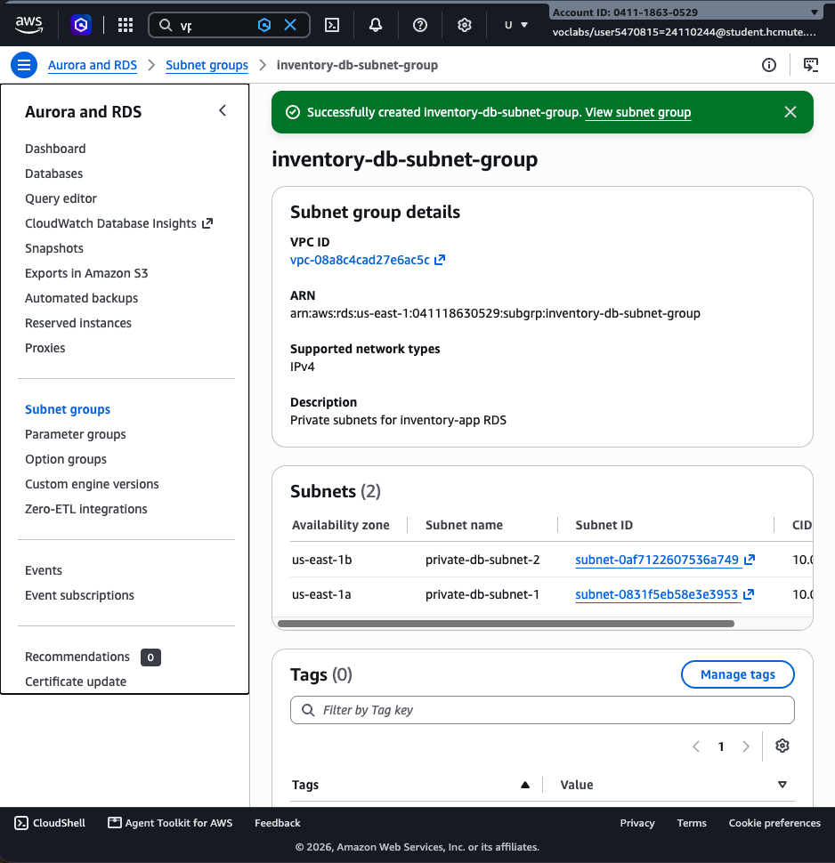

### 3.2. Rà soát Route Tables

Nhóm đã kiểm tra Route Tables liên quan đến hai private subnets để rà soát việc liên kết subnet và định tuyến mạng theo thiết kế. Thông tin bàn giao xác nhận việc rà soát đã được thực hiện, nhưng không kèm Route Table ID hoặc chi tiết từng route. Vì vậy, báo cáo không ghi nhận các giá trị route cụ thể khi chưa có cấu hình hoặc ảnh chụp đối chiếu.

**Hình 2. Route Tables của các private subnets**

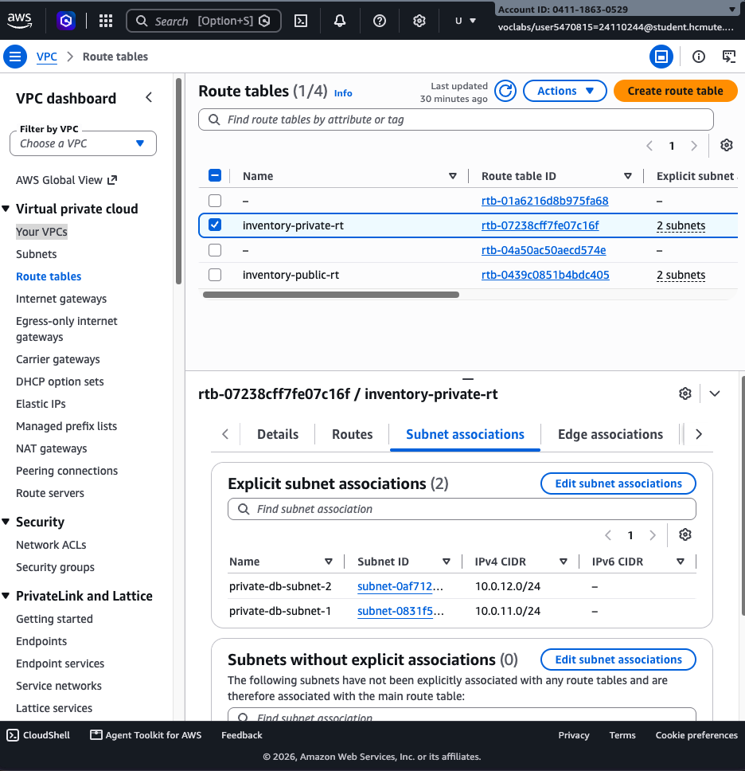

### 3.3. Rà soát `inventory-db-sg`

Nhóm đã rà soát quy tắc bảo mật của `inventory-db-sg` theo phạm vi công việc. Thông tin bàn giao chưa bao gồm chi tiết các rule inbound/outbound, protocol, port hoặc source thực tế; các giá trị này cần được đối chiếu với cấu hình AWS khi bổ sung minh chứng.

**Hình 3. Quy tắc bảo mật của `inventory-db-sg`**

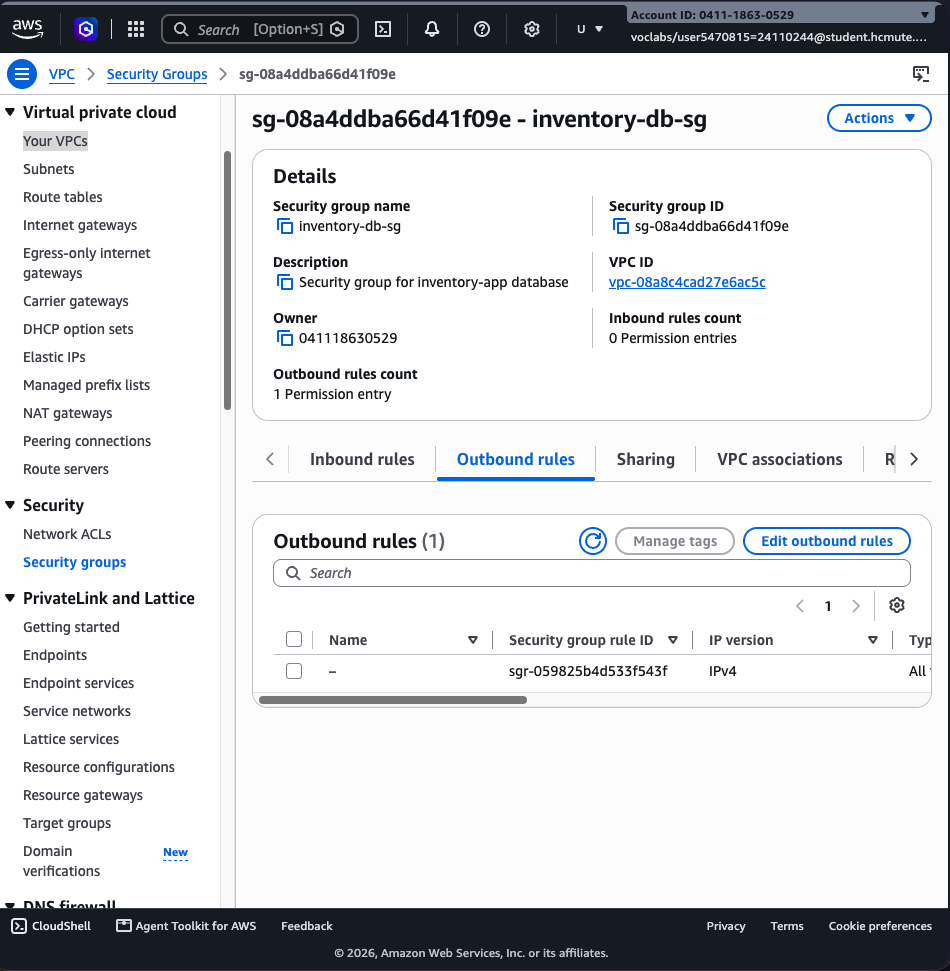

### 3.4. Thiết lập AWS Elastic Beanstalk

Nhóm đã tạo Elastic Beanstalk Application `inventory-app` và Environment ban đầu `inventory-env` trong VPC `inventory-vpc`. Environment này dùng Python 3.14 trên Amazon Linux 2023 và **Sample application** để kiểm tra khởi tạo; đây chưa phải ứng dụng của nhóm. Khi deploy ứng dụng, bước cài dependencies thất bại do `psycopg2-binary==2.9.9` không build được trên Python 3.14 trong môi trường Beanstalk. Nhóm chuyển sang tạo Environment mới `inventory-env-py312` sử dụng Python 3.12 trên Amazon Linux 2023 và triển khai source bundle của ứng dụng.

Environment `inventory-env-py312` khởi chạy thành công với Health `Ok` (Green), Running version `1.0`, và domain `inventory-env-py312.eba-vbehyxmh.us-east-1.elasticbeanstalk.com`. Environment chạy trong `inventory-vpc`, dùng Single instance, public subnets và public IP để phục vụ HTTP. Cấu hình quyền sử dụng Service role `LabRole` và EC2 Instance Profile `LabInstanceProfile`; EC2 được gắn `inventory-web-sg`. Security Group của RDS cho phép PostgreSQL TCP/5432 từ `inventory-web-sg`, không mở cổng database cho toàn Internet.

Ảnh minh chứng hạ tầng ban đầu:

**Hình 4. Environment `inventory-env` khởi chạy thành công**

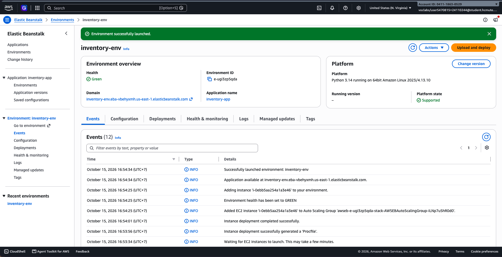

**Hình 5. Cấu hình mạng của Elastic Beanstalk Environment**

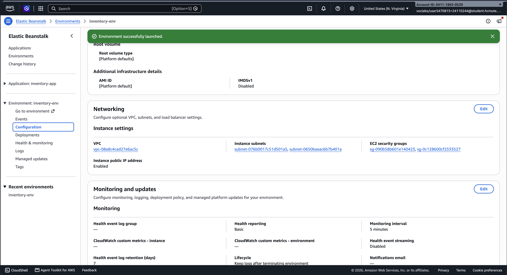

**Hình 6. Chi tiết EC2 instance do Elastic Beanstalk quản lý**

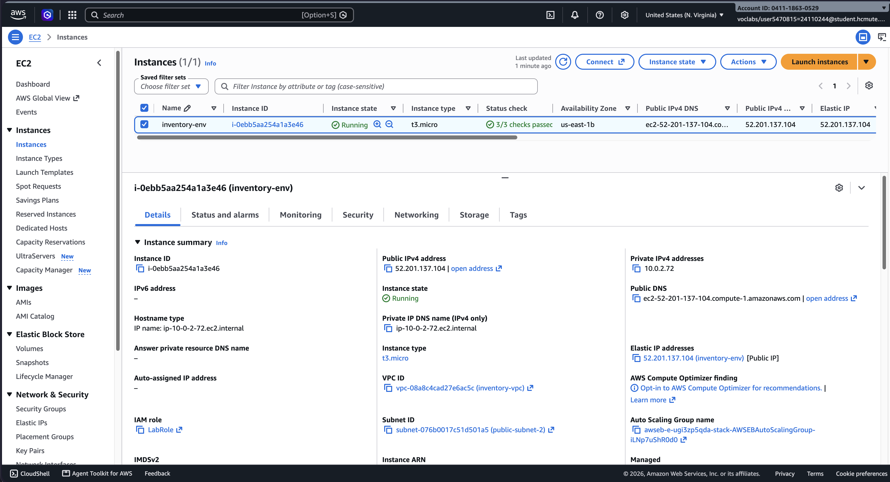

**Hình 7. IAM role, Security Groups và inbound rules của EC2 instance**

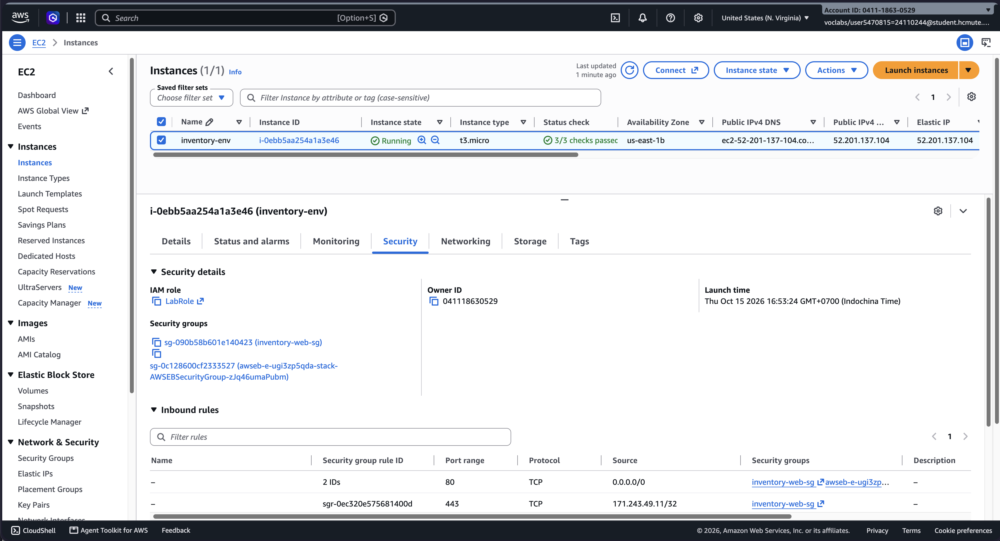

### 3.5. Cấu hình kết nối và khởi tạo cấu trúc CSDL trên Amazon RDS

Theo thông tin triển khai được cung cấp, Amazon RDS PostgreSQL `inventory-db` đã được tạo trong Region `us-east-1`. Endpoint được bàn giao cho SV1 để cấu hình ứng dụng Web. Các thông số kết nối hiện có được tổng hợp trong bảng sau:

| Thông số | Giá trị |
| :--- | :--- |
| DB instance | `inventory-db` |
| Endpoint (`DB_HOST`) | `inventory-db.c92a24squlld.us-east-1.rds.amazonaws.com` |
| Port (`DB_PORT`) | `5432` |
| Database (`DB_NAME`) | `inventory_db` |
| Username (`DB_USER`) | `postgres` |
| Password (`DB_PASSWORD`) | Được quản lý riêng, không ghi trong báo cáo |

Schema PostgreSQL tại [schema.sql](../../database/schema.sql) định nghĩa hai bảng `products` và `transactions`, cùng các index hỗ trợ truy vấn. Script [init_db.py](../../init_db.py) được chuẩn bị để đọc schema và kết nối bằng các biến môi trường; script ưu tiên `DB_PASSWORD` và vẫn hỗ trợ `DB_PASS` để tương thích với cấu hình cũ.

Schema đã được thực thi từ EC2 `inventory-env` tới RDS bằng kết nối PostgreSQL có xác thực SSL (`sslmode=verify-full`). Kết quả thực thi cho thấy các câu lệnh tạo bảng và index hoàn tất. Khi chạy lại schema để kiểm tra, PostgreSQL trả về thông báo các quan hệ đã tồn tại và bỏ qua thao tác tạo trùng; đây là hành vi mong đợi do schema sử dụng `IF NOT EXISTS`.

Sau đó, nhóm truy vấn `information_schema.tables` và nhận được hai kết quả `products` và `transactions` trong schema `public`. Như vậy, việc tạo cấu trúc hai bảng trên database `inventory_db` đã được xác minh. Schema chỉ tạo bảng và index, không chèn dữ liệu sản phẩm mẫu. Ảnh chụp terminal ghi nhận lệnh thực thi và kết quả truy vấn được dùng làm minh chứng cho bước này.

**Hình 8. Kết quả khởi tạo schema và xác minh hai bảng trên RDS**

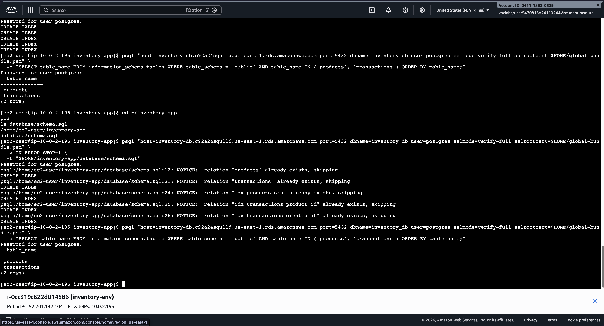

### 3.6. Triển khai ứng dụng và kiểm thử tích hợp

Nhóm đóng gói source bundle gồm `app.py`, `init_db.py`, `database/`, `templates/`, `requirements.txt` và `Procfile`, sau đó triển khai lên `inventory-env-py312`. Environment sử dụng biến môi trường để kết nối RDS; mật khẩu không được ghi trong báo cáo. Ứng dụng chạy qua Gunicorn theo `Procfile`.

Sau triển khai, trang Inventory App tải thành công và hiển thị sản phẩm kiểm thử `test` lấy từ kho dữ liệu. Nhóm thao tác nhập/xuất trên giao diện và kiểm tra dữ liệu tồn kho được cập nhật. Ảnh chụp giao diện ghi nhận một sản phẩm với số lượng tồn là 10 tại thời điểm chụp.

Nhóm kiểm tra endpoint `GET /api/products` trên domain Beanstalk. API trả HTTP `200 OK` và JSON chứa sản phẩm `test`; phản hồi tại thời điểm chụp ghi nhận số lượng là 11. Khác biệt số lượng giữa hai ảnh phản ánh thời điểm chụp sau các thao tác kiểm thử; cả hai minh chứng đều cho thấy ứng dụng đọc dữ liệu sản phẩm từ database.

**Hình 9. Environment `inventory-env-py312` hoạt động với Health `Ok`**

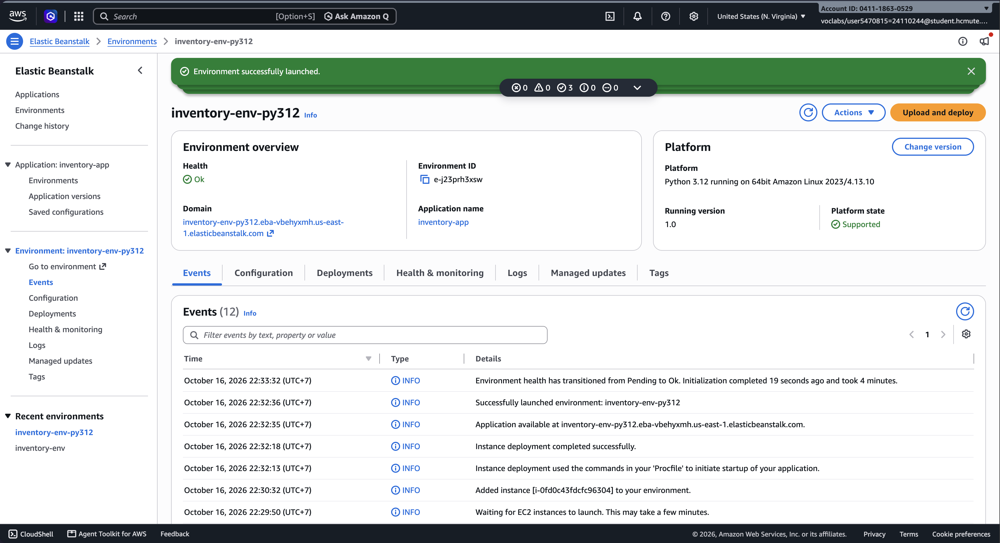

**Hình 10. Giao diện Inventory App hiển thị dữ liệu sản phẩm từ kho**

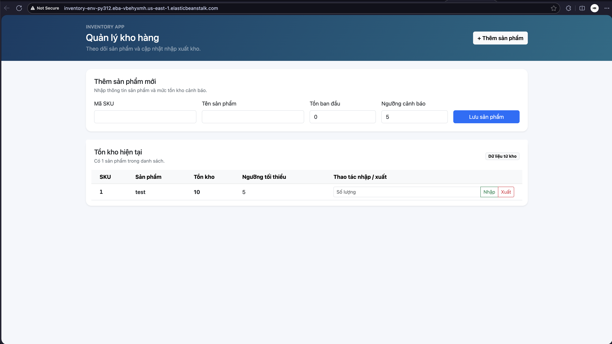

**Hình 11. Kiểm thử API `GET /api/products` trả HTTP 200**

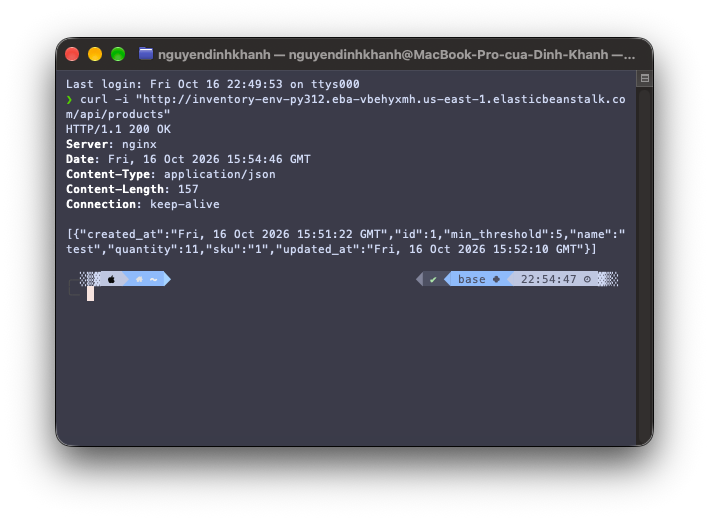

---

## 4. KẾT QUẢ VÀ MINH CHỨNG

| Hạng mục | Kết quả | Minh chứng |
| :--- | :--- | :--- |
| `inventory-db-subnet-group` | Đã tạo thành công với hai private subnets thuộc `us-east-1a` và `us-east-1b`; sẵn sàng cung cấp hạ tầng mạng cho RDS. | Hình 1: `screenshots/11_rds_subnet_group.png`. |
| Amazon RDS `inventory-db` | RDS PostgreSQL đã được tạo; endpoint, port, database và username được tổng hợp tại Mục 3.5. | Endpoint được nhóm cung cấp; schema và hai bảng được xác minh trong Hình 8. |
| Khởi tạo schema trên RDS | Đã thực thi schema trên `inventory_db`; truy vấn xác nhận có đủ hai bảng `products` và `transactions` trong schema `public`. Chạy lại schema không tạo trùng bảng/index do có `IF NOT EXISTS`. | Hình 8: `screenshots/19_rds_tables_created.png`. |
| Route Tables | Đã rà soát theo yêu cầu công việc. | Hình 2: `screenshots/12_private_route_tables.png`. |
| `inventory-db-sg` | Đã rà soát theo yêu cầu công việc. | Hình 3: `screenshots/13_inventory_db_sg.png`. |
| Elastic Beanstalk `inventory-env-py312` | Ứng dụng đã được triển khai trên Python 3.12 / Amazon Linux 2023; Health `Ok` (Green), Running version `1.0`. | Hình 9: `screenshots/20_beanstalk_env_py312_green.png`. |
| Cấu hình VPC, subnet và IAM | Environment ở `inventory-vpc`, public subnets; sử dụng `LabRole`, `LabInstanceProfile` và `inventory-web-sg`. | Hình 5–7: `screenshots/16_beanstalk_networking.png`, `17_beanstalk_ec2_instance.png`, `18_beanstalk_ec2_security.png`. |
| Tích hợp Web với RDS | Giao diện tải và hiển thị sản phẩm kiểm thử; dữ liệu được đọc từ kho dữ liệu. | Hình 10: `screenshots/21_inventory_web_rds_integration.png`. |
| Kiểm thử REST API | `GET /api/products` trả HTTP `200 OK` và JSON sản phẩm. | Hình 11: `screenshots/22_api_products_test.png`. |

---

## 5. KHAI BÁO SỬ DỤNG TRỢ LÝ AI

- **Công cụ và model:** Trợ lý AI trong cuộc trao đổi này được sử dụng để biên soạn và rà soát nội dung báo cáo. Model cụ thể không được xác định trong thông tin phiên làm việc. AWS Console và AWS CLI là công cụ kỹ thuật, không phải công cụ AI.
- **Phạm vi hỗ trợ:** Hỗ trợ biên tập nội dung báo cáo về hạ tầng mạng, Amazon RDS, Elastic Beanstalk, triển khai ứng dụng và kiểm thử tích hợp; cập nhật script khởi tạo schema để ưu tiên biến `DB_PASSWORD`.
- **Nội dung được hỗ trợ biên soạn:** Cấu trúc lại báo cáo theo các phần mục tiêu, thiết kế mạng, công việc đã thực hiện, kết quả/minh chứng và kết luận.
- **Kiểm chứng:** AI không truy cập AWS account và không trực tiếp tạo hoặc thay đổi tài nguyên AWS. Việc chạy schema, triển khai Environment và kiểm thử ứng dụng do nhóm thực hiện; báo cáo dựa trên kết quả và ảnh minh chứng được lưu trong repository.
- **Minh chứng tham chiếu:** [Nhật ký công việc tuần 2](../../logs/week2.md).

---

## 6. KẾT LUẬN

Trong tuần 2, nhóm đã chuẩn bị DB Subnet Group và Security Group cho tầng dữ liệu, tạo RDS PostgreSQL `inventory-db`, thực thi schema và xác nhận hai bảng `products`, `transactions`. Ứng dụng Flask đã được triển khai trên Elastic Beanstalk Environment `inventory-env-py312` dùng Python 3.12; Environment đạt Health `Ok` (Green). Kiểm thử giao diện xác nhận sản phẩm được hiển thị từ database; API `GET /api/products` trả `200 OK` cùng dữ liệu JSON. Các minh chứng tương ứng được trình bày tại Hình 8–11. Environment ban đầu `inventory-env` đã dùng Sample application và không phải Environment đang chạy ứng dụng Flask.


---

## 7. CÔNG VIỆC ĐƯỢC GIAO VÀ QUÁ TRÌNH THỰC HIỆN – VÕ MINH QUÂN
### 7.1. Thứ Tư – Chuẩn bị hạ tầng mạng cho cơ sở dữ liệu

**Thời gian theo phân công:** 20:00–23:00, 3 giờ.

**Công việc được giao:** Tạo DB Subnet Group từ hai private subnets thuộc hai Availability Zones; rà soát Route Tables và Security Group của tầng database.

#### a. Kiểm tra hai private subnets

Trong AWS VPC Console, em kiểm tra các subnet của `inventory-vpc`, ID `vpc-08899e1e1656f5f73`. Hai subnet được lựa chọn cho tầng database có thông tin:

| Tên subnet | Subnet ID | CIDR | Availability Zone |
| :--- | :--- | :--- | :--- |
| `private-db-subnet-1` | `subnet-0dd54ddbccaf6c278` | `10.0.11.0/24` | `us-east-1a` |
| `private-db-subnet-2` | `subnet-0f9fd779d37829d6e` | `10.0.12.0/24` | `us-east-1b` |

Cả hai subnet ở trạng thái Available, thuộc cùng VPC và có Auto-assign public IPv4 address là No. Hai trang chi tiết cùng hiển thị Route Table `inventory-private-rt`, ID `rtb-0116fecc27360c7f6`.

**Minh chứng subnet thứ nhất:**

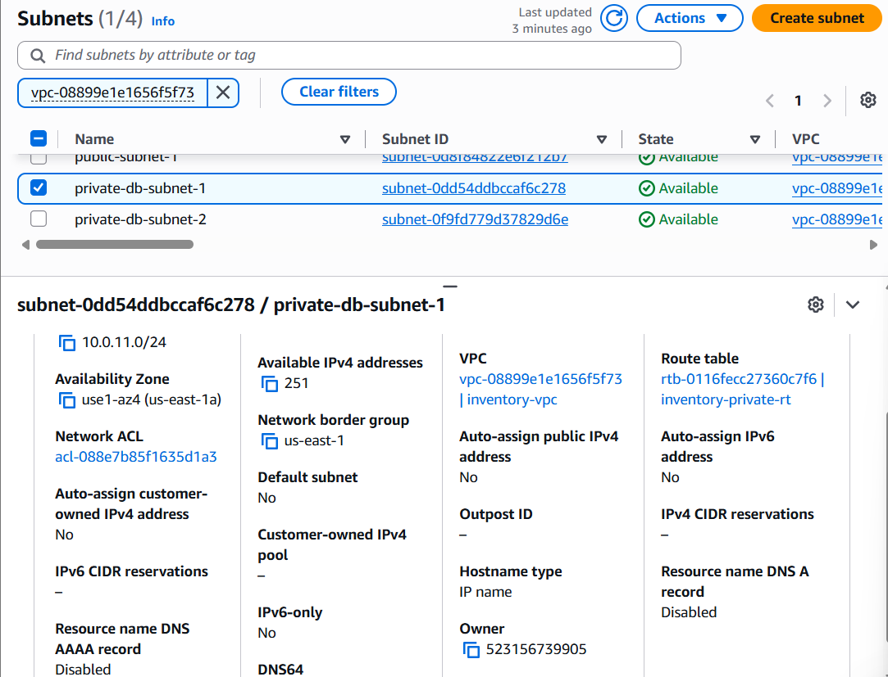

**Minh chứng subnet thứ hai:**

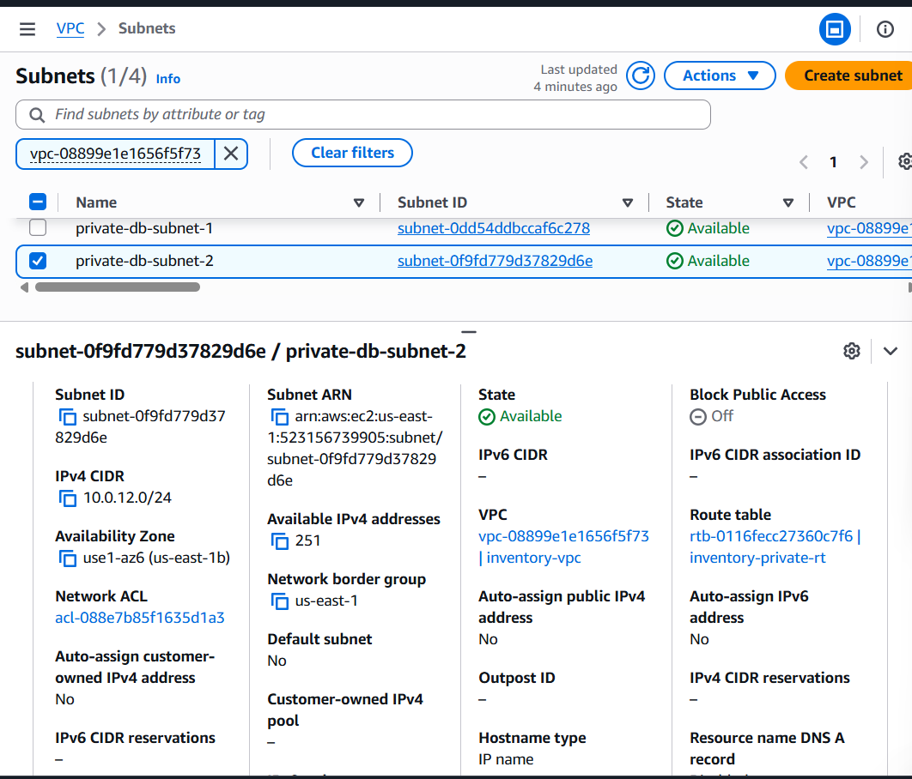

#### b. Tạo DB Subnet Group

Em tạo `inventory-db-subnet-group` trong VPC dự án, mô tả `Private subnet group for inventory database`, và chọn đúng hai subnet nêu trên. Sau khi tạo, danh sách hiển thị trạng thái Complete; trang chi tiết xác nhận đủ hai subnet ở `us-east-1a` và `us-east-1b`.

DB Subnet Group chuẩn bị lựa chọn mạng cho RDS. Việc có hai AZ trong nhóm không đồng nghĩa đã bật Multi-AZ cho database; RDS thực tế trong lần triển khai này sử dụng Single-AZ.

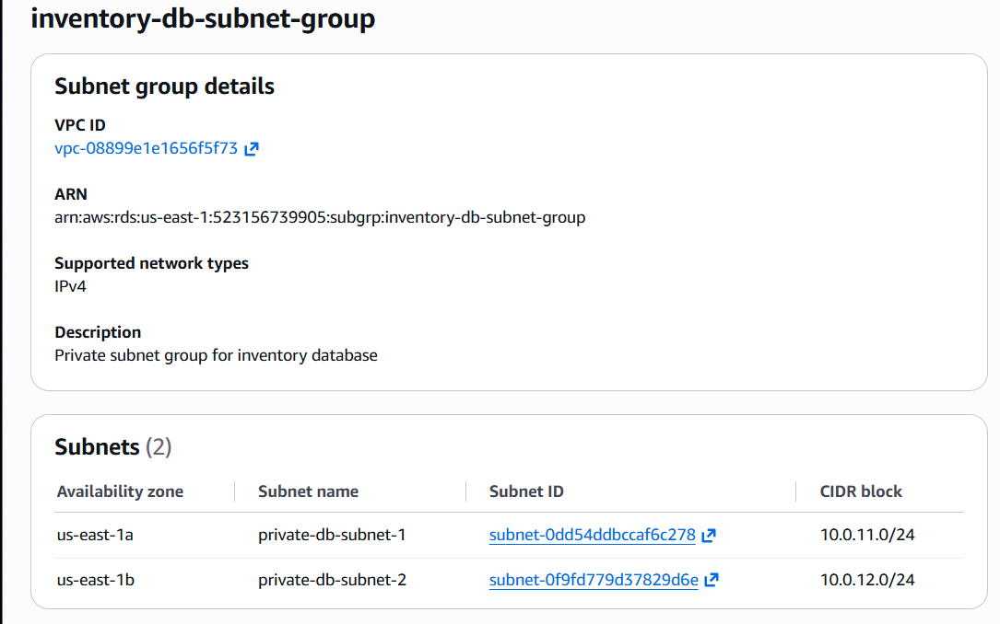

#### c. Kiểm tra Route Table

Em rà soát bảng định tuyến `inventory-private-rt`. Ảnh Routes ghi nhận một route `10.0.0.0/16` có Target `local`, Status Active và không có route mặc định `0.0.0.0/0` trong bảng được chụp. Hai trang chi tiết subnet ở trên cho thấy chúng sử dụng cùng Route Table này.

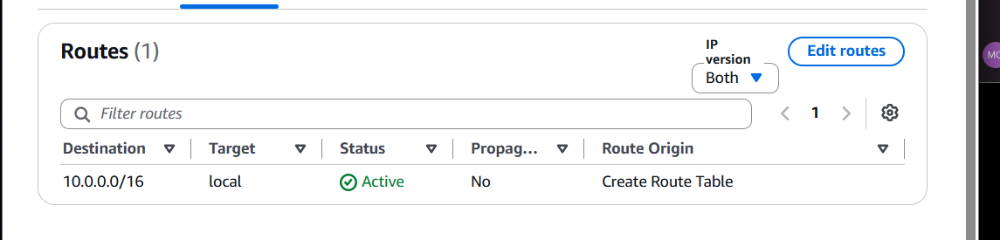

#### d. Kiểm tra Security Group database

Security Group `inventory-db-sg`, ID `sg-0f5e8348f198a9f97`, thuộc VPC dự án. Inbound rules có một quy tắc PostgreSQL TCP/5432 với Source là Security Group `inventory-web-sg`, ID `sg-0bb46c5bb3bba364b`. Ảnh không ghi nhận rule mở cổng PostgreSQL cho toàn Internet.

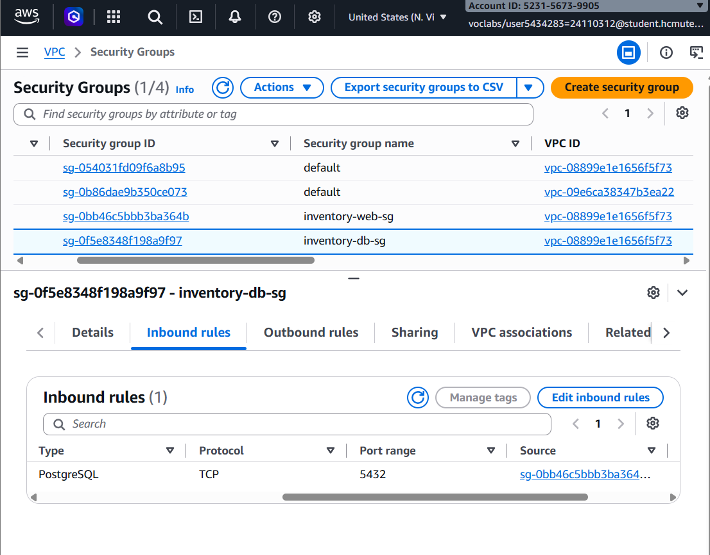

**Kết quả thứ Tư:** Đã chuẩn bị DB Subnet Group, đối chiếu hai subnet, kiểm tra route nội bộ và quy tắc cho phép tầng Web kết nối PostgreSQL.

### 7.2. Thứ Năm – Khởi tạo Amazon RDS PostgreSQL

**Thời gian theo phân công:** 13:30–16:30, 3 giờ.

**Công việc được giao:** Tạo RDS PostgreSQL trong mạng riêng, gắn Security Group phù hợp và kiểm tra cấu hình tài nguyên.

Em sử dụng Full configuration, chọn PostgreSQL và tạo instance `inventory-db`. Phiên bản thực tế hiển thị sau khi tạo là 18.3, khác phiên bản 15/16 dự kiến trong nhật ký. Báo cáo ghi nhận phiên bản thực tế, không sử dụng thông số dự kiến thay cho kết quả triển khai.

| Thuộc tính | Cấu hình thực tế |
| :--- | :--- |
| DB instance identifier | `inventory-db` |
| Engine / version | PostgreSQL 18.3 |
| Instance class | `db.t3.micro` |
| Storage | General Purpose SSD (gp3), 20 GiB |
| Multi-AZ | No |
| Availability Zone | `us-east-1b` |
| VPC | `inventory-vpc` |
| DB Subnet Group | `inventory-db-subnet-group` |
| VPC Security Group | `inventory-db-sg` |
| Publicly accessible | No |
| Port | `5432` |
| Master username | `postgres` |
| Storage encryption | Enabled |
| Storage autoscaling sau điều chỉnh | Disabled, theo xác nhận kiểm tra lại của sinh viên |

Sau quá trình tạo và sao lưu ban đầu, RDS chuyển sang trạng thái Available. Em kiểm tra phần Connectivity & security để xác nhận đúng VPC, subnet group, Security Group và không bật public access.


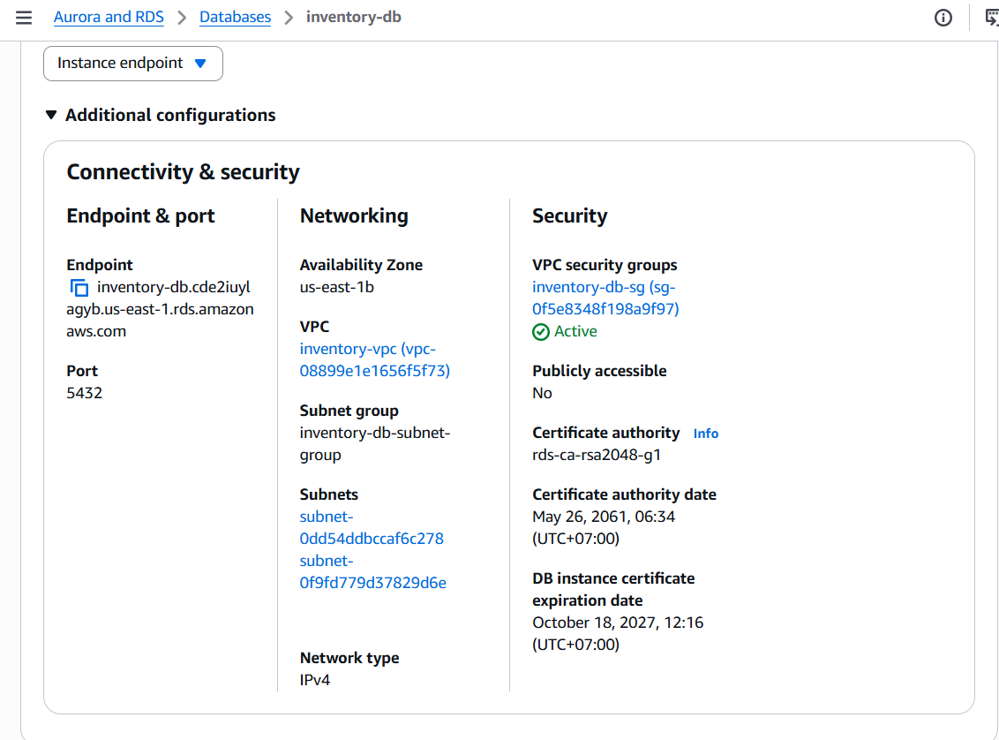

Ban đầu Storage autoscaling được bật với giới hạn 1000 GiB. Em thực hiện Modify, chuyển Enable storage autoscaling từ Yes sang No và chọn Apply immediately. Khi kiểm tra lại, mục này hiển thị Disabled. Đây là thay đổi cấu hình autoscaling, không phải giảm dung lượng đang cấp phát.

Ở trang Configuration, DB name ban đầu hiển thị dấu `-`. Vì vậy, database `inventory_db` được tạo bằng SQL trong bước thứ Sáu, không tạo lại RDS instance.

**Kết quả thứ Năm:** RDS PostgreSQL đã sẵn sàng, có cấu hình mạng riêng phù hợp với thiết kế và dung lượng cấp phát 20 GiB.

### 7.3. Thứ Sáu – Khởi tạo database, schema và bàn giao kết nối

**Thời gian theo phân công:** 08:30–11:30, 3 giờ.

**Công việc được giao:** Thực thi schema tạo hai bảng và cung cấp thông số kết nối cho Nguyễn Đình Khanh.

#### a. Chuẩn bị máy kết nối trong VPC

Do danh sách EC2 trong tài khoản đang sử dụng chưa có instance, em tạo `inventory-db-setup` để thực hiện công việc quản trị database. Máy sử dụng Amazon Linux 2023, được cấu hình public subnet trong VPC dự án, gắn `inventory-web-sg` và `LabInstanceProfile`. Em mở terminal bằng Session Manager và cài PostgreSQL client:

```bash
sudo dnf install -y postgresql15
psql --version
```

Terminal xác nhận psql 15.19. Khi kết nối tới PostgreSQL server 18.3, client đưa ra cảnh báo khác major version; các lệnh SQL tạo database, schema và truy vấn xác minh trong lần thực hiện vẫn thành công.

#### b. Kết nối RDS và tạo database

Em tải chứng chỉ CA từ AWS và kết nối bằng `sslmode=verify-full`:

```bash
cd ~
curl -fLo global-bundle.pem https://truststore.pki.rds.amazonaws.com/global/global-bundle.pem
psql "host=inventory-db.cde2iuylagyb.us-east-1.rds.amazonaws.com port=5432 dbname=postgres user=postgres sslmode=verify-full sslrootcert=$HOME/global-bundle.pem connect_timeout=15" -W
```

Mật khẩu được nhập tương tác, không đưa vào lệnh hoặc repository. Terminal ghi nhận kết nối SSL sử dụng TLS 1.3. Truy vấn kiểm tra ban đầu không tìm thấy `inventory_db`, sau đó em thực hiện:

```sql
CREATE DATABASE inventory_db;
\connect inventory_db
SELECT current_database(), current_user;
```

Kết quả xác nhận database hiện tại là `inventory_db`, user là `postgres`.

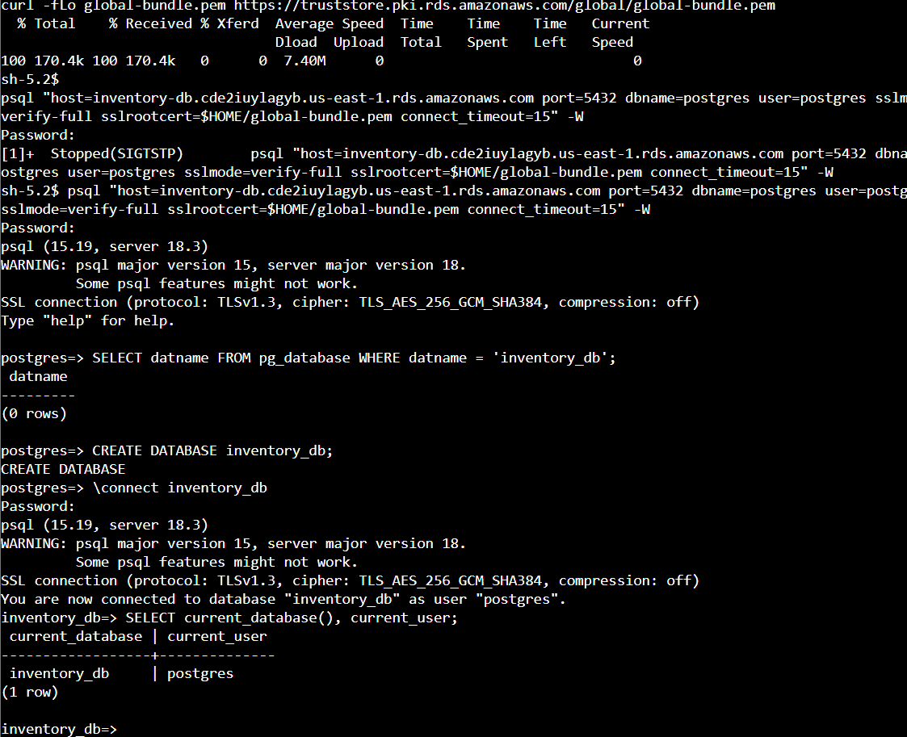

#### c. Thực thi schema và xác minh bảng

Em tải `database/schema.sql` từ repository, đọc nội dung trước khi thực thi và chạy với tùy chọn dừng khi có lỗi, gói thao tác trong một transaction:

```bash
curl -fLo schema.sql https://raw.githubusercontent.com/qilskcter/inventory-app/main/database/schema.sql
cat schema.sql
psql "host=inventory-db.cde2iuylagyb.us-east-1.rds.amazonaws.com port=5432 dbname=inventory_db user=postgres sslmode=verify-full sslrootcert=$HOME/global-bundle.pem connect_timeout=15" -W -v ON_ERROR_STOP=1 --single-transaction -f schema.sql
```

Terminal trả về hai dòng CREATE TABLE và ba dòng CREATE INDEX. Schema định nghĩa bảng `products` lưu sản phẩm và bảng `transactions` lưu giao dịch nhập/xuất; `transactions.product_id` tham chiếu `products.id`. Các index được tạo gồm `idx_products_sku`, `idx_transactions_product_id`, `idx_transactions_created_at`.

Em truy vấn xác minh:

```sql
SELECT current_database(), table_name
FROM information_schema.tables
WHERE table_schema = 'public'
ORDER BY table_name;
```

Kết quả trả về đúng hai dòng `inventory_db | products` và `inventory_db | transactions`.

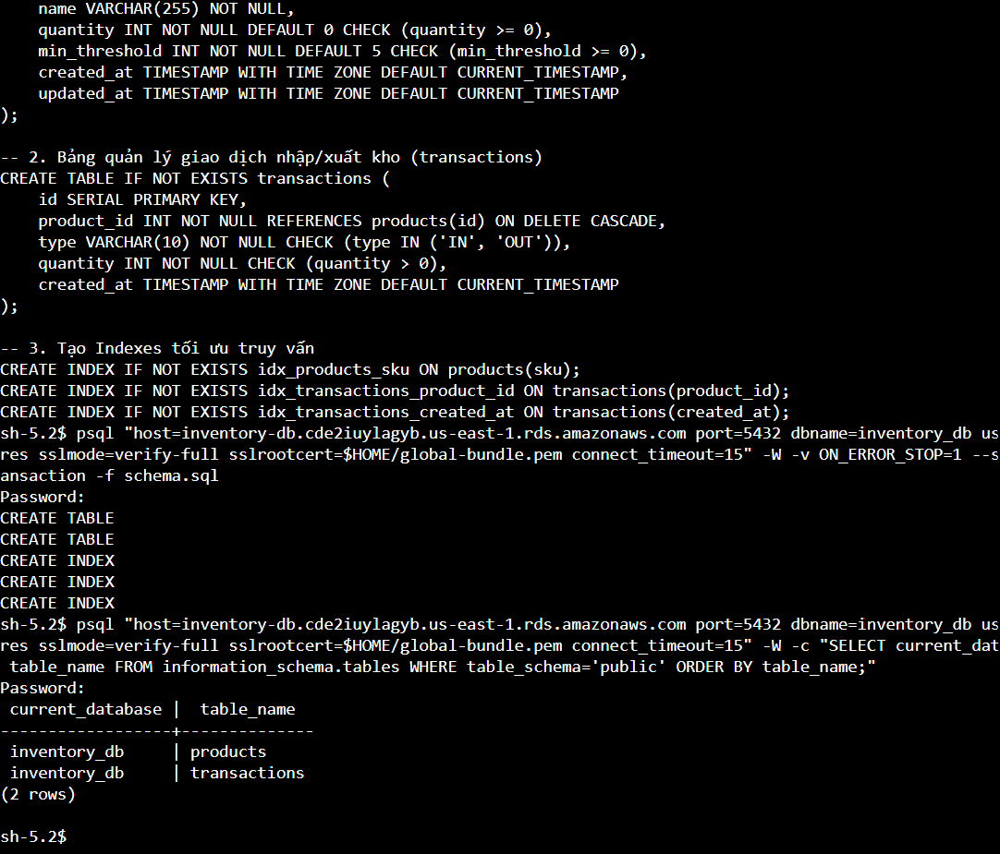

Schema chỉ tạo bảng và index, chưa chèn sản phẩm mẫu. Không ghi nhận đã seed dữ liệu hoặc hoàn tất tích hợp Web với RDS mới từ kết quả này.

#### d. Bàn giao cho thành viên phụ trách ứng dụng

Em đã xác nhận bàn giao cho Nguyễn Đình Khanh các thông số:

| Biến môi trường | Giá trị |
| :--- | :--- |
| `DB_HOST` | `inventory-db.cde2iuylagyb.us-east-1.rds.amazonaws.com` |
| `DB_PORT` | `5432` |
| `DB_NAME` | `inventory_db` |
| `DB_USER` | `postgres` |
| `DB_PASSWORD` | Quản lý và trao đổi riêng, không ghi trong báo cáo |

Thông tin tài khoản, Region và VPC cũng được cung cấp để đối chiếu mạng của ứng dụng trước khi kết nối. RDS mới khác Endpoint cũ được ghi trong phần báo cáo triển khai trước đó; kết quả hoạt động của Web ở Endpoint cũ không được dùng để xác nhận ứng dụng đã kết nối RDS mới.

**Kết quả thứ Sáu:** Đã tạo database, hai bảng, ba index; xác minh bằng SQL và bàn giao thông số kết nối. Việc ứng dụng sử dụng thành công kết nối mới cần được xác minh trong bước phối hợp tích hợp.

### 7.4. Thứ Bảy – Kiểm tra truy cập mạng và giám sát tài nguyên

**Thời gian theo phân công:** 14:00–16:30, 2,5 giờ.

**Công việc được giao:** Kiểm tra tính cô lập mạng của RDS và theo dõi CPU, dung lượng trống, số kết nối.

#### a. Theo dõi CloudWatch Metrics

Em mở RDS Monitoring, quan sát các biểu đồ của `inventory-db`. Trong khoảng thời gian hiển thị trên ảnh:

- CPUUtilization có điểm đầu khoảng 24%, sau đó chủ yếu khoảng 4–6%.
- DatabaseConnections ghi nhận hoạt động kết nối trong khoảng theo dõi. Giá trị trên biểu đồ là giá trị thống kê theo khoảng lấy mẫu; không diễn giải giá trị thập phân thành số phiên kết nối tức thời.
- FreeStorageSpace giảm từ khoảng 20,61 tỷ byte xuống khoảng 20 tỷ byte. Đây là đơn vị byte hiển thị trên biểu đồ, không phải 20 GiB.

Các kết quả chỉ mô tả khoảng quan sát, chưa đủ để kết luận hiệu năng dài hạn hoặc nguyên nhân biến động dung lượng.

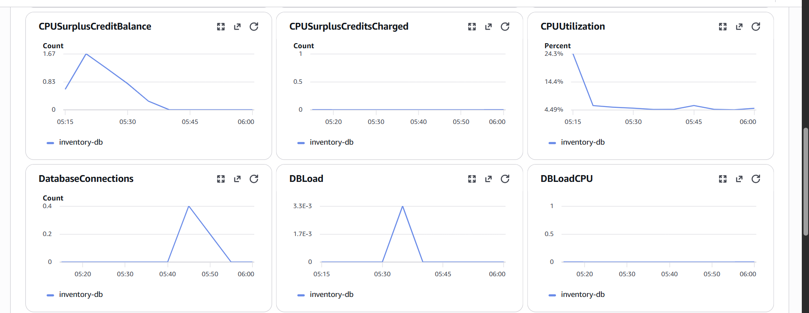

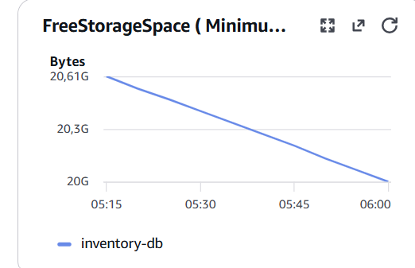

#### b. Kiểm thử kết nối từ máy cá nhân

Trên Windows PowerShell của máy cá nhân, em chạy:

```powershell
Test-NetConnection -ComputerName "inventory-db.cde2iuylagyb.us-east-1.rds.amazonaws.com" -Port 5432
```

Kết quả Endpoint phân giải thành IP riêng `10.0.12.160`, RemotePort là 5432, TcpTestSucceeded là False. Kết nối TCP từ máy cá nhân trong lần thử không thành công; Ping cũng timeout nhưng không được dùng riêng để kết luận khả năng truy cập PostgreSQL.

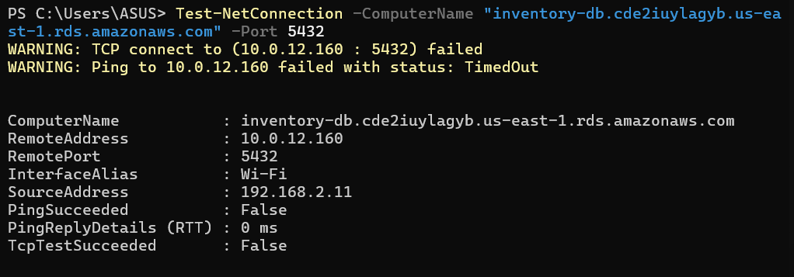

Kết hợp với cấu hình Publicly accessible: No, inbound rule từ `inventory-web-sg` và kết nối SQL thành công từ EC2 gắn Security Group đó, kết quả phù hợp với thiết kế truy cập database trong mạng riêng. Không suy rộng một lần kiểm thử thành khẳng định đã kiểm tra mọi nguồn trên Internet.

**Kết quả thứ Bảy:** Đã theo dõi đủ ba Metrics, ghi nhận kết nối thành công từ EC2 được cấp quyền và kết nối thất bại từ máy cá nhân ngoài VPC.

### 7.5. Chủ nhật – Kiểm tra Tags, tổng hợp minh chứng và quản lý tài nguyên

**Thời gian theo phân công:** 09:00–11:30, 2,5 giờ.

**Công việc được giao:** Hoàn thiện ảnh minh chứng, rà soát Tags, viết báo cáo hạ tầng và dừng RDS khi không sử dụng.

Em kiểm tra RDS `inventory-db` có đủ hai Tags `Project=inventory-app` và `Owner=Khanh-Quan`.

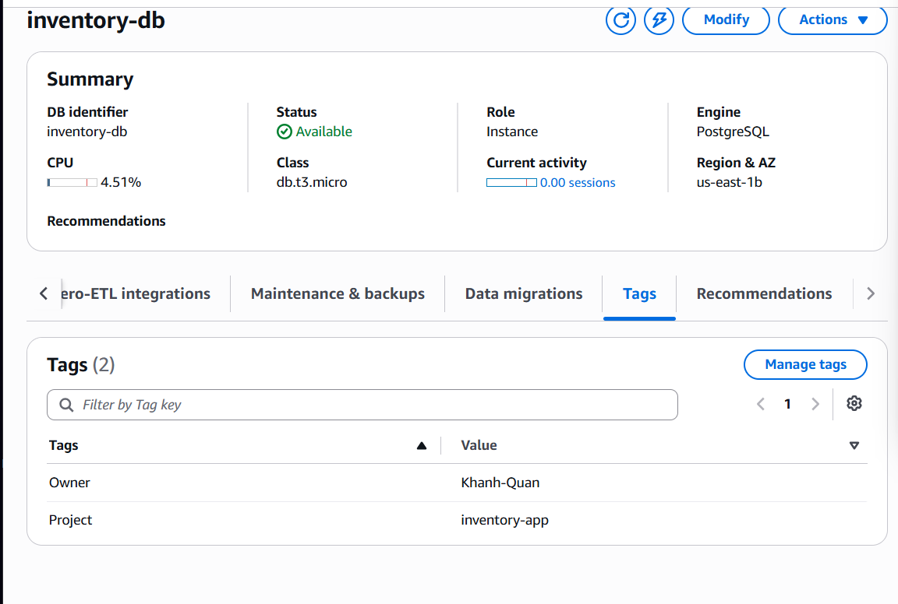

DB Subnet Group ban đầu chưa có Tags. Em bổ sung hai Tags tương tự; Console hiển thị Tags modified successfully và danh sách hai giá trị đúng.

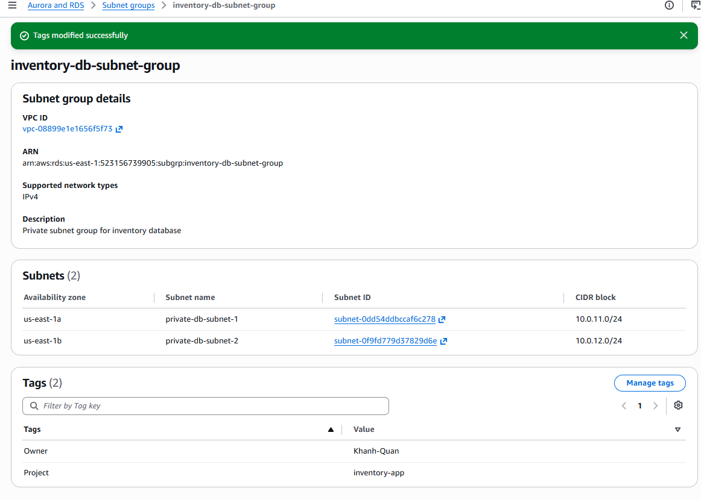

Em kiểm tra lại Storage autoscaling và xác nhận Disabled. Các ảnh được tổng hợp theo từng công việc để chuẩn bị cập nhật vào `documents/week_2/screenshots/` và dẫn trong báo cáo.

**Trạng thái còn lại:** Chưa có xác nhận đã dừng RDS hoặc EC2 `inventory-db-setup`; cần phối hợp với Khanh để kết thúc sử dụng trước khi dừng. Chưa xác nhận toàn bộ ảnh và báo cáo mới đã được commit lên GitHub. Không đánh dấu hoàn thành hai nội dung này khi chưa thực hiện.

---

## 8. KẾT QUẢ VÀ MINH CHỨNG CỦA VÕ MINH QUÂN

| Ngày | Kết quả | Tên ảnh minh chứng |
| :--- | :--- | :--- |
| Thứ Tư | Kiểm tra hai private subnets thuộc cùng VPC, khác AZ. | `23_private_db_subnet_1.png`, `24_private_db_subnet_2.png` |
| Thứ Tư | Tạo DB Subnet Group gồm đủ hai subnet. | `25_rds_subnet_group.png` |
| Thứ Tư | Rà soát route nội bộ và inbound PostgreSQL từ Web SG. | `26_private_route_table.png`, `27_inventory_db_sg.png` |
| Thứ Năm | Tạo RDS Available, đúng mạng riêng, port 5432. | `28_rds_available.png`, `29_rds_connectivity_security.png` |
| Thứ Sáu | Tạo và kết nối `inventory_db` qua SSL. | `31_rds_database_connection.png` |
| Thứ Sáu | Tạo hai bảng, ba index; truy vấn xác nhận hai bảng. | `32_rds_tables_created.png` |
| Thứ Sáu | Đã bàn giao kết nối cho Khanh theo xác nhận của sinh viên. | Ghi nhận bàn giao trong mục 7.3; không công khai mật khẩu. |
| Thứ Bảy | Theo dõi CPU, kết nối và dung lượng trống. | `33_rds_cpu_connections.png`, `34_rds_free_storage_space.png` |
| Thứ Bảy | Kiểm thử từ máy cá nhân trả TcpTestSucceeded: False. | `35_rds_external_connection_test.png` |
| Chủ nhật | Kiểm tra Tags RDS và bổ sung Tags Subnet Group. | `36_rds_tags.png`, `37_rds_subnet_group_tags.png` |
| Chủ nhật | Đã xác nhận autoscaling Disabled. | Xác nhận kiểm tra lại của sinh viên; chưa có ảnh sau điều chỉnh trong bộ minh chứng trao đổi. |


**Quy ước lưu ảnh:** Các đường dẫn trên tính từ vị trí báo cáo `documents/week_2/week2.md`. Cần lưu ảnh đúng tên vào `documents/week_2/screenshots/`. Tên ảnh giữ theo các lần hướng dẫn và ảnh đã trao đổi; không sử dụng ảnh triển khai cũ của Khanh để thay minh chứng RDS mới của Quân.

---

## 9. KHAI BÁO SỬ DỤNG TRỢ LÝ AI 

- **Công cụ:** Gemini 3.6 Flash
- **Phạm vi hỗ trợ:** Hướng dẫn kiểm tra subnet, tạo DB Subnet Group, rà soát Route Table và Security Group, tạo RDS, cấu hình EC2 quản trị, kết nối PostgreSQL, thực thi schema, xem Metrics và bổ sung Tags.
- **Hỗ trợ lệnh và tài liệu:** Gợi ý các lệnh `psql`, `curl`, truy vấn xác minh bảng và `Test-NetConnection`; hướng dẫn chọn ảnh minh chứng và tổng hợp báo cáo theo nhật ký.
- **Cách kiểm chứng:** Sinh viên trực tiếp thao tác trong AWS Console và terminal, thực thi lệnh và cung cấp ảnh kết quả. Việc xác nhận tạo database, bảng và index dựa trên đầu ra PostgreSQL; kiểm tra cấu hình và giám sát dựa trên ảnh AWS Console.
- **Giới hạn:** AI không trực tiếp truy cập tài khoản AWS hoặc thực hiện các thay đổi tài nguyên trong phiên hướng dẫn. Chưa xác minh ứng dụng của Khanh đã kết nối RDS mới; chưa xác nhận đã dừng tài nguyên. Những nội dung này không được ghi là hoàn thành.
- **Thông tin nhạy cảm:** Mật khẩu RDS không được ghi trong báo cáo, câu lệnh minh họa hoặc repository. Sinh viên chịu trách nhiệm rà soát nội dung và ảnh trước khi nộp.

---

## 10. TỔNG KẾT CỦA VÕ MINH QUÂN

Trong tuần 2, em đã thực hiện phần hạ tầng mạng và cơ sở dữ liệu theo phân công. Em kiểm tra hai private subnets trong VPC dự án, tạo DB Subnet Group trên hai Availability Zones, rà soát Route Table và cấu hình Security Group cho phép PostgreSQL TCP/5432 từ tầng Web.

Em đã tạo RDS PostgreSQL 18.3 với class `db.t3.micro`, storage gp3 20 GiB và không bật truy cập công khai. Từ EC2 quản trị trong VPC, em kết nối RDS qua SSL có xác minh chứng chỉ, tạo `inventory_db`, thực thi schema và xác nhận hai bảng `products`, `transactions` cùng ba index. Sau đó, em bàn giao thông số kết nối cho Nguyễn Đình Khanh để phối hợp cấu hình ứng dụng.

Em đã quan sát CPUUtilization, FreeStorageSpace, DatabaseConnections và kiểm thử truy cập từ máy cá nhân. Kết quả cho thấy EC2 được cấp quyền truy vấn được database, còn lần kiểm tra TCP/5432 từ máy cá nhân không thành công, phù hợp với thiết kế RDS trong mạng riêng. Em cũng hoàn thiện Tags của RDS và DB Subnet Group, đồng thời xác nhận Storage autoscaling đã Disabled.

Qua các công việc này, em hiểu rõ hơn sự khác nhau giữa DB instance và database bên trong PostgreSQL, vai trò của subnet group và Security Group, cách kết nối SSL và cách dùng truy vấn để xác minh kết quả thay vì chỉ dựa vào trạng thái Console.

Các nội dung cần hoàn thiện tiếp là xác minh tích hợp ứng dụng với RDS mới cùng Khanh, cập nhật ảnh và báo cáo lên GitHub, và dừng tài nguyên khi nhóm không còn sử dụng. Em chưa ghi nhận các nội dung này là hoàn tất khi chưa có kết quả xác nhận.

