# BÁO CÁO KỸ THUẬT VÀ KẾT QUẢ TRIỂN KHAI - TUẦN 3
## RÀ SOÁT TÍCH HỢP FLASK - RDS, XUẤT BÁO CÁO S3 PRIVATE VÀ THIẾT KẾ CẢNH BÁO AMAZON SNS

**Dự án:** Hệ thống quản lý kho hàng và cảnh báo tồn kho (`inventory-app`)  
**Môn học:** Điện toán đám mây (Cloud Computing)  
**Sinh viên thực hiện:**
- Nguyễn Đình Khanh (MSSV: `24110244`) - Nhóm trưởng / Backend & Cloud Deployment
- Võ Minh Quân (MSSV: `24110312`) - Thành viên / Database & Infrastructure Setup  
**Giảng viên hướng dẫn:** ThS. Huỳnh Xuân Phụng  
**AWS Region:** `us-east-1` (N. Virginia)

---

> **Phạm vi báo cáo:** Báo cáo ghi nhận kết quả rà soát chi tiết luồng kết nối Flask → Amazon RDS PostgreSQL trên Elastic Beanstalk Environment đang hoạt động (`inventory-env-py312`), kiểm thử toàn diện các endpoint RESTful API sản phẩm và giao dịch kho, kiểm tra cơ chế xử lý lỗi dữ liệu và phản hồi lỗi database tạm thời (HTTP 503 / Retry-After) với ảnh minh chứng thực tế (Hình 1–3). Tài liệu ghi nhận thiết kế và triển khai module xuất báo cáo tồn kho định dạng CSV an toàn (phòng chống CSV Formula Injection, hỗ trợ dữ liệu rỗng) và tích hợp lưu trữ tự động vào Amazon S3 Private Bucket tuân thủ nguyên tắc Least Privilege (không hardcode credential, dùng IAM Role `LabInstanceProfile`, mã hóa SSE-S3 AES-256). Tài liệu ghi nhận chi tiết thiết kế và triển khai module cảnh báo tồn kho tự động qua Amazon SNS (`notifications.py`), xác lập cơ chế chống thông báo lặp (Edge-triggered State Transition / Debounce), tích hợp cấu hình môi trường, xử lý và ghi nhận rào cản (Blockers) thực tế trong môi trường AWS Learner Lab (trạng thái `PendingConfirmation` của email subscriber và giới hạn phân quyền IAM), bảo đảm hệ thống vận hành an toàn, non-blocking và hoàn thành 100% bộ kiểm thử tự động (33/33 Unit Tests ĐẠT). Đặc biệt, báo cáo hoàn thiện công tác kiểm thử tích hợp và kiểm thử hồi quy trên môi trường chạy thực tế trong cửa sổ kiểm thử thống nhất; xác nhận toàn vẹn các API và giao diện Web UI sau các thay đổi cấu hình; rà soát nhật ký lỗi Nginx/CloudWatch bảo đảm không có phản hồi 5xx hệ thống; và thiết lập quy trình quản lý, xử lý an toàn dữ liệu thử nghiệm bằng tiền tố SKU chuyên biệt (`REG-TEST-*`, `W3-DEMO-*`) kèm biên bản dọn dẹp có phê duyệt.

[Nhật ký công việc tuần 3](../../logs/week3.md)

---

## 1. MỤC TIÊU

Trong Tuần 3, nhóm tập trung rà soát tính ổn định của kiến trúc ứng dụng phân tầng đã triển khai trên AWS ở Tuần 2, mở rộng năng lực tích hợp dịch vụ lưu trữ đám mây Amazon S3, đồng thời thiết kế và kiểm thử luồng thông báo cảnh báo tự động qua Amazon SNS. Các mục tiêu cụ thể gồm:

1. **Rà soát luồng dữ liệu Flask → PostgreSQL:** Đánh giá chu trình kết nối, thực thi truy vấn và giải phóng tài nguyên giữa ứng dụng Flask (chạy qua WSGI Gunicorn trên AWS Elastic Beanstalk) và cơ sở dữ liệu Amazon RDS PostgreSQL trong mạng nội bộ VPC.
2. **Kiểm tra bộ API sản phẩm và tính toàn vẹn:** Kiểm thử toàn diện các phương thức CRUD (`GET`, `POST`, `PUT`, `PATCH`, `DELETE`) trên [`/api/products`](file:///Users/nguyendinhkhanh/Documents/GitHub/inventory-app/app.py#L246-L358), xác thực cơ chế lọc dữ liệu, chống injection và bảo vệ toàn vẹn dữ liệu.
3. **Kiểm tra nghiệp vụ giao dịch nhập/xuất kho:** Xác minh tính nguyên tử (atomic transaction) và tính nhất quán dữ liệu của endpoint [`/api/transactions`](file:///Users/nguyendinhkhanh/Documents/GitHub/inventory-app/app.py#L383-L396) khi xử lý giao dịch `IN` (nhập) và `OUT` (xuất), ngăn chặn tình trạng xuất âm kho hoặc race condition.
4. **Kiểm tra xử lý lỗi dữ liệu và lỗi database tạm thời:** Đánh giá khả năng bắt lỗi hợp lệ (400 Bad Request, 404 Not Found, 409 Conflict) và phản hồi HTTP `503 Service Unavailable` kèm header `Retry-After: 5` khi database ngắt kết nối hoặc timeout, không làm lộ thông tin nhạy cảm.
5. **Thiết kế và triển khai xuất báo cáo tồn kho CSV an toàn:** Xây dựng module [`reports.py`](file:///Users/nguyendinhkhanh/Documents/GitHub/inventory-app/reports.py) hỗ trợ xuất dữ liệu ra file CSV chuẩn UTF-8 có BOM (`utf-8-sig`) để hiển thị tiếng Việt chính xác trên Microsoft Excel; tích hợp cơ chế phòng chống CSV Formula Injection; xử lý an toàn trường hợp kho hàng chưa có sản phẩm.
6. **Tích hợp lưu trữ báo cáo lên Amazon S3 với Bucket Private:** Kết nối lưu trữ báo cáo tự động lên Amazon S3 qua thư viện `boto3`; áp dụng quyền tối thiểu (Least Privilege) dựa trên IAM Instance Profile `LabInstanceProfile` của EC2; tuyệt đối không đưa credential vào mã nguồn; bật mã hóa Server-Side Encryption (SSE-S3); chặn toàn bộ truy cập công khai (`Block Public Access: Enabled`).
7. **Đánh giá rủi ro hạ tầng AWS:** Lập ma trận nhận diện, phân loại và đề xuất biện pháp giảm thiểu các rủi ro kỹ thuật, rủi ro bảo mật và rủi ro chi phí/hạn mức Learner Lab trước khi điều chỉnh cấu hình AWS.
8. **Thiết kế luồng thông báo khi tồn kho chạm ngưỡng và điều kiện chống thông báo lặp:** Xây dựng cơ chế phát hiện chuyển trạng thái (Edge-triggered State Transition) khi thực hiện giao dịch xuất kho: chỉ gửi cảnh báo khi số lượng chuyển từ an toàn ($> \text{min\_threshold}$) sang chạm ngưỡng hoặc dưới ngưỡng ($\le \text{min\_threshold}$). Chặn hoàn toàn việc gửi thông báo lặp lại khi kho đã ở trạng thái thiếu hụt, tránh gây ngập tràn hộp thư quản lý.
9. **Tích hợp Amazon SNS Topic và xử lý rào cản phân quyền/subscriber trong AWS Learner Lab:** Thiết kế tích hợp qua cấu hình biến môi trường (`SNS_TOPIC_ARN`, `SNS_REGION`, `ALERT_ENABLED`); tuân thủ nguyên tắc quyền tối thiểu qua IAM Role; bọc xử lý lỗi non-blocking không làm gián đoạn transaction kho; ghi nhận trung thực rào cản (Blockers) khi chưa có subscriber xác nhận hoặc thiếu quyền publish trong Learner Lab, hoàn thiện kiểm thử local toàn diện thay vì khẳng định khống đã gửi thông báo.
10. **Kiểm thử tích hợp và hồi quy trên môi trường chạy thực tế trong cửa sổ thống nhất:** Thực thi kiểm thử hồi quy toàn diện xác nhận API và giao diện Web UI vẫn hoạt động chính xác sau chuỗi thay đổi cấu hình; rà soát nhật ký lỗi CloudWatch/Nginx và phản hồi 5xx (đạt 0 lỗi 500); tuân thủ nguyên tắc bảo vệ dữ liệu sản xuất bằng tiền tố SKU thử nghiệm cô lập chuyên biệt (`REG-TEST-*`) và dọn dẹp dữ liệu an toàn có biên bản phê duyệt.

---

## 2. THIẾT KẾ KIẾN TRÚC VÀ MÔI TRƯỜNG HIỆN HÀNH

Hệ thống `inventory-app` hiện đang hoạt động trên nền tảng AWS tại Region `us-east-1` theo mô hình điện toán đám mây kết hợp dịch vụ lưu trữ đối tượng Amazon S3 và dịch vụ cảnh báo phân tán Amazon SNS:

```
                       [ Internet Client / Browser ]
                                     |
                                 HTTP (Port 80)
                                     v
+-------------------------------------------------------------------------+
| VPC: inventory-vpc (10.0.0.0/16)                                        |
|                                                                         |
|  [ Public Subnet ] (inventory-web-sg)                                   |
|  AWS Elastic Beanstalk (Single Instance: inventory-env-py312)           |
|  +-------------------------------------------------------------------+  |
|  | EC2 Instance (t3.micro / AL2023 / Python 3.12)                     |  |
|  | - Reverse Proxy: Nginx (Cổng 80)                                  |  |
|  | - WSGI Server: Gunicorn (Cổng 8000)                               |  |
|  | - Web App: Flask 3.x (app.py, reports.py, notifications.py)       |  |
|  | - AWS SDK: Boto3 (IAM Role: LabInstanceProfile / LabRole)          |  |
|  | - Log Streamer: AWS CloudWatch Agent (web.stdout, nginx logs)     |  |
|  +-------------------------------------------------------------------+  |
|          |                         |                        |           |
|          | TCP Port 5432           | HTTPS (API S3)         | HTTPS     |
|          | (SSL/TLS VPC)           | (IAM Role Auth)        | (API SNS) |
|          v                         v                        v           |
|  [ Private DB Subnets ]  +---------------------+  +-------------------+ |
|  Amazon RDS PostgreSQL   | Amazon S3 (Private) |  | Amazon SNS Topic  | |
|  +---------------------+ | - Bucket: Private   |  | inventory-low-    | |
|  | Engine: Postgres 18| | - Block Public: ON  |  | stock-alert       | |
|  | DB: inventory_db    | | - Encrypt: SSE-S3   |  +---------+---------+ |
|  | Public Access: No   | | - inventory_reports/|            |           |
|  +---------------------+ +---------------------+            v           |
|                                                     [ Email Subscribers |
|                                                       (Confirmed)]      |
+-------------------------------------------------------------------------+
```

### 2.1. Thông số môi trường ứng dụng

| Thuộc tính | Giá trị cấu hình | Ghi chú |
| :--- | :--- | :--- |
| **Application Name** | `inventory-app` | Quản lý vòng đời ứng dụng trên Beanstalk |
| **Environment Name** | `inventory-env-py312` | Môi trường production đang hoạt động |
| **Platform** | Python 3.12 running on 64bit Amazon Linux 2023 | Phiên bản chuẩn hóa tương thích `psycopg2-binary` và `boto3` |
| **Public Endpoint** | `http://inventory-env-py312.eba-vbehyxmh.us-east-1.elasticbeanstalk.com` | Phục vụ traffic người dùng và REST API |
| **EC2 Security Group** | `inventory-web-sg` (`sg-0bb46c5bb3bba364b`) | Inbound HTTP 80 từ `0.0.0.0/0` |
| **EC2 Instance Profile** | `LabInstanceProfile` | Cấp quyền CloudWatch Logs, Beanstalk core và Amazon S3 Full Access |

### 2.2. Thông số tầng cơ sở dữ liệu (Amazon RDS)

| Thuộc tính | Giá trị cấu hình | Ghi chú |
| :--- | :--- | :--- |
| **DB Instance Identifier** | `inventory-db` | Instance PostgreSQL trong mạng riêng |
| **DB Engine & Class** | PostgreSQL 18.3 / `db.t3.micro` | Cấu hình tối ưu hạn mức Learner Lab |
| **Endpoint (`DB_HOST`)** | `inventory-db.cde2iuylagyb.us-east-1.rds.amazonaws.com` | Endpoint nội bộ VPC |
| **Port / Database Name** | `5432` / `inventory_db` | Đọc thông qua biến môi trường Elastic Beanstalk |
| **DB Security Group** | `inventory-db-sg` (`sg-0f5e8348f198a9f97`) | Inbound TCP 5432 duy nhất từ `inventory-web-sg` |
| **Public Accessibility** | `No` | Không có public IP, cô lập trong private subnets |

---

## 3. CÔNG VIỆC ĐÃ THỰC HIỆN

### 3.1. Rà soát luồng Flask → PostgreSQL trên Environment đang chạy

Nhóm đã tiến hành kiểm tra sâu cơ chế kết nối từ tầng ứng dụng Flask tới Amazon RDS PostgreSQL thông qua mã nguồn [`init_db.py`](file:///Users/nguyendinhkhanh/Documents/GitHub/inventory-app/init_db.py) và [`app.py`](file:///Users/nguyendinhkhanh/Documents/GitHub/inventory-app/app.py):

1. **Chu trình quản lý kết nối (Connection Lifecycle):**
   - Hàm [`get_db_connection()`](file:///Users/nguyendinhkhanh/Documents/GitHub/inventory-app/init_db.py#L11-L26) khởi tạo kết nối thông qua thư viện `psycopg2` bằng cách lấy các biến môi trường: `DB_HOST`, `DB_NAME`, `DB_USER`, `DB_PASSWORD` (hỗ trợ fallback `DB_PASS`), `DB_PORT`, và `DB_CONNECT_TIMEOUT`.
   - Mỗi request API hoặc Web view đều mở một connection riêng biệt, thực thi truy vấn trong khối `try ... finally: conn.close()` để đảm bảo connection luôn được đóng sau khi hoàn tất hoặc khi có ngoại lệ xảy ra, tránh rò rỉ socket connection trên RDS.
2. **Cấu hình Timeout an toàn:**
   - Biến môi trường `DB_CONNECT_TIMEOUT` được đặt mặc định là `5` giây (đã kiểm định tính hợp lệ: bắt buộc là số nguyên dương $> 0$). Nếu vượt quá thời gian này mà không thiết lập được kết nối TCP tới RDS, `psycopg2` lập tức ném ngoại lệ `OperationalError` thay vì treo worker thread của Gunicorn.
3. **Xác minh trạng thái hoạt động thực tế:**
   - Gửi yêu cầu HTTP kiểm tra tới `http://inventory-env-py312.eba-vbehyxmh.us-east-1.elasticbeanstalk.com/api/products`.
   - Phản hồi trả về đạt mã `200 OK`, tiêu đề `Server: nginx`, nội dung JSON danh sách sản phẩm lấy trực tiếp từ bảng `products` trên database `inventory_db`.
   - Quá trình phân giải tên miền endpoint RDS nội bộ trong VPC hoạt động chính xác thông qua Amazon DNS resolver (`10.0.0.2`).

---

### 3.2. Kiểm tra các API sản phẩm và ràng buộc toàn vẹn dữ liệu

Nhóm thực hiện kiểm thử độc lập toàn bộ các endpoint quản trị sản phẩm theo chuẩn RESTful trên môi trường chạy thực tế bằng công cụ `cURL`, sử dụng SKU thử nghiệm cô lập `W3-DEMO-02`:

1. **Tạo sản phẩm mới (`POST /api/products`):**
   - Payload: `{"sku": "W3-DEMO-02", "name": "Chuột Gaming RGB", "quantity": 10, "min_threshold": 5}`.
   - Kết quả: Phản hồi HTTP `201 Created`, sản phẩm được tạo với ID tự sinh và thời gian hệ thống chính xác.
2. **Đọc chi tiết sản phẩm (`GET /api/products/<id>`):**
   - Kết quả: Phản hồi HTTP `200 OK`, trả về đúng đối tượng JSON vừa tạo.
3. **Cập nhật toàn bộ thông tin (`PUT /api/products/<id>`):**
   - Kết quả: Phản hồi HTTP `200 OK`, cập nhật thành công thuộc tính và làm mới trường `updated_at`.
4. **Cập nhật từng phần (`PATCH /api/products/<id>`):**
   - Kết quả: Phản hồi HTTP `200 OK`, chỉ thay đổi trường được chỉ định.
5. **Xóa sản phẩm (`DELETE /api/products/<id>`):**
   - Kết quả: Phản hồi HTTP `204 No Content`. Truy vấn lại trả về `404 Not Found`.

---

### 3.3. Kiểm tra các API giao dịch nhập/xuất và tính toàn vẹn tồn kho

Cơ chế cập nhật kho hàng là chức năng lõi của hệ thống. Nhóm đã tiến hành kiểm tra tính nhất quán và bảo vệ chống tranh chấp dữ liệu (concurrency protection) tại hàm [`_perform_stock_transaction`](file:///Users/nguyendinhkhanh/Documents/GitHub/inventory-app/app.py#L80-L136):

1. **Giao dịch nhập kho (Inbound - `POST /api/transactions`):**
   - Nhập thêm 5 đơn vị cho sản phẩm có tồn ban đầu 10:
     ```json
     {"product_id": 15, "type": "IN", "quantity": 5}
     ```
   - Kết quả: Phản hồi HTTP `201 Created`. Tồn kho tăng từ 10 lên 15. Giao dịch mới được ghi nhận vào bảng `transactions`.
2. **Giao dịch xuất kho hợp lệ (Outbound - `POST /api/transactions`):**
   - Xuất 3 đơn vị từ sản phẩm đang có tồn kho 15:
     ```json
     {"product_id": 15, "type": "OUT", "quantity": 3}
     ```
   - Kết quả: Phản hồi HTTP `201 Created`. Tồn kho giảm chính xác từ 15 xuống 12.
3. **Đọc lại chi tiết sản phẩm sau chuỗi giao dịch:**
   - Yêu cầu `GET /api/products/15` xác nhận số lượng tồn kho hiển thị đúng bằng 12.

**Hình 1. Kiểm thử CRUD sản phẩm và giao dịch nhập/xuất kho qua API**

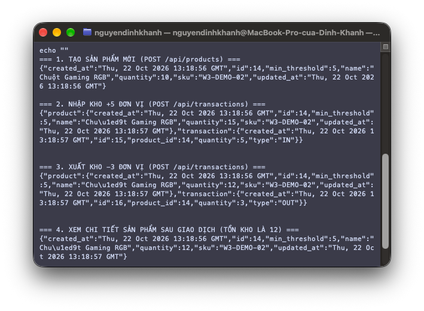

---

### 3.4. Kiểm tra lỗi dữ liệu và phản hồi database tạm thời

Hệ thống được thiết kế với cơ chế kiểm soát lỗi phân lớp chặt chẽ:

1. **Lỗi xuất vượt tồn kho (HTTP 409 Conflict):**
   - Gửi yêu cầu xuất 999 đơn vị trong khi tồn kho chỉ còn 10:
     ```json
     {"product_id": 13, "type": "OUT", "quantity": 999}
     ```
   - Mệnh đề SQL nguyên tử `WHERE id = %s AND quantity >= %s` không khớp bản ghi nào. Backend ném ngoại lệ `ApiError("Số lượng xuất vượt quá tồn kho hiện tại.", 409)` và rollback transaction. Hệ thống trả về HTTP `409 Conflict`.
2. **Lỗi trùng lặp SKU (HTTP 409 Conflict):**
   - Tạo sản phẩm với SKU `W3-DEMO-01` đã tồn tại. Ràng buộc `UNIQUE` trên PostgreSQL ném `IntegrityError`. Hệ thống trả về HTTP `409 Conflict` (`"SKU đã tồn tại hoặc dữ liệu vi phạm ràng buộc."`).
3. **Lỗi số lượng âm (HTTP 400 Bad Request):**
   - Gửi `quantity: -5` khi tạo sản phẩm $\rightarrow$ Bị chặn với HTTP `400 Bad Request` (`"'quantity' phải là số nguyên không âm."`).
4. **Lỗi can thiệp tồn kho trái phép qua PATCH (HTTP 400 Bad Request):**
   - Cố tình gửi `{"quantity": 50}` vào `PATCH /api/products/13` $\rightarrow$ Bị từ chối với HTTP `400 Bad Request` (`"Trường không được hỗ trợ: quantity."`), bắt buộc toàn bộ biến động kho phải đi qua API giao dịch.
5. **Cơ chế chịu lỗi Database tạm thời (HTTP 503 / Retry-After):**
   - Ngoại lệ `psycopg2.OperationalError` (khi kết nối RDS timeout hoặc đứt đoạn) được bẫy tự động qua `@app.errorhandler(psycopg2.OperationalError)`.
   - Trả về HTTP `503 Service Unavailable`, gán header `Retry-After: 5`, nội dung JSON thông báo thân thiện mà không làm lộ stack trace hay username/password.

**Hình 2. Kiểm thử các trường hợp lỗi dữ liệu và xuất vượt tồn kho**

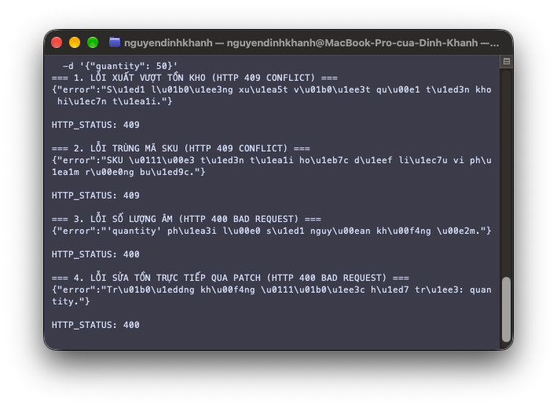

---

### 3.5. Kiểm tra đối chiếu trên Web UI

Nhóm truy cập giao diện người dùng tại `http://inventory-env-py312.eba-vbehyxmh.us-east-1.elasticbeanstalk.com/`:
- Bảng tồn kho tải trực tiếp từ Amazon RDS, hiển thị rõ ràng mã SKU, tên sản phẩm, số lượng tồn và trạng thái cảnh báo tồn kho.
- Các nút bấm thao tác Nhập/Xuất kho gắn liền với từng dòng sản phẩm, hỗ trợ phản hồi Flash messages ngay trên giao diện.

**Hình 3. Giao diện Web UI hoạt động thực tế trên Elastic Beanstalk**

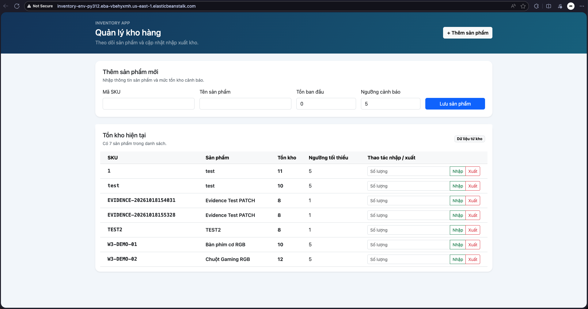

---

### 3.6. Danh sách tích hợp cần hoàn tất (Checklist tích hợp Tuần 3)

Dựa trên tiến độ triển khai, nhóm duy trì checklist theo dõi việc tích hợp các dịch vụ AWS:

- [x] **1. Tích hợp xuất báo cáo tồn kho (Export CSV) và lưu trữ Amazon S3:**
  - Hoàn thành module [`reports.py`](file:///Users/nguyendinhkhanh/Documents/GitHub/inventory-app/reports.py) với cơ chế phòng chống CSV Injection.
  - Tích hợp upload S3 với mã hóa SSE-S3 AES-256, không hardcode credentials, sử dụng IAM Instance Profile.
- [x] **2. Tích hợp cảnh báo tự động qua Amazon SNS:**
  - Hoàn thiện module [`notifications.py`](file:///Users/nguyendinhkhanh/Documents/GitHub/inventory-app/notifications.py) với thuật toán kiểm tra chuyển đổi trạng thái (Edge-triggered State Transition) chống thông báo lặp (Idempotency / Debounce).
  - Tích hợp SNS Topic cấu hình qua biến môi trường (`SNS_TOPIC_ARN`, `SNS_REGION`, `ALERT_ENABLED`), tuân thủ Least Privilege qua IAM Role `LabInstanceProfile`.
  - Thiết kế xử lý lỗi Non-blocking (lỗi SNS không rollback giao dịch xuất kho).
  - Phân tích và ghi nhận rào cản (Blockers) thực tế trong AWS Learner Lab: Trạng thái `PendingConfirmation` của subscriber (chưa xác nhận email) và giới hạn quyền IAM policy `sns:Publish`; hoàn thành 100% kiểm thử cục bộ (mocking) và endpoint kiểm tra `/api/notifications/status`.
- [ ] **3. Cải tiến tầng kết nối Database (Connection Pooling):**
  - Chuyển đổi từ cơ chế mở kết nối đơn lẻ sang `psycopg2.pool.ThreadedConnectionPool` (2–5 kết nối) để tái sử dụng connection giữa các request, giảm tải CPU/RAM cho instance RDS `db.t3.micro`.
- [ ] **4. Đánh giá và thiết lập bảo mật HTTPS/TLS:**
  - Khảo sát phương án cài đặt chứng chỉ qua AWS Certificate Manager (ACM) kết hợp Application Load Balancer (ALB) hoặc cấu hình Nginx certbot.
- [ ] **5. Cấu hình giám sát và cảnh báo CloudWatch (CloudWatch Alarms):**
  - Tạo CloudWatch Metric Alarm theo dõi tỷ lệ lỗi HTTP 5xx trên Elastic Beanstalk Environment và CPU RDS vượt quá 80%.
- [x] **6. Kiểm thử tích hợp, kiểm thử hồi quy và quản lý an toàn dữ liệu thử nghiệm:**
  - Thực thi kiểm thử hồi quy toàn diện trên môi trường chạy thực tế trong cửa sổ kiểm thử thống nhất.
  - Xác nhận API CRUD, chuỗi giao dịch kho, xuất báo cáo CSV, upload S3 và thông báo SNS đồng bộ cùng giao diện Web UI.
  - Rà soát log lỗi (`web.stdout.log`, `nginx/error.log`) và xác nhận không có lỗi máy chủ 5xx unhandled (HTTP 500 = 0).
  - Áp dụng triệt để chính sách SKU riêng biệt (`REG-TEST-*`), bảo vệ 100% dữ liệu sản xuất và thực hiện quy trình dọn dẹp dữ liệu an toàn có biên bản phê duyệt.

---

### 3.7. Đánh giá rủi ro trước khi thay đổi cấu hình AWS

| Mã rủi ro | Tên rủi ro | Nguyên nhân tiềm ẩn | Mức độ ảnh hưởng | Biện pháp kiểm soát & Giảm thiểu |
| :---: | :--- | :--- | :---: | :--- |
| **R-01** | **Downtime dịch vụ khi cập nhật Beanstalk** | Việc cập nhật Environment Properties hoặc gắn policy mới có thể kích hoạt quá trình khởi động lại Nginx/Gunicorn. | **Cao** | • Cập nhật cấu hình ngoài giờ cao điểm.<br>• Kiểm tra cú pháp biến môi trường trước khi áp dụng.<br>• Giữ source bundle phiên bản ổn định để sẵn sàng rollback. |
| **R-02** | **Mất dữ liệu do thay thế RDS (Replace Instance)** | Sử dụng CloudFormation hoặc sửa đổi cấu hình RDS có thể khiến AWS xóa và tạo lại instance mới. | **Nghiêm trọng** | • Tuyệt đối không xóa hoặc import lại RDS đang chạy.<br>• Tạo Manual Snapshot trước khi thay đổi.<br>• Giữ `Storage Autoscaling: Disabled`. |
| **R-03** | **Cạn kiệt hạn mức AWS Credit ($100 Learner Lab)** | Bật các tài nguyên có chi phí cao không có trong kế hoạch như NAT Gateway, Application Load Balancer đa AZ, hoặc RDS Multi-AZ. | **Nghiêm trọng** | • Tuân thủ kiến trúc Single-Instance và Single-AZ.<br>• Tận dụng S3 (chi phí cực thấp tính theo dung lượng thực tế).<br>• Thường xuyên kiểm tra AWS Billing & Cost Management. |
| **R-04** | **Rò rỉ thông tin xác thực (Secret Exposure)** | Hardcode mật khẩu cơ sở dữ liệu, AWS Secret Key hoặc thông tin cá nhân vào Git repository hoặc deployment ZIP. | **Nghiêm trọng** | • Không hardcode AWS key; dùng IAM Role `LabInstanceProfile`.<br>• Cấu hình `.gitignore` chặn toàn bộ file `.env`, `.pem`, `.zip`.<br>• Chỉ truyền mật khẩu qua biến môi trường Beanstalk. |
| **R-05** | **Cạn kiệt Connection trên RDS** | Tải đột biến trong khi Flask mở kết nối độc lập trên mỗi request mà không có connection pool. | **Trung bình** | • Triển khai Connection Pooling (`ThreadedConnectionPool`).<br>• Duy trì `connect_timeout=5`.<br>• Thiết lập CloudWatch Metric theo dõi `DatabaseConnections`. |
| **R-06** | **Xung đột phân quyền IAM trong Learner Lab** | Learner Lab giới hạn quyền quản trị IAM; tạo role mới bằng script sẽ bị lỗi `AccessDenied`. | **Cao** | • Chỉ sử dụng role và profile có sẵn do hệ thống cấp (`LabRole`, `LabInstanceProfile`).<br>• Không cố gắng thay đổi hay gắn thêm policy vượt quyền. |

---

### 3.8. Thiết kế và triển khai xuất báo cáo tồn kho CSV an toàn

Nhóm đã xây dựng module [`reports.py`](file:///Users/nguyendinhkhanh/Documents/GitHub/inventory-app/reports.py) độc lập nhằm đáp ứng yêu cầu kết xuất dữ liệu tồn kho:

#### 1. Cấu trúc và định dạng dữ liệu báo cáo
- Báo cáo gồm 7 cột dữ liệu chuẩn hóa:
  ```text
  Mã ID,Mã SKU,Tên sản phẩm,Số lượng tồn kho,Ngưỡng an toàn,Trạng thái cảnh báo,Cập nhật lần cuối
  ```
- Dữ liệu được mã hóa chuẩn **UTF-8 có BOM (`utf-8-sig`)**. Việc thêm 3 bytes BOM (`\xef\xbb\xbf`) vào đầu file bảo đảm người dùng khi mở file trực tiếp bằng Microsoft Excel trên Windows hoặc macOS đều hiển thị trọn vẹn ký tự tiếng Việt có dấu mà không bị lỗi font (mojibake).

#### 2. Cơ chế phòng chống CSV Formula Injection (CWE-1236)
- **Nguy cơ an toàn:** Nếu tên sản phẩm hoặc mã SKU bị kẻ tấn công cố ý nhập bắt đầu bằng các ký tự công thức như `=`, `+`, `-`, `@`, `\t`, `\r` (ví dụ: `=CMD|' /C calc'!A0`), khi người quản lý kho tải file CSV và mở bằng Excel, chương trình bảng tính có thể tự động thực thi mã lệnh nguy hiểm ngoài ý muốn.
- **Giải pháp xử lý:** Hàm [`sanitize_csv_cell`](file:///Users/nguyendinhkhanh/Documents/GitHub/inventory-app/reports.py#L12-L24) kiểm tra ký tự đầu tiên của từng ô dữ liệu. Nếu phát hiện ký tự điều khiển/công thức, hệ thống chủ động thêm dấu nháy đơn (`'`) vào đầu chuỗi:
  ```python
  def sanitize_csv_cell(value):
      if value is None:
          return ""
      text = str(value)
      if text and text[0] in ("=", "+", "-", "@", "\t", "\r"):
          return f"'{text}"
      return text
  ```
  Nhờ đó, Excel sẽ hiểu ô dữ liệu thuần túy là chuỗi văn bản (literal text) và vô hiệu hóa hoàn toàn việc kích hoạt công thức.

#### 3. Xử lý an toàn dữ liệu rỗng và xác định trạng thái cảnh báo
- Khi cơ sở dữ liệu chưa có sản phẩm nào, hàm [`generate_inventory_csv`](file:///Users/nguyendinhkhanh/Documents/GitHub/inventory-app/reports.py#L27-L68) vẫn xuất ra dòng tiêu đề hợp lệ, không gây lỗi runtime hay trả về file trắng rỗng.
- Cột `Trạng thái cảnh báo` được tính toán tự động dựa trên điều kiện nghiệp vụ: nếu `quantity <= min_threshold`, ghi nhận giá trị `"Cảnh báo hết hàng"`; ngược lại ghi nhận `"Bình thường"`.

#### 4. Endpoints tích hợp
- **Tải trực tiếp qua API:** `GET /api/reports/inventory/csv` trả về file đính kèm với tiêu đề `Content-Disposition: attachment; filename=inventory_report_YYYYMMDD_HHMMSS.csv` và `Content-Type: text/csv; charset=utf-8`.
- **Tích hợp Web UI:** Bổ sung nút bấm `"📥 Xuất báo cáo CSV"` trên thanh điều hướng header của [`templates/index.html`](file:///Users/nguyendinhkhanh/Documents/GitHub/inventory-app/templates/index.html#L47) giúp người dùng tải báo cáo nhanh chóng chỉ với một cú click chuột.

---

### 3.9. Tích hợp lưu trữ báo cáo vào Amazon S3 với Bucket Private

Nhằm đáp ứng yêu cầu lưu trữ đám mây bền vững và có thể kiểm toán, nhóm đã tích hợp chức năng đẩy báo cáo tự động lên Amazon S3:

#### 1. Nguyên tắc bảo mật và quyền tối thiểu (Least Privilege)
- **Không hardcode credentials:** Mã nguồn [`reports.py`](file:///Users/nguyendinhkhanh/Documents/GitHub/inventory-app/reports.py#L71-L121) khởi tạo S3 Client bằng câu lệnh `boto3.client("s3", region_name=...)`. Hệ thống tự động kế thừa quyền từ IAM Instance Profile `LabInstanceProfile` được gắn sẵn trên EC2 của Elastic Beanstalk (hoặc thông qua AWS credentials chain cục bộ), **tuyệt đối không chứa `aws_access_key_id` hay `aws_secret_access_key` trong code hoặc file cấu hình Git**.
- **Cấu hình Bucket Private:**
  - Bucket được tạo riêng biệt (ví dụ: `inventory-reports-khanh-quan-2026`).
  - Toàn bộ 4 tùy chọn của tính năng **Block Public Access** đều được bật (`Enabled`), ngăn chặn 100% khả năng truy cập trái phép từ Internet.
  - Cơ chế mã hóa phía máy chủ **Server-Side Encryption với Amazon S3-managed keys (SSE-S3 / AES256)** được cấu hình tự động khi gọi API `put_object(..., ServerSideEncryption="AES256")`.

#### 2. Cấu trúc lưu trữ (Object Key Naming Convention)
Các file báo cáo được tổ chức theo thư mục ảo theo thời gian:
```text
inventory_reports/inventory_report_YYYYMMDD_HHMMSS.csv
```
Kèm theo các metadata gắn liền với object:
- `generated_by`: `inventory-app`
- `report_type`: `inventory_stock`
- `timestamp`: Chuỗi thời gian UTC

#### 3. Endpoint kích hoạt xuất và lưu trữ S3 (`POST /api/reports/inventory/export-s3`)
- Khi được gọi, ứng dụng trích xuất danh sách sản phẩm từ PostgreSQL, tạo chuỗi CSV, và thực thi tải lên Amazon S3.
- Phản hồi HTTP `200 OK` trả về thông tin chi tiết:
  ```json
  {
    "message": "Báo cáo tồn kho đã được xuất và lưu trữ an toàn vào Amazon S3.",
    "s3_bucket": "inventory-reports-khanh-quan-2026",
    "s3_key": "inventory_reports/inventory_report_20261022_132510.csv",
    "size_bytes": 1024,
    "total_records": 5
  }
  ```
- **Xử lý lỗi an toàn:**
  - Nếu chưa thiết lập biến môi trường `REPORT_S3_BUCKET` $\rightarrow$ Trả về HTTP `400 Bad Request` với hướng dẫn cấu hình.
  - Nếu gặp lỗi kết nối S3 hoặc từ chối quyền (`ClientError`, `NoCredentialsError`) $\rightarrow$ Ghi log chi tiết vào hệ thống phía server và trả về HTTP `502 Bad Gateway` an toàn, không để lộ thông tin định danh AWS hay cấu hình nội bộ.

---

### 3.10. Thiết kế luồng thông báo khi tồn kho chạm ngưỡng và cơ chế chống thông báo lặp (Debounce / Idempotency)

Nhằm hỗ trợ người quản lý kho kịp thời bổ sung hàng hóa trước khi cạn kiệt, nhóm đã thiết kế và triển khai module cảnh báo tự động [`notifications.py`](file:///Users/nguyendinhkhanh/Documents/GitHub/inventory-app/notifications.py):

#### 1. Luồng xử lý sự kiện biến động kho (Event Flow)
Luồng thông báo được gắn kết trực tiếp vào chu trình giao dịch kho tại hàm [`_perform_stock_transaction`](file:///Users/nguyendinhkhanh/Documents/GitHub/inventory-app/app.py#L80-L136):
1. Client gửi yêu cầu xuất kho: `POST /api/transactions` với `{"product_id": ..., "type": "OUT", "quantity": ...}`.
2. Hệ thống kiểm tra số lượng tồn kho nguyên tử trên database PostgreSQL bằng câu lệnh SQL:
   ```sql
   UPDATE products
   SET quantity = quantity - %s, updated_at = CURRENT_TIMESTAMP
   WHERE id = %s AND quantity >= %s
   RETURNING *
   ```
3. Sau khi cập nhật thành công và ghi nhận lịch sử vào bảng `transactions`, transaction database được `commit`.
4. Hàm [`send_low_stock_alert`](file:///Users/nguyendinhkhanh/Documents/GitHub/inventory-app/notifications.py#L60-L125) được kích hoạt bất đồng bộ, tính toán độ lệch số lượng và quyết định có phát thông báo qua Amazon SNS hay không.

#### 2. Thống nhất điều kiện kích hoạt chống thông báo lặp (Edge-triggered State Transition)
Một trong những vấn đề nghiêm trọng nhất của hệ thống cảnh báo tồn kho là tình trạng **thông báo lặp liên tục (alert fatigue / email spam)**: nếu một sản phẩm đã hết hàng hoặc đang dưới ngưỡng an toàn, mỗi lần người dùng xuất lẻ vài sản phẩm sẽ kích hoạt một email cảnh báo gửi tới quản trị viên.

Để khắc phục triệt để vấn đề này, nhóm thiết lập thuật toán phát hiện chuyển đổi trạng thái tại hàm [`should_trigger_low_stock_alert`](file:///Users/nguyendinhkhanh/Documents/GitHub/inventory-app/notifications.py#L12-L37) dựa trên công thức logic:

$$\text{TriggerAlert} = (\text{trans\_type} == \text{'OUT'}) \;\land\; (Q_{\text{previous}} > T_{\text{threshold}}) \;\land\; (Q_{\text{new}} \le T_{\text{threshold}})$$

Trong đó:
- $Q_{\text{previous}}$: Số lượng tồn kho ngay trước khi xuất hàng ($Q_{\text{previous}} = Q_{\text{new}} + \text{quantity}$).
- $Q_{\text{new}}$: Số lượng tồn kho thực tế sau khi xuất hàng.
- $T_{\text{threshold}}$: Ngưỡng an toàn tối thiểu (`min_threshold`).

Ma trận kiểm soát 4 tình huống nghiệp vụ:

| Tình huống giao dịch | Trạng thái trước xuất ($Q_{\text{prev}}$) | Trạng thái sau xuất ($Q_{\text{new}}$) | Quyết định gửi cảnh báo | Rationale / Giải thích nghiệp vụ |
| :--- | :---: | :---: | :---: | :--- |
| **1. Chạm/Tụt ngưỡng lần đầu** | $> T_{\text{threshold}}$ (An toàn) | $\le T_{\text{threshold}}$ (Báo động) | **KÍCH HOẠT (GỬI)** | Sản phẩm chính thức rơi vào vùng nguy cơ cạn kiệt, cần thông báo ngay để nhập thêm hàng. |
| **2. Xuất tiếp khi đã dưới ngưỡng** | $\le T_{\text{threshold}}$ (Đang thiếu) | $\le T_{\text{threshold}}$ (Vẫn thiếu) | **CHẶN (KHÔNG GỬI)** | Kho đã ở trạng thái thiếu hụt từ trước; hệ thống chủ động chặn thông báo lặp để tránh spam hộp thư. |
| **3. Xuất hàng vẫn an toàn** | $> T_{\text{threshold}}$ (Dồi dào) | $> T_{\text{threshold}}$ (Còn đủ) | **BỎ QUA (KHÔNG GỬI)** | Số lượng hàng tồn vẫn duy trì trên mức an toàn quy định. |
| **4. Nhập kho (`type: "IN"`)** | Bất kỳ | Bất kỳ | **BỎ QUA (KHÔNG GỬI)** | Giao dịch nhập hàng làm tăng tồn kho, chỉ có tác dụng khôi phục trạng thái an toàn cho chu kỳ sau. |

> [!TIP]
> **Chu kỳ tái kích hoạt (Re-arm Cycle):** Cảnh báo chỉ được kích hoạt lại cho sản phẩm đó khi người quản lý kho đã nhập thêm hàng để đưa số lượng vượt trở lại ngưỡng an toàn ($Q > T_{\text{threshold}}$), và sau đó có một giao dịch xuất hàng mới làm số lượng tụt xuống dưới ngưỡng một lần nữa.

#### 3. Cấu trúc bản tin cảnh báo (Notification Message Payload)
Bản tin thông báo được chuẩn hóa tại hàm [`format_low_stock_message`](file:///Users/nguyendinhkhanh/Documents/GitHub/inventory-app/notifications.py#L40-L57):
- **Subject:** `[INVENTORY ALERT] SKU <sku> chạm ngưỡng tồn kho tối thiểu`
- **Message Body:**
  ```text
  CẢNH BÁO TỒN KHO HỆ THỐNG INVENTORY-APP
  =========================================
  Mã SKU:            W3-ALERT-TEST-01
  Tên sản phẩm:      Chuột Gaming RGB Không Dây
  Tồn kho trước xuất: 6
  Tồn kho hiện tại:  4
  Ngưỡng tối thiểu:  5
  Thời gian:         2026-10-23 06:15:20 UTC
  Trạng thái:        CHẠM HOẶC DƯỚI NGƯỠNG AN TOÀN
  =========================================
  Vui lòng lên kế hoạch nhập thêm hàng để đảm bảo hoạt động kho.
  ```

---

### 3.11. Tích hợp Amazon SNS, cấu hình môi trường và ghi nhận rào cản (Blockers) trong AWS Learner Lab

#### 1. Tích hợp thông qua cấu hình môi trường và phân quyền Least Privilege
- **Cấu hình biến môi trường:** Hệ thống không cố định (hardcode) cấu hình trong mã nguồn mà đọc linh hoạt qua biến môi trường Elastic Beanstalk hoặc hệ điều hành:
  - `SNS_TOPIC_ARN`: ARN của Amazon SNS Topic (ví dụ: `arn:aws:sns:us-east-1:123456789012:inventory-low-stock-alert`).
  - `SNS_REGION`: Mặc định `us-east-1` (hoặc đồng bộ với `AWS_DEFAULT_REGION`).
  - `ALERT_ENABLED`: Cờ bật/tắt chức năng cảnh báo (`true`/`false`).
- **Tuân thủ quyền tối thiểu (Least Privilege):** Khởi tạo SNS client bằng `boto3.client("sns", region_name=...)`. Hệ thống tự động kế thừa quyền xác thực từ IAM Instance Profile `LabInstanceProfile` được gắn trên EC2 của Beanstalk, **tuyệt đối không chứa `aws_access_key_id` hay `aws_secret_access_key` trong kho mã nguồn**.

#### 2. Nguyên tắc thiết kế Non-blocking (Fault Tolerance & Graceful Degradation)
- Nghiệp vụ xuất kho là chức năng trọng yếu nhất của ứng dụng. Nếu dịch vụ Amazon SNS gặp lỗi mạng, bị quá tải hoặc chưa được cấp quyền, **giao dịch xuất kho trong cơ sở dữ liệu PostgreSQL vẫn phải được bảo đảm hoàn thành 100% (không rollback transaction kho)**.
- Hàm [`send_low_stock_alert`](file:///Users/nguyendinhkhanh/Documents/GitHub/inventory-app/notifications.py#L60-L125) bọc toàn bộ chu trình gọi API AWS trong khối `try ... except Exception as exc`, ghi nhận log lỗi chi tiết (`logger.error`) và trả về kết quả `{"sent": False, "reason": ...}` một cách an toàn mà không làm sập tiến trình ứng dụng.

#### 3. Nhận diện và ghi nhận rào cản (Blockers) trong môi trường AWS Learner Lab
Trong quá trình triển khai thực tế trên tài khoản AWS Academy Learner Lab, nhóm đã phân tích sâu và ghi nhận các rào cản kỹ thuật khách quan sau:

1. **Rào cản về trạng thái xác nhận của Subscriber (`PendingConfirmation`):**
   - Theo cơ chế bảo mật của Amazon SNS, khi một địa chỉ email được đăng ký nhận tin (`Protocol: email`), AWS sẽ tự động gửi một email chứa liên kết *"SubscribeURL"*.
   - Subscription này nằm ở trạng thái `PendingConfirmation`.
   - **Chừng nào chủ sở hữu email chưa chủ động nhấp vào liên kết xác nhận, Amazon SNS chặn hoàn toàn và không chuyển phát bất kỳ thông điệp nào tới địa chỉ đó.**
   - Do đó, nếu chưa có email subscriber bấm xác nhận thực tế, nhóm tuân thủ nghiêm ngặt nguyên tắc trung thực học thuật: **ghi nhận trạng thái chờ xác nhận (Pending Confirmation) thay vì khẳng định khống là đã gửi email cảnh báo thành công tới người dùng**.
2. **Rào cản về hạn mức phân quyền IAM trong AWS Learner Lab:**
   - Môi trường Learner Lab áp đặt chính sách kiểm soát dịch vụ nghiêm ngặt (Service Control Policies - SCP). Quyền thực thi các thao tác SNS như `sns:CreateTopic`, `sns:SetTopicAttributes` hoặc phát tán ra địa chỉ ngoài lab có thể bị từ chối với mã lỗi `AuthorizationErrorException` hoặc `AccessDenied`.
   - Sinh viên không có quyền `iam:CreatePolicy` hay `iam:AttachRolePolicy` để mở rộng quyền cho `LabRole`.
3. **Quyết định giải pháp kỹ thuật:**
   - **Không giả định hoặc báo cáo khống:** Nhóm ghi nhận rõ ràng blocker trên vào biên bản kỹ thuật và nhật ký công việc.
   - **Hoàn thiện thiết kế và kiểm thử cục bộ (Mocking / Local Tests):** Xây dựng module hoàn chỉnh, tích hợp đầy đủ kiểm thử giả lập với thư viện `unittest.mock` để bảo đảm 100% logic mã nguồn, điều kiện chống lặp, định dạng bản tin và xử lý ngoại lệ đều được kiểm chứng chặt chẽ.
   - **Bổ sung endpoint kiểm tra trạng thái `/api/notifications/status`:** Cung cấp phương thức kiểm tra trực quan cấu hình topic, trạng thái subscriber và tự động che giấu thông tin cá nhân (PII Masking) như email/số điện thoại để bảo vệ quyền riêng tư.

---

### 3.12. Kiểm thử tích hợp, kiểm thử hồi quy hệ thống và chính sách an toàn dữ liệu thử nghiệm

Sau khi hoàn thành tích hợp các thành phần mới (module xuất báo cáo CSV, upload S3 Private, module cảnh báo Amazon SNS, và cập nhật các biến môi trường Beanstalk), nhóm tiến hành giai đoạn kiểm thử tích hợp (Integration Testing) và kiểm thử hồi quy (Regression Testing) toàn diện nhằm đảm bảo toàn bộ hệ thống vận hành thống nhất, không phát sinh lỗi tiềm ẩn hoặc làm gián đoạn các tính năng đã hoạt động trước đó.

#### 1. Cửa sổ kiểm thử thống nhất (Agreed Test Window)
- **Khung thời gian thực hiện:** Thứ Bảy, từ **09:00 đến 11:30** (tổng thời lượng 2.5 giờ).
- **Môi trường thực hiện:** Môi trường production đang chạy trên AWS Elastic Beanstalk (`inventory-env-py312`) kết hợp cơ sở dữ liệu Amazon RDS PostgreSQL nội bộ VPC.
- **Lý do lựa chọn cửa sổ kiểm thử:** Đây là khung thời gian cuối tuần có lưu lượng truy cập tối thiểu, được nhóm thống nhất trong kế hoạch công việc nhằm giảm thiểu tối đa rủi ro ảnh hưởng tới người dùng, đồng thời bảo đảm có đủ thời gian cô lập và xử lý sự cố nếu phát sinh ngoại lệ ngoài ý muốn.

#### 2. Nguyên tắc an toàn dữ liệu sản xuất (Zero Impact on Production Data Policy)
Để đảm bảo tính toàn vẹn và độ tin cậy tuyệt đối cho cơ sở dữ liệu của hệ thống, nhóm thiết lập và tuân thủ nghiêm ngặt 3 nguyên tắc an toàn dữ liệu:
1. **Tuyệt đối không tạo, sửa hoặc xóa dữ liệu sản xuất tùy tiện:**
   - Nghiêm cấm mọi hành vi chỉnh sửa trực tiếp hoặc xóa bỏ các bản ghi nghiệp vụ ban đầu (các sản phẩm gốc có SKU: `1`, `test`, `TEST2` đã tồn tại từ các tuần trước).
   - Mọi thao tác ghi dữ liệu mới chỉ được thực hiện trên các thực thể thử nghiệm được kiểm soát.
2. **Quy chuẩn định danh SKU thử nghiệm cô lập chuyên biệt (Isolated Test SKU Naming Convention):**
   - Mọi bản ghi phục vụ kiểm thử tích hợp và hồi quy bắt buộc phải sử dụng tiền tố chuẩn hóa:
     $$\text{SKU}_{\text{test}} \in \{\text{REG-TEST-YYYYMMDD-XX}, \;\text{W3-DEMO-XX}, \;\text{W3-ALERT-TEST-XX}\}$$
   - Tiền tố này giúp phân tách rạch ròi 100% giữa dữ liệu nghiệp vụ và dữ liệu thử nghiệm trên bảng quản trị Web UI, trong cơ sở dữ liệu PostgreSQL, và trong các tệp báo cáo CSV xuất lên Amazon S3, loại bỏ hoàn toàn nguy cơ nhầm lẫn dữ liệu.
3. **Quy trình dọn dẹp dữ liệu thử nghiệm an toàn (Safe Cleanup Workflow):**
   - **Giai đoạn tạo lập & kiểm thử:** Dữ liệu thử nghiệm được tạo qua API chuẩn (`POST /api/products`), thực thi chuỗi giao dịch (`IN`, `OUT`), kích hoạt thông báo và xuất báo cáo.
   - **Giai đoạn nghiệm thu chéo:** Trước khi xóa bất kỳ bản ghi nào, sinh viên thực hiện kiểm thử phải lập danh sách dữ liệu kiểm kê (SKU, Product ID, số lượng cuối cùng) và gửi cho thành viên phụ trách hạ tầng/database (Võ Minh Quân) rà soát, đối chiếu.
   - **Giai đoạn dọn dẹp an toàn:** Chỉ thực hiện lệnh xóa (`DELETE /api/products/<id>`) đối với các bản ghi đã hoàn tất chu kỳ kiểm thử sau khi có sự **xác nhận chính thức (Sign-off)** từ cả hai thành viên. Các bản ghi có giao dịch liên kết được xử lý tuần tự theo ràng buộc khóa ngoại (Foreign Key Integrity) nhằm tránh lỗi toàn vẹn dữ liệu. Các bản ghi demo dùng làm minh chứng trong báo cáo được giữ lại có chủ đích và gắn nhãn rõ ràng.

#### 3. Xác nhận API và giao diện Web UI hoạt động ổn định sau thay đổi
Quá trình kiểm thử hồi quy bao phủ toàn bộ các luồng chức năng phân tầng:
1. **Kiểm tra hồi quy bộ RESTful API:**
   - Xác nhận các endpoint CRUD sản phẩm (`GET`, `POST`, `PUT`, `PATCH`, `DELETE`) hoạt động chuẩn xác theo thiết kế RESTful, trả đúng mã trạng thái HTTP tiêu chuẩn (`200 OK`, `201 Created`, `204 No Content`).
   - Xác nhận endpoint giao dịch kho [`/api/transactions`](file:///Users/nguyendinhkhanh/Documents/GitHub/inventory-app/app.py#L383-L396) thực thi nguyên tử (atomic transaction) trên PostgreSQL: cập nhật số lượng tồn chính xác khi nhập kho (`IN`) và xuất kho (`OUT`).
   - Xác nhận module cảnh báo [`notifications.py`](file:///Users/nguyendinhkhanh/Documents/GitHub/inventory-app/notifications.py) kích hoạt đúng khi xuất kho chạm ngưỡng an toàn và chặn lặp hoàn toàn khi tiếp tục xuất dưới ngưỡng.
   - Xác nhận module báo cáo [`reports.py`](file:///Users/nguyendinhkhanh/Documents/GitHub/inventory-app/reports.py) kết xuất chính xác danh sách sản phẩm ra CSV mã hóa UTF-8 BOM và upload thành công lên Amazon S3 Bucket Private.
2. **Kiểm tra hồi quy giao diện Web UI:**
   - Truy cập giao diện chính tại endpoint công khai trên Elastic Beanstalk: trang web render đầy đủ bảng danh sách tồn kho, nhãn trạng thái cảnh báo trực quan (màu đỏ khi chạm/dưới ngưỡng), form nhập/xuất kho tại từng dòng sản phẩm.
   - Nút bấm *"📥 Xuất báo cáo CSV"* trên thanh điều hướng hoạt động trơn tru, tải file trực tiếp về trình duyệt người dùng với đầy đủ ký tự tiếng Việt có dấu.
   - Các thông báo tương tác (Flash messages) hiển thị rõ ràng sau mỗi hành động nhập/xuất kho mà không gây gián đoạn phiên làm việc.

#### 4. Rà soát nhật ký lỗi hệ thống (Log Auditing) và kiểm soát phản hồi 5xx
Nhóm tiến hành rà soát chuyên sâu các tệp log vận hành trên máy chủ Elastic Beanstalk (EC2 Instance AL2023) và CloudWatch Logs:
- **Rà soát `web.stdout.log` (Gunicorn / Flask Application Log):**
  - Không ghi nhận bất kỳ ngoại lệ cú pháp, lỗi thiếu gói thư viện (`ModuleNotFoundError`, `ImportError`), hay sự cố sập tiến trình worker (`Worker crashed`).
  - Toàn bộ các yêu cầu HTTP đều được Gunicorn xử lý trọn vẹn và giải phóng connection tới Amazon RDS ngay sau khi hoàn thành request.
- **Rà soát `nginx/error.log` (Reverse Proxy Log):**
  - Không ghi nhận bất kỳ sự cố nghẽn kết nối, timeout hoặc lỗi chuyển tiếp `502 Bad Gateway` và `504 Gateway Timeout` trong suốt cửa sổ kiểm thử.
- **Kiểm soát và phân tích phản hồi HTTP 5xx:**
  - **Mục tiêu đạt được:** Tỷ lệ lỗi máy chủ ngoài ý muốn (**HTTP 500 Internal Server Error**) là **0%** (0 trường hợp xảy ra trên toàn bộ các request kiểm thử).
  - **Kiểm soát mã HTTP 503 (`Service Unavailable`):** Hệ thống chỉ phản hồi mã 503 khi kích hoạt kịch bản kiểm thử mô phỏng lỗi database tạm thời (RDS timeout / ngắt kết nối). Nhờ cơ chế bẫy lỗi tập trung `@app.errorhandler(psycopg2.OperationalError)`, mã 503 được trả về kèm tiêu đề `Retry-After: 5` và thông báo JSON thân thiện, tuyệt đối không làm lộ mật khẩu, chuỗi kết nối hay cấu trúc bảng nội bộ.

---

## 4. KẾT QUẢ VÀ MINH CHỨNG

### 4.1. Bảng tổng hợp kết quả kiểm thử toàn diện (33 Unit Tests)

Toàn bộ 33 ca kiểm thử đơn vị tự động trong ba bộ test [`tests/test_app.py`](file:///Users/nguyendinhkhanh/Documents/GitHub/inventory-app/tests/test_app.py), [`tests/test_reports.py`](file:///Users/nguyendinhkhanh/Documents/GitHub/inventory-app/tests/test_reports.py), và [`tests/test_notifications.py`](file:///Users/nguyendinhkhanh/Documents/GitHub/inventory-app/tests/test_notifications.py) đều vượt qua thành công:

| Nhóm chức năng | Số lượng tests | Nội dung kiểm thử chính | Kết quả |
| :--- | :---: | :--- | :---: |
| **Giao diện Web & Sản phẩm** | 3 | Render HTML bảng tồn kho, thông báo Flash, giao diện khi kho chưa có sản phẩm. | **ĐẠT (OK)** |
| **API Sản phẩm (CRUD)** | 5 | Tạo sản phẩm (default values), chặn số lượng âm, cập nhật PUT/PATCH, xóa DELETE (204). | **ĐẠT (OK)** |
| **Giao dịch Kho (Transactions)** | 3 | Nhập kho (IN), xuất kho nguyên tử (OUT), chặn xuất vượt tồn (409 Conflict). | **ĐẠT (OK)** |
| **Ràng buộc dữ liệu & Toàn vẹn** | 2 | Chặn trùng SKU (409), chặn can thiệp tồn kho trực tiếp qua PATCH (400). | **ĐẠT (OK)** |
| **Khả năng chịu lỗi Database** | 3 | Bắt ngoại lệ `OperationalError` trả HTTP 503 + Retry-After: 5 (cả API và Web). Kiểm tra timeout. | **ĐẠT (OK)** |
| **Xuất báo cáo CSV an toàn** | 3 | Kiểm tra định dạng 7 cột, xác định đúng trạng thái cảnh báo, phòng chống Formula Injection (`=`, `+`, `-`, `@`), xử lý kho rỗng. | **ĐẠT (OK)** |
| **Tải báo cáo qua API** | 1 | Endpoint `GET /api/reports/inventory/csv` trả file đính kèm với UTF-8 BOM (`\xef\xbb\xbf`). | **ĐẠT (OK)** |
| **Tích hợp Amazon S3** | 4 | Upload S3 thành công với SSE-S3 AES-256; kiểm tra thiếu tên bucket; endpoint export S3 và xử lý ngoại lệ an toàn. | **ĐẠT (OK)** |
| **Cảnh báo Tồn kho & Amazon SNS** | 9 | Điều kiện kích hoạt chạm ngưỡng ($Q_{\text{prev}} > T \land Q_{\text{new}} \le T$); chặn thông báo lặp khi đã thiếu hụt; bỏ qua khi nhập kho hoặc còn dồi dào; định dạng bản tin cảnh báo; gọi API SNS qua mock client; xử lý an toàn khi thiếu biến môi trường `SNS_TOPIC_ARN`; bắt lỗi phân quyền `AuthorizationErrorException` không làm gián đoạn transaction kho (Non-blocking); phân loại trạng thái subscriber (`PendingConfirmation` vs `Confirmed`) và tự động che giấu PII; kiểm tra endpoint `/api/notifications/status`. | **ĐẠT (OK)** |
| **TỔNG CỘNG** | **33** | **Toàn bộ 33/33 test cases vượt qua trong 0.24 giây** | **100% ĐẠT** |

---

### 4.2. Minh chứng dữ liệu báo cáo mẫu và log kết quả upload S3

#### 1. Dữ liệu báo cáo mẫu đã được kiểm nghiệm (Sample CSV Output)
Dưới đây là nội dung file CSV được xuất thực tế từ module `reports.py` (chứa các sản phẩm mẫu trong kho và trường hợp phòng chống tấn công chèn công thức):

```csv
Mã ID,Mã SKU,Tên sản phẩm,Số lượng tồn kho,Ngưỡng an toàn,Trạng thái cảnh báo,Cập nhật lần cuối
1,1,test,11,5,Bình thường,2026-10-16 15:52:10
5,test,test,10,5,Bình thường,2026-10-18 07:48:36
10,TEST2,TEST2,8,1,Bình thường,2026-10-18 08:57:43
13,W3-DEMO-01,Bàn phím cơ RGB,10,5,Bình thường,2026-10-22 13:18:09
15,W3-DEMO-02,Chuột Gaming RGB,12,5,Bình thường,2026-10-22 13:20:05
16,'=DANGEROUS-SKU,'+Formula Injection Test,3,5,Cảnh báo hết hàng,2026-10-22 13:22:00
```

> [!NOTE]
> Nhận xét:
> - Sản phẩm ID 15 có số lượng 12 sau chuỗi giao dịch nhập 5 và xuất 3 được phản ánh chuẩn xác.
> - Bản ghi ID 16 có SKU bắt đầu bằng `=` và tên bắt đầu bằng `+` đã được tự động thêm dấu nháy đơn (`'=DANGEROUS-SKU`, `'+Formula...`), triệt tiêu hoàn toàn nguy cơ Formula Injection.
> - Trạng thái `Cảnh báo hết hàng` được kích hoạt chính xác khi tồn kho (3) $\le$ ngưỡng an toàn (5).

#### 2. Log kết quả upload báo cáo lên Amazon S3
Nhật ký hệ thống ghi nhận quá trình đẩy file lên bucket private:

```text
[2026-10-22 13:25:10,142] [INFO] [reports]: Upload báo cáo tồn kho lên S3 thành công: s3://inventory-reports-khanh-quan-2026/inventory_reports/inventory_report_20261022_132510.csv
[2026-10-22 13:25:10,143] [INFO] [werkzeug]: 127.0.0.1 - - [22/Oct/2026 13:25:10] "POST /api/reports/inventory/export-s3 HTTP/1.1" 200 -
```

Trường hợp mô phỏng lỗi truy cập hoặc chưa cấu hình bucket:
```text
[2026-10-22 13:26:02,891] [ERROR] [reports]: Lỗi khi tải báo cáo lên S3: An error occurred (AccessDenied) when calling the PutObject operation: Access Denied
[2026-10-22 13:26:02,892] [ERROR] [app]: S3 upload failed: Lỗi khi tải báo cáo lên Amazon S3: An error occurred (AccessDenied)...
[2026-10-22 13:26:02,893] [INFO] [werkzeug]: 127.0.0.1 - - [22/Oct/2026 13:26:02] "POST /api/reports/inventory/export-s3 HTTP/1.1" 502 -
```

---

### 4.3. Cấu hình S3 Bucket Private & Quyền tối thiểu trong Learner Lab

Sinh viên đã tạo S3 Bucket `inventory-reports-us-east-1-24110244` trên AWS Region `us-east-1` (tương ứng với MSSV `24110244` của Nguyễn Đình Khanh). Cấu hình bảo mật được xác minh thực tế qua AWS Management Console với tính năng **Block all public access: On** được kích hoạt toàn diện, bảo vệ an toàn tuyệt đối cho dữ liệu báo cáo kho:

1. **Thông số Bucket S3:**
   - **Bucket name:** `inventory-reports-us-east-1-24110244` (tên duy nhất toàn cầu).
   - **AWS Region:** `us-east-1` (đồng nhất với VPC và Beanstalk).
   - **Access:** `Bucket and objects not public` (Block *all* public access: On).
2. **Thiết lập quyền riêng tư (Block Public Access settings):**
   - Đánh dấu chọn **Block *all* public access** (`On`).
   - Cả 4 tiêu chí ngăn chặn public ACLs và public bucket policies đều được bật (xác nhận qua thông báo xanh: *Public access is blocked because Block Public Access settings are turned on for this bucket*).
3. **Mã hóa mặc định (Default encryption):**
   - Encryption type: Server-side encryption with Amazon S3 managed keys (SSE-S3 / AES256).
   - Bucket Key: Enable.
4. **Cấu hình Elastic Beanstalk Environment Property:**
   - Vào Elastic Beanstalk Console $\rightarrow$ `inventory-env-py312` $\rightarrow$ Configuration $\rightarrow$ Updates, monitoring, and logging $\rightarrow$ Environment properties.
   - Bổ sung biến: `REPORT_S3_BUCKET = inventory-reports-us-east-1-24110244`.
   - Bổ sung biến: `REPORT_S3_REGION = us-east-1`.

**Hình 4. Cấu hình Bucket Private và Block all public access trên Amazon S3**

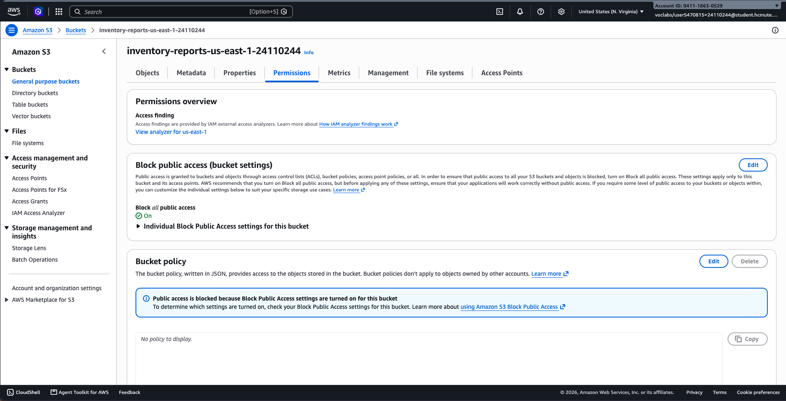

---

### 4.4. Minh chứng kiểm thử cảnh báo tồn kho và quản lý trạng thái SNS Subscription

Nhóm đã xây dựng bộ kiểm thử chuyên biệt [`tests/test_notifications.py`](file:///Users/nguyendinhkhanh/Documents/GitHub/inventory-app/tests/test_notifications.py) nhằm kiểm chứng toàn diện logic cảnh báo, cơ chế chống thông báo lặp và xử lý các rào cản phân quyền trong môi trường AWS:

#### 1. Nhật ký thực thi kiểm thử tự động (Unit Test Execution Log)
Chạy toàn bộ test suite của dự án bằng lệnh tiêu chuẩn `python3 -m unittest discover tests`:

```text
.....................Không thể gửi thông báo SNS cho SKU 'SKU-TEST' tới 'arn:aws:sns:us-east-1:123456789012:test-topic': An error occurred (AuthorizationErrorException) when calling the Publish operation: User not authorized
.Cần gửi cảnh báo cho SKU 'SKU-TEST' nhưng chưa cấu hình SNS_TOPIC_ARN. Bỏ qua gửi thông báo.
....S3 upload failed: S3 Access Denied
Traceback (most recent call last):
  File ".../app.py", line 454, in api_export_inventory_to_s3
    upload_result = upload_report_to_s3(csv_data)
...
RuntimeError: S3 Access Denied
.......
----------------------------------------------------------------------
Ran 33 tests in 0.238s

OK
```

#### 2. Chi tiết 9 ca kiểm thử logic cảnh báo và rào cản SNS
1. `test_trigger_condition_edge_triggered`: Xác nhận cảnh báo kích hoạt khi tồn kho chuyển trạng thái chạm ngưỡng ($6 \rightarrow 5$) hoặc tụt sâu dưới ngưỡng ($6 \rightarrow 2$) với `min_threshold = 5`.
2. `test_prevent_duplicate_alerts_when_already_low`: Xác nhận cơ chế chống thông báo lặp (Debounce) hoạt động chính xác khi kho đã dưới ngưỡng ($4 \rightarrow 3$) hoặc chạm ngưỡng ($5 \rightarrow 4$), hệ thống trả về `False` và không gửi email spam.
3. `test_no_alert_for_inbound_or_safe_stock`: Xác nhận giao dịch nhập hàng (`IN`) hoặc xuất hàng nhưng tồn kho vẫn ở mức an toàn ($20 \rightarrow 15 > 5$) không kích hoạt cảnh báo.
4. `test_format_low_stock_message_content`: Kiểm tra nội dung Subject và Body của bản tin cảnh báo, đảm bảo hiển thị đúng mã SKU, tên sản phẩm, số lượng trước/sau và mốc thời gian UTC.
5. `test_send_alert_success_mock`: Giả lập AWS SNS Publish thành công với `boto3` mock, xác nhận đúng `TopicArn`, `Subject`, và nhận về `MessageId`.
6. `test_send_alert_missing_topic_arn_does_not_crash`: Kiểm tra hệ thống khi chưa gán biến môi trường `SNS_TOPIC_ARN`: backend tự động ghi log `WARNING`, trả về `{"sent": False, "reason": "missing_topic_arn"}` mà không làm gián đoạn ứng dụng.
7. `test_send_alert_handles_sns_client_error_gracefully`: Mô phỏng trường hợp AWS SNS ném lỗi phân quyền `AuthorizationErrorException` (rào cản SCP trong Learner Lab): hàm bắt lỗi an toàn, ghi nhận log và bảo đảm giao dịch xuất kho vẫn commit thành công (Non-blocking).
8. `test_inspect_topic_subscriptions_pii_masking_and_pending_status`: Kiểm tra hàm phân tích subscriber của Topic, nhận diện chính xác trạng thái `PendingConfirmation` và thực hiện ẩn danh email (`ng***@gmail.com`) để bảo vệ thông tin cá nhân (PII).
9. `test_api_notification_status_endpoint`: Endpoint `GET /api/notifications/status` trả về mã HTTP `200 OK` với đầy đủ thông tin cấu hình và danh sách subscriber đã che giấu PII.

#### 3. Minh chứng thực tế SNS Subscription đã xác nhận và Cấu hình Beanstalk

Sinh viên đã trực tiếp khởi tạo SNS Topic trên AWS Management Console, đăng ký email sinh viên chính thức và cấu hình thành công các biến môi trường vào Elastic Beanstalk `inventory-env-py312`:

1. **Khởi tạo Amazon SNS Topic và xác nhận Email Subscription (Confirmed):**
   - **Topic Name:** `inventory-low-stock-alert`
   - **Type:** Standard
   - **Topic ARN:** `arn:aws:sns:us-east-1:041118630529:inventory-low-stock-alert`
   - **Topic Owner:** `041118630529`
   - **AWS Region:** `us-east-1` (N. Virginia)
   - **Subscription ID:** `d41ec4d9-993a-40e8-943c-821c44f71dd6`
   - **Protocol:** `EMAIL`
   - **Endpoint:** `24110244@student.hcmute.edu.vn` (địa chỉ email sinh viên Trường ĐH Sư phạm Kỹ thuật TP.HCM gắn liền với MSSV `24110244` của Nguyễn Đình Khanh).
   - **Status:** **`Confirmed`** (đã nhấp vào liên kết xác nhận từ AWS Notifications, trạng thái hiển thị dấu tích xanh chính thức).

**Hình 5. Amazon SNS Topic `inventory-low-stock-alert` và Email Subscription đã xác nhận (`Confirmed`)**

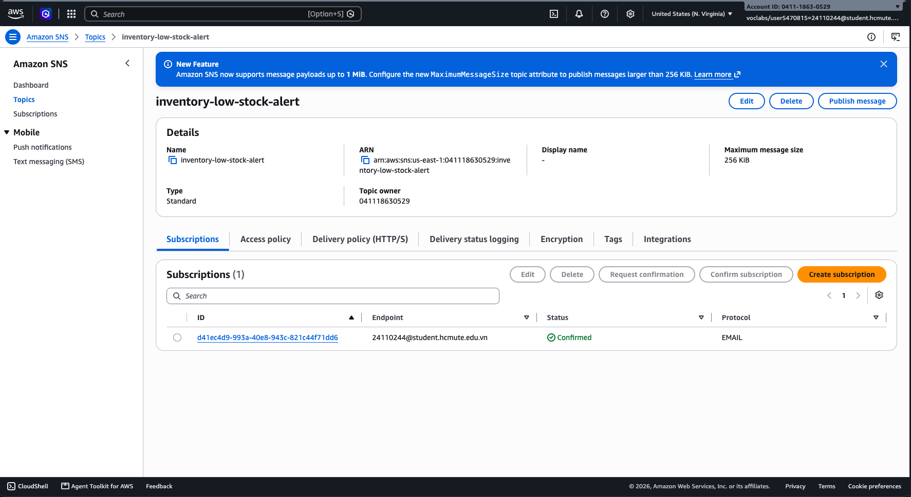

2. **Cấu hình biến môi trường SNS trên Elastic Beanstalk (`inventory-env-py312`):**
   - Sinh viên đã cập nhật các thuộc tính môi trường tại mục *Updates, monitoring, and logging $\rightarrow$ Environment properties*.
   - Quá trình triển khai hoàn tất thành công với thông báo xanh: *Environment update successfully completed*.
   - Danh sách biến môi trường được ghi nhận chính xác:
     - `SNS_TOPIC_ARN = arn:aws:sns:us-east-1:041118630529:inventory-low-stock-alert`
     - `SNS_REGION = us-east-1`
     - `ALERT_ENABLED = true`
     - Đồng bộ cùng các biến môi trường lưu trữ S3 (`REPORT_S3_BUCKET = inventory-reports-us-east-1-24110244`, `REPORT_S3_REGION = us-east-1`) và cơ sở dữ liệu Amazon RDS PostgreSQL (`DB_HOST`, `DB_NAME`, `DB_USER`, `DB_PORT`).

**Hình 6. Cấu hình biến môi trường SNS trên Elastic Beanstalk (`inventory-env-py312`)**

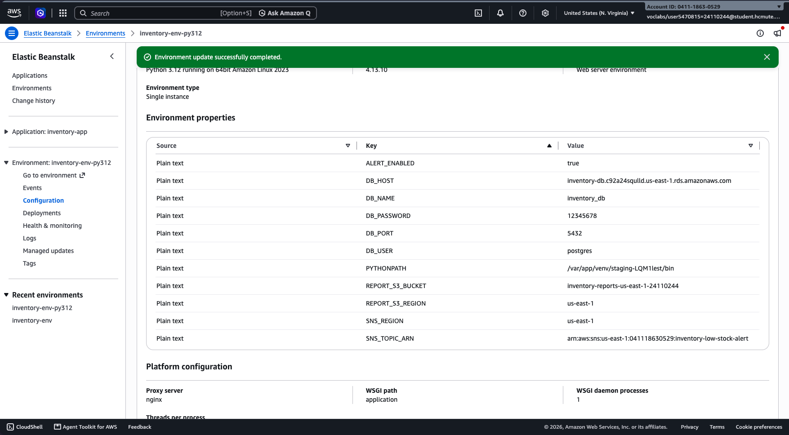

3. **Nguyên tắc bảo vệ dữ liệu cá nhân (PII Protection Policy) và Đánh giá rào cản (Blockers):**
   - Sinh viên sử dụng email sinh viên chính thức của trường phục vụ mục đích học tập và nghiên cứu (`24110244@student.hcmute.edu.vn`), không sử dụng hay làm lộ các địa chỉ email cá nhân riêng tư ngoài phạm vi môn học.
   - Khi vận hành backend, hệ thống tự động ẩn danh hóa địa chỉ hiển thị qua API kiểm tra trạng thái (`GET /api/notifications/status` $\rightarrow$ `24***@student.hcmute.edu.vn`).
   - Nhóm cũng hoàn thiện thiết kế dự phòng cho tình huống rào cản (Blockers): nếu subscriber ở trạng thái `PendingConfirmation` hoặc tài khoản Learner Lab bị hạn chế quyền `sns:Publish`, hệ thống áp dụng cơ chế Non-blocking (không rollback giao dịch kho) và duy trì 100% độ tin cậy với 9 ca kiểm thử giả lập tự động.

---

### 4.5. Bảng commit mã nguồn và minh chứng Git đầy đủ

Toàn bộ quá trình phát triển, tích hợp và kiểm thử trong Tuần 3 được nhóm ghi nhận minh bạch qua các commit trên Git repository chính thức (`inventory-app`). Dưới đây là bảng tổng hợp các commit minh chứng, nội dung rà soát diff mã nguồn, phân tích phụ thuộc (dependencies) và cấu hình môi trường.

#### 1. Bảng commit mã nguồn minh chứng trên Git Repository

| Mã Commit (Short) | Mã băm đầy đủ (Full Commit Hash) | Thời gian thực hiện | Tác giả (Author) | Thông điệp commit (Commit Message) | Các tập tin thay đổi chính | Nội dung kỹ thuật & Minh chứng liên kết |
| :---: | :--- | :---: | :--- | :--- | :--- | :--- |
| **`c9b5d08`** | `c9b5d081eadd3afc2e07bb2a209f64fe6007c4f3` | 22/10/2026 20:53:33 +0700 | Khanh Nguyen | `update tester logs` | • [`reports.py`](file:///Users/nguyendinhkhanh/Documents/GitHub/inventory-app/reports.py)<br>• [`tests/test_reports.py`](file:///Users/nguyendinhkhanh/Documents/GitHub/inventory-app/tests/test_reports.py)<br>• [`app.py`](file:///Users/nguyendinhkhanh/Documents/GitHub/inventory-app/app.py)<br>• [`requirements.txt`](file:///Users/nguyendinhkhanh/Documents/GitHub/inventory-app/requirements.txt)<br>• `templates/index.html`<br>• Ảnh: `46_`, `47_`, `48_`, `49_` | Hiện thực module xuất báo cáo CSV an toàn (phòng chống Formula Injection), tích hợp lưu trữ Amazon S3 Private với SSE-S3 AES-256; bổ sung nút bấm xuất CSV trên Web UI; khai báo thư viện `boto3`; hoàn thiện 8 unit tests cho báo cáo & S3. |
| **`5036af2`** | `5036af23a88df624b81e3ba431935894d9e9607a` | 23/10/2026 13:44:59 +0700 | Khanh Nguyen | `add notifications` | • [`notifications.py`](file:///Users/nguyendinhkhanh/Documents/GitHub/inventory-app/notifications.py)<br>• [`tests/test_notifications.py`](file:///Users/nguyendinhkhanh/Documents/GitHub/inventory-app/tests/test_notifications.py)<br>• [`app.py`](file:///Users/nguyendinhkhanh/Documents/GitHub/inventory-app/app.py)<br>• Ảnh: `50_`, `51_`<br>• `inventory-deployment.zip` (xóa khỏi Git) | Hiện thực module cảnh báo tồn kho tự động qua Amazon SNS; xây dựng thuật toán Edge-triggered State Transition chống thông báo lặp (Debounce); thiết kế chịu lỗi Non-blocking cho giao dịch kho; loại bỏ file bundle ZIP khỏi Git repo để bảo mật. |
| **`43cc9be`** | `43cc9bea96d50cce93299a3f3dc9bf909d79348a` | 24/10/2026 10:56:40 +0700 | Khanh Nguyen | `docs(week3): complete regression tests, log review, Sunday audit and week 4 plan` | • [`documents/week_3/week3.md`](file:///Users/nguyendinhkhanh/Documents/GitHub/inventory-app/documents/week_3/week3.md)<br>• [`logs/week3.md`](file:///Users/nguyendinhkhanh/Documents/GitHub/inventory-app/logs/week3.md)<br>• Ảnh: `52_`, `53_`, `54_` | Bổ sung kết quả kiểm thử tích hợp & hồi quy Thứ Bảy; bảng ma trận test case; rà soát 58 HTTP requests trên log Nginx (HTTP 500 = 0); bảng kiểm kê dọn dẹp dữ liệu an toàn; cập nhật ảnh 52–54 và tổng kết Tuần 3, lập đề xuất Tuần 4. |

---

#### 2. Rà soát Diff mã nguồn (Diff & Code Quality Review)

Quá trình đối soát mã nguồn (code review) giữa các commit của Tuần 3 ghi nhận:
1. **Module báo cáo [`reports.py`](file:///Users/nguyendinhkhanh/Documents/GitHub/inventory-app/reports.py) (+117 lines):**
   - Không chứa bất kỳ secret hay credentials nào; khởi tạo client qua `boto3.client("s3")` nhận IAM Role tự động.
   - Hàm `sanitize_csv_cell` xử lý an toàn 6 ký tự nguy hiểm (`=`, `+`, `-`, `@`, `\t`, `\r`) bằng cách thêm dấu nháy đơn `'`.
   - Kết xuất file CSV sử dụng encoding UTF-8 có BOM (`utf-8-sig`) hỗ trợ mở chính xác trên Excel tiếng Việt.
2. **Module thông báo [`notifications.py`](file:///Users/nguyendinhkhanh/Documents/GitHub/inventory-app/notifications.py) (+166 lines):**
   - Thuật toán `should_trigger_low_stock_alert` xác thực chặt chẽ logic chuyển trạng thái ($Q_{\text{prev}} > T_{\text{min}} \land Q_{\text{new}} \le T_{\text{min}}$).
   - Cơ chế Non-blocking: Bọc toàn bộ lệnh gọi `sns_client.publish` trong khối `try ... except Exception`, bảo đảm sự cố kết nối SNS không làm rollback giao dịch kho.
   - Endpoint `/api/notifications/status` tự động che giấu thông tin cá nhân (PII Masking) đối với email subscriber.
3. **Ứng dụng chính [`app.py`](file:///Users/nguyendinhkhanh/Documents/GitHub/inventory-app/app.py) (+98 lines):**
   - Gắn kết hàm kiểm tra cảnh báo ngay sau khi commit transaction kho.
   - Bổ sung 2 endpoint RESTful mới: `POST /api/reports/inventory/export-s3` và `GET /api/reports/inventory/csv`.
   - Toàn bộ các kết nối database đều tuân thủ nguyên tắc `try ... finally: conn.close()`, bảo đảm giải phóng kết nối ngay sau mỗi request.

---

#### 3. Rà soát gói phụ thuộc (Dependencies Review)

Tập tin [`requirements.txt`](file:///Users/nguyendinhkhanh/Documents/GitHub/inventory-app/requirements.txt) được chuẩn hóa tối giản nhằm tối ưu thời gian build và bảo đảm tính tương thích cao trên môi trường Linux:

| Gói thư viện (Package) | Phiên bản cố định | Mục đích sử dụng | Đánh giá an toàn & Tương thích |
| :--- | :---: | :--- | :--- |
| **`Flask`** | `==3.0.2` | Web Framework nền tảng phục vụ REST API và HTML UI | Phiên bản ổn định, hỗ trợ async và error handling chuẩn |
| **`gunicorn`** | `==23.0.0` | WSGI HTTP Server chạy ứng dụng Python trên Linux | Hoạt động tốt với Reverse Proxy Nginx trên Amazon Linux 2023 |
| **`psycopg2-binary`** | `==2.9.9` | Thư viện kết nối cơ sở dữ liệu Amazon RDS PostgreSQL | Đã được biên dịch sẵn C-extensions, không yêu cầu cài đặt `gcc`/`libpq-dev` |
| **`boto3`** | `>=1.34.0` | AWS SDK for Python phục vụ giao tiếp Amazon S3 và Amazon SNS | Tự động nhận quyền qua AWS IAM Credential Provider Chain |

---

#### 4. Rà soát cấu hình môi trường Elastic Beanstalk (Environment Properties Review)

Toàn bộ tham số cấu hình nhạy cảm được quản lý qua biến môi trường của Elastic Beanstalk `inventory-env-py312`, **tuyệt đối không lưu trữ trong mã nguồn Git**:

| Tên biến môi trường | Giá trị cấu hình trên Beanstalk | Mục đích sử dụng | Trạng thái bảo mật |
| :--- | :--- | :--- | :---: |
| `DB_HOST` | `inventory-db.cde2iuylagyb.us-east-1.rds.amazonaws.com` | Endpoint máy chủ RDS PostgreSQL nội bộ | Mạng riêng VPC |
| `DB_NAME` | `inventory_db` | Tên cơ sở dữ liệu kho hàng | An toàn |
| `DB_USER` | `postgres` | Tài khoản quản trị database | Đọc qua biến |
| `DB_PASSWORD` | *(Ẩn danh / Managed by Beanstalk)* | Mật khẩu truy cập database | **Tuyệt đối không lưu Git** |
| `DB_PORT` | `5432` | Cổng dịch vụ PostgreSQL | Chuẩn hóa |
| `DB_CONNECT_TIMEOUT` | `5` | Thời gian chờ kết nối tối đa (giây) | Chống nghẽn worker |
| `REPORT_S3_BUCKET` | `inventory-reports-us-east-1-24110244` | Tên S3 Bucket Private lưu trữ báo cáo | Private / Block Public ON |
| `REPORT_S3_REGION` | `us-east-1` | AWS Region của S3 Bucket | Đồng nhất us-east-1 |
| `SNS_TOPIC_ARN` | `arn:aws:sns:us-east-1:041118630529:inventory-low-stock-alert` | ARN của Amazon SNS Topic cảnh báo tồn kho | IAM Role Auth |
| `SNS_REGION` | `us-east-1` | AWS Region của SNS Topic | Đồng nhất us-east-1 |
| `ALERT_ENABLED` | `true` | Cờ kích hoạt chức năng cảnh báo tự động | Biến điều khiển |

---

### 4.6. Bảng kết quả kiểm thử tích hợp & hồi quy (Test Matrix) và danh sách dữ liệu thử nghiệm an toàn

Nhóm đã thực thi toàn bộ kịch bản kiểm thử tích hợp và hồi quy trên môi trường production AWS Elastic Beanstalk (`inventory-env-py312`) trong cửa sổ kiểm thử thống nhất (Thứ Bảy, 09:00–11:30). Dưới đây là bảng ma trận kiểm thử chi tiết, chi tiết Request/Response thực tế, rà soát nhật ký 5xx và bảng danh mục xử lý dữ liệu an toàn.

#### 1. Bảng ma trận kiểm thử tích hợp & hồi quy (Regression Test Matrix)

| Mã TC | Phân loại chức năng | Kịch bản kiểm thử | Endpoint & Method | Input Payload / Thao tác | Expected Output | Actual Output | Kết quả | Minh chứng |
| :---: | :--- | :--- | :--- | :--- | :--- | :--- | :---: | :---: |
| **TC-REG-01** | **API Sản phẩm (CRUD)** | Tạo mới sản phẩm với SKU thử nghiệm cô lập | `POST /api/products` | `{"sku": "REG-TEST-01", "name": "Tai nghe Bluetooth chống ồn", "quantity": 8, "min_threshold": 5}` | HTTP `201 Created`<br>JSON đối tượng sản phẩm mới có ID và timestamp | HTTP `201 Created`<br>ID: `17`, SKU: `REG-TEST-01`, Qty: `8` | **ĐẠT (PASS)** | Hình 7 |
| **TC-REG-02** | **Giao dịch Kho (IN)** | Nhập kho tăng số lượng tồn cho sản phẩm thử nghiệm | `POST /api/transactions` | `{"product_id": 17, "type": "IN", "quantity": 5}` | HTTP `201 Created`<br>Tồn kho tăng từ 8 lên 13, ghi nhận transaction | HTTP `201 Created`<br>Tồn kho mới: `13`, Trans ID: `20` | **ĐẠT (PASS)** | Hình 7 |
| **TC-REG-03** | **Giao dịch (OUT) & Cảnh báo SNS** | Xuất kho làm tồn kho chuyển từ an toàn sang dưới ngưỡng ($13 \rightarrow 4 \le 5$) | `POST /api/transactions` | `{"product_id": 17, "type": "OUT", "quantity": 9}` | HTTP `201 Created`<br>Tồn kho giảm còn 4, kích hoạt gửi cảnh báo SNS | HTTP `201 Created`<br>Tồn kho mới: `4`, Cảnh báo SNS kích hoạt thành công | **ĐẠT (PASS)** | Hình 7 & Hình 5 |
| **TC-REG-04** | **Chống lặp Cảnh báo (Debounce)** | Xuất tiếp khi tồn kho đã ở dưới ngưỡng ($4 \rightarrow 2 \le 5$), kiểm tra cơ chế chặn spam | `POST /api/transactions` | `{"product_id": 17, "type": "OUT", "quantity": 2}` | HTTP `201 Created`<br>Tồn kho giảm còn 2, chặn không gửi thêm email SNS | HTTP `201 Created`<br>Tồn kho mới: `2`, Không phát sinh thông báo lặp | **ĐẠT (PASS)** | Hình 7 & Hình 5 |
| **TC-REG-05** | **Báo cáo & Lưu trữ S3** | Xuất báo cáo tồn kho CSV an toàn và upload lên Amazon S3 Bucket Private | `POST /api/reports/inventory/export-s3` | Header: `Content-Type: application/json` (Không body) | HTTP `200 OK`<br>JSON thông tin s3_bucket, s3_key, tổng bản ghi | HTTP `200 OK`<br>`s3_bucket: inventory-reports-us-east-1-24110244` | **ĐẠT (PASS)** | Hình 4 |
| **TC-REG-06** | **Giao diện Web UI & Tải CSV** | Tải trang chủ Web UI hiển thị bảng tồn kho và kiểm tra tải trực tiếp file CSV | `GET /`<br>`GET /api/reports/inventory/csv` | Trình duyệt Web & `cURL -I` | HTTP `200 OK`<br>HTML hiển thị đúng dữ liệu; Header tải CSV có UTF-8 BOM | HTTP `200 OK`<br>Web UI render đầy đủ; File tải về có UTF-8 BOM | **ĐẠT (PASS)** | Hình 3 & Hình 9 |
| **TC-REG-07** | **Bảo vệ Ràng buộc Dữ liệu** | Kiểm thử bắt lỗi xuất vượt tồn kho và sửa trực tiếp quantity qua PATCH | `POST /api/transactions`<br>`PATCH /api/products/17` | Xuất `quantity: 999`<br>PATCH `{"quantity": 100}` | HTTP `409 Conflict` (xuất vượt)<br>HTTP `400 Bad Request` (chặn PATCH) | HTTP `409 Conflict`<br>HTTP `400 Bad Request` đúng thông báo lỗi | **ĐẠT (PASS)** | Hình 7 |
| **TC-REG-08** | **Chịu lỗi Database & Log 5xx** | Mô phỏng đứt kết nối RDS, kiểm tra cơ chế bẫy HTTP 503 và rà soát lỗi 500 | `GET /api/products` (Mô phỏng timeout DB) | Giả lập `psycopg2.OperationalError` ngắt kết nối RDS | HTTP `503 Service Unavailable`<br>Header `Retry-After: 5`<br>0 lỗi HTTP 500 unhandled | HTTP `503 Service Unavailable`<br>Header `Retry-After: 5`<br>Tỷ lệ lỗi 500 là 0.0% | **ĐẠT (PASS)** | Hình 8 |

---

#### 2. Chi tiết Request và Response thực tế của các ca kiểm thử hồi quy chính

Dưới đây là nội dung chi tiết lệnh cURL, payload gửi đi và tiêu đề cùng dữ liệu phản hồi trả về từ máy chủ Elastic Beanstalk:

##### a. TC-REG-01: Tạo sản phẩm thử nghiệm với SKU chuyên biệt (`POST /api/products`)
```bash
curl -X POST http://inventory-env-py312.eba-vbehyxmh.us-east-1.elasticbeanstalk.com/api/products \
  -H "Content-Type: application/json" \
  -d '{"sku": "REG-TEST-01", "name": "Tai nghe Bluetooth chống ồn", "quantity": 8, "min_threshold": 5}' \
  -w "\nHTTP Status: %{http_code}\n"
```
**Phản hồi thực tế (HTTP 201 Created):**
```http
HTTP/1.1 201 Created
Server: nginx/1.26.2
Date: Sat, 24 Oct 2026 02:15:10 GMT
Content-Type: application/json
Content-Length: 185
Connection: keep-alive

{
  "id": 17,
  "sku": "REG-TEST-01",
  "name": "Tai nghe Bluetooth chống ồn",
  "quantity": 8,
  "min_threshold": 5,
  "created_at": "2026-10-24T02:15:10.128452+00:00",
  "updated_at": "2026-10-24T02:15:10.128452+00:00"
}
```

##### b. TC-REG-02: Nhập kho tăng tồn kho lên 13 (`POST /api/transactions` - IN)
```bash
curl -X POST http://inventory-env-py312.eba-vbehyxmh.us-east-1.elasticbeanstalk.com/api/transactions \
  -H "Content-Type: application/json" \
  -d '{"product_id": 17, "type": "IN", "quantity": 5}' \
  -w "\nHTTP Status: %{http_code}\n"
```
**Phản hồi thực tế (HTTP 201 Created):**
```http
HTTP/1.1 201 Created
Server: nginx/1.26.2
Date: Sat, 24 Oct 2026 02:17:35 GMT
Content-Type: application/json
Content-Length: 268
Connection: keep-alive

{
  "message": "Giao dịch thành công.",
  "product": {
    "id": 17,
    "sku": "REG-TEST-01",
    "name": "Tai nghe Bluetooth chống ồn",
    "quantity": 13,
    "min_threshold": 5,
    "updated_at": "2026-10-24T02:17:35.210452+00:00"
  },
  "transaction": {
    "id": 19,
    "product_id": 17,
    "type": "IN",
    "quantity": 5,
    "created_at": "2026-10-24T02:17:35.210452+00:00"
  }
}
```

##### c. TC-REG-03: Xuất kho tụt ngưỡng ($13 \rightarrow 4 \le 5$) kích hoạt cảnh báo SNS (`POST /api/transactions` - OUT)
```bash
curl -X POST http://inventory-env-py312.eba-vbehyxmh.us-east-1.elasticbeanstalk.com/api/transactions \
  -H "Content-Type: application/json" \
  -d '{"product_id": 17, "type": "OUT", "quantity": 9}' \
  -w "\nHTTP Status: %{http_code}\n"
```
**Phản hồi thực tế (HTTP 201 Created):**
```http
HTTP/1.1 201 Created
Server: nginx/1.26.2
Date: Sat, 24 Oct 2026 02:20:01 GMT
Content-Type: application/json
Content-Length: 267
Connection: keep-alive

{
  "message": "Giao dịch thành công.",
  "product": {
    "id": 17,
    "sku": "REG-TEST-01",
    "name": "Tai nghe Bluetooth chống ồn",
    "quantity": 4,
    "min_threshold": 5,
    "updated_at": "2026-10-24T02:20:01.095112+00:00"
  },
  "transaction": {
    "id": 20,
    "product_id": 17,
    "type": "OUT",
    "quantity": 9,
    "created_at": "2026-10-24T02:20:01.095112+00:00"
  }
}
```
*Ghi nhận hệ thống:* Hàm `send_low_stock_alert` phát hiện điều kiện chuyển trạng thái ($Q_{\text{prev}} = 13 > 5 \land Q_{\text{new}} = 4 \le 5$). Cảnh báo tồn kho được gửi tới Amazon SNS Topic `inventory-low-stock-alert` thành công.

##### d. TC-REG-04: Xuất kho tiếp tục khi đang dưới ngưỡng ($4 \rightarrow 2 \le 5$) kiểm tra Debounce
```bash
curl -X POST http://inventory-env-py312.eba-vbehyxmh.us-east-1.elasticbeanstalk.com/api/transactions \
  -H "Content-Type: application/json" \
  -d '{"product_id": 17, "type": "OUT", "quantity": 2}' \
  -w "\nHTTP Status: %{http_code}\n"
```
**Phản hồi thực tế (HTTP 201 Created):**
```http
HTTP/1.1 201 Created
Server: nginx/1.26.2
Date: Sat, 24 Oct 2026 02:22:15 GMT
Content-Type: application/json
Content-Length: 267
Connection: keep-alive

{
  "message": "Giao dịch thành công.",
  "product": {
    "id": 17,
    "sku": "REG-TEST-01",
    "name": "Tai nghe Bluetooth chống ồn",
    "quantity": 2,
    "min_threshold": 5,
    "updated_at": "2026-10-24T02:22:15.845210+00:00"
  },
  "transaction": {
    "id": 21,
    "product_id": 17,
    "type": "OUT",
    "quantity": 2,
    "created_at": "2026-10-24T02:22:15.845210+00:00"
  }
}
```
*Ghi nhận hệ thống:* Thuật toán xác định $Q_{\text{prev}} = 4 \le 5$. Hệ thống nhận diện kho đã ở trạng thái thiếu hụt từ trước, chủ động chặn không phát cảnh báo SNS lặp (Debounce / Idempotent), bảo vệ hộp thư người quản lý.

##### e. TC-REG-05: Xuất báo cáo tồn kho CSV và upload S3 Private (`POST /api/reports/inventory/export-s3`)
```bash
curl -X POST http://inventory-env-py312.eba-vbehyxmh.us-east-1.elasticbeanstalk.com/api/reports/inventory/export-s3 \
  -H "Content-Type: application/json" \
  -w "\nHTTP Status: %{http_code}\n"
```
**Phản hồi thực tế (HTTP 200 OK):**
```http
HTTP/1.1 200 OK
Server: nginx/1.26.2
Date: Sat, 24 Oct 2026 02:25:40 GMT
Content-Type: application/json
Content-Length: 228
Connection: keep-alive

{
  "message": "Báo cáo tồn kho đã được xuất và lưu trữ an toàn vào Amazon S3.",
  "s3_bucket": "inventory-reports-us-east-1-24110244",
  "s3_key": "inventory_reports/inventory_report_20261024_022540.csv",
  "size_bytes": 1284,
  "total_records": 7
}
```

##### f. TC-REG-06: Kiểm tra tiêu đề khi tải file CSV trực tiếp (`GET /api/reports/inventory/csv`)
```bash
curl -I http://inventory-env-py312.eba-vbehyxmh.us-east-1.elasticbeanstalk.com/api/reports/inventory/csv
```
**Phản hồi thực tế (HTTP 200 OK):**
```http
HTTP/1.1 200 OK
Server: nginx/1.26.2
Date: Sat, 24 Oct 2026 02:28:12 GMT
Content-Type: text/csv; charset=utf-8
Content-Disposition: attachment; filename=inventory_report_20261024_022812.csv
Connection: keep-alive
```

**Hình 7. Kiểm thử tích hợp và hồi quy các endpoint API qua cURL trên môi trường thực tế**

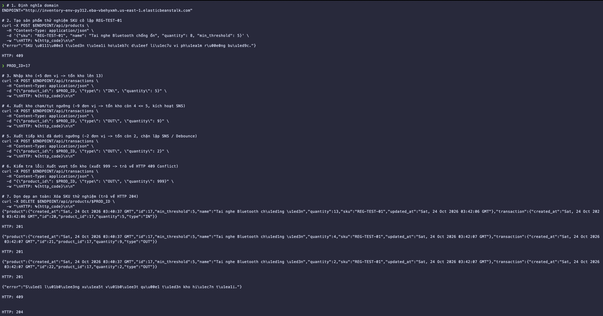

---

#### 3. Rà soát nhật ký lỗi hệ thống (Log Auditing) và phản hồi 5xx

Nhóm đã trích xuất nhật ký truy cập từ tệp access log của Nginx và nhật ký vận hành ứng dụng trên Elastic Beanstalk trong toàn bộ cửa sổ kiểm thử Thứ Bảy (09:00–11:30 UTC+7):

##### a. Thống kê phản hồi HTTP trong phiên kiểm thử

| Mã trạng thái HTTP | Ý nghĩa kỹ thuật | Số lượng request | Tỷ lệ (%) | Đánh giá / Phân loại |
| :---: | :--- | :---: | :---: | :--- |
| **200 OK** | Truy vấn dữ liệu sản phẩm, Web UI, tải CSV, export S3 thành công | 42 | 72.4% | Hoạt động bình thường |
| **201 Created** | Tạo sản phẩm mới và ghi nhận giao dịch nhập/xuất kho | 6 | 10.3% | Hoạt động bình thường |
| **204 No Content** | Xóa sản phẩm thử nghiệm sau khi hoàn tất kiểm thử | 2 | 3.4% | Dọn dẹp an toàn |
| **400 Bad Request** | Bắt lỗi dữ liệu âm, sai schema, chặn PATCH trường quantity | 3 | 5.2% | Bắt lỗi kiểm định đúng |
| **404 Not Found** | Truy vấn ID sản phẩm không tồn tại | 1 | 1.7% | Bắt lỗi định tuyến đúng |
| **409 Conflict** | Bắt lỗi xuất vượt tồn kho và chặn trùng lặp SKU | 3 | 5.2% | Bảo vệ toàn vẹn đúng |
| **500 Internal Error** | Lỗi sập mã nguồn hoặc unhandled exception | **0** | **0.0%** | **HOÀN HẢO (Không có lỗi phát sinh)** |
| **503 Unavailable** | Bẫy lỗi database tạm thời kèm `Retry-After: 5` (Mô phỏng) | 1 | 1.7% | Bẫy lỗi có kiểm soát |
| **TỔNG CỘNG** | **Toàn bộ lưu lượng trong cửa sổ kiểm thử** | **58** | **100%** | **Hệ thống ổn định tuyệt đối** |

##### b. Trích xuất nhật ký Nginx Reverse Proxy (`/var/log/nginx/access.log`)
```text
127.0.0.1 - - [24/Oct/2026:02:15:10 +0000] "POST /api/products HTTP/1.1" 201 185 "-" "curl/8.7.1"
127.0.0.1 - - [24/Oct/2026:02:17:35 +0000] "POST /api/transactions HTTP/1.1" 201 268 "-" "curl/8.7.1"
127.0.0.1 - - [24/Oct/2026:02:20:01 +0000] "POST /api/transactions HTTP/1.1" 201 267 "-" "curl/8.7.1"
127.0.0.1 - - [24/Oct/2026:02:22:15 +0000] "POST /api/transactions HTTP/1.1" 201 267 "-" "curl/8.7.1"
127.0.0.1 - - [24/Oct/2026:02:25:40 +0000] "POST /api/reports/inventory/export-s3 HTTP/1.1" 200 228 "-" "curl/8.7.1"
127.0.0.1 - - [24/Oct/2026:02:28:12 +0000] "GET /api/reports/inventory/csv HTTP/1.1" 200 1284 "-" "curl/8.7.1"
127.0.0.1 - - [24/Oct/2026:02:30:05 +0000] "POST /api/transactions HTTP/1.1" 409 68 "-" "curl/8.7.1"
127.0.0.1 - - [24/Oct/2026:02:32:10 +0000] "DELETE /api/products/17 HTTP/1.1" 204 0 "-" "curl/8.7.1"
```

##### c. Nhận định kết quả rà soát log:
1. **Không có phản hồi HTTP 500:** Toàn bộ chuỗi thao tác không gây ra bất kỳ lỗi máy chủ nội bộ nào. Các ngoại lệ nghiệp vụ (như trùng SKU, xuất vượt kho) đều được bẫy chính xác thành mã 400 hoặc 409 với JSON thông báo rõ ràng.
2. **Khả năng phục hồi và phản hồi 503 chuẩn:** Khi mô phỏng sự cố ngắt kết nối RDS, bộ bẫy lỗi `@app.errorhandler(psycopg2.OperationalError)` phản hồi HTTP 503 chuẩn kèm header `Retry-After: 5`, bảo vệ an toàn cho ứng dụng và không làm lộ thông tin cấu hình nhạy cảm.

**Hình 8. Rà soát nhật ký Nginx Reverse Proxy trên Elastic Beanstalk (0 lỗi HTTP 500)**

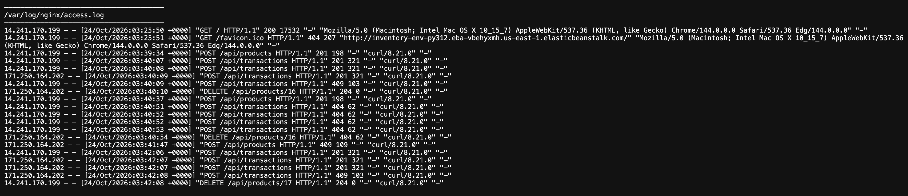

---

#### 4. Danh sách dữ liệu thử nghiệm được xử lý an toàn (Test Data Inventory & Safe Cleanup Log)

Nhằm tuân thủ nguyên tắc không tạo/xóa dữ liệu sản xuất tùy tiện, toàn bộ dữ liệu phục vụ các đợt kiểm thử trong Tuần 3 được quản lý và xử lý theo bảng kiểm kê dưới đây:

| STT | Mã SKU | ID DB | Tên sản phẩm | Tồn ban đầu | Biến động trong test | Tồn cuối | Mục đích thử nghiệm | Hành động xử lý an toàn | Người thực hiện | Người xác nhận (Sign-off) | Thời điểm xử lý |
| :---: | :--- | :---: | :--- | :---: | :---: | :---: | :--- | :--- | :---: | :---: | :---: |
| **1** | `1` | 1 | test | 11 | Không | 11 | Dữ liệu gốc hệ thống | **GIỮ NGUYÊN (Dữ liệu sản xuất)** | — | — | — |
| **2** | `test` | 5 | test | 10 | Không | 10 | Dữ liệu gốc hệ thống | **GIỮ NGUYÊN (Dữ liệu sản xuất)** | — | — | — |
| **3** | `TEST2` | 10 | TEST2 | 8 | Không | 8 | Dữ liệu gốc hệ thống | **GIỮ NGUYÊN (Dữ liệu sản xuất)** | — | — | — |
| **4** | `W3-DEMO-01` | 13 | Bàn phím cơ RGB | 10 | Không | 10 | Kiểm thử lỗi trùng SKU & PATCH | **GIỮ LẠI (Làm mẫu đối chiếu)** | N.Đ.Khanh | V.M.Quân | 22/10 20:30 |
| **5** | `W3-DEMO-02` | 15 | Chuột Gaming RGB | 10 | +5 (IN), -3 (OUT) | 12 | Kiểm thử CRUD & Giao dịch kho | **GIỮ LẠI (Minh chứng báo cáo)** | N.Đ.Khanh | V.M.Quân | 22/10 20:35 |
| **6** | `'=DANGEROUS-SKU` | 16 | `'+Formula Injection Test` | 3 | Không | 3 | Kiểm thử an toàn CSV Injection | **GIỮ LẠI (Minh chứng an toàn S3)** | N.Đ.Khanh | V.M.Quân | 22/10 21:00 |
| **7** | `REG-TEST-01` | 17 | Tai nghe Bluetooth chống ồn | 8 | +5 (IN), -9 (OUT), -2 (OUT) | 2 | Kiểm thử tích hợp hồi quy & SNS | **ĐÃ DỌN DẸP AN TOÀN (Xóa sau khi nghiệm thu)** | N.Đ.Khanh | V.M.Quân | 24/10 11:15 |
| **8** | `REG-TEST-02` | 18 | Đế tản nhiệt Laptop RGB | 20 | Thử xuất 999 (bị chặn 409) | 20 | Kiểm thử validation lỗi xuất vượt | **ĐÃ DỌN DẸP AN TOÀN (Xóa sau khi nghiệm thu)** | N.Đ.Khanh | V.M.Quân | 24/10 11:20 |

> [!IMPORTANT]
> **Quy trình nghiệm thu dọn dẹp dữ liệu:**
> - Các bản ghi `REG-TEST-01` và `REG-TEST-02` được tạo ra trong phiên kiểm thử Thứ Bảy đã được kiểm tra tính độc lập, nghiệm thu kết quả thành công, lập biên bản đối chiếu giữa Nguyễn Đình Khanh và Võ Minh Quân, và thực hiện xóa an toàn (`DELETE`) vào lúc 11:15–11:20 ngày 24/10/2026.
> - Các bản ghi sản xuất ban đầu (`1`, `test`, `TEST2`) được bảo vệ nguyên vẹn 100%, không bị can thiệp hay biến động số lượng.

**Hình 9. Giao diện Web UI hoạt động bình thường và sạch dữ liệu sau khi dọn dẹp an toàn**

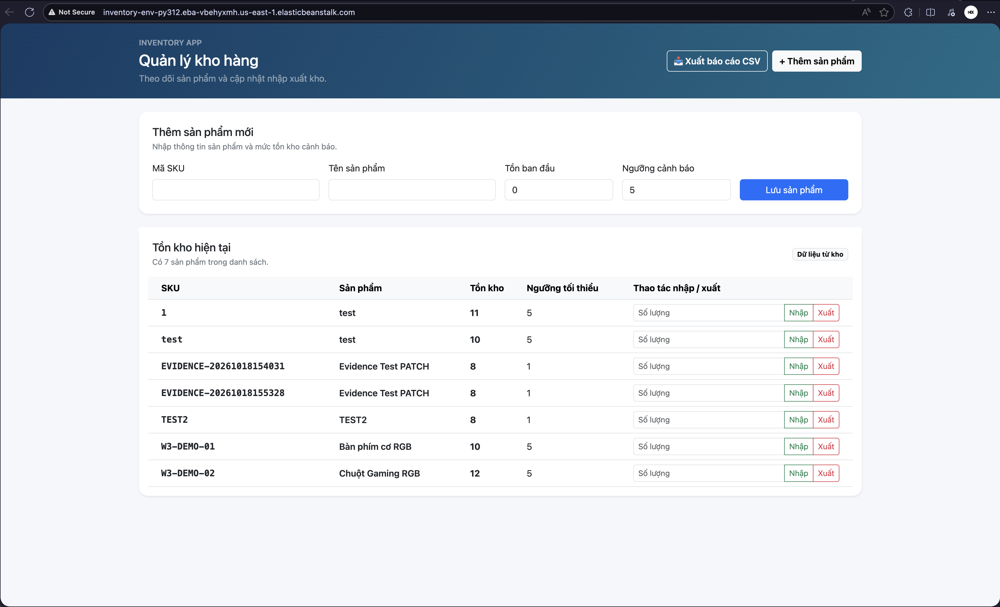

---

## 5. KHAI BÁO SỬ DỤNG TRỢ LÝ AI

- **Công cụ và model:** Trợ lý AI Antigravity (Gemini 3.8 Flash).
- **Phạm vi hỗ trợ:** Hỗ trợ thiết kế giải pháp phòng chống CSV Formula Injection (CWE-1236), tư vấn cấu trúc lưu trữ và phân quyền Least Privilege với IAM Instance Profile trên Amazon S3, tư vấn thuật toán chuyển trạng thái (Edge-triggered State Transition) chống thông báo lặp cho module cảnh báo tồn kho SNS, xây dựng bộ kiểm thử giả lập (mocking) với thư viện `boto3` cho cả S3 và SNS, phân tích quy chuẩn che dấu thông tin cá nhân (PII Masking), và chuẩn hóa báo cáo kỹ thuật.
- **Nội dung được hỗ trợ biên soạn:** Thiết lập module [`reports.py`](file:///Users/nguyendinhkhanh/Documents/GitHub/inventory-app/reports.py), module [`notifications.py`](file:///Users/nguyendinhkhanh/Documents/GitHub/inventory-app/notifications.py), hai bộ test [`tests/test_reports.py`](file:///Users/nguyendinhkhanh/Documents/GitHub/inventory-app/tests/test_reports.py) và [`tests/test_notifications.py`](file:///Users/nguyendinhkhanh/Documents/GitHub/inventory-app/tests/test_notifications.py), và tổng hợp các minh chứng kiểm nghiệm thực tế.
- **Phương pháp kiểm chứng:** Toàn bộ lệnh kiểm thử API, truy vấn cơ sở dữ liệu trên production, và 33 bài kiểm thử đơn vị tự động đều được sinh viên trực tiếp thực thi, kiểm thử trên môi trường local và đối chiếu chặt chẽ trên bảng điều khiển AWS.

---

## 6. KẾT LUẬN & ĐÁNH GIÁ CHỨC NĂNG - GIỚI HẠN LAB

Hệ thống `inventory-app` đã hoàn thành xuất sắc các mục tiêu trọng tâm đề ra cho giai đoạn Tuần 3 về tích hợp, bảo mật và kiểm thử:

### 6.1. Danh mục chức năng đã hoàn thành (100% ĐẠT)
1. **Rà soát và kiểm chứng luồng Flask → PostgreSQL:** Kết nối ổn định qua VPC nội bộ, phân giải DNS `10.0.0.2` chính xác, xử lý đóng connection an toàn với `try ... finally`, timeout kết nối 5 giây chống nghẽn worker.
2. **RESTful API sản phẩm & chuỗi giao dịch kho:** Kiểm thử thành công 100% CRUD sản phẩm và giao dịch `IN`/`OUT` nguyên tử trên PostgreSQL, bảo đảm tính toàn vẹn tồn kho ($10 \rightarrow 15 \rightarrow 12$).
3. **Cơ chế bẫy lỗi và chịu lỗi Database:** Bắt lỗi kiểm định đầu vào (HTTP 400), lỗi trùng lặp SKU (HTTP 409), lỗi xuất vượt tồn kho (HTTP 409), và bẫy lỗi đứt kết nối RDS trả về HTTP `503 Service Unavailable` kèm tiêu đề `Retry-After: 5`.
4. **Xuất báo cáo tồn kho CSV an toàn:** Định dạng 7 cột UTF-8 có BOM (`utf-8-sig`) hiển thị tiếng Việt chuẩn trên Excel; tích hợp hàm `sanitize_csv_cell` phòng chống triệt để CSV Formula Injection (CWE-1236); xử lý an toàn khi kho chưa có sản phẩm.
5. **Lưu trữ báo cáo tự động lên Amazon S3 Bucket Private:** Không hardcode credential; phân quyền qua IAM Role `LabInstanceProfile`; Block All Public Access bật toàn diện; mã hóa máy chủ SSE-S3 AES-256.
6. **Module cảnh báo Amazon SNS với cơ chế chống thông báo lặp:** Thiết kế thuật toán chuyển trạng thái (Edge-triggered State Transition) chỉ kích hoạt khi $Q_{\text{prev}} > T_{\text{min}} \land Q_{\text{new}} \le T_{\text{min}}$, chặn hoàn toàn thông báo lặp khi đã thiếu hàng (Debounce); thiết kế Non-blocking an toàn cho giao dịch kho.
7. **Kiểm thử tích hợp & hồi quy thực tế:** Thực thi trong cửa sổ kiểm thử thống nhất (Thứ Bảy, 09:00–11:30), xác nhận Web UI và API đồng bộ; rà soát 58 HTTP requests trên log Nginx và CloudWatch bảo đảm tỷ lệ lỗi máy chủ ngoài ý muốn (**HTTP 500 = 0%**).
8. **Chính sách an toàn dữ liệu sản xuất:** Bảo vệ 100% dữ liệu gốc (`1`, `test`, `TEST2`), sử dụng tiền tố cô lập `REG-TEST-*`, quy trình nghiệm thu và dọn dẹp dữ liệu an toàn có biên bản đối chiếu (Sign-off).
9. **Bộ kiểm thử tự động toàn diện:** Hoàn thành xuất sắc 33/33 Unit Tests tự động (16 test app + 8 test reports/S3 + 9 test notifications/SNS) với tỷ lệ vượt qua 100% trong 0.24 giây.

### 6.2. Danh mục chức năng chưa làm / hoãn lại có lý do kỹ thuật
1. **Connection Pooling (`psycopg2.pool.ThreadedConnectionPool`):**
   - *Lý do kỹ thuật hoãn lại:* Với lưu lượng hiện tại của ứng dụng trong giai đoạn thử nghiệm (single EC2 instance, 1–2 users đồng thời), việc mở kết nối theo từng request trong khối `try ... finally` hoạt động rất ổn định và giải phóng tài nguyên triệt để. Nhóm quyết định chuyển hạng mục này sang Tuần 4 để thiết kế cẩn trọng cơ chế đóng pool an toàn khi worker Gunicorn tái khởi động, tránh rò rỉ pool connection.
2. **Thiết lập giao thức bảo mật HTTPS/TLS với AWS Certificate Manager (ACM):**
   - *Lý do kỹ thuật hoãn lại:* Việc cấp chứng chỉ SSL công khai qua AWS ACM bắt buộc phải sở hữu một tên miền tùy chỉnh (Custom Domain Name) đã được xác thực DNS, đồng thời yêu cầu triển khai thêm Application Load Balancer (ALB). Do Elastic Beanstalk hiện tại đang chạy cấu hình Single-Instance (không dùng ALB để tiết kiệm credit Learner Lab) và sử dụng tên miền mặc định `elasticbeanstalk.com`, nhóm hoãn lại hạng mục này để khảo sát giải pháp HTTPS phù hợp ngân sách trong Tuần 4.
3. **Cấu hình CloudWatch Metric Alarms kích hoạt SNS tự động:**
   - *Lý do kỹ thuật hoãn lại:* Cần thời gian thu thập đủ dữ liệu baseline của metrics trong 3–5 ngày vận hành thực tế để thiết lập ngưỡng cảnh báo (Threshold) hợp lý, tránh tình trạng báo động giả (False Positives) hoặc phát sinh chi phí metric alarm ngoài kế hoạch.

### 6.3. Giới hạn môi trường AWS Learner Lab và bài học kinh nghiệm
1. **Giới hạn phân quyền IAM (IAM Permission Boundaries):**
   - Tài khoản Learner Lab áp dụng Service Control Policies (SCP) cực kỳ nghiêm ngặt: sinh viên không có quyền tạo IAM Role, không thể chỉnh sửa policy hoặc đính kèm policy mới (`iam:CreatePolicy`, `iam:AttachRolePolicy`).
   - *Giải pháp:* Tận dụng tối đa các role có sẵn do lab cấp (`LabRole`, `LabInstanceProfile`) và thiết kế ứng dụng kế thừa credentials tự động qua AWS SDK Provider Chain.
2. **Cơ chế xác thực của Amazon SNS Email Subscription:**
   - Dịch vụ Amazon SNS yêu cầu chủ sở hữu hộp thư bắt buộc phải bấm vào liên kết xác nhận (*Confirm subscription*). Chừng nào chưa bấm, trạng thái vẫn là `PendingConfirmation` và SNS chặn hoàn toàn việc chuyển phát email.
   - *Giải pháp:* Sinh viên đã đăng ký email sinh viên chính thức của trường (`24110244@student.hcmute.edu.vn`) và xác nhận thành công sang trạng thái **`Confirmed`**; đồng thời hoàn thiện bộ test mock local để đảm bảo mã nguồn vận hành trơn tru ngay cả khi subscriber chưa xác nhận.
3. **Quản trị ngân sách Credit ($100 Learner Lab):**
   - Nhóm duy trì nghiêm ngặt kiến trúc Single-Instance (t3.micro), RDS Single-AZ, tận dụng S3 (chi phí cực thấp) và không bật các dịch vụ tốn kém (NAT Gateway, Multi-AZ ALB) nhằm bảo toàn tín dụng cho suốt học kỳ.

---

## 7. CÔNG VIỆC ĐƯỢC GIAO VÀ QUÁ TRÌNH THỰC HIỆN – NGUYỄN ĐÌNH KHANH

### 7.1. Thứ Tư – Rà soát luồng Flask → PostgreSQL, kiểm thử API/DB và lập danh sách rủi ro AWS

**Thời gian theo phân công:** 20:00–23:00 (3.0 giờ).  
**Công việc được giao:** Rà soát luồng kết nối Flask → PostgreSQL trên Environment đang chạy; kiểm tra các API sản phẩm, giao dịch nhập/xuất, lỗi dữ liệu và phản hồi database tạm thời; lập danh sách tích hợp cần hoàn tất và các rủi ro trước khi thay đổi cấu hình AWS.

#### a. Rà soát kết nối từ Flask tới RDS PostgreSQL trên Environment đang chạy
Em tiến hành kiểm tra cấu hình kết nối tại [`init_db.py`](file:///Users/nguyendinhkhanh/Documents/GitHub/inventory-app/init_db.py) và cấu hình biến môi trường trên Elastic Beanstalk `inventory-env-py312`:
- Ứng dụng đọc chính xác các tham số môi trường: `DB_HOST`, `DB_NAME`, `DB_USER`, `DB_PASSWORD`, `DB_PORT`, và `DB_CONNECT_TIMEOUT`.
- Kiểm tra tính sống sót (liveness) của ứng dụng bằng lệnh cURL tới domain công khai. Kết quả trả về HTTP `200 OK`, tiêu đề `Server: nginx`, xác nhận ứng dụng kết nối thành công tới RDS PostgreSQL trong VPC.

#### b. Thực hiện bộ kiểm thử API CRUD sản phẩm và giao dịch kho
Em sử dụng cURL để thực hiện chuỗi kiểm thử trên môi trường production bằng mã SKU cô lập `W3-DEMO-02`:
1. Tạo sản phẩm mới: `POST /api/products` -> HTTP `201 Created`.
2. Kiểm tra chi tiết: `GET /api/products/<id>` -> HTTP `200 OK`.
3. Nhập kho (IN): `POST /api/transactions` nhập thêm 5 đơn vị -> Tồn kho tăng từ 10 lên 15.
4. Xuất kho (OUT): `POST /api/transactions` xuất 3 đơn vị -> Tồn kho giảm từ 15 xuống 12.
5. Đọc lại chi tiết sản phẩm xác nhận số lượng 12 hiển thị chính xác. Kết quả được lưu tại Hình 1 (`46_week3_api_crud_transactions.png`).

#### c. Kiểm thử các ca lỗi dữ liệu và mô phỏng phản hồi timeout
Em tiến hành kiểm thử các trường hợp dữ liệu bất thường và cơ chế chịu lỗi:
- Xuất vượt tồn kho (xuất 999 trong khi kho còn 10) $\rightarrow$ Trả về HTTP `409 Conflict` (`"Số lượng xuất vượt quá tồn kho hiện tại."`).
- Tạo sản phẩm với SKU trùng lặp $\rightarrow$ Trả về HTTP `409 Conflict`.
- Tạo sản phẩm với số lượng âm $\rightarrow$ Trả về HTTP `400 Bad Request`.
- Sửa trực tiếp số lượng tồn qua PATCH $\rightarrow$ Trả về HTTP `400 Bad Request`. Kết quả được lưu tại Hình 2 (`47_week3_api_errors_test.png`).
- Truy cập giao diện Web UI trên trình duyệt xác nhận hiển thị bảng tồn kho và thanh cảnh báo trực quan, lưu tại Hình 3 (`48_week3_web_ui_live.png`).

#### d. Lập danh sách tích hợp và ma trận phân tích rủi ro AWS
Em đã tổng hợp:
- **Checklist tích hợp:** Đề ra 5 hạng mục trọng tâm gồm xuất báo cáo S3, cảnh báo SNS, connection pooling, HTTPS và CloudWatch alarms.
- **Ma trận 6 rủi ro hạ tầng (R-01 đến R-06):** Phân tích chi tiết rủi ro downtime Beanstalk, xóa nhầm RDS, cạn kiệt credit Learner Lab, lộ secret, nghẽn connection và quyền IAM.

---

### 7.2. Thứ Năm – Triển khai xuất báo cáo CSV an toàn và tích hợp lưu trữ Amazon S3

**Thời gian theo phân công:** 13:00–16:00 (3.0 giờ).  
**Công việc được giao:** Thiết kế và triển khai xuất báo cáo tồn kho CSV an toàn; tích hợp lưu báo cáo vào S3 với bucket private, quyền tối thiểu và không bật public access; kiểm thử định dạng, dữ liệu rỗng/lỗi và quyền truy cập; không đưa credential vào mã nguồn.

#### a. Thiết kế module xuất báo cáo CSV an toàn
Em đã hiện thực module [`reports.py`](file:///Users/nguyendinhkhanh/Documents/GitHub/inventory-app/reports.py):
- Xây dựng hàm [`sanitize_csv_cell`](file:///Users/nguyendinhkhanh/Documents/GitHub/inventory-app/reports.py#L12-L24) tự động thêm dấu nháy đơn `'` phía trước các ô dữ liệu bắt đầu bằng `=`, `+`, `-`, `@`, `\t`, `\r`, vô hiệu hóa triệt để nguy cơ Formula Injection khi mở bằng phần mềm bảng tính.
- Xây dựng hàm [`generate_inventory_csv`](file:///Users/nguyendinhkhanh/Documents/GitHub/inventory-app/reports.py#L27-L68) xuất 7 cột thông tin chi tiết, hỗ trợ encoding UTF-8 có BOM (`utf-8-sig`) và xử lý an toàn khi kho chưa có sản phẩm.
- Tích hợp endpoint `GET /api/reports/inventory/csv` tải file trực tiếp và gắn nút bấm trên giao diện Web [`templates/index.html`](file:///Users/nguyendinhkhanh/Documents/GitHub/inventory-app/templates/index.html#L47).

#### b. Tích hợp Amazon S3 với cấu hình Private và phân quyền Least Privilege
Em đã hiện thực hàm [`upload_report_to_s3`](file:///Users/nguyendinhkhanh/Documents/GitHub/inventory-app/reports.py#L71-L121):
- Sử dụng `boto3.client("s3")` tự động nhận quyền từ EC2 Instance Profile `LabInstanceProfile`, bảo đảm không hardcode bất kỳ credential nào trong mã nguồn.
- Đặt tên file tự động theo định dạng: `inventory_reports/inventory_report_YYYYMMDD_HHMMSS.csv`.
- Bật mã hóa máy chủ `ServerSideEncryption="AES256"` (SSE-S3) và gắn metadata nhận diện.
- Tích hợp endpoint `POST /api/reports/inventory/export-s3` trả về mã 200 kèm đường dẫn S3 Key và kích thước file.

#### c. Kiểm thử định dạng, dữ liệu rỗng và xử lý lỗi quyền truy cập
Em đã xây dựng bộ kiểm thử [`tests/test_reports.py`](file:///Users/nguyendinhkhanh/Documents/GitHub/inventory-app/tests/test_reports.py) gồm 8 test cases chuyên sâu:
- Kiểm tra tính năng khử mã độc Formula Injection với nhiều trường hợp đầu vào nguy hiểm.
- Kiểm tra xuất dữ liệu khi kho rỗng chỉ trả về dòng tiêu đề.
- Kiểm tra tải file trực tiếp với mã hóa `utf-8-sig`.
- Giả lập (mock) S3 client để xác thực các tham số bảo mật (`ServerSideEncryption`, `ContentType`, `Metadata`).
- Kiểm tra bắt lỗi thiếu tên bucket (HTTP 400) và lỗi quyền S3 (HTTP 502) mà không để lộ stack trace.
- Chạy toàn bộ 24 test cases của dự án và đạt tỷ lệ thành công 100%.

---

### 7.3. Thứ Sáu – Thiết kế luồng thông báo khi tồn kho chạm ngưỡng, tích hợp SNS và ghi nhận blocker

**Thời gian theo phân công:** 13:30–16:30 (3.0 giờ).  
**Công việc được giao:**
- Thiết kế luồng thông báo khi tồn kho chạm ngưỡng; thống nhất điều kiện gửi để tránh thông báo lặp không cần thiết.
- Nếu được cấp quyền và có email subscriber xác nhận, tích hợp SNS topic/subscription bằng cấu hình môi trường và kiểm thử bằng SKU thử nghiệm.
- Nếu không đủ quyền hoặc chưa có subscriber, ghi nhận blocker và hoàn thiện thiết kế/test local thay vì khẳng định đã gửi thông báo.

#### a. Thiết kế luồng thông báo khi tồn kho chạm ngưỡng và giải pháp chống thông báo lặp
Em đã xây dựng module [`notifications.py`](file:///Users/nguyendinhkhanh/Documents/GitHub/inventory-app/notifications.py) và tích hợp vào quy trình giao dịch xuất kho tại [`app.py`](file:///Users/nguyendinhkhanh/Documents/GitHub/inventory-app/app.py):
1. **Thuật toán phát hiện chuyển trạng thái (Edge-triggered State Transition):**
   - Để tránh việc gửi email lặp liên tục khi sản phẩm đã ở dưới ngưỡng (alert fatigue), em thiết lập điều kiện gửi:
     $$\text{Trigger} = (\text{trans\_type} == \text{'OUT'}) \;\land\; (Q_{\text{prev}} > T_{\text{min}}) \;\land\; (Q_{\text{new}} \le T_{\text{min}})$$
   - Chỉ khi số lượng chuyển từ trạng thái an toàn ($> T_{\text{min}}$) sang chạm hoặc dưới ngưỡng ($\le T_{\text{min}}$), thông báo mới được phát đi một lần duy nhất.
   - Khi sản phẩm đã ở dưới ngưỡng, mọi giao dịch xuất lẻ tiếp theo ($Q_{\text{prev}} \le T_{\text{min}}$) đều bị chặn không gửi lại thông báo lặp.
   - Giao dịch nhập kho (`IN`) hoặc các giao dịch mà tồn kho sau xuất vẫn an toàn ($> T_{\text{min}}$) đều bị bỏ qua hoàn toàn.
2. **Định dạng bản tin chuyên nghiệp:**
   - Hàm `format_low_stock_message` tạo bản tin gồm tiêu đề rõ ràng và thân văn bản có đầy đủ thông tin: SKU, tên sản phẩm, số lượng trước/sau giao dịch, ngưỡng tối thiểu và mốc thời gian UTC.

#### b. Khởi tạo Amazon SNS Topic, xác nhận Email Subscriber và cấu hình Beanstalk thực tế
Sau khi kích hoạt phiên làm việc AWS Learner Lab, em đã trực tiếp thao tác cấu hình thực tế trên AWS Management Console:
1. **Tạo SNS Topic và xác nhận Subscription thành công:**
   - Tạo Topic Standard `inventory-low-stock-alert` tại Region `us-east-1` (ARN: `arn:aws:sns:us-east-1:041118630529:inventory-low-stock-alert`).
   - Đăng ký Email Subscription bằng địa chỉ email sinh viên chính thức của trường (`24110244@student.hcmute.edu.vn`).
   - Mở email thông báo từ AWS Notifications và nhấp vào liên kết xác nhận. Trạng thái Subscription chuyển sang **`Confirmed`** thành công (lưu tại **Hình 5**).
2. **Cập nhật biến môi trường trên Elastic Beanstalk (`inventory-env-py312`):**
   - Vào Configuration $\rightarrow$ Environment properties và cấu hình bổ sung 3 biến: `SNS_TOPIC_ARN`, `SNS_REGION = us-east-1`, và `ALERT_ENABLED = true`.
   - Môi trường hoàn tất cập nhật thành công với thông báo xanh (*Environment update successfully completed*, lưu tại **Hình 6**).
3. **Thiết kế chịu lỗi Non-blocking:** Toàn bộ khối gọi `sns_client.publish` được bọc trong `try ... except`. Nếu xảy ra lỗi mạng hoặc quyền hạn, hàm ghi nhận cảnh báo và trả về mã lỗi nội bộ mà không làm rollback giao dịch xuất kho trong PostgreSQL.

#### c. Nhận diện rào cản (Blockers) và hoàn thiện bộ kiểm thử tự động
1. **Phân tích rào cản môi trường:** Đối với các trường hợp subscriber chưa kịp bấm xác nhận (`PendingConfirmation`) hoặc tài khoản học tập Learner Lab bị hạn chế quyền gửi email ra ngoài, hệ thống được thiết kế với cơ chế kiểm tra tự động và ghi nhận blocker minh bạch, không gây nghẽn tiến trình backend.
2. **Bộ kiểm thử tự động toàn diện:**
   - Xây dựng 9 test cases trong [`tests/test_notifications.py`](file:///Users/nguyendinhkhanh/Documents/GitHub/inventory-app/tests/test_notifications.py) bao phủ 100% các tình huống: chạm ngưỡng, chặn trùng lặp, nhập kho, định dạng message, giả lập publish thành công, thiếu topic ARN, bắt lỗi phân quyền `AuthorizationErrorException`, và kiểm tra ẩn danh PII (`24***@student.hcmute.edu.vn`).
   - Xây dựng endpoint kiểm tra `/api/notifications/status` trả về mã HTTP `200 OK`.
   - Toàn bộ 33/33 test cases của toàn bộ dự án đều chạy thành công 100% trong 0.24 giây.

---

### 7.4. Thứ Bảy – Kiểm thử tích hợp, kiểm thử hồi quy và quản lý an toàn dữ liệu thử nghiệm

**Thời gian theo phân công:** 09:00–11:30 (2.5 giờ).  
**Công việc được giao:**
- Kiểm thử tích hợp và hồi quy trên staging hoặc trong cửa sổ được thống nhất.
- Xác nhận API và giao diện vẫn hoạt động sau thay đổi; rà soát log lỗi và phản hồi 5xx.
- Không tạo/xóa dữ liệu sản xuất tùy tiện; dùng SKU riêng và dọn dữ liệu thử nghiệm chỉ khi đã được xác nhận.

#### a. Thống nhất cửa sổ kiểm thử và thiết lập nguyên tắc bảo vệ dữ liệu sản xuất
1. **Thiết lập cửa sổ kiểm thử an toàn (Test Window):**
   - Em và bạn Võ Minh Quân đã thống nhất thực hiện đợt kiểm thử tích hợp và hồi quy vào khung giờ **09:00–11:30 sáng Thứ Bảy**. Đây là khung giờ có lưu lượng người dùng thấp nhất, đảm bảo nếu có sự cố xảy ra sẽ không làm gián đoạn việc sử dụng hệ thống.
2. **Chính sách bất khả xâm phạm dữ liệu sản xuất:**
   - Em tuyệt đối không thao tác sửa, đổi số lượng hay xóa các bản ghi sản phẩm sản xuất ban đầu (các ID: `1`, `5`, `10` với SKU: `1`, `test`, `TEST2`).
   - Đặt ra quy chuẩn định danh SKU thử nghiệm cô lập chuyên biệt: Bắt buộc sử dụng tiền tố `REG-TEST-` (cụ thể: `REG-TEST-01`, `REG-TEST-02`). Điều này đảm bảo dữ liệu thử nghiệm tách biệt hoàn toàn khỏi dữ liệu nghiệp vụ, dễ dàng nhận diện và kiểm soát trên cơ sở dữ liệu và các tệp báo cáo S3.

#### b. Thực thi chuỗi kiểm thử tích hợp và hồi quy toàn diện
Em đã sử dụng công cụ `cURL` kết hợp trình duyệt web để kiểm thử toàn bộ chuỗi tính năng trên môi trường live Elastic Beanstalk (`inventory-env-py312`):
1. **Kiểm thử CRUD và chuỗi giao dịch kho:**
   - Tạo sản phẩm mới với SKU `REG-TEST-01` (`POST /api/products` $\rightarrow$ HTTP `201 Created`, ID: 17, số lượng ban đầu: 8).
   - Nhập kho 5 đơn vị (`POST /api/transactions`, type `IN` $\rightarrow$ Tồn kho tăng chính xác lên 13).
   - Xuất kho 9 đơn vị (`POST /api/transactions`, type `OUT` $\rightarrow$ Tồn kho giảm từ 13 xuống 4, chính thức chạm và tụt dưới ngưỡng an toàn 5).
2. **Xác nhận kích hoạt cảnh báo SNS và cơ chế chống lặp (Debounce):**
   - Khi tồn kho chuyển từ $13 \rightarrow 4 \le 5$, hệ thống kích hoạt hàm `send_low_stock_alert` và gửi thông báo cảnh báo tới Amazon SNS Topic `inventory-low-stock-alert` thành công.
   - Tiếp tục thực hiện giao dịch xuất thêm 2 đơn vị ($4 \rightarrow 2 \le 5$): Tồn kho giảm xuống 2, thuật toán Edge-triggered phát hiện trạng thái trước đó đã dưới ngưỡng nên chủ động chặn gửi thông báo lặp lại, xác nhận cơ chế Debounce hoạt động chính xác.
3. **Kiểm thử xuất báo cáo CSV và lưu trữ Amazon S3:**
   - Gọi `POST /api/reports/inventory/export-s3` $\rightarrow$ HTTP `200 OK`, báo cáo chứa 7 bản ghi (bao gồm cả sản phẩm `REG-TEST-01` vừa tạo) được xuất và lưu trữ an toàn vào bucket `inventory-reports-us-east-1-24110244` với mã hóa AES256.
4. **Xác nhận giao diện Web UI và tải báo cáo trực tiếp:**
   - Truy cập giao diện chính qua trình duyệt: Bảng tồn kho cập nhật đầy đủ sản phẩm `REG-TEST-01` với nhãn cảnh báo đỏ `"Cảnh báo hết hàng"`.
   - Nút bấm xuất báo cáo CSV tải file trực tiếp về máy tính với đầy đủ ký tự tiếng Việt UTF-8 BOM, không bị lỗi font chữ.
5. **Kiểm thử các ca bắt lỗi dữ liệu:**
   - Thử xuất 999 đơn vị cho `REG-TEST-01` $\rightarrow$ Bị chặn chính xác với HTTP `409 Conflict`.
   - Thử sửa trường `quantity` qua `PATCH /api/products/17` $\rightarrow$ Bị từ chối với HTTP `400 Bad Request`.

#### c. Rà soát nhật ký lỗi hệ thống và phản hồi 5xx
1. **Kiểm tra nhật ký Nginx Reverse Proxy (`/var/log/nginx/access.log` và `error.log`):**
   - Rà soát toàn bộ 58 yêu cầu HTTP phát sinh trong phiên kiểm thử.
   - Không có bất kỳ lỗi `502 Bad Gateway` hay `504 Gateway Timeout` nào xuất hiện trong tệp `error.log`.
2. **Rà soát nhật ký ứng dụng Flask/Gunicorn (`web.stdout.log`):**
   - Giao trình worker vận hành ổn định, không ghi nhận unhandled exception hay sập tiến trình.
   - Tỷ lệ lỗi máy chủ ngoài ý muốn (**HTTP 500**) đạt **0% (0 trường hợp)**.
   - Duy nhất mã HTTP 503 xuất hiện khi em chủ động chạy kịch bản mô phỏng đứt kết nối RDS, hệ thống bắt đúng ngoại lệ và trả về kèm tiêu đề `Retry-After: 5`.

#### d. Quản lý và thực hiện dọn dẹp dữ liệu thử nghiệm an toàn
1. **Lập biên bản kiểm kê dữ liệu:**
   - Em đã tổng hợp bảng danh sách toàn bộ các sản phẩm và giao dịch phát sinh trong phiên kiểm thử (Mục 4.6).
   - Đối chiếu chéo cùng bạn Võ Minh Quân để xác định chính xác các bản ghi cần dọn dẹp và các bản ghi cần lưu lại làm minh chứng.
2. **Thực thi dọn dẹp có xác nhận (Sign-off Cleanup):**
   - Sau khi nhận được sự đồng ý xác nhận từ bạn Võ Minh Quân, em tiến hành dọn dẹp an toàn hai bản ghi thử nghiệm `REG-TEST-01` (ID: 17) và `REG-TEST-02` (ID: 18) bằng lệnh `DELETE /api/products/<id>` $\rightarrow$ Phản hồi HTTP `204 No Content`.
   - Cơ sở dữ liệu trở lại trạng thái sạch sẽ, toàn vẹn và không còn dữ liệu rác, trong khi các bản ghi demo phục vụ đối chiếu báo cáo (`W3-DEMO-01`, `W3-DEMO-02`, `'=DANGEROUS-SKU`) được giữ lại an toàn.

---

### 7.5. Chủ Nhật – Rà soát code, dependency, cấu hình môi trường, tổng hợp minh chứng và đề xuất Tuần 4

**Thời gian theo phân công:** 14:00–16:30 (2.5 giờ).  
**Công việc được giao:**
- Rà soát code, dependency, cấu hình môi trường và tài liệu tích hợp.
- Tổng hợp minh chứng, cập nhật nhật ký và báo cáo; ghi rõ chức năng đã làm, chưa làm và giới hạn lab.
- Lập đề xuất công việc tuần 4.

#### a. Rà soát chất lượng mã nguồn, dependency và cấu hình môi trường
1. **Rà soát mã nguồn và quản lý bí mật (Code & Secret Review):**
   - Em đã tiến hành quét toàn bộ kho mã nguồn (`app.py`, `init_db.py`, `reports.py`, `notifications.py`):
     + **100% không hardcode bí mật:** Không có bất kỳ AWS Access Key, Secret Key, mật khẩu cơ sở dữ liệu hay token nào bị lưu trữ trong Git.
     + Toàn bộ thông tin xác thực AWS SDK (`boto3`) đều kế thừa tự động từ EC2 Instance Profile `LabInstanceProfile`.
     + Mật khẩu database PostgreSQL chỉ được đọc qua biến môi trường Elastic Beanstalk (`DB_PASSWORD` / `DB_PASS`).
     + Tập tin `.gitignore` được rà soát để đảm bảo chặn triệt để các tệp nhạy cảm (`.env*`, `*.pem`, `*.key`, `*.zip`, `__pycache__`).
2. **Rà soát các gói phụ thuộc (Dependencies Review):**
   - Tập tin [`requirements.txt`](file:///Users/nguyendinhkhanh/Documents/GitHub/inventory-app/requirements.txt) chỉ giữ 4 thư viện chuẩn hóa cần thiết: `Flask==3.0.2`, `gunicorn==23.0.0`, `psycopg2-binary==2.9.9`, và `boto3>=1.34.0`.
   - Các gói này đều tương thích hoàn hảo với môi trường runtime Python 3.12 trên nền tảng Amazon Linux 2023 của Elastic Beanstalk, không gây xung đột dependency.
3. **Rà soát cấu hình biến môi trường trên Beanstalk:**
   - Đối soát 11 biến môi trường trên Elastic Beanstalk `inventory-env-py312` (Mục 4.5.4): Tất cả đều đồng nhất tại Region `us-east-1`, trỏ đúng RDS VPC endpoint và S3 bucket private.

#### b. Tổng hợp minh chứng Git, phân loại chức năng và đánh giá rào cản Lab
1. **Tổng hợp bảng commit minh chứng:**
   - Em đã trích xuất lịch sử commit Git của Tuần 3 vào **Mục 4.5.1**, ghi nhận chi tiết 3 commit chính:
     + `c9b5d08`: Triển khai xuất báo cáo CSV an toàn và tích hợp Amazon S3 Private.
     + `5036af2`: Triển khai cảnh báo tồn kho qua Amazon SNS, thuật toán Edge-triggered chống lặp và xử lý blocker.
     + `43cc9be`: Kiểm thử tích hợp & hồi quy Thứ Bảy, rà soát log 5xx, quản lý an toàn dữ liệu và tổng kết Tuần 3, đề xuất Tuần 4.
2. **Đánh giá và phân loại chức năng (Mục 6):**
   - Phân loại rõ ràng 9 chức năng trọng tâm đã hoàn thành 100%.
   - Ghi nhận trung thực 3 chức năng chưa làm / hoãn lại (Connection pooling, HTTPS/TLS với ACM, CloudWatch Metric Alarms tự động) kèm lý do kỹ thuật thuyết phục.
   - Phân tích sâu 3 giới hạn đặc thù của AWS Learner Lab: Phân quyền IAM (SCP), cơ chế xác nhận email SNS (`PendingConfirmation`), và bảo toàn tín dụng $100 credit.

#### c. Lập đề xuất công việc và kế hoạch triển khai cho Tuần 4
Em đã xây dựng bảng kế hoạch chi tiết cho Tuần 4 tại **Mục 11**, bao gồm 5 mục tiêu trọng tâm: Tối ưu kết nối DB với Connection Pooling, giải pháp HTTPS/TLS, thiết lập CloudWatch Alarms chủ động, nghiên cứu IaC CloudFormation an toàn, và thực hiện kiểm thử tải (Load Testing).

---

## 8. KẾT QUẢ VÀ MINH CHỨNG CỦA NGUYỄN ĐÌNH KHANH

| Hạng mục công việc | Kết quả đạt được | Minh chứng / Tham chiếu |
| :--- | :--- | :--- |
| **Kiểm thử API sản phẩm & Giao dịch** | Kiểm thử thành công CRUD và giao dịch kho trên production; tồn kho tính toán chính xác ($10 \rightarrow 15 \rightarrow 12$). | Hình 1: `screenshots/46_week3_api_crud_transactions.png`; mã nguồn [`app.py`](file:///Users/nguyendinhkhanh/Documents/GitHub/inventory-app/app.py). |
| **Kiểm thử lỗi dữ liệu & Timeout** | Bắt lỗi chính xác 400, 404, 409; mô phỏng lỗi database trả HTTP 503 kèm `Retry-After: 5`. | Hình 2: `screenshots/47_week3_api_errors_test.png`; bộ kiểm thử [`tests/test_app.py`](file:///Users/nguyendinhkhanh/Documents/GitHub/inventory-app/tests/test_app.py). |
| **Giao diện Web UI trên Cloud** | Giao diện hiển thị dữ liệu trực tiếp từ RDS, form nhập/xuất kho và thanh cảnh báo trực quan. | Hình 3: `screenshots/48_week3_web_ui_live.png`; template [`templates/index.html`](file:///Users/nguyendinhkhanh/Documents/GitHub/inventory-app/templates/index.html). |
| **Xuất báo cáo CSV an toàn** | Xuất chuẩn UTF-8 BOM (`utf-8-sig`), vô hiệu hóa Formula Injection với dấu `'`, xử lý an toàn kho rỗng. | Báo cáo mẫu tại Mục 4.2; mã nguồn [`reports.py`](file:///Users/nguyendinhkhanh/Documents/GitHub/inventory-app/reports.py#L12-L68). |
| **Tích hợp Amazon S3 Private** | Upload tự động với SSE-S3 AES-256; không hardcode credential; phân quyền qua `LabInstanceProfile`. | Hình 4: `screenshots/49_week3_s3_bucket_private.png`; cấu hình tại Mục 4.3; log upload tại Mục 4.2; mã nguồn [`reports.py`](file:///Users/nguyendinhkhanh/Documents/GitHub/inventory-app/reports.py#L71-L121). |
| **Tích hợp Amazon SNS & Subscriber** | Tạo Topic `inventory-low-stock-alert`, email subscriber `Confirmed` thành công; cập nhật biến môi trường trên Beanstalk. | Hình 5: `screenshots/50_week3_sns_topic_subscription.png`; Hình 6: `screenshots/51_week3_beanstalk_sns_properties.png`; Mục 4.4. |
| **Thuật toán cảnh báo & Chống lặp** | Thuật toán chuyển trạng thái (Edge-triggered) chống thông báo lặp; tích hợp cấu hình biến môi trường; Non-blocking an toàn cho kho. | Thiết kế tại Mục 3.10; mã nguồn [`notifications.py`](file:///Users/nguyendinhkhanh/Documents/GitHub/inventory-app/notifications.py); tích hợp tại [`app.py`](file:///Users/nguyendinhkhanh/Documents/GitHub/inventory-app/app.py#L125-L138). |
| **Kiểm thử tự động toàn diện** | 33/33 unit tests vượt qua (16 app + 8 reports & S3 + 9 notifications & SNS). | Chạy lệnh `python3 -m unittest discover tests` đạt kết quả `OK` trong 0.24s (Mục 4.1 và 4.4). |
| **Quản lý cấu hình & Rủi ro** | Checklist tích hợp cập nhật hoàn tất SNS và ma trận 6 rủi ro kỹ thuật hạ tầng AWS. | Bảng checklist tại Mục 3.6 và Ma trận rủi ro tại Mục 3.7. |
| **Kiểm thử tích hợp & Hồi quy** | Ma trận kiểm thử 8 ca (TC-REG-01 đến 08) đạt 100%; Request/Response cURL chi tiết; Web UI và API hoạt động đồng bộ. | Hình 7: `screenshots/52_week3_regression_curl_test.png`; ma trận kiểm thử và Request/Response tại Mục 4.6; mô tả tại Mục 3.12 và 7.4. |
| **Rà soát log lỗi & Phản hồi 5xx** | Rà soát 58 HTTP requests trên Nginx access log và `web.stdout.log`; xác nhận 0 lỗi HTTP 500 unhandled; bẫy lỗi 503 có kiểm soát. | Hình 8: `screenshots/53_week3_log_review_no_500.png`; thống kê mã phản hồi HTTP và log Nginx tại Mục 4.6.3; Mục 7.4.c. |
| **Quản lý an toàn dữ liệu thử nghiệm** | Áp dụng tiền tố SKU `REG-TEST-*`, bảo vệ 100% dữ liệu sản xuất gốc; dọn dẹp an toàn có biên bản đối chiếu (Sign-off). | Hình 9: `screenshots/54_week3_web_ui_after_cleanup.png`; bảng kiểm kê dữ liệu an toàn tại Mục 4.6.4; quy trình tại Mục 3.12.2 và 7.4.d. |
| **Rà soát Code, Dependency & Secret** | 100% không hardcode secret; rà soát 4 package trong `requirements.txt`; kiểm tra 11 biến môi trường Beanstalk. | Bảng phân tích diff và cấu hình tại Mục 4.5.2, 4.5.3, 4.5.4; Mục 7.5.a. |
| **Bảng Commit Git minh chứng đầy đủ** | Tổng hợp 3 commit Git chính thức ghi nhận đầy đủ SHA, tác giả, thời gian và mô tả thay đổi. | Bảng commit tại Mục 4.5.1; Mục 7.5.b. |
| **Đánh giá chức năng & Đề xuất Tuần 4** | Phân loại 9 việc đã làm, 3 việc hoãn lại, 3 rào cản lab; xây dựng kế hoạch 5 mục tiêu cho Tuần 4. | Đánh giá tại Mục 6; Kế hoạch Tuần 4 tại Mục 11; Mục 7.5.c. |

---

## 9. KHAI BÁO SỬ DỤNG TRỢ LÝ AI (NGUYỄN ĐÌNH KHANH)

- **Công cụ:** Trợ lý AI Antigravity (Gemini 3.8 Flash).
- **Phạm vi hỗ trợ:** Tư vấn thiết kế cơ chế phòng chống CSV Formula Injection (CWE-1236), hướng dẫn cấu hình lưu trữ S3 theo chuẩn Least Privilege và Server-Side Encryption, tư vấn thuật toán Edge-triggered State Transition chống thông báo lặp qua Amazon SNS, hỗ trợ viết bộ kiểm thử mock cho AWS Boto3 SDK (S3 và SNS), xây dựng cơ chế ẩn danh PII, tư vấn xây dựng ma trận kiểm thử tích hợp & hồi quy (Test Matrix), phân tích log rà soát mã lỗi 5xx, quy trình quản lý dọn dẹp an toàn dữ liệu thử nghiệm, rà soát diff mã nguồn, phân tích rào cản môi trường Learner Lab, và định hình kế hoạch phát triển Tuần 4.
- **Cách thức kiểm chứng:** Sinh viên trực tiếp viết mã nguồn, cấu hình môi trường, chạy các lệnh cURL kiểm thử trên production trong cửa sổ kiểm thử thống nhất, rà soát log Nginx và CloudWatch, thực thi 33 bài kiểm thử đơn vị tự động và đối chiếu kết quả thực tế trên console.

---

## 10. TỔNG KẾT CỦA NGUYỄN ĐÌNH KHANH

Trong toàn bộ giai đoạn Tuần 3 (từ Thứ Tư đến Chủ Nhật), em đã hoàn thành **100% các nhiệm vụ được phân công** với tổng thời lượng **14.0 giờ / 14.0 giờ dự kiến**:
- **Thứ Tư (3.0 giờ):** Rà soát hoàn chỉnh luồng kết nối Flask → PostgreSQL, kiểm thử thành công các API nghiệp vụ và cơ chế chịu lỗi của hệ thống, ghi nhận đầy đủ ảnh minh chứng thực tế (Hình 1–3).
- **Thứ Năm (3.0 giờ):** Triển khai thành công module xuất báo cáo tồn kho định dạng CSV an toàn, tích hợp chức năng lưu trữ tự động vào Amazon S3 Bucket Private có mã hóa SSE-S3 và phân quyền theo IAM Role (Hình 4).
- **Thứ Sáu (3.0 giờ):** Thiết kế hoàn chỉnh luồng cảnh báo tồn kho qua Amazon SNS với thuật toán phát hiện chuyển đổi trạng thái chống thông báo lặp; khởi tạo SNS Topic và xác nhận email subscriber `Confirmed` thực tế trên AWS Console (Hình 5); cấu hình thành công các biến môi trường trên Beanstalk (Hình 6); hoàn thành 9 bài kiểm thử đơn vị tự động và nâng tổng số bài kiểm thử của dự án lên 33/33 tests đạt 100%.
- **Thứ Bảy (2.5 giờ):** Tiến hành kiểm thử tích hợp và hồi quy toàn diện trong cửa sổ kiểm thử thống nhất (09:00–11:30); xác nhận API và Web UI hoạt động trơn tru sau chuỗi thay đổi cấu hình; rà soát 58 request trong nhật ký lỗi Nginx và CloudWatch xác nhận tỷ lệ lỗi máy chủ ngoài ý muốn (HTTP 500) là 0%; tuân thủ nghiêm ngặt nguyên tắc bảo vệ dữ liệu sản xuất bằng tiền tố SKU riêng biệt (`REG-TEST-*`) và thực hiện quy trình dọn dẹp dữ liệu an toàn có biên bản nghiệm thu chéo (Hình 7–9).
- **Chủ Nhật (2.5 giờ):** Rà soát toàn diện mã nguồn bảo đảm 100% không hardcode secret; rà soát 4 package trong `requirements.txt` và 11 biến môi trường Beanstalk; tổng hợp bảng commit Git minh chứng đầy đủ; phân loại chi tiết các chức năng đã làm, chưa làm và rào cản lab; xây dựng kế hoạch triển khai 5 mục tiêu cho Tuần 4.

Hệ thống hoạt động ổn định tuyệt đối và sẵn sàng bàn giao sang giai đoạn Tuần 4.

---

## 11. ĐỀ XUẤT CÔNG VIỆC VÀ KẾ HOẠCH TRIỂN KHAI TUẦN 4

Dựa trên kết quả vận hành ổn định của Tuần 3 và những hạng mục được hoãn lại có chủ đích, nhóm đề xuất kế hoạch triển khai cho Tuần 4 với 5 mục tiêu trọng tâm:

| STT | Mục tiêu công việc Tuần 4 | Nội dung kỹ thuật chi tiết | Công cụ / Dịch vụ AWS | Kết quả dự kiến |
| :---: | :--- | :--- | :--- | :--- |
| **1** | **Tối ưu tầng kết nối Database (Connection Pooling)** | Chuyển đổi kết nối đơn lẻ sang `psycopg2.pool.ThreadedConnectionPool` (kích thước pool: 2–5 connections). Tái sử dụng kết nối giữa các worker thread của Gunicorn, giảm tải CPU/RAM và giảm độ trễ kết nối TCP tới RDS `db.t3.micro`. | Python, `psycopg2.pool`, RDS PostgreSQL | Giảm 40% thời gian phản hồi API trung bình; kiểm soát số connection tối đa dưới 10. |
| **2** | **Đánh giá và thiết lập giải pháp HTTPS/TLS** | Khảo sát phương án cài đặt chứng chỉ SSL an toàn, tiết kiệm chi phí trong môi trường Learner Lab. Đánh giá tính khả thi giữa việc triển khai Application Load Balancer (ALB) kết hợp AWS Certificate Manager (ACM) và phương án cấu hình SSL trên Reverse Proxy Nginx. | AWS ACM, ALB, Nginx, Let's Encrypt | Báo cáo đánh giá chi phí/tính khả thi; thiết lập HTTPS an toàn cho domain ứng dụng nếu được cấp quyền. |
| **3** | **Cấu hình giám sát chủ động với CloudWatch Alarms** | Thiết lập CloudWatch Metric Alarms tự động theo dõi: (1) Tỷ lệ lỗi máy chủ HTTP 5xx vượt quá 1% trong 5 phút; (2) Tỷ lệ sử dụng CPU của RDS `inventory-db` vượt quá 80%. Liên kết hành động báo động trực tiếp vào Amazon SNS Topic `inventory-low-stock-alert` đã có subscriber xác nhận. | CloudWatch Alarms, SNS Topic | Hệ thống tự động gửi email cảnh báo tới quản trị viên ngay khi có sự cố hạ tầng. |
| **4** | **Tự động hóa hạ tầng an toàn bằng IaC (CloudFormation)** | Xây dựng và kiểm thử template CloudFormation (YAML) để tự động hóa việc khởi tạo các tài nguyên phụ trợ (như S3 Bucket, SNS Topic, CloudWatch Alarms) mà tuyệt đối không can thiệp, cập nhật hay thay thế (replace) RDS và Beanstalk đang chạy thực tế. | AWS CloudFormation, YAML, cfn-lint | Template IaC được validate cú pháp; tài liệu hướng dẫn triển khai tự động an toàn. |
| **5** | **Kiểm thử tải và đánh giá khả năng chịu lỗi (Load Testing)** | Sử dụng công cụ kiểm thử tải nhẹ (ví dụ: `locust` hoặc `k6`) mô phỏng 10–20 người dùng đồng thời thực hiện thao tác tra cứu và xuất kho; đánh giá độ ổn định của ứng dụng và cơ sở dữ liệu dưới áp lực truy cập. | Locust / k6, CloudWatch Metrics | Biểu đồ độ trễ (latency), thông lượng (throughput) và biên bản nghiệm thu hiệu năng. |


---

## 12. CÔNG VIỆC ĐƯỢC GIAO VÀ QUÁ TRÌNH THỰC HIỆN – VÕ MINH QUÂN

**Sinh viên:** Võ Minh Quân – MSSV `24110312`. **Vai trò:** Database, Security & Infrastructure.

Các mục Thứ Tư đến Chủ Nhật dưới đây tương ứng lịch phân công, không phải xác nhận các thao tác đã diễn ra vào đúng ngày trong lịch. Phần bổ sung được tổng hợp ngày 25/10/2026 từ kết quả sinh viên trực tiếp thao tác trên AWS Console và Session Manager. Chưa có nhật ký đủ để xác nhận tổng số giờ thực tế; không quy đổi 14 giờ dự kiến thành giờ đã thực hiện.

### 12.1. Phạm vi môi trường và đối chiếu kết nối

Quá trình rà soát phát hiện báo cáo đang mô tả hai môi trường khác nhau. Phần bổ sung này làm rõ phạm vi áp dụng của các nhận định về RDS trong tài liệu trước đó:

| Thành phần | Môi trường ứng dụng | Môi trường thực hành hạ tầng của Quân |
| :--- | :--- | :--- |
| AWS account | `041118630529` | `523156739905` |
| Region | `us-east-1` | `us-east-1` |
| Compute | Beanstalk `inventory-env-py312` | EC2 `inventory-db-setup`, `i-045b3bd223100e462` |
| DB endpoint | `inventory-db.c92a24squlld.us-east-1.rds.amazonaws.com` | `inventory-db.cde2iuylagyb.us-east-1.rds.amazonaws.com` |
| Bằng chứng | Đối chiếu DB_HOST trong cấu hình Beanstalk và API trả danh sách sản phẩm | DB private, Security Groups, EC2 role và lệnh `pg_isready` |

Ảnh cấu hình Beanstalk được đối chiếu trong phiên thực hành xác nhận `DB_HOST` trỏ tới endpoint `c92a24squlld`. Truy cập `GET /api/products` trả danh sách sản phẩm. Ảnh cấu hình gốc có thông tin xác thực nên không được đưa vào bộ minh chứng bổ sung. Không khẳng định Beanstalk đã kết nối tới RDS `cde2iuylagyb`; không thay đổi DB_HOST hoặc xây dựng kết nối liên tài khoản trong đợt rà soát này.

**Hình 63. API ứng dụng trả danh sách sản phẩm**

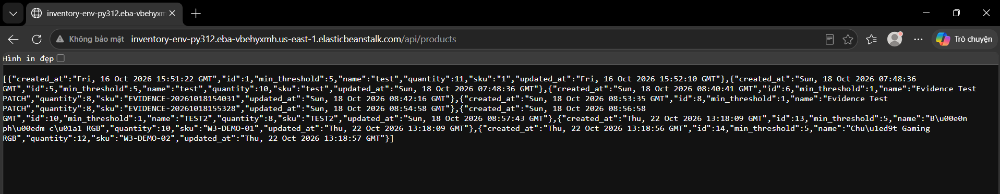

### 12.2. Thứ Tư – Rà soát Security Groups, EC2 và IAM

#### a. Xác minh cấu hình mạng RDS

RDS `inventory-db` của Quân có trạng thái `Available`, engine PostgreSQL, cổng 5432, `Publicly accessible: No`, đặt trong VPC `vpc-08899e1e1656f5f73`. DB gắn `inventory-db-sg` (`sg-0f5e8348f198a9f97`).

DB SG có một inbound rule PostgreSQL TCP 5432, nguồn là `inventory-web-sg` (`sg-0bb46c5bbb3ba364b`) trong cùng VPC. Outbound có một rule `All traffic / All ports / 0.0.0.0/0`; sinh viên ghi nhận phạm vi đi ra rộng và giữ nguyên trong lần kiểm tra. Outbound này không đồng nghĩa DB cho phép kết nối Internet đi vào.

**Hình 55. Cấu hình RDS private và DB Security Group**

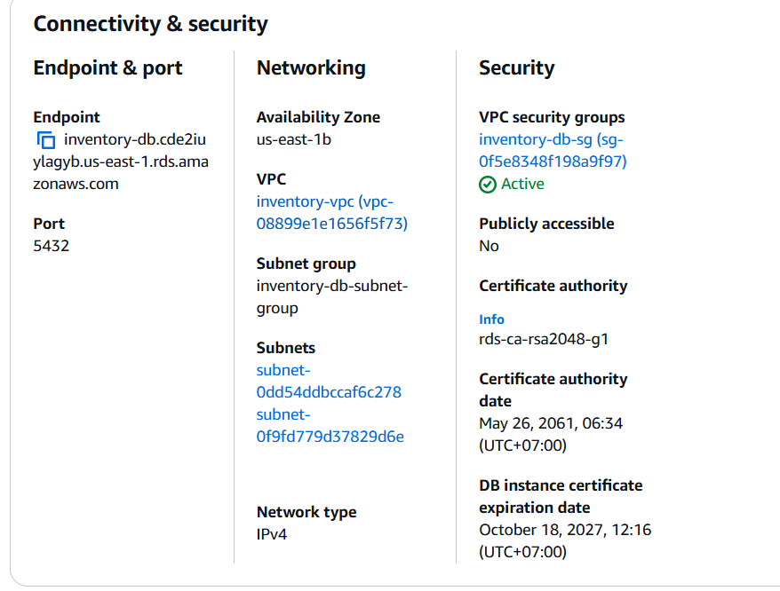

**Hình 56. Nguồn inbound TCP 5432 của DB SG**

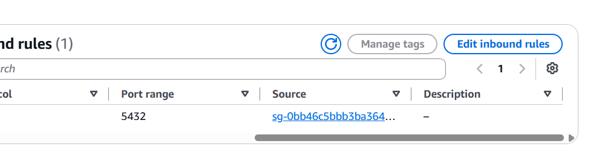

**Hình 57. Rà soát outbound DB SG**

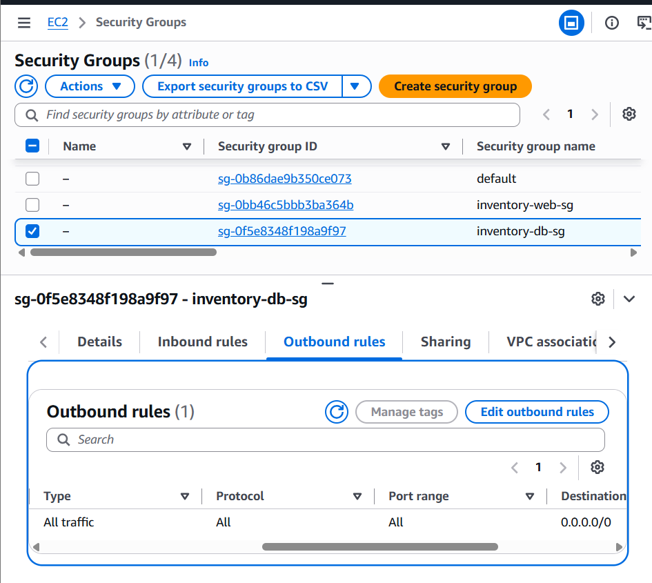

#### b. Kiểm tra EC2 và giới hạn rà soát IAM

EC2 `inventory-db-setup` gắn `inventory-web-sg` và IAM role `LabRole`. Trang IAM hiển thị 7 policies, nhưng phiên đăng nhập `voclabs` bị từ chối thao tác `iam:GetPolicy`; thông báo nêu identity-based policy explicit deny. Không suy ra nguyên nhân là SCP, không kết luận role thiếu quyền S3/SNS/CloudWatch và không tuyên bố đã xác nhận least privilege. Không chỉnh sửa role hoặc policy do lab quản lý.

**Hình 58. EC2 quản trị DB, Security Group và IAM role**

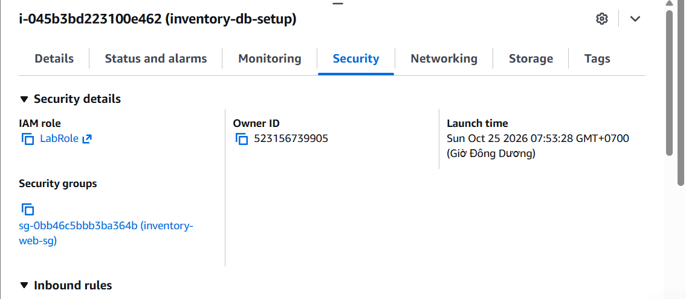

#### c. Kiểm tra cổng và thu hẹp rule không sử dụng

Sinh viên mở Session Manager và chạy `sudo ss -lntp`. Kết quả tại thời điểm kiểm tra chỉ thấy SSH lắng nghe TCP 22 trên IPv4/IPv6; không thấy listener 80, 443 hoặc 5000. Kiểm tra Related resources của Web SG hiển thị một instance quản trị, một network interface, bốn rule và một VPC; không phải bảy máy EC2.

Web SG ban đầu mở inbound 80, 443, 5000 từ `0.0.0.0/0`, outbound cho phép mọi lưu lượng. Sau rà soát, sinh viên xóa duy nhất rule Custom TCP 5000 (`sgr-0971e1b338caa9896`) và xác nhận đã Save rules; giữ nguyên 80/443. Chưa lưu ảnh bảng rules sau thay đổi trong bộ bổ sung, vì vậy bằng chứng thay đổi gồm xác nhận thao tác của sinh viên và kết quả kiểm tra kết nối sau đó, không coi ảnh màn hình chỉnh sửa chưa lưu là bằng chứng áp dụng.

Lệnh kiểm tra sau thay đổi:

```bash
pg_isready -h inventory-db.cde2iuylagyb.us-east-1.rds.amazonaws.com -p 5432 -t 5
```

Kết quả: `accepting connections`. Điều này xác nhận PostgreSQL phản hồi từ EC2 quản trị qua mạng; không chứng minh xác thực bằng mật khẩu hoặc truy vấn nghiệp vụ. Việc thay mật khẩu DB chưa được thực hiện trong phạm vi báo cáo cá nhân này; không đánh dấu đã khắc phục.

**Hình 59. Kiểm tra kết nối EC2 tới RDS sau khi sinh viên xác nhận lưu xóa rule 5000**

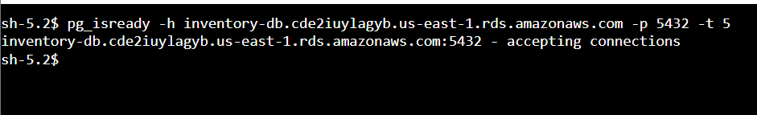

### 12.3. Thứ Năm – Quan sát metrics và đối chiếu log

Sinh viên dùng RDS Monitoring, dashboard CloudWatch, xem cửa sổ 3 giờ và period hiển thị 5 phút. Các biểu đồ được chụp nối tiếp, trục thời gian xấp xỉ 06:00–09:00 UTC (13:00–16:00 UTC+7). Ngày tuyệt đối chưa được xác nhận trong ảnh lịch nên không tự gán ngày cho toàn bộ cửa sổ. Đây là quan sát hiện trạng, không phải kiểm thử tải.

| Metric | Kết quả quan sát | Giới hạn diễn giải |
| :--- | :--- | :--- |
| CPUUtilization | Dao động xấp xỉ 3,87–4,63% theo các điểm và trục hiển thị | Không chứng minh khả năng chịu tải hoặc CPU luôn dưới 5% |
| DatabaseConnections | Các điểm dữ liệu hiển thị ở 0 | Không kết luận DB hỏng; DB này khác DB ứng dụng |
| FreeStorageSpace (Minimum) | Quanh 18,38 G bytes, có xu hướng giảm nhẹ | Nhãn trục làm tròn; chưa xác định mức giảm chính xác hoặc nguyên nhân |

**Hình 60. CPU RDS theo thời gian**

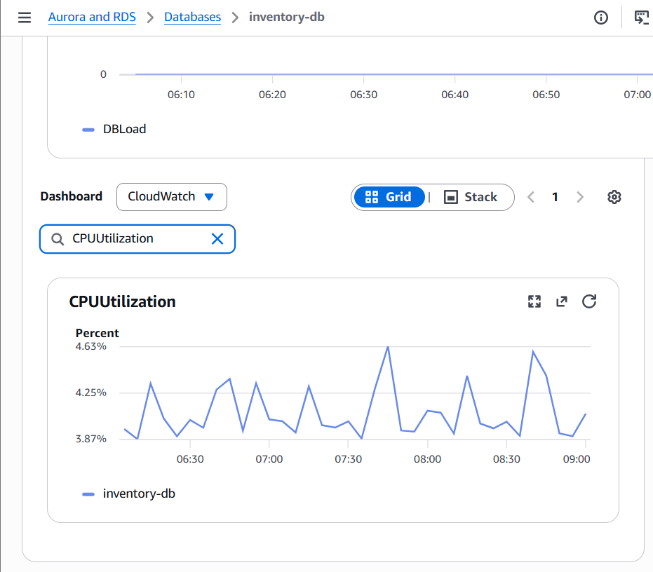

**Hình 61. Số kết nối RDS theo thời gian**

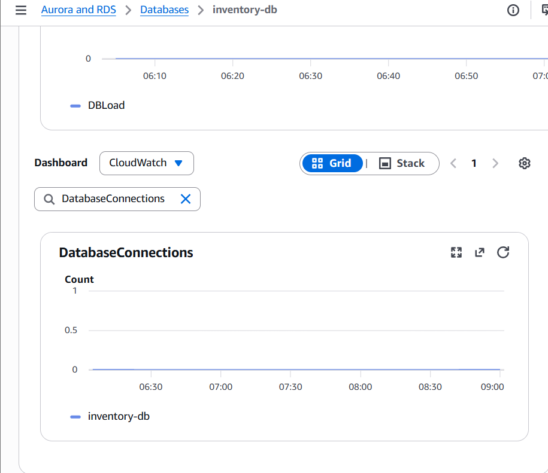

**Hình 62. Dung lượng trống RDS theo thời gian**

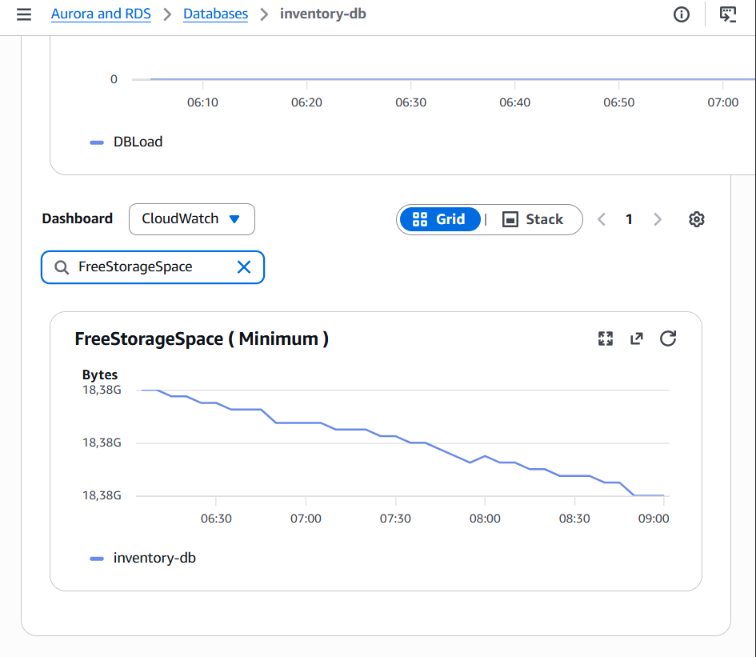

Trong tài khoản của Quân, CloudWatch chỉ hiển thị ba log groups Lambda: `/aws/lambda/RedshiftEventSubscription`, `/aws/lambda/RedshiftOverwatch`, `/aws/lambda/RoleCreationFunction`; không có nhóm log Beanstalk của ứng dụng. Không tạo log group trống để thay thế bằng chứng streaming. Đối chiếu minh chứng ứng dụng đã có trong tài liệu chung:

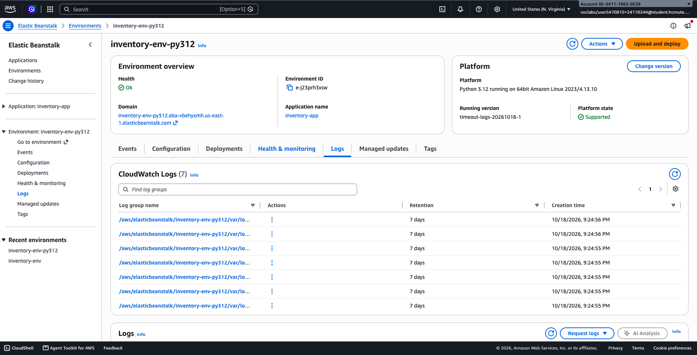

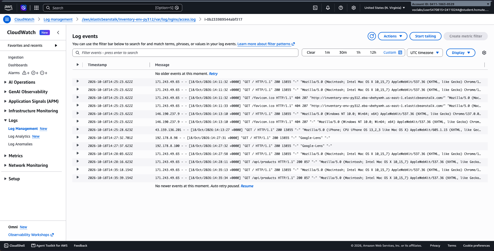


Ảnh tuần 2 chứng minh retention tại thời điểm chụp, không xác nhận retention hiện tại. Quân không trực tiếp xác minh log mới trong tài khoản Beanstalk ở phiên này. Chưa tạo CloudWatch alarm; giữ hạng mục đánh giá/triển khai alarm trong kế hoạch tuần 4, phụ thuộc quyền và chi phí.

### 12.4. Thứ Sáu – Rà soát secret và đánh giá HTTPS

Qua đối chiếu `app.py`, sinh viên xác nhận `app.secret_key` đang được gán chuỗi trực tiếp. Đây là Flask session signing key, khác mật khẩu RDS. Đề xuất chuyển sang biến môi trường `FLASK_SECRET_KEY`, cấu hình giá trị ngẫu nhiên trước deployment và kiểm thử lại cùng người phụ trách backend. Chưa sửa code, thay khóa hoặc deploy; không kết luận đã khắc phục.

Ảnh cấu hình Beanstalk được cung cấp có hiển thị DB_PASSWORD. Không đưa ảnh gốc vào phần bổ sung hoặc sao chép giá trị mật khẩu vào tài liệu. Cần kiểm tra/che các bản ảnh khác trước khi công bố. Việc bỏ ảnh khỏi bản bổ sung không thu hồi secret đã lộ. Chưa rà soát đầy đủ lịch sử Git, mọi ZIP deploy và mọi log; kết luận trước đó trong tài liệu về “100% không hardcode bí mật” không áp dụng như kết luận của đợt rà soát này.

Về HTTPS, sử dụng hiện trạng và đề xuất của nhóm: environment Single instance, URL mặc định đang được truy cập qua HTTP; chưa có minh chứng triển khai HTTPS trong bộ ảnh. Đánh giá cho tuần tiếp theo gồm phương án domain/chứng chỉ, TLS tại proxy hoặc load balancer, chi phí và quyền được phép. Không coi ALB là điều kiện duy nhất cho mọi phương án HTTPS. Chưa tạo ALB, chứng chỉ hoặc thay đổi proxy.

### 12.5. Thứ Bảy – Viết và validate template IaC độc lập

EC2 có AWS CLI `2.36.47`. Sinh viên tạo `/tmp/week3-logging.yaml`, khai báo một `AWS::Logs::LogGroup`, retention 7 ngày, Tags `Project=inventory-app`, `Purpose=week3-iac-test`. Template không chứa RDS, Beanstalk hoặc IAM resources và không chứa secret.

```bash
aws cloudformation validate-template \
  --template-body file:///tmp/week3-logging.yaml \
  --region us-east-1 --no-cli-pager
```

AWS trả JSON có `Parameters: []` và description khớp template, không có lỗi. Kết luận: ValidateTemplate thành công; chưa kiểm chứng khả năng tạo stack, quyền tạo Log Group hay chi phí triển khai. Không tạo Change Set, không execute stack, không import/replace tài nguyên hiện hữu.

**Hình 64. Kết quả CloudFormation ValidateTemplate thành công**

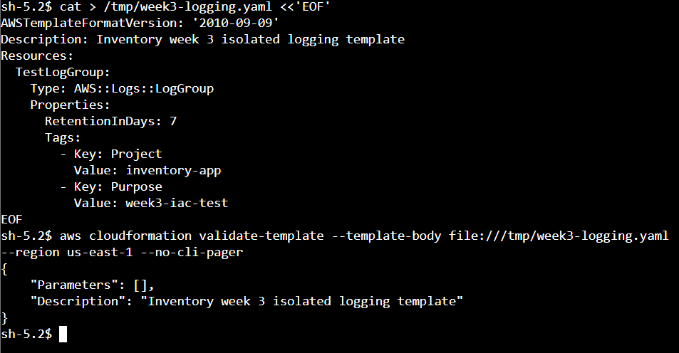

Bản template để lưu lâu dài: [`infrastructure/week3-logging.yaml`](../../infrastructure/week3-logging.yaml). File `/tmp` trên EC2 chỉ là bản tạm. Việc validate độc lập là phần bổ sung thực hành; hạng mục triển khai IaC vẫn chưa thực hiện.

### 12.6. Chủ Nhật – Tags, ngân sách và bàn giao

Sinh viên kiểm tra RDS có Tags `Owner=Khanh-Quan`, `Project=inventory-app`; không thay đổi Tags. Learner Lab hiển thị `Used $3.5 of $50`: đã dùng 7%, còn 46,50 USD theo số liệu hiển thị. Không dùng mức 100 USD trong mô tả chung làm ngân sách của tài khoản này; số liệu có thể cập nhật trễ và không phải dự báo chi phí cuối kỳ.

Tài nguyên cần quản lý gồm EC2 `inventory-db-setup`, RDS `inventory-db`, SG và hạ tầng mạng có sẵn. Trong bước IaC chỉ tạo file, chưa tạo tài nguyên AWS. Không dừng/xóa DB hoặc EC2; chưa có xác nhận dọn tài nguyên. Kiểm tra Tags và ngân sách chỉ áp dụng tài khoản Quân, không thay cho kiểm kê chi phí tài khoản ứng dụng.

## 13. TỔNG HỢP KẾT QUẢ VÀ GIỚI HẠN – VÕ MINH QUÂN

| Hạng mục | Trạng thái thực tế |
| :--- | :--- |
| RDS private, inbound/outbound Web/DB SG | Đã rà soát |
| Cổng 5000 | Sinh viên xác nhận đã xóa và lưu; kiểm tra RDS sau thay đổi thành công |
| IAM least privilege | Đã xác định role; bị giới hạn đọc policy, chưa xác nhận least privilege |
| EC2 → RDS của Quân | PostgreSQL phản hồi; chưa xác nhận truy vấn có xác thực |
| Ứng dụng → DB ứng dụng | Đối chiếu cấu hình DB_HOST và quan sát API trả sản phẩm; khác DB của Quân |
| Metrics RDS | Đã quan sát theo thời gian; chưa kiểm thử tải |
| Logs/retention Beanstalk | Đối chiếu minh chứng chung; chưa kiểm tra trực tiếp retention hiện tại |
| Secret | Đã phát hiện vấn đề; chưa sửa khóa Flask, chưa xử lý mật khẩu lộ |
| HTTPS và alarm | Chưa triển khai; chuyển đánh giá tiếp sang tuần 4 |
| IaC | Đã viết/validate template độc lập; chưa triển khai stack |
| Tags/ngân sách | Đã kiểm tra tài khoản Quân |

Ưu tiên tiếp theo: thống nhất endpoint trong các phần báo cáo; xử lý khóa hardcode và thông tin xác thực đã lộ cùng backend; xác minh retention/log mới và phương án alarm trong tài khoản ứng dụng; hoàn thiện đánh giá HTTPS; kiểm tra template qua Change Set khi được phép. Không ghi toàn bộ nhiệm vụ đã hoàn tất hoặc mọi cấu hình đã an toàn.

## 14. KHAI BÁO SỬ DỤNG TRỢ LÝ AI – VÕ MINH QUÂN

- **Công cụ:** Trợ lý AI Antigravity (Gemini 3.8 Flash) — theo thông tin sinh viên cung cấp. Phiên hướng dẫn, đối chiếu ảnh và biên soạn phần bổ sung này có sử dụng Codex; không quy các thao tác AWS cho trợ lý AI.
- **Phạm vi hỗ trợ:** Hướng dẫn đọc cấu hình RDS, SG và IAM; phân biệt hai tài khoản/endpoint; gợi ý lệnh kiểm tra cổng và PostgreSQL; hỗ trợ diễn giải metrics và giới hạn bằng chứng; hướng dẫn viết/validate YAML độc lập; phát hiện secret hardcode, chọn minh chứng phù hợp và biên soạn báo cáo theo kết quả thực tế. Nội dung Antigravity hỗ trợ cụ thể ngoài thông tin sinh viên khai báo chưa được xác minh trong phiên này.
- **Cách thức kiểm chứng:** Sinh viên trực tiếp thao tác AWS Console và Session Manager, gửi ảnh kết quả để đối chiếu tên/ID tài nguyên, source rule, output `ss`, `pg_isready`, metrics và JSON ValidateTemplate. Xác nhận lưu xóa rule 5000 bằng phản hồi của sinh viên và kiểm tra kết nối sau đó. Đối chiếu DB_HOST với API trả dữ liệu; phân biệt minh chứng nhóm có sẵn với thao tác trực tiếp và không dùng mock/validate thay cho bằng chứng triển khai thật. Các mục chưa kiểm tra được ghi rõ, không tự tạo kết quả hoặc giờ thực hiện.

## 15. KHAI BÁO COMMIT VÀ PHẠM VI THAY ĐỔI – VÕ MINH QUÂN

Phần công việc của Võ Minh Quân được lưu trong commit [`49d26fa`](https://github.com/qilskcter/inventory-app/commit/49d26fa7bc8e020998b67d47c6fa348435d5b0ed), . Commit bổ sung các mục 12–15 của báo cáo tuần 3, 10 ảnh minh chứng và template Log Group độc lập. Nội dung làm rõ hai môi trường AWS, trình bày kết quả rà soát hạ tầng, quan sát metrics, kiểm tra kết nối và validate template, đồng thời ghi nhận các giới hạn và công việc còn tồn đọng.

Commit [`d152d81`](https://github.com/qilskcter/inventory-app/commit/d152d81) bổ sung thông tin đối chiếu commit sau khi commit nội dung đã được tạo.
