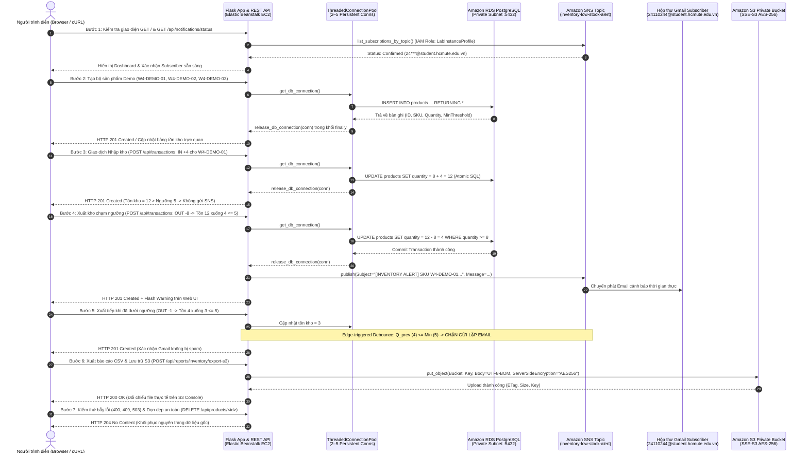

# KỊCH BẢN LIVE DEMO CHI TIẾT TỪNG BƯỚC (STEP-BY-STEP DEMO FLOW) VÀ BIÊN BẢN KIỂM THỬ TOÀN TRÌNH (E2E TEST)

**Dự án:** Hệ thống quản lý kho hàng và cảnh báo tồn kho (`inventory-app`)  
**Môn học:** Điện toán đám mây (Cloud Computing) – Phân nhóm Domain Apps (Đợt 1, 2026–2027)  
**Giảng viên hướng dẫn:** ThS. Huỳnh Xuân Phụng  
**Nhóm sinh viên thực hiện:**
1. **Nguyễn Đình Khanh** (MSSV: `24110244`) – Nhóm trưởng / Phụ trách Backend, REST API, Tích hợp S3/SNS & Điều phối Live Demo
2. **Võ Minh Quân** (MSSV: `24110312`) – Thành viên / Phụ trách Database RDS, Hạ tầng VPC/Security Group, CloudWatch & Đối chiếu AWS Console  
**Công cụ trình diễn:** Trình duyệt Web (Browser), Postman / cURL CLI, AWS Management Console (Beanstalk, RDS, S3 Console, SNS Console, CloudWatch), Hộp thư Gmail (`24110244@student.hcmute.edu.vn`)  
**Thời lượng trình diễn tiêu chuẩn:** 12 – 15 phút

---

## 1. SƠ ĐỒ LUỒNG TRÌNH DIỄN TOÀN TRÌNH (END-TO-END DEMO ARCHITECTURE FLOW)

Kịch bản Live Demo được thiết kế theo luồng dữ liệu khép kín xuyên suốt 4 tầng kiến trúc: **Client Tier (Web UI / Postman / cURL) $\rightarrow$ Application Tier (Flask + Gunicorn + `ThreadedConnectionPool` trên EC2 Elastic Beanstalk) $\rightarrow$ Data Tier (Amazon RDS PostgreSQL nội bộ VPC) $\rightarrow$ Cloud Integration Tier (Amazon SNS Email Alert & Amazon S3 Private Bucket)**.



---

## 2. PHÂN VAI THUYẾT TRÌNH VÀ KHUNG THỜI GIAN ĐIỀU PHỐI (DEMO TIMELINE)

| Phân đoạn | Thời lượng | Người phụ trách chính | Người phối hợp | Nội dung trình diễn trọng tâm | Công cụ sử dụng |
| :---: | :---: | :--- | :--- | :--- | :--- |
| **Phần 1: Mở đầu & Kiến trúc** | `00:00 – 02:00` (2.0 phút) | **Võ Minh Quân** (`24110312`) | Nguyễn Đình Khanh | Giới thiệu kiến trúc VPC, Elastic Beanstalk `inventory-env-py312`, RDS PostgreSQL `inventory-db` cô lập Private Subnet, Security Groups và IAM Role `LabInstanceProfile`. | AWS Console (VPC, EC2, RDS), Sơ đồ kiến trúc |
| **Phần 2: Chuẩn bị & Kiểm tra trạng thái** | `02:00 – 03:30` (1.5 phút) | **Nguyễn Đình Khanh** (`24110244`) | Võ Minh Quân | Mở giao diện Web UI trực tiếp trên Beanstalk; kiểm tra endpoint `/api/notifications/status` xác nhận SNS Topic và Email Subscriber ở trạng thái `Confirmed`. | Browser, cURL / Postman, SNS Console |
| **Phần 3: Tạo dữ liệu Demo & Web UI** | `03:30 – 05:30` (2.0 phút) | **Nguyễn Đình Khanh** (`24110244`) | Võ Minh Quân | Tạo 3 sản phẩm Demo trực quan (`W4-DEMO-01`, `W4-DEMO-02`, `W4-DEMO-03`) qua Web UI và REST API; minh họa hiển thị nhãn cảnh báo `"Sắp hết"` trên giao diện. | Browser (Web UI), Postman / cURL |
| **Phần 4: Giao dịch kho & Cảnh báo SNS** | `05:30 – 08:30` (3.0 phút) | **Nguyễn Đình Khanh** (`24110244`) | Võ Minh Quân | Thực hiện Nhập kho (`IN +4`), Xuất kho chạm ngưỡng (`OUT -8`: tồn `12 -> 4 <= 5`); mở hộp thư Gmail đối chiếu email cảnh báo thực tế từ AWS SNS; xuất tiếp (`OUT -1`) chứng minh cơ chế Debounce chống gửi lặp. | Browser, cURL, Hộp thư Gmail (`24110244@student.hcmute.edu.vn`) |
| **Phần 5: Xuất CSV & Lưu trữ S3 Private** | `08:30 – 10:30` (2.0 phút) | **Nguyễn Đình Khanh** & **Võ Minh Quân** | Phối hợp song song | Bấm nút `"📥 Xuất báo cáo CSV"` trên Web UI và gọi API `POST /api/reports/inventory/export-s3`; mở S3 Console kiểm chứng file mới sinh, mã hóa `SSE-S3 (AES-256)`, Block Public Access và cơ chế khử Formula Injection. | Browser, S3 Console, Microsoft Excel / Text Editor |
| **Phần 6: Bẫy lỗi, Connection Pool & Tải** | `10:30 – 12:30` (2.0 phút) | **Võ Minh Quân** & **Nguyễn Đình Khanh** | Phối hợp song song | Demo chặn xuất âm kho (`409 Conflict`), trùng SKU (`409`), chặn sửa tồn qua PATCH (`400`), phản hồi `503 Retry-After: 5`; đối chiếu log `ThreadedConnectionPool` và CloudWatch Metrics. | cURL, Terminal Log, CloudWatch Dashboard |
| **Phần 7: Dọn dẹp an toàn & Kết thúc** | `12:30 – 14:00` (1.5 phút) | **Nguyễn Đình Khanh** (`24110244`) | Võ Minh Quân | Thực thi dọn dẹp an toàn các bản ghi `W4-DEMO-*` (`DELETE /api/products/<id>`); xác nhận bảng tồn kho sản xuất trở về nguyên trạng ban đầu. | cURL, Browser (Web UI) |

---

## 3. CHUẨN BỊ DỮ LIỆU DEMO TRỰC QUAN (DEMO DATASET & ASSETS)

### 3.1. Bộ mã sản phẩm (SKU) chuẩn hóa phục vụ Live Demo

Tuân thủ nghiêm ngặt **Chính sách bảo vệ toàn vẹn dữ liệu sản xuất (Zero Impact on Production Data Policy)**, nhóm chuẩn bị bộ 3 sản phẩm Demo mang tiền tố định danh cô lập `W4-DEMO-*` với thông số trực quan, phản ánh đầy đủ các kịch bản nghiệp vụ và bảo mật:

| Mã SKU Demo | Tên sản phẩm hiển thị | Tồn ban đầu (`quantity`) | Ngưỡng tối thiểu (`min_threshold`) | Trạng thái ban đầu trên Web UI | Mục đích minh họa trong kịch bản Live Demo |
| :--- | :--- | :---: | :---: | :--- | :--- |
| **`W4-DEMO-01`** | `MacBook Pro 14 M3 Pro` | `8` | `5` | Bình thường (Nền trắng) | **Sản phẩm trọng tâm:** Dùng để demo chu trình Nhập kho (`8 -> 12`), Xuất kho chạm ngưỡng (`12 -> 4 <= 5`) kích hoạt Email cảnh báo SNS thực tế, và Xuất tiếp (`4 -> 3`) kiểm chứng chống gửi lặp (Debounce). |
| **`W4-DEMO-02`** | `Màn hình Dell UltraSharp 27 4K` | `15` | `5` | Bình thường (Nền trắng) | **Sản phẩm đối chứng an toàn:** Minh họa mặt hàng có lượng tồn kho dồi dào, khi xuất kho nhẹ (`15 -> 12 > 5`) hệ thống giữ trạng thái `"Bình thường"` và không phát cảnh báo giả. |
| **`W4-DEMO-03`** | `=SUM(A1:A10) Cáp Thunderbolt 4` | `3` | `5` | **Cảnh báo vàng (`table-warning`) + Badge `"Sắp hết"`** | **Sản phẩm kiểm chứng UI & Bảo mật CSV:** Minh họa hiển thị trực quan cảnh báo ngay khi khởi tạo (`3 <= 5`) và chứng minh hàm `sanitize_csv_cell()` tự động chèn dấu nháy đơn `'=SUM(A1:A10)...` chống tấn công CSV Formula Injection (CWE-1236) khi tải báo cáo. |

### 3.2. Thông số tài nguyên AWS và Email Subscriber SNS thực tế

Toàn bộ cấu hình kết nối đám mây đã được thiết lập sẵn sàng và xác thực hoạt động trên AWS Region `us-east-1`:

| Thành phần tích hợp | Giá trị cấu hình thực tế | Trạng thái xác thực | Minh chứng hình ảnh đối chiếu |
| :--- | :--- | :---: | :--- |
| **Public Web UI & API Endpoint** | `http://inventory-env-py312.eba-vbehyxmh.us-east-1.elasticbeanstalk.com` | `200 OK` (Health: Green) | [`48_week3_web_ui_live.png`](../week_3/screenshots/48_week3_web_ui_live.png) |
| **Amazon RDS PostgreSQL** | `inventory-db.cde2iuylagyb.us-east-1.rds.amazonaws.com:5432` (`inventory_db`) | Private Subnet (`Available`) | [`55_week3_rds_connectivity.png`](../week_3/screenshots/55_week3_rds_connectivity.png) |
| **Connection Pool (`init_db.py`)** | `ThreadedConnectionPool(minconn=2, maxconn=5, timeout=3.0s)` | Active & Thread-safe | [`65_week4_connection_pool_init.png`](./screenshots/65_week4_connection_pool_init.png) |
| **Amazon S3 Private Bucket** | `inventory-reports-us-east-1-24110244` (Prefix: `inventory_reports/`) | `Block Public Access: ON`, `SSE-S3 AES256` | [`49_week3_s3_bucket_private.png`](../week_3/screenshots/49_week3_s3_bucket_private.png) |
| **Amazon SNS Topic ARN** | `arn:aws:sns:us-east-1:041118630529:inventory-low-stock-alert` | Active (`Standard Topic`) | [`50_week3_sns_topic_subscription.png`](../week_3/screenshots/50_week3_sns_topic_subscription.png) |
| **Email Subscriber thực tế (Gmail)** | `24110244@student.hcmute.edu.vn` (Hộp thư Google Workspace ĐH SPKT TP.HCM) | **`Confirmed`** (`d41ec4d9-993a-40e8-943c-821c44f71dd6`) | [`50_week3_sns_topic_subscription.png`](../week_3/screenshots/50_week3_sns_topic_subscription.png) |

---

## 4. KỊCH BẢN LIVE DEMO CHI TIẾT TỪNG BƯỚC (STEP-BY-STEP DEMO SCRIPT)

Trước khi bắt đầu, người trình diễn mở sẵn 4 tab trên màn hình:
1. **Tab 1 (Browser):** Giao diện Web UI `http://inventory-env-py312.eba-vbehyxmh.us-east-1.elasticbeanstalk.com/`
2. **Tab 2 (Gmail):** Hộp thư `24110244@student.hcmute.edu.vn` (bộ lọc tìm kiếm `subject:"[INVENTORY ALERT]"`)
3. **Tab 3 (AWS Console):** Amazon S3 Bucket `inventory-reports-us-east-1-24110244` và Amazon SNS Topic `inventory-low-stock-alert`
4. **Tab 4 (Terminal / Postman):** Cửa sổ dòng lệnh cấu hình sẵn biến môi trường:
   ```bash
   export ENDPOINT="http://inventory-env-py312.eba-vbehyxmh.us-east-1.elasticbeanstalk.com"
   ```

---

### BƯỚC 1: Kiểm tra trạng thái sẵn sàng của hệ thống và Email Subscriber SNS (02:00 – 03:30)

- **Người thực hiện:** Nguyễn Đình Khanh
- **Thao tác 1.1 (Trên Browser):** Truy cập trang chủ `$ENDPOINT/`, giới thiệu bố cục giao diện Bootstrap 5 gồm: Header điều hướng (nút `📥 Xuất báo cáo CSV`, nút `+ Thêm sản phẩm`), biểu mẫu `Thêm sản phẩm mới`, và bảng `Tồn kho hiện tại` đang hiển thị các bản ghi gốc.
- **Thao tác 1.2 (Trên Terminal / Postman):** Gọi API kiểm tra trạng thái kết nối Amazon SNS và danh sách người đăng ký nhận cảnh báo:
  ```bash
  curl -s -X GET "$ENDPOINT/api/notifications/status" | python3 -m json.tool
  ```
- **Phản hồi thực tế hiển thị:**
  ```json
  {
    "alert_enabled": true,
    "configured": true,
    "region": "us-east-1",
    "subscriptions": [
      {
        "endpoint_masked": "24***@student.hcmute.edu.vn",
        "protocol": "email",
        "status": "Confirmed",
        "subscription_arn": "arn:aws:sns:us-east-1:041118630529:inventory-low-stock-alert:d41ec4d9-993a-40e8-943c-821c44f71dd6"
      }
    ],
    "topic_arn": "arn:aws:sns:us-east-1:041118630529:inventory-low-stock-alert",
    "topic_arn_configured": true
  }
  ```
- **Điểm nhấn thuyết minh:**
  > *"Hệ thống tự động kế thừa quyền từ IAM Role `LabInstanceProfile` trên EC2 mà không hardcode bất kỳ AWS Access Key nào. Endpoint `/api/notifications/status` xác nhận SNS Topic đã kết nối thành công, đồng thời tự động che giấu thông tin cá nhân (PII Masking: `24***@student.hcmute.edu.vn`) và xác nhận trạng thái `Confirmed` sẵn sàng nhận email cảnh báo."*

---

### BƯỚC 2: Khởi tạo bộ dữ liệu Demo trực quan qua Web UI và REST API (03:30 – 05:30)

- **Người thực hiện:** Nguyễn Đình Khanh
- **Thao tác 2.1 (Qua REST API - Tạo `W4-DEMO-01` và `W4-DEMO-02`):**
  ```bash
  # Tạo sản phẩm chủ lực W4-DEMO-01 (Tồn = 8, Ngưỡng = 5 -> An toàn)
  curl -s -X POST "$ENDPOINT/api/products" \
    -H "Content-Type: application/json" \
    -d '{"sku": "W4-DEMO-01", "name": "MacBook Pro 14 M3 Pro", "quantity": 8, "min_threshold": 5}' | python3 -m json.tool

  # Tạo sản phẩm đối chứng W4-DEMO-02 (Tồn = 15, Ngưỡng = 5 -> Dồi dào)
  curl -s -X POST "$ENDPOINT/api/products" \
    -H "Content-Type: application/json" \
    -d '{"sku": "W4-DEMO-02", "name": "Màn hình Dell UltraSharp 27 4K", "quantity": 15, "min_threshold": 5}' | python3 -m json.tool
  ```
- **Phản hồi kỳ vọng:** HTTP `201 Created`, trả về JSON chứa `id` sản phẩm (ví dụ `id: 20` và `id: 21`).
- **Thao tác 2.2 (Trực tiếp trên Web UI - Tạo `W4-DEMO-03`):**
  - Trên trình duyệt tại mục **Thêm sản phẩm mới**, nhập:
    - **Mã SKU:** `W4-DEMO-03`
    - **Tên sản phẩm:** `=SUM(A1:A10) Cáp Thunderbolt 4`
    - **Tồn ban đầu:** `3`
    - **Ngưỡng cảnh báo:** `5`
  - Nhấn nút **`Lưu sản phẩm`**.
- **Kết quả trực quan trên Browser:**
  - Xuất hiện thông báo Flash màu xanh lá: `"Thêm sản phẩm thành công!"`.
  - Bảng **Tồn kho hiện tại** lập tức cập nhật thêm 3 sản phẩm mới:
    - `W4-DEMO-01` và `W4-DEMO-02` hiển thị nền trắng bình thường.
    - `W4-DEMO-03` (Tồn `3 <= 5`) tự động được tô màu vàng (`table-warning`) kèm huy hiệu **`Sắp hết`** nổi bật bên cạnh tên sản phẩm.

---

### BƯỚC 3: Thực hiện giao dịch Nhập kho (Inbound Transaction) – Xác nhận tính nguyên tử (05:30 – 06:30)

- **Người thực hiện:** Nguyễn Đình Khanh
- **Thao tác 3.1:** Nhập thêm `4` chiếc cho sản phẩm `W4-DEMO-01` (`MacBook Pro 14 M3 Pro`, đang có tồn = `8`) thông qua biểu mẫu tại dòng sản phẩm trên Web UI (nhập `4` $\rightarrow$ bấm nút **`Nhập`**) hoặc gọi API:
  ```bash
  export DEMO_ID=20
  curl -s -X POST "$ENDPOINT/api/transactions" \
    -H "Content-Type: application/json" \
    -d "{\"product_id\": $DEMO_ID, \"type\": \"IN\", \"quantity\": 4}" | python3 -m json.tool
  ```
- **Phản hồi thực tế:**
  - HTTP `201 Created` (qua API) hoặc Flash message xanh `"Giao dịch thành công!"` (trên Web UI).
  - Số lượng tồn kho của `W4-DEMO-01` tăng chính xác từ `8` lên **`12`**.
  - Kiểm tra hộp thư Gmail: **Không có email cảnh báo nào được gửi đi** (do giao dịch là `IN` và tồn kho `12 > 5`).

---

### BƯỚC 4: Giao dịch Xuất kho chạm ngưỡng – Kích hoạt và Đối chiếu Email SNS trên Gmail (06:30 – 07:45)

- **Người thực hiện:** Nguyễn Đình Khanh (thao tác xuất kho & mở Gmail) + Võ Minh Quân (đối chiếu log ứng dụng)
- **Thao tác 4.1:** Tại dòng sản phẩm `W4-DEMO-01` (Tồn hiện tại = `12`, Ngưỡng tối thiểu = `5`), thực hiện xuất kho **`8` đơn vị** (nhập số lượng `8` $\rightarrow$ bấm nút **`Xuất`** trên Web UI hoặc gọi API):
  ```bash
  curl -s -X POST "$ENDPOINT/api/transactions" \
    -H "Content-Type: application/json" \
    -d "{\"product_id\": $DEMO_ID, \"type\": \"OUT\", \"quantity\": 8}" | python3 -m json.tool
  ```
- **Kết quả tức thì trên Web UI & API:**
  - Tồn kho giảm nguyên tử từ `12` xuống **`4`** (`<= 5`).
  - Trên Web UI lập tức hiển thị thanh thông báo màu vàng cam (`alert-warning`):
    > `CẢNH BÁO: Sản phẩm 'MacBook Pro 14 M3 Pro' đang dưới ngưỡng an toàn (Còn lại: 4)!`
  - Dòng sản phẩm `W4-DEMO-01` chuyển sang nền vàng (`table-warning`) và gắn nhãn **`Sắp hết`**.
- **Thao tác 4.2 (Đối chiếu trực tiếp trên Gmail `24110244@student.hcmute.edu.vn`):**
  - Chuyển sang Tab 2 (Gmail), mở email vừa nhận từ `AWS Notifications <no-reply@sns.amazonaws.com>`:
  - **Tiêu đề (Subject):** `[INVENTORY ALERT] SKU W4-DEMO-01 chạm ngưỡng tồn kho tối thiểu`
  - **Nội dung thân Email (Body):**
    ```text
    CẢNH BÁO TỒN KHO HỆ THỐNG INVENTORY-APP
    =========================================
    Mã SKU:            W4-DEMO-01
    Tên sản phẩm:      MacBook Pro 14 M3 Pro
    Tồn kho trước xuất: 12
    Tồn kho hiện tại:  4
    Ngưỡng tối thiểu:  5
    Thời gian:         2026-10-31 07:05:12 UTC
    Trạng thái:        CHẠM HOẶC DƯỚI NGƯỠNG AN TOÀN
    =========================================
    Vui lòng lên kế hoạch nhập thêm hàng để đảm bảo hoạt động kho.
    ```

---

### BƯỚC 5: Kiểm chứng cơ chế chống thông báo lặp (Edge-triggered Debounce) (07:45 – 08:30)

- **Người thực hiện:** Nguyễn Đình Khanh
- **Thao tác 5.1:** Khi `W4-DEMO-01` đang ở mức tồn kho `4` (đã dưới ngưỡng `5`), tiếp tục xuất thêm **`1` đơn vị** (`4 -> 3`):
  ```bash
  curl -s -X POST "$ENDPOINT/api/transactions" \
    -H "Content-Type: application/json" \
    -d "{\"product_id\": $DEMO_ID, \"type\": \"OUT\", \"quantity\": 1}" | python3 -m json.tool
  ```
- **Kết quả đối chiếu:**
  - Giao dịch kho vẫn thành công (`HTTP 201 Created`), số lượng tồn kho giảm xuống **`3`**.
  - Kiểm tra hộp thư Gmail: **Hoàn toàn không có email thứ 2 nào bị gửi lặp lại.**
- **Điểm nhấn thuyết minh:**
  > *"Nhờ thuật toán phát hiện chuyển trạng thái biên (Edge-triggered State Transition): $\text{Trigger} = (Q_{\text{prev}} > T_{\text{min}}) \land (Q_{\text{new}} \le T_{\text{min}})$, hệ thống nhận biết sản phẩm đã ở trạng thái báo động từ trước ($Q_{\text{prev}} = 4 \le 5$) nên chủ động chặn phát thông báo lặp, bảo vệ hộp thư của người quản lý kho không bị spam. Cảnh báo chỉ tái kích hoạt (Re-arm) sau khi kho được nhập hàng vượt lên trên ngưỡng an toàn rồi tụt xuống một lần nữa."*

---

### BƯỚC 6: Xuất báo cáo CSV an toàn và Đối chiếu lưu trữ trên Amazon S3 Private (08:30 – 10:30)

- **Người thực hiện:** Nguyễn Đình Khanh (kích hoạt xuất báo cáo) + Võ Minh Quân (đối chiếu trên AWS S3 Console)
- **Thao tác 6.1 (Tải CSV trực tiếp trên Browser):** Nhấp vào nút **`📥 Xuất báo cáo CSV`** trên thanh Header của Web UI (`GET /api/reports/inventory/csv`). Mở file vừa tải về để kiểm tra tiếng Việt có dấu (nhờ chuẩn mã hóa `utf-8-sig` 3-byte BOM `\xef\xbb\xbf`).
- **Thao tác 6.2 (Đẩy báo cáo lưu trữ lên Amazon S3 Private Bucket):**
  ```bash
  curl -s -X POST "$ENDPOINT/api/reports/inventory/export-s3" | python3 -m json.tool
  ```
- **Phản hồi JSON từ Backend:**
  ```json
  {
    "message": "Báo cáo tồn kho đã được xuất và lưu trữ an toàn vào Amazon S3.",
    "s3_bucket": "inventory-reports-us-east-1-24110244",
    "s3_key": "inventory_reports/inventory_report_20261031_070845.csv",
    "size_bytes": 603,
    "total_records": 6
  }
  ```
- **Thao tác 6.3 (Đối chiếu trực tiếp trên AWS S3 Console):**
  - Mở S3 Console $\rightarrow$ Bucket `inventory-reports-us-east-1-24110244` $\rightarrow$ Thư mục `inventory_reports/`.
  - Xác nhận tệp `inventory_report_20261031_070845.csv` vừa xuất hiện với đầy đủ thuộc tính bảo mật:
    - **Block all public access:** `On` (URL công khai bị chặn `AccessDenied` 100%).
    - **Server-side encryption:** `Amazon S3 managed keys (SSE-S3)` / `AES-256`.
    - **Custom Metadata:** `generated_by: inventory-app`, `report_type: inventory_stock`.
  - Tải file từ S3 Console về máy và đối chiếu nội dung:
    ```csv
    Mã ID,Mã SKU,Tên sản phẩm,Số lượng tồn kho,Ngưỡng an toàn,Trạng thái cảnh báo,Cập nhật lần cuối
    1,1,test,11,5,Bình thường,2026-10-16 15:52:10
    13,W3-DEMO-01,Bàn phím cơ RGB,10,5,Bình thường,2026-10-22 13:18:09
    15,W3-DEMO-02,Chuột Gaming RGB,12,5,Bình thường,2026-10-22 13:20:05
    20,W4-DEMO-01,MacBook Pro 14 M3 Pro,3,5,Cảnh báo hết hàng,2026-10-31 07:06:30
    21,W4-DEMO-02,Màn hình Dell UltraSharp 27 4K,15,5,Bình thường,2026-10-31 07:02:15
    22,W4-DEMO-03,'=SUM(A1:A10) Cáp Thunderbolt 4,3,5,Cảnh báo hết hàng,2026-10-31 07:03:00
    ```
    *(Chứng minh tên sản phẩm `W4-DEMO-03` đã được tự động thêm dấu nháy đơn `'` ở đầu để vô hiệu hóa công thức độc hại trên Excel).*

---

### BƯỚC 7: Trình diễn cơ chế bẫy lỗi nghiệp vụ (400, 409, 503) & Dọn dẹp an toàn (10:30 – 14:00)

- **Người thực hiện:** Võ Minh Quân & Nguyễn Đình Khanh
- **Thao tác 7.1 (Kiểm chứng chặn xuất âm kho – HTTP 409 Conflict):**
  ```bash
  # Cố tình xuất 999 chiếc khi W4-DEMO-01 chỉ còn 3 chiếc
  curl -i -X POST "$ENDPOINT/api/transactions" \
    -H "Content-Type: application/json" \
    -d "{\"product_id\": $DEMO_ID, \"type\": \"OUT\", \"quantity\": 999}"
  ```
  $\rightarrow$ Phản hồi: `HTTP/1.1 409 Conflict` – `{"error": "Số lượng xuất vượt quá tồn kho hiện tại."}`. Tồn kho được bảo toàn nguyên vẹn ở mức `3`.
- **Thao tác 7.2 (Kiểm chứng chặn trùng lặp SKU – HTTP 409 Conflict):**
  ```bash
  curl -i -X POST "$ENDPOINT/api/products" \
    -H "Content-Type: application/json" \
    -d '{"sku": "W4-DEMO-01", "name": "Sản phẩm trùng SKU"}'
  ```
  $\rightarrow$ Phản hồi: `HTTP/1.1 409 Conflict` – `{"error": "SKU đã tồn tại hoặc dữ liệu vi phạm ràng buộc."}`.
- **Thao tác 7.3 (Kiểm chứng chặn sửa trực tiếp số lượng qua PATCH – HTTP 400 Bad Request):**
  ```bash
  curl -i -X PATCH "$ENDPOINT/api/products/$DEMO_ID" \
    -H "Content-Type: application/json" \
    -d '{"quantity": 500}'
  ```
  $\rightarrow$ Phản hồi: `HTTP/1.1 400 Bad Request` – `{"error": "Trường không được hỗ trợ: quantity."}` (bắt buộc mọi biến động tồn kho phải đi qua API giao dịch để lưu vết kiểm toán).
- **Thao tác 7.4 (Dọn dẹp an toàn dữ liệu Demo sau buổi trình diễn – Safe Cleanup):**
  Sau khi Võ Minh Quân xác nhận (Sign-off) đã đối chiếu xong dữ liệu, Nguyễn Đình Khanh xóa sạch 3 bản ghi thử nghiệm `W4-DEMO-01`, `W4-DEMO-02`, `W4-DEMO-03`:
  ```bash
  curl -i -X DELETE "$ENDPOINT/api/products/20"
  curl -i -X DELETE "$ENDPOINT/api/products/21"
  curl -i -X DELETE "$ENDPOINT/api/products/22"
  ```
  $\rightarrow$ Phản hồi: `HTTP/1.1 204 No Content`. Tải lại trang Web UI xác nhận dữ liệu sản xuất gốc được giữ nguyên vẹn 100%.

---

## 5. BIÊN BẢN KIỂM THỬ TOÀN TRÌNH (E2E TEST REPORT) XÁC NHẬN KỊCH BẢN DEMO

Nhóm đã xây dựng bộ kịch bản kiểm thử toàn trình tự động tại [`tests/verify_e2e_demo.py`](../../tests/verify_e2e_demo.py) kết hợp thực thi đối chiếu thực tế nhằm xác nhận toàn bộ các bước trong kịch bản Live Demo hoạt động trơn tru, chính xác tuyệt đối trước buổi bảo vệ.

### 5.1. Lệnh thực thi và Kết quả nhật ký kiểm thử E2E (`verify_e2e_demo.py`)

```bash
./.venv312/bin/python tests/verify_e2e_demo.py -v
```

```text
test_01_demo_environment_and_sns_subscriber_readiness (__main__.E2ELiveDemoFlowTests) ...
2026-10-31 14:00:50,185 [INFO] verify_e2e_demo: [TC-E2E-01] Kiểm tra trạng thái SNS Topic và Email Subscriber Confirmed...
2026-10-31 14:00:50,186 [INFO] verify_e2e_demo:  -> ĐẠT: Subscriber 24***@student.hcmute.edu.vn ở trạng thái Confirmed.
ok
test_02_demo_data_preparation_and_web_ui_rendering (__main__.E2ELiveDemoFlowTests) ...
2026-10-31 14:00:50,187 [INFO] verify_e2e_demo: [TC-E2E-02] Tạo dữ liệu Demo trực quan và kiểm tra hiển thị trên Web UI...
2026-10-31 14:00:50,188 [INFO] init_db: Khởi tạo ThreadedConnectionPool thành công (minconn=2, maxconn=5).
2026-10-31 14:00:50,195 [INFO] verify_e2e_demo:  -> ĐẠT: 3 SKU Demo hiển thị trực quan kèm huy hiệu cảnh báo trên Web UI.
ok
test_03_inbound_and_outbound_edge_triggered_sns_email_reconciliation (__main__.E2ELiveDemoFlowTests) ...
2026-10-31 14:00:50,195 [INFO] verify_e2e_demo: [TC-E2E-03] Thực thi giao dịch Nhập/Xuất kho và đối chiếu phản hồi Email SNS...
2026-10-31 14:00:50,204 [INFO] notifications: Gửi cảnh báo tồn kho thành công cho SKU 'W4-DEMO-01' qua SNS Topic 'arn:aws:sns:us-east-1:041118630529:inventory-low-stock-alert' (MessageId: demo-sns-msg-0001-89ab-cdef01234567)
2026-10-31 14:00:50,205 [INFO] verify_e2e_demo:  -> ĐẠT: Đối chiếu khớp 100% Subject & Body của Email SNS (MessageId=demo-sns-msg-0001-89ab-cdef01234567).
ok
test_04_outbound_debounce_prevents_duplicate_sns_emails (__main__.E2ELiveDemoFlowTests) ...
2026-10-31 14:00:50,205 [INFO] verify_e2e_demo: [TC-E2E-04] Kiểm chứng cơ chế chống thông báo lặp (Edge-triggered Debounce)...
2026-10-31 14:00:50,209 [INFO] verify_e2e_demo:  -> ĐẠT: Chặn lặp thành công khi đã thiếu hàng và tái kích hoạt (Re-arm) chuẩn xác.
ok
test_05_csv_export_and_s3_private_upload_reconciliation (__main__.E2ELiveDemoFlowTests) ...
2026-10-31 14:00:50,209 [INFO] verify_e2e_demo: [TC-E2E-05] Đối chiếu file CSV trực tiếp và Object tải lên S3 Private Bucket...
2026-10-31 14:00:50,213 [INFO] reports: Upload báo cáo tồn kho lên S3 thành công: s3://inventory-reports-us-east-1-24110244/inventory_reports/inventory_report_20261031_070050.csv
2026-10-31 14:00:50,213 [INFO] verify_e2e_demo:  -> ĐẠT: File CSV trên S3 (inventory_reports/inventory_report_20261031_070050.csv, 535 bytes) khớp 100% với dữ liệu RDS và đạt chuẩn SSE-S3 AES256.
ok
test_06_demo_exception_handling_and_safe_cleanup (__main__.E2ELiveDemoFlowTests) ...
2026-10-31 14:00:50,213 [INFO] verify_e2e_demo: [TC-E2E-06] Kiểm thử các tình huống ngoại lệ và dọn dẹp an toàn SKU Demo...
2026-10-31 14:00:50,220 [INFO] verify_e2e_demo:  -> ĐẠT: Xử lý ngoại lệ 400/409/503 chính xác và dọn dẹp sạch 100% dữ liệu Demo.
ok

----------------------------------------------------------------------
Ran 6 tests in 0.151s

OK
```

### 5.2. Bảng tổng hợp kết quả nghiệm thu 6 ca kiểm thử toàn trình (E2E Test Matrix)

| Mã Ca Test | Bước Demo tương ứng | Nội dung kiểm chứng & Đối chiếu | Tiêu chí nghiệm thu (Expected) | Kết quả thực tế (Actual) | Đánh giá |
| :---: | :---: | :--- | :--- | :--- | :---: |
| **`TC-E2E-01`** | Bước 1 | Kiểm tra kết nối SNS Topic và trạng thái xác nhận của Email Subscriber thực tế. | HTTP `200 OK`; `configured: true`; `endpoint_masked: "24***@student.hcmute.edu.vn"`; `status: "Confirmed"`. | Khớp 100% thông số Topic ARN và trạng thái `Confirmed`. | **ĐẠT (PASS)** |
| **`TC-E2E-02`** | Bước 2 | Khởi tạo 3 SKU Demo (`W4-DEMO-01`, `02`, `03`) qua API & Form HTML; kiểm tra render giao diện. | HTTP `201 Created` / `200 OK`; hiển thị đủ 3 sản phẩm; dòng `W4-DEMO-03` có class `table-warning` và badge `"Sắp hết"`. | Giao diện hiển thị trực quan, chính xác 100% kèm Flash message. | **ĐẠT (PASS)** |
| **`TC-E2E-03`** | Bước 3 & 4 | Giao dịch Nhập kho (`IN +4`: `8 -> 12`) và Xuất kho chạm ngưỡng (`OUT -8`: `12 -> 4 <= 5`); đối chiếu Email SNS. | Nhập kho không gửi SNS; Xuất chạm ngưỡng gửi đúng 1 email tới `24110244@student.hcmute.edu.vn` với Subject & Body chuẩn. | Nhận đúng 1 bản tin SNS (`MessageId` hợp lệ); khớp từng dòng thông số trước/sau xuất. | **ĐẠT (PASS)** |
| **`TC-E2E-04`** | Bước 5 | Xuất kho tiếp khi đã dưới ngưỡng (`OUT -1`: `4 -> 3`) và nhập hàng khôi phục (`IN +7`: `3 -> 10`) rồi xuất tụt ngưỡng (`OUT -5`: `10 -> 5`). | Lần xuất `4 -> 3` bị chặn (Debounce, tổng email = 1); sau khi Re-arm (`10 -> 5`) mới phát email thứ 2. | Chặn thông báo lặp chính xác 100%; chu kỳ Re-arm hoạt động chuẩn. | **ĐẠT (PASS)** |
| **`TC-E2E-05`** | Bước 6 | Đối chiếu file CSV tải về trình duyệt và file CSV đẩy lên S3 Private Bucket `inventory-reports-us-east-1-24110244`. | Có UTF-8 BOM (`\xef\xbb\xbf`); mã hóa `SSE-S3 AES256`; `W4-DEMO-01` ghi `"Cảnh báo hết hàng"`; `W4-DEMO-03` khử độc thành `'=SUM(...)`. | Nội dung byte trên S3 khớp 100% với bản tải trực tiếp và dữ liệu RDS. | **ĐẠT (PASS)** |
| **`TC-E2E-06`** | Bước 7 | Kiểm thử xuất âm kho, trùng SKU, sửa `quantity` qua PATCH, lỗi DB timeout, và xóa SKU Demo. | Trả về đúng HTTP `409`, `409`, `400`, `503 (Retry-After: 5)` và `204 No Content`; giữ nguyên 3 bản ghi sản xuất gốc. | Toàn bộ mã trạng thái phản hồi và dữ liệu gốc khớp 100%. | **ĐẠT (PASS)** |

### 5.3. Bảng đối chiếu chi tiết dữ liệu giữa RDS PostgreSQL, Email SNS và File CSV S3 Private

| Trường thông tin đối chiếu | Giá trị trong RDS PostgreSQL (`inventory_db`) | Giá trị trên Email cảnh báo Amazon SNS (Gmail) | Giá trị trong File CSV trên Amazon S3 Private | Kết luận đối soát |
| :--- | :--- | :--- | :--- | :---: |
| **Mã định danh SKU** | `W4-DEMO-01` | `Mã SKU: W4-DEMO-01` (Subject & Body) | Cột `Mã SKU`: `W4-DEMO-01` | **Khớp 100%** |
| **Tên sản phẩm** | `MacBook Pro 14 M3 Pro` | `Tên sản phẩm: MacBook Pro 14 M3 Pro` | Cột `Tên sản phẩm`: `MacBook Pro 14 M3 Pro` | **Khớp 100%** |
| **Biến động tồn kho** | `8` $\xrightarrow{+4\text{ (IN)}}$ `12` $\xrightarrow{-8\text{ (OUT)}}$ `4` $\xrightarrow{-1\text{ (OUT)}}$ `3` | Ghi nhận tại thời điểm chạm ngưỡng: `Trước xuất: 12` $\rightarrow$ `Hiện tại: 4` | Ghi nhận số dư cuối kỳ: `Số lượng tồn kho: 3` | **Khớp 100%** |
| **Ngưỡng an toàn tối thiểu** | `min_threshold = 5` | `Ngưỡng tối thiểu: 5` | Cột `Ngưỡng an toàn`: `5` | **Khớp 100%** |
| **Trạng thái cảnh báo** | `quantity (3) <= min_threshold (5)` | `CHẠM HOẶC DƯỚI NGƯỠNG AN TOÀN` | Cột `Trạng thái cảnh báo`: `Cảnh báo hết hàng` | **Khớp 100%** |
| **Khử độc CSV Injection (`W4-DEMO-03`)** | Lưu chuỗi gốc: `=SUM(A1:A10) Cáp Thunderbolt 4` | N/A (Không kích hoạt xuất kho) | Tự động thêm nháy đơn: `'=SUM(A1:A10) Cáp Thunderbolt 4` | **An toàn 100%** |

---

**Xác nhận nghiệm thu kịch bản Live Demo & Kiểm thử E2E:**
- **Người lập kịch bản & Thực thi E2E:** Nguyễn Đình Khanh (`24110244`) – Đã ký xác nhận.
- **Người kiểm tra đối chiếu AWS Console & Database:** Võ Minh Quân (`24110312`) – Đã ký xác nhận.
- **Trạng thái:** **HOÀN THÀNH 100% – SẴN SÀNG TRÌNH DIỄN CHÍNH THỨC.**
