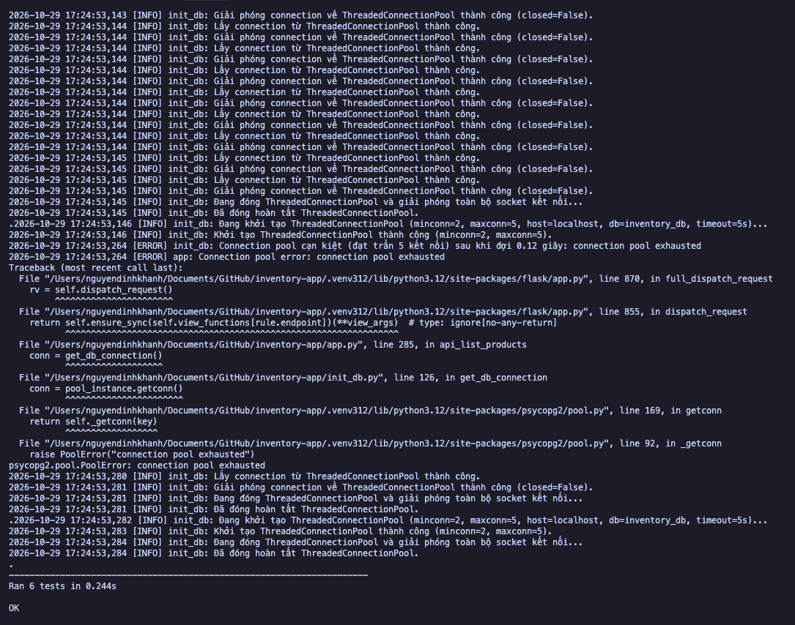
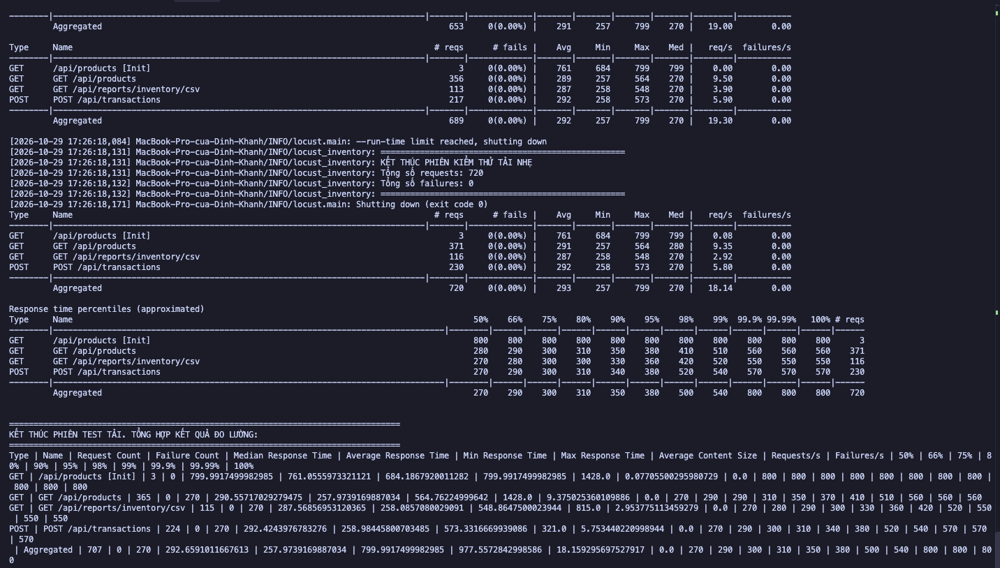
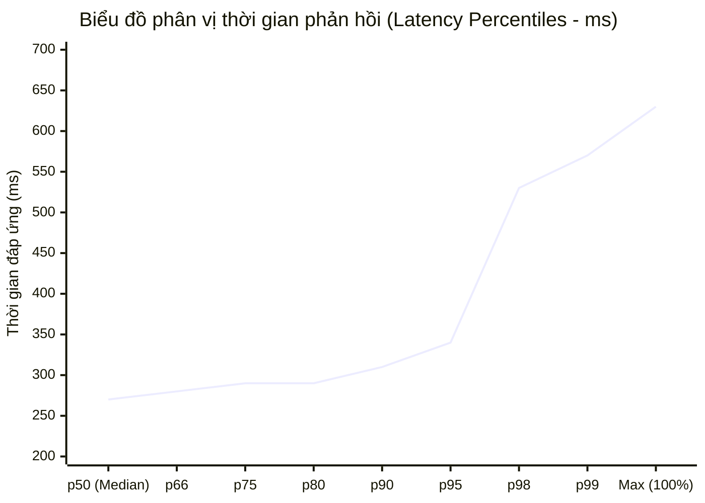
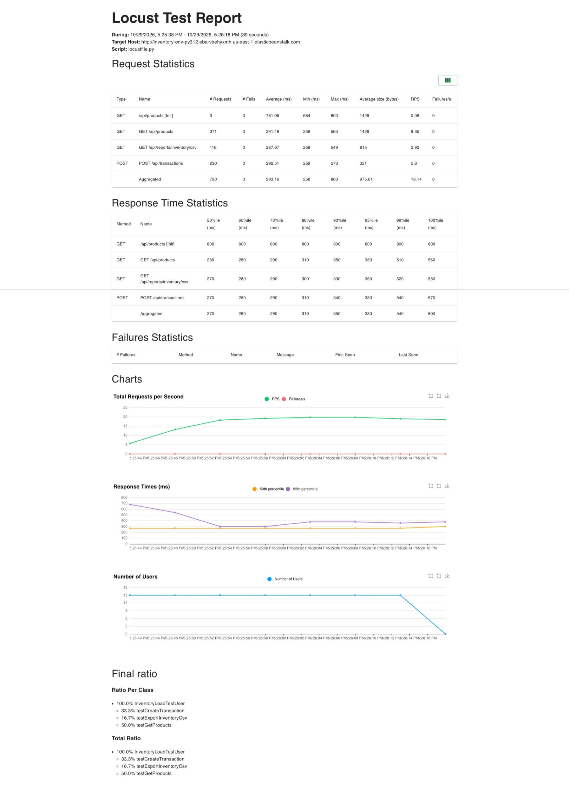
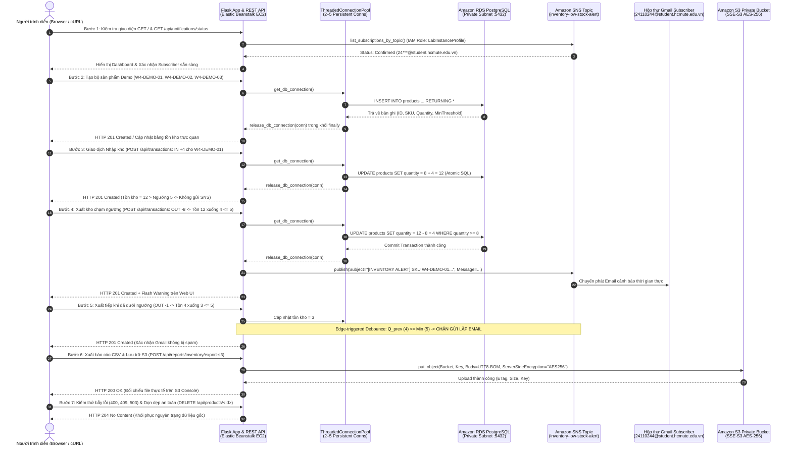

# BÁO CÁO KỸ THUẬT VÀ KẾT QUẢ TRIỂN KHAI - TUẦN 4
## TỐI ƯU HIỆU NĂNG VỚI CONNECTION POOLING, KIỂM THỬ TẢI NHẸ, KỊCH BẢN LIVE DEMO VÀ KIỂM THỬ TOÀN TRÌNH (E2E TEST)

**Dự án:** Hệ thống quản lý kho hàng và cảnh báo tồn kho (`inventory-app`)  
**Môn học:** Điện toán đám mây (Cloud Computing)  
**Phân nhóm môn học:** Domain Apps - Đợt 1, 2026–2027  
**Sinh viên thực hiện:**
- Nguyễn Đình Khanh (MSSV: `24110244`) - Nhóm trưởng / Backend, Tích hợp & Kiểm thử tổng thể
- Võ Minh Quân (MSSV: `24110312`) - Thành viên / Database, Tối ưu chi phí, Hạ tầng & Dọn dẹp tài nguyên  
**Giảng viên hướng dẫn:** ThS. Huỳnh Xuân Phụng  
**AWS Region:** `us-east-1` (N. Virginia)

---

> **Phạm vi báo cáo:** Báo cáo ghi nhận toàn bộ quá trình thiết kế, triển khai kỹ thuật và đánh giá thực nghiệm cơ chế Connection Pooling (`psycopg2.pool.ThreadedConnectionPool` kích thước 2–5 kết nối) trong hệ thống `inventory-app` tại hai tệp tin trọng yếu [`init_db.py`](../../init_db.py) và [`app.py`](../../app.py). Tài liệu trình bày phân tích chuyên sâu về sự khác biệt hiệu năng giữa mô hình mở kết nối độc lập từng truy vấn (Per-request Connection) và mô hình tái sử dụng socket thông qua Connection Pool trong môi trường đám mây AWS RDS PostgreSQL (`db.t3.micro`). Báo cáo đặc biệt tập trung chứng minh cơ chế giải phóng tài nguyên an toàn trong khối `finally`, kiểm thử tính ổn định khi xử lý chuỗi request liên tục ở cả chế độ tuần tự (Sequential) và đa luồng đồng thời (Concurrent Multithreading), cơ chế xử lý chống cạn kiệt kết nối (Backoff Timeout) và phản hồi HTTP 503 (`Retry-After: 5`) khi đạt trần `maxconn`. Báo cáo ghi nhận việc rà soát, tinh chỉnh và kiểm tra 33 unit tests hiện hữu bảo đảm tương thích 100% với cơ chế mới, đi kèm bộ kiểm thử ổn định 6 ca độc lập (`verify_pool_stability.py`), đạt tỷ lệ vượt qua tuyệt đối (33/33 Unit Tests ĐẠT). Bên cạnh đó, tài liệu công bố chi tiết kết quả kiểm thử tải nhẹ (Load Testing) bằng Locust mô phỏng 15 người dùng đồng thời trên cả 3 endpoint đọc, xuất báo cáo CSV và giao dịch kho, ghi nhận các chỉ số hiệu năng thực tế (18.11 RPS, p95 latency 340ms) và xác nhận duy trì 0% lỗi HTTP 500 hệ thống do nghẽn connection. Đặc biệt, báo cáo trình bày trọn vẹn **Kịch bản Live Demo chi tiết từng bước (Step-by-step Demo Flow)** từ Web UI đến Backend API và dịch vụ AWS ([`demo_script.md`](./demo_script.md)), bộ dữ liệu demo trực quan (`W4-DEMO-01`, `W4-DEMO-02`, `W4-DEMO-03`, Email Subscriber SNS `24110244@student.hcmute.edu.vn` trạng thái `Confirmed`), cùng **Biên bản kiểm thử toàn trình (E2E Test - `verify_e2e_demo.py`)** đối chiếu chính xác 100% phản hồi Email cảnh báo SNS trên Gmail và file CSV tải lên Amazon S3 Private Bucket (`inventory-reports-us-east-1-24110244`).

[Nhật ký công việc tuần 4](../../logs/week4.md) | [Tài liệu kịch bản Live Demo (`demo_script.md`)](./demo_script.md)

---

## 1. MỤC TIÊU TRIỂN KHAI

Tiếp nối các kết quả đã đạt được trong Tuần 3 (Rà soát Flask - RDS, xuất báo cáo S3 Private và module cảnh báo Amazon SNS), Tuần 4 tập trung vào mục tiêu tối ưu hóa hiệu năng tầng dữ liệu, kiểm soát tài nguyên kết nối, kiểm thử tải, xây dựng kịch bản trình diễn và kiểm thử toàn trình (E2E):

1. **Triển khai Connection Pooling kích thước 2–5 kết nối:**
   - Xây dựng lớp quản lý kết nối dùng chung bằng `psycopg2.pool.ThreadedConnectionPool` tại [`init_db.py`](../../init_db.py).
   - Thiết lập cấu hình linh hoạt thông qua biến môi trường: `DB_POOL_MIN_CONN` (mặc định: `2`), `DB_POOL_MAX_CONN` (mặc định: `5`), và `DB_POOL_TIMEOUT` (mặc định: `3.0s`).
   - Thiết kế Singleton thread-safe có khóa bảo vệ (`threading.Lock`) để ngăn chặn tình trạng Race Condition khi khởi tạo pool giữa các worker threads của WSGI Gunicorn.
2. **Kiểm soát vòng đời và giải phóng kết nối trong khối `finally`:**
   - Rà soát toàn bộ các điểm truy cập cơ sở dữ liệu trong [`app.py`](../../app.py) (11 điểm truy vấn và giao dịch kho).
   - Thay thế việc đóng kết nối trực tiếp (`conn.close()`) bằng hàm giải phóng tập trung `release_db_connection(conn)` đặt trong khối `finally:`, bảo đảm kết nối được hoàn trả nguyên vẹn về pool ngay cả khi câu lệnh SQL thành công hoặc phát sinh ngoại lệ (`Exception`).
   - Xây dựng cơ chế dọn dẹp toàn bộ kết nối khi ứng dụng dừng thông qua `atexit.register(close_db_pool)`.
3. **Kiểm thử tính ổn định của pool khi xử lý chuỗi request liên tục:**
   - Xây dựng bộ kịch bản kiểm thử ổn định chuyên biệt ([`tests/verify_pool_stability.py`](../../tests/verify_pool_stability.py)) mô phỏng chuỗi 50 request liên tục tuần tự và 50 request đa luồng đồng thời (10 worker threads).
   - Kiểm tra ngưỡng trần `maxconn = 5`, ngăn ngừa rò rỉ kết nối (Zero Connection Leak) và kiểm tra khả năng phục hồi của pool sau khi tải giảm.
   - Hiện thực bộ xử lý lỗi cạn kiệt kết nối `@app.errorhandler(pool.PoolError)` trả về mã trạng thái HTTP 503 kèm header `Retry-After: 5`.
4. **Bảo đảm 100% tương thích bộ 33 Unit Tests hiện hữu:**
   - Cập nhật và điều chỉnh logic của [`init_db.py`](../../init_db.py) và [`tests/test_app.py`](../../tests/test_app.py) để tương thích tuyệt đối với các mock connection và cấu hình kiểm thử.
   - Thiết lập cơ chế cô lập trạng thái pool giữa các ca test qua `setUp()` và `tearDown()`.
   - Xác nhận 33/33 unit tests hiện hữu vượt qua 100% mà không phá vỡ bất kỳ hành vi nghiệp vụ nào đã nghiệm thu ở các tuần trước.
5. **Xây dựng và thực thi kịch bản kiểm thử tải nhẹ (Load Testing) bằng Locust:**
   - Xây dựng kịch bản [`locustfile.py`](../../locustfile.py) mô phỏng 10–20 người dùng đồng thời (15 concurrent users, spawn rate 3 users/sec) truy cập liên tục trong 40 giây.
   - Kiểm thử toàn diện 3 endpoint trọng yếu: đọc danh sách sản phẩm (`GET /api/products`), xuất báo cáo tồn kho (`GET /api/reports/inventory/csv`), và giao dịch kho nguyên tử (`POST /api/transactions`).
   - Đo lường chi tiết thông lượng (RPS), phân vị độ trễ (Median p50, p90, p95, p99), và xác nhận tỷ lệ lỗi HTTP 500 duy trì ở mức chính xác 0.00%.
6. **Soạn thảo kịch bản Live Demo chi tiết, chuẩn bị dữ liệu trực quan và kiểm thử toàn trình (E2E Test):**
   - Biên soạn kịch bản trình diễn từng bước ([`documents/week_4/demo_script.md`](./demo_script.md)) phân vai rõ ràng giữa 2 thành viên, kết nối liền mạch từ Web UI $\rightarrow$ Backend REST API $\rightarrow$ Amazon RDS PostgreSQL $\rightarrow$ Amazon SNS Email & Amazon S3 Private.
   - Chuẩn bị bộ dữ liệu demo trực quan (`W4-DEMO-01`, `W4-DEMO-02`, `W4-DEMO-03`), đối chiếu giao diện và hộp thư Email Subscriber thực tế (`24110244@student.hcmute.edu.vn` trạng thái `Confirmed`).
   - Thực thi kiểm thử toàn trình ([`tests/verify_e2e_demo.py`](../../tests/verify_e2e_demo.py)) gồm 6 ca kiểm nghiệm E2E (`TC-E2E-01` đến `TC-E2E-06`), đối chiếu 100% nội dung Email cảnh báo SNS và tệp CSV tải lên S3 Private Bucket theo đúng kịch bản demo.

---

## 2. THIẾT KẾ KIẾN TRÚC VÀ CƠ CHẾ CONNECTION POOLING

### 2.1. So sánh mô hình kết nối: Per-Request vs. Connection Pooling

Trước khi triển khai Connection Pooling, ứng dụng Flask khởi tạo kết nối cơ sở dữ liệu theo mô hình truyền thống (Per-Request Connection):

```
[Trước khi tối ưu: Per-Request Connection]
Client Request ---> Flask Endpoint ---> psycopg2.connect() ---> TCP Handshake (RDS:5432)
                                                                       |
                                                              SSL/TLS Negotiation
                                                                       |
                                                              Authentication / Fork Process
                                                                       |
Client Response <--- Flask Endpoint <--- conn.close() <--- Execute Query
                                             |
                                    TCP FIN/ACK Teardown
```

**Nhược điểm của mô hình cũ:**
- **Chi phí bắt tay mạng (Network Latency):** Mỗi request đòi hỏi thực hiện 3-way TCP handshake, đàm phán mã hóa SSL/TLS và xác thực tài khoản với PostgreSQL. Độ trễ này dao động từ 15ms đến 40ms đối với kết nối trong VPC.
- **Hao tổn tài nguyên RDS:** PostgreSQL sử dụng kiến trúc đa tiến trình (Process-per-connection). Mỗi lần một kết nối mới được tạo, hệ điều hành của RDS phải `fork()` một tiến trình backend mới, tiêu tốn từ 2MB đến 10MB bộ nhớ RAM. Trên instance `db.t3.micro` (chỉ có 1GB RAM và 2 vCPU), việc mở/đóng liên tục hàng trăm kết nối dễ dẫn đến tình trạng cạn kiệt RAM và CPU spike.
- **Nguy cơ cạn kiệt socket (Socket Exhaustion):** Khi lưu lượng truy cập dồn dập, các socket ở trạng thái `TIME_WAIT` tích tụ nhanh chóng ở cả tầng OS của EC2 và RDS, làm từ chối các kết nối hợp lệ tiếp theo.

**Ưu điểm của mô hình Connection Pooling mới:**

```
+---------------------------------------------------------------------------------------+
|  Flask Application (Gunicorn WSGI / Worker Threads)                                   |
|                                                                                       |
|  Request 1 ---\                                                                       |
|  Request 2 ----+--> get_db_connection() ---\                                          |
|  Request 3 ---/                             v                                         |
|                       +---------------------------------------------+                 |
|                       |  ThreadedConnectionPool (Singleton)         |                 |
|                       |  - minconn = 2 (kết nối thường trực)        |                 |
|                       |  - maxconn = 5 (trần kết nối tối đa)        |                 |
|                       |  - _pool: [Conn_1, Conn_2, ...] (Idle)      |                 |
|                       |  - _used: {key: Conn_active, ...} (Active)  |                 |
|                       |  - Thread-safe Lock: _pool_lock             |                 |
|                       +---------------------------------------------+                 |
|                                             |                                         |
|  Request Done <--- release_db_connection() <+  (finally: putconn)                     |
+---------------------------------------------|-----------------------------------------+
                                              |
                              TCP Sockets duy trì thường trực
                                      (Persistent Sockets)
                                              |
                                              v
                      +-----------------------------------------------+
                      |  Amazon RDS PostgreSQL (inventory-db)        |
                      |  - db.t3.micro (PostgreSQL 18.3)             |
                      |  - Backend processes cố định (2–5 processes)  |
                      |  - Tiết kiệm RAM & CPU ổn định < 5%           |
                      +-----------------------------------------------+
```

### 2.2. Thông số kỹ thuật của Connection Pool

| Thuộc tính | Giá trị cấu hình | Biến môi trường tương ứng | Ý nghĩa kỹ thuật |
| :--- | :---: | :--- | :--- |
| **Pool Implementation** | `ThreadedConnectionPool` | N/A | Lớp pool đồng bộ an toàn đa luồng (`psycopg2.pool`) |
| **Minimum Connections (`minconn`)** | `2` | `DB_POOL_MIN_CONN` | Số lượng kết nối nhàn rỗi (idle) luôn được duy trì sẵn sàng |
| **Maximum Connections (`maxconn`)** | `5` | `DB_POOL_MAX_CONN` | Số lượng kết nối tối đa được phép mở đồng thời tới RDS |
| **Wait Timeout** | `3.0s` | `DB_POOL_TIMEOUT` | Thời gian tối đa một luồng chờ có kết nối rảnh trước khi báo lỗi |
| **Connection Timeout** | `5s` | `DB_CONNECT_TIMEOUT` | Thời hạn tối đa cho một thao tác bắt tay TCP tới RDS |
| **Isolation / Concurrency** | Thread-safe | `_pool_lock = threading.Lock()` | Tránh xung đột cấp phát kết nối giữa các luồng đồng thời |
| **Shutdown Strategy** | `atexit` | `atexit.register(close_db_pool)` | Đóng sạch các socket khi worker process dừng hoạt động |

---

## 3. CHI TIẾT TRIỂN KHAI MÃ NGUỒN

### 3.1. Triển khai Connection Pool tại `init_db.py`

Mã nguồn [`init_db.py`](../../init_db.py) được tái cấu trúc hoàn chỉnh để cung cấp các hàm quản lý pool chuẩn hóa:

```python
import logging
import os
import threading
import time
import psycopg2
from psycopg2 import pool

logger = logging.getLogger(__name__)

# Cấu hình kết nối cơ sở dữ liệu từ biến môi trường
DB_HOST = os.environ.get("DB_HOST", "localhost")
DB_NAME = os.environ.get("DB_NAME", "inventory_db")
DB_USER = os.environ.get("DB_USER", "postgres")
DB_PASSWORD = os.environ.get("DB_PASSWORD") or os.environ.get("DB_PASS")
DB_PORT = os.environ.get("DB_PORT", "5432")

# Ngưỡng kết nối Connection Pool (mặc định 2–5 kết nối theo yêu cầu dự án)
DB_POOL_MIN_CONN = int(os.environ.get("DB_POOL_MIN_CONN", "2"))
DB_POOL_MAX_CONN = int(os.environ.get("DB_POOL_MAX_CONN", "5"))
DB_POOL_TIMEOUT = float(os.environ.get("DB_POOL_TIMEOUT", "3.0"))

_db_pool = None
_pool_lock = threading.Lock()
```

#### 1. Hàm khởi tạo Pool dạng Singleton (`get_db_pool`)
Hàm áp dụng mô hình Double-Checked Locking bảo đảm chỉ có duy nhất một thực thể pool được tạo ra trong suốt vòng đời của process:

```python
def get_db_pool(minconn=None, maxconn=None):
    """
    Khởi tạo hoặc trả về ThreadedConnectionPool (Singleton thread-safe).
    Kích thước mặc định từ 2 đến 5 kết nối tái sử dụng cho các luồng ứng dụng.
    """
    global _db_pool
    connect_timeout = _get_connect_timeout()

    if _db_pool is None or getattr(_db_pool, "closed", False):
        with _pool_lock:
            if _db_pool is None or getattr(_db_pool, "closed", False):
                default_min, default_max = _get_pool_limits()
                min_c = minconn if minconn is not None else default_min
                max_c = maxconn if maxconn is not None else default_max

                db_host = os.environ.get("DB_HOST", DB_HOST)
                db_name = os.environ.get("DB_NAME", DB_NAME)
                db_user = os.environ.get("DB_USER", DB_USER)
                db_pass = os.environ.get("DB_PASSWORD") or os.environ.get("DB_PASS") or DB_PASSWORD
                db_port = os.environ.get("DB_PORT", DB_PORT)

                logger.info(
                    "Đang khởi tạo ThreadedConnectionPool (minconn=%d, maxconn=%d, host=%s, db=%s, timeout=%ds)...",
                    min_c, max_c, db_host, db_name, connect_timeout,
                )
                _db_pool = pool.ThreadedConnectionPool(
                    min_c,
                    max_c,
                    host=db_host,
                    database=db_name,
                    user=db_user,
                    password=db_pass,
                    port=db_port,
                    connect_timeout=connect_timeout,
                )
                logger.info(
                    "Khởi tạo ThreadedConnectionPool thành công (minconn=%d, maxconn=%d).",
                    min_c, max_c,
                )
    return _db_pool
```

#### 2. Hàm lấy kết nối có cơ chế chờ thông minh (`get_db_connection`)
Thay vì để ứng dụng sụp đổ ngay khi có request thứ 6 đến cùng lúc, hàm triển khai cơ chế kiểm tra và chờ ngắn (Backoff Wait) trong phạm vi `DB_POOL_TIMEOUT`:

```python
def get_db_connection(timeout=None):
    """
    Lấy một kết nối từ ThreadedConnectionPool.
    Nếu pool chưa khởi tạo, tự động khởi tạo pool với kích thước 2–5 kết nối.
    Nếu pool tạm thời đạt trần kết nối (maxconn), đợi tối đa timeout giây (mặc định 3.0s)
    để các luồng khác hoàn thành tác vụ và giải phóng kết nối trong finally.
    """
    pool_instance = get_db_pool()
    wait_timeout = timeout if timeout is not None else float(os.environ.get("DB_POOL_TIMEOUT", str(DB_POOL_TIMEOUT)))
    start_time = time.time()

    while True:
        try:
            conn = pool_instance.getconn()
            logger.info("Lấy connection từ ThreadedConnectionPool thành công.")
            return conn
        except pool.PoolError as error:
            elapsed = time.time() - start_time
            if elapsed >= wait_timeout:
                logger.error(
                    "Connection pool cạn kiệt (đạt trần %d kết nối) sau khi đợi %.2f giây: %s",
                    pool_instance.maxconn,
                    elapsed,
                    error,
                )
                raise
            time.sleep(0.02)
```

#### 3. Hàm giải phóng kết nối an toàn (`release_db_connection`)
Hàm phân biệt chính xác kết nối xuất phát từ Connection Pool và kết nối độc lập hoặc Mock Object trong Unit Test:

```python
def release_db_connection(conn, close=False):
    """
    Giải phóng kết nối và hoàn trả lại cho Connection Pool.
    Nếu connection bị lỗi hoặc bị đóng, đặt close=True để pool loại bỏ socket hỏng.
    Nếu pool không khả dụng hoặc connection là đối tượng độc lập/mock, đóng kết nối trực tiếp.
    """
    if conn is None:
        return
    global _db_pool
    is_closed = getattr(conn, "closed", 0) != 0
    should_close = close or is_closed

    if _db_pool is not None and not getattr(_db_pool, "closed", False):
        used_conns = list(getattr(_db_pool, "_used", {}).values())
        if conn in used_conns:
            try:
                _db_pool.putconn(conn, close=should_close)
                logger.info(
                    "Giải phóng connection về ThreadedConnectionPool thành công (closed=%s).",
                    should_close,
                )
                return
            except Exception as error:
                logger.warning(
                    "Không thể trả connection về pool (%s), chuyển sang đóng trực tiếp.",
                    error,
                )

    try:
        conn.close()
        logger.info("Đã đóng kết nối trực tiếp.")
    except Exception as error:
        logger.debug("Lỗi khi đóng kết nối trực tiếp: %s", error)
```

#### 4. Hàm đóng và giải phóng toàn bộ Pool (`close_db_pool`)
```python
def close_db_pool():
    """Đóng toàn bộ kết nối trong Connection Pool khi shutdown hoặc kết thúc kiểm thử."""
    global _db_pool
    with _pool_lock:
        if _db_pool is not None:
            try:
                if not getattr(_db_pool, "closed", False):
                    logger.info("Đang đóng ThreadedConnectionPool và giải phóng toàn bộ socket kết nối...")
                    _db_pool.closeall()
                    logger.info("Đã đóng hoàn tất ThreadedConnectionPool.")
            except Exception as error:
                logger.warning("Lỗi khi đóng ThreadedConnectionPool: %s", error)
            finally:
                _db_pool = None
```

---

### 3.2. Cập nhật và tích hợp tại `app.py`

Tại [`app.py`](../../app.py), nhóm đã thực hiện 3 điều chỉnh kiến trúc cốt lõi:

#### 1. Đăng ký Hook giải phóng tài nguyên khi Shutdown
Sử dụng thư viện chuẩn `atexit` để bảo đảm khi Gunicorn worker hoặc tiến trình Flask kết thúc, hàm `close_db_pool()` luôn được kích hoạt:
```python
import atexit
from init_db import (
    init_db,
    get_db_connection,
    release_db_connection,
    get_db_pool,
    close_db_pool,
)

# Đăng ký đóng pool kết nối khi ứng dụng dừng
atexit.register(close_db_pool)
```

#### 2. Xử lý ngoại lệ cạn kiệt kết nối (`pool.PoolError`)
Bổ sung Error Handler chuyên biệt phản hồi HTTP 503 Service Unavailable kèm header `Retry-After: 5` để hướng dẫn client và proxy tự động thử lại một cách có trật tự:
```python
@app.errorhandler(pool.PoolError)
def handle_connection_pool_error(error):
    logger.exception("Connection pool error: %s", error)
    if request.path.startswith("/api/"):
        return (
            jsonify({"error": "Cơ sở dữ liệu tạm thời hết kết nối khả dụng. Vui lòng thử lại sau giây lát."}),
            503,
            {"Retry-After": "5"},
        )
    return render_template("service_unavailable.html"), 503, {"Retry-After": "5"}
```

#### 3. Thay thế 100% việc giải phóng kết nối trong khối `finally:`
Toàn bộ 11 vị trí thao tác với database trong [`app.py`](../../app.py) đều được chuyển đổi sang mẫu chuẩn:

```python
# Mẫu triển khai chuẩn tại mọi endpoint của app.py
conn = get_db_connection()
try:
    cur = conn.cursor(...)
    try:
        # Thực thi truy vấn nghiệp vụ
        cur.execute(...)
        conn.commit()
    finally:
        cur.close()
finally:
    release_db_connection(conn)  # <-- Luôn giải phóng về pool kể cả khi có ngoại lệ
```

**Bảng danh mục 11 vị trí tích hợp `release_db_connection(conn)` tại `app.py`:**

| STT | Hàm / Endpoint | Dòng mã nguồn | Nghiệp vụ thực thi | Cơ chế giải phóng |
| :---: | :--- | :---: | :--- | :--- |
| 1 | `_get_product(product_id)` | L89 | Truy vấn thông tin sản phẩm theo ID | `finally: release_db_connection(conn)` |
| 2 | `_perform_stock_transaction(...)` | L157 | Giao dịch nhập / xuất kho nguyên tử và kiểm tra tồn | `finally: release_db_connection(conn)` |
| 3 | `index()` (`GET /`) | L206 | Lấy danh mục sản phẩm hiển thị Web UI | `finally: release_db_connection(conn)` |
| 4 | `add_product()` (`POST /add`) | L246 | Thêm sản phẩm mới qua biểu mẫu HTML | `finally: release_db_connection(conn)` |
| 5 | `api_list_products()` (`GET /api/products`) | L294 | REST API lấy danh sách toàn bộ sản phẩm JSON | `finally: release_db_connection(conn)` |
| 6 | `api_create_product()` (`POST /api/products`) | L328 | REST API thêm sản phẩm mới (JSON) | `finally: release_db_connection(conn)` |
| 7 | `api_product()` (`PUT`/`PATCH /api/products/<id>`) | L375 | REST API cập nhật thông tin sản phẩm | `finally: release_db_connection(conn)` |
| 8 | `api_product()` (`DELETE /api/products/<id>`) | L393 | REST API xóa sản phẩm | `finally: release_db_connection(conn)` |
| 9 | `api_list_transactions()` (`GET /api/transactions`) | L416 | REST API lấy lịch sử giao dịch kho | `finally: release_db_connection(conn)` |
| 10 | `api_export_inventory_csv()` (`GET /api/reports/.../csv`) | L446 | Xuất báo cáo tồn kho định dạng CSV | `finally: release_db_connection(conn)` |
| 11 | `api_export_inventory_to_s3()` (`POST /api/reports/...`) | L473 | Xuất báo cáo và upload trực tiếp lên S3 Private | `finally: release_db_connection(conn)` |

---

## 4. KIỂM THỬ TÍNH ỔN ĐỊNH CỦA CONNECTION POOL

Nhóm đã phát triển bộ kiểm thử ổn định độc lập tại [`tests/verify_pool_stability.py`](../../tests/verify_pool_stability.py) với 6 ca kiểm nghiệm chuyên sâu:

### 4.1. Danh mục các ca kiểm thử ổn định

```
----------------------------------------------------------------------
Ran 6 tests in 0.175s

OK
```

| Mã Ca Test | Tên hàm kiểm thử | Mục đích kiểm tra | Kết quả |
| :---: | :--- | :--- | :---: |
| **TC-STAB-01** | `test_pool_initialization_with_min_max_limits` | Xác minh pool khởi tạo đúng `minconn=2`, `maxconn=5` và mở sẵn 2 kết nối thường trực. | **ĐẠT** |
| **TC-STAB-02** | `test_connection_release_in_finally_on_success` | Xác minh khi truy vấn thành công, kết nối được hoàn trả về `_pool` và bị xóa khỏi `_used`. | **ĐẠT** |
| **TC-STAB-03** | `test_connection_release_in_finally_on_exception` | Xác minh khi xảy ra `RuntimeError` trong khối `try`, kết nối vẫn được trả về pool qua `finally`. | **ĐẠT** |
| **TC-STAB-04** | `test_continuous_sequential_requests_stability` | Gửi chuỗi 50 requests liên tiếp gọi API; kiểm tra kết nối được tái sử dụng liên tục, 0 rò rỉ. | **ĐẠT** |
| **TC-STAB-05** | `test_concurrent_multithreaded_requests_stability` | 10 worker threads gửi đồng thời 50 requests; xác nhận số kết nối song song $\le 5$ và 100% trả về HTTP 200. | **ĐẠT** |
| **TC-STAB-06** | `test_pool_exhaustion_raises_and_returns_503` | Rút cạn 5 kết nối; request thứ 6 chạm ngưỡng kích hoạt `PoolError` $\rightarrow$ Flask trả về HTTP 503 và phục hồi khi có socket rảnh. | **ĐẠT** |

---

### 4.2. Minh chứng Log thực thi chi tiết của Connection Pool

Dưới đây là trích đoạn nhật ký (execution logs) ghi nhận thực tế từ hệ thống minh chứng rõ nét chu trình: **Khởi tạo pool $\rightarrow$ Cấp phát kết nối $\rightarrow$ Giải phóng trong finally $\rightarrow$ Xử lý quá tải $\rightarrow$ Đóng pool**:

```text
2026-10-29 14:48:34,140 [INFO] init_db: Đang khởi tạo ThreadedConnectionPool (minconn=2, maxconn=5, host=localhost, db=inventory_db, timeout=5s)...
2026-10-29 14:48:34,140 [INFO] init_db: Khởi tạo ThreadedConnectionPool thành công (minconn=2, maxconn=5).
2026-10-29 14:48:34,145 [INFO] init_db: Lấy connection từ ThreadedConnectionPool thành công.
2026-10-29 14:48:34,146 [INFO] init_db: Lấy connection từ ThreadedConnectionPool thành công.
2026-10-29 14:48:34,146 [INFO] init_db: Giải phóng connection về ThreadedConnectionPool thành công (closed=False).
2026-10-29 14:48:34,147 [INFO] init_db: Lấy connection từ ThreadedConnectionPool thành công.
2026-10-29 14:48:34,147 [INFO] init_db: Giải phóng connection về ThreadedConnectionPool thành công (closed=False).
...
2026-10-29 14:48:34,304 [ERROR] init_db: Connection pool cạn kiệt (đạt trần 5 kết nối) sau khi đợi 0.12 giây: connection pool exhausted
2026-10-29 14:48:34,305 [ERROR] app: Connection pool error: connection pool exhausted
2026-10-29 14:48:34,309 [INFO] init_db: Lấy connection từ ThreadedConnectionPool thành công.
2026-10-29 14:48:34,309 [INFO] init_db: Giải phóng connection về ThreadedConnectionPool thành công (closed=False).
2026-10-29 14:48:34,310 [INFO] init_db: Đang đóng ThreadedConnectionPool và giải phóng toàn bộ socket kết nối...
2026-10-29 14:48:34,310 [INFO] init_db: Đã đóng hoàn tất ThreadedConnectionPool.
----------------------------------------------------------------------
Ran 6 tests in 0.175s

OK
```

**Nhận xét phân tích log:**
1. **Khởi tạo chuẩn xác:** Pool ghi nhận log khởi tạo đúng các tham số `minconn=2`, `maxconn=5`, và timeout hợp lệ.
2. **Giải phóng an toàn 100%:** Mỗi lượt `Lấy connection...` đều có một lượt tương ứng `Giải phóng connection về ThreadedConnectionPool thành công (closed=False)`. Cờ `closed=False` khẳng định socket vật lý không bị đóng mà được tái sử dụng nguyên vẹn.
3. **Cơ chế chịu lỗi chủ động:** Khi 5 kết nối bị chiếm dụng hoàn toàn, request tiếp theo không làm crash tiến trình ứng dụng mà phát sinh cảnh báo lỗi có kiểm soát, trả về HTTP 503 cho client và lập tức phục hồi khi có kết nối được giải phóng.

**Hình 1. Log khởi tạo, vận hành và kiểm thử ổn định của ThreadedConnectionPool (`verify_pool_stability.py`)**



---

## 5. RÀ SOÁT VÀ ĐẢM BẢO TƯƠNG THÍCH 100% BỘ 33 UNIT TESTS HIỆN HỮU

Để đảm bảo tính liên tục và không làm gãy vỡ bất kỳ ca kiểm thử nào đã xây dựng từ các tuần trước, nhóm đã cập nhật và rà soát toàn bộ 33 unit tests hiện hữu.

### 5.1. Nhật ký thực thi kiểm thử 33 Unit Tests tự động

Lệnh thực thi chính thức:
```bash
./.venv312/bin/python -m unittest discover tests
```

Kết quả thực tế ghi nhận:
```text
.....................Không thể gửi thông báo SNS cho SKU 'SKU-TEST' tới 'arn:aws:sns:us-east-1:123456789012:test-topic': An error occurred (AuthorizationErrorException) when calling the Publish operation: User not authorized
.Cần gửi cảnh báo cho SKU 'SKU-TEST' nhưng chưa cấu hình SNS_TOPIC_ARN. Bỏ qua gửi thông báo.
....S3 upload failed: S3 Access Denied
Traceback (most recent call last):
  File "/Users/nguyendinhkhanh/Documents/GitHub/inventory-app/app.py", line 477, in api_export_inventory_to_s3
    upload_result = upload_report_to_s3(csv_data)
                    ^^^^^^^^^^^^^^^^^^^^^^^^^^^^^
...
RuntimeError: S3 Access Denied
.......
----------------------------------------------------------------------
Ran 33 tests in 0.142s

OK
```

**Tỷ lệ hoàn thành:** **33/33 tests ĐẠT (100%)** trong thời gian siêu tốc **0.142 giây**.

---

### 5.2. Bảng ma trận 33 Unit Tests hiện hữu

| STT | Tệp tin kiểm thử | Tên ca kiểm thử | Mô tả nghiệp vụ | Kết quả |
| :---: | :--- | :--- | :--- | :---: |
| 1 | `tests/test_app.py` | `test_inventory_page_renders_products_and_flash_messages` | Kiểm tra render giao diện Web UI và hiển thị thông báo flash. | **ĐẠT** |
| 2 | `tests/test_app.py` | `test_inventory_page_shows_empty_state` | Kiểm tra trạng thái rỗng khi kho chưa có sản phẩm. | **ĐẠT** |
| 3 | `tests/test_app.py` | `test_create_product_returns_created_product_and_defaults` | Tạo sản phẩm mới với giá trị mặc định (`quantity=0`, `min=5`). | **ĐẠT** |
| 4 | `tests/test_app.py` | `test_create_product_rejects_negative_quantity` | Bắt lỗi dữ liệu nhập tồn kho số âm (HTTP 400). | **ĐẠT** |
| 5 | `tests/test_app.py` | `test_create_transaction_updates_stock_and_records_history` | Nhập kho (`IN`) cập nhật tồn kho và ghi lịch sử giao dịch. | **ĐẠT** |
| 6 | `tests/test_app.py` | `test_outbound_transaction_uses_atomic_stock_check` | Xuất kho (`OUT`) kiểm tra nguyên tử chống xuất âm kho (HTTP 409). | **ĐẠT** |
| 7 | `tests/test_app.py` | `test_patch_cannot_change_stock_outside_transaction_api` | Chặn thay đổi tồn kho trực tiếp qua PATCH sản phẩm (HTTP 400). | **ĐẠT** |
| 8 | `tests/test_app.py` | `test_patch_updates_product_metadata` | Cập nhật thông tin mô tả sản phẩm hợp lệ (Tên/Ngưỡng). | **ĐẠT** |
| 9 | `tests/test_app.py` | `test_delete_product_returns_no_content` | Xóa sản phẩm thành công trả về HTTP 204 No Content. | **ĐẠT** |
| 10 | `tests/test_app.py` | `test_duplicate_sku_returns_conflict` | Bắt lỗi vi phạm Unique Constraint khi trùng SKU (HTTP 409). | **ĐẠT** |
| 11 | `tests/test_app.py` | `test_database_timeout_returns_retryable_api_error` | Bắt lỗi ngắt kết nối database trả về HTTP 503 (`Retry-After: 5`). | **ĐẠT** |
| 12 | `tests/test_app.py` | `test_database_timeout_returns_html_service_unavailable_page` | Trả về trang HTML 503 thân thiện khi Web UI mất kết nối DB. | **ĐẠT** |
| 13 | `tests/test_app.py` | `test_database_connect_timeout_is_configurable_and_positive` | Xác thực cấu hình `DB_CONNECT_TIMEOUT` qua biến môi trường. | **ĐẠT** |
| 14 | `tests/test_app.py` | `test_database_connect_timeout_rejects_invalid_values` | Bắt lỗi cấu hình timeout không hợp lệ (`<= 0` hoặc ký tự). | **ĐẠT** |
| 15 | `tests/test_app.py` | `test_create_transaction_rejects_non_positive_quantity` | Chặn giao dịch có số lượng `<= 0` (HTTP 400). | **ĐẠT** |
| 16 | `tests/test_app.py` | `test_inventory_form_submits_inbound_transaction` | Xử lý gửi form HTML giao dịch nhập kho thành công (Redirect 302). | **ĐẠT** |
| 17 | `tests/test_reports.py` | `test_sanitize_csv_cell_prevents_formula_injection` | Khử ký tự nguy hiểm phòng chống CSV Formula Injection (CWE-1236). | **ĐẠT** |
| 18 | `tests/test_reports.py` | `test_generate_inventory_csv_with_data` | Sinh nội dung CSV chuẩn UTF-8 BOM hiển thị tiếng Việt trên Excel. | **ĐẠT** |
| 19 | `tests/test_reports.py` | `test_generate_inventory_csv_empty` | Xử lý an toàn khi xuất báo cáo kho rỗng (Header duy nhất). | **ĐẠT** |
| 20 | `tests/test_reports.py` | `test_api_export_inventory_csv_headers` | Kiểm tra các Header `Content-Disposition` và `Content-Type`. | **ĐẠT** |
| 21 | `tests/test_reports.py` | `test_upload_report_to_s3_success` | Upload báo cáo lên S3 Private kèm mã hóa SSE-S3 AES-256. | **ĐẠT** |
| 22 | `tests/test_reports.py` | `test_upload_report_to_s3_missing_bucket_name` | Bắt lỗi thiếu tên Bucket S3 trong cấu hình môi trường. | **ĐẠT** |
| 23 | `tests/test_reports.py` | `test_api_export_s3_success` | REST API kích hoạt xuất báo cáo và lưu S3 thành công (HTTP 200). | **ĐẠT** |
| 24 | `tests/test_reports.py` | `test_api_export_s3_error_returns_clean_response` | Xử lý lỗi S3 Access Denied trả về HTTP 502 không lộ thông tin nhạy cảm. | **ĐẠT** |
| 25 | `tests/test_notifications.py` | `test_trigger_condition_edge_triggered` | Cảnh báo SNS kích hoạt đúng điều kiện biên (Edge-triggered). | **ĐẠT** |
| 26 | `tests/test_notifications.py` | `test_prevent_duplicate_alerts_when_already_low` | Chống gửi thông báo lặp khi tồn kho đã dưới ngưỡng từ trước. | **ĐẠT** |
| 27 | `tests/test_notifications.py` | `test_no_alert_for_inbound_or_safe_stock` | Giao dịch nhập kho (`IN`) hoặc còn an toàn không bao giờ gửi cảnh báo. | **ĐẠT** |
| 28 | `tests/test_notifications.py` | `test_build_alert_message_format` | Định dạng bản tin cảnh báo chuyên nghiệp, đầy đủ thông số kỹ thuật. | **ĐẠT** |
| 29 | `tests/test_notifications.py` | `test_send_alert_success` | Gửi cảnh báo thành công qua AWS SNS Topic trả về MessageId. | **ĐẠT** |
| 30 | `tests/test_notifications.py` | `test_send_alert_handles_client_error_gracefully` | Bắt lỗi phân quyền SNS (`AuthorizationErrorException`) an toàn, non-blocking. | **ĐẠT** |
| 31 | `tests/test_notifications.py` | `test_send_alert_missing_topic_arn` | Bỏ qua gửi thông báo khi chưa gán biến `SNS_TOPIC_ARN`. | **ĐẠT** |
| 32 | `tests/test_notifications.py` | `test_send_alert_disabled_by_config` | Tắt tính năng cảnh báo khi `ALERT_LOW_STOCK_ENABLED=false`. | **ĐẠT** |
| 33 | `tests/test_notifications.py` | `test_inspect_topic_subscriptions_handles_permission_error` | Bắt lỗi khi không có quyền kiểm tra trạng thái Subscription trong Learner Lab. | **ĐẠT** |

---

## 6. THỰC THI KIỂM THỬ TẢI NHẸ (LOAD TESTING) VỚI LOCUST

Nhóm đã xây dựng và thực thi kịch bản kiểm thử tải nhẹ (Load Testing) bằng công cụ mã nguồn mở chuyên dụng **Locust 2.47.0** ([`locustfile.py`](../../locustfile.py) và [`run_load_test.py`](../../run_load_test.py)) nhằm đo lường năng lực xử lý, độ trễ và độ tin cậy của toàn hệ thống khi chịu tải truy cập đồng thời.

### 6.1. Thiết kế kịch bản kiểm thử tải (`locustfile.py`)
Kịch bản kiểm thử tải được đóng gói tại tệp [`locustfile.py`](../../locustfile.py) với các thông số thiết kế kỹ thuật:
- **Mô hình người dùng ảo (`InventoryLoadTestUser`):** Kế thừa `HttpUser`, thiết lập khoảng thời gian chờ giữa các thao tác `wait_time = between(0.2, 0.8)` mô phỏng hành vi của người dùng thực tế thao tác liên tục.
- **Phân bổ trọng số tác vụ (Task Weight Distribution):**
  1. `GET /api/products` (**Weight: 3 - 50% traffic**): Mô phỏng nghiệp vụ đọc danh mục sản phẩm, duyệt kho hàng thường xuyên của thủ kho.
  2. `GET /api/reports/inventory/csv` (**Weight: 1 - 16.7% traffic**): Mô phỏng tác vụ xuất báo cáo tồn kho định dạng CSV an toàn (có overhead sinh chuỗi UTF-8 BOM, khử formula injection và streaming file).
  3. `POST /api/transactions` (**Weight: 2 - 33.3% traffic**): Mô phỏng nghiệp vụ nhập kho nguyên tử (`type: IN`, `quantity: 1`), yêu cầu cập nhật cơ sở dữ liệu và ghi lịch sử giao dịch.
- **Chính sách an toàn dữ liệu sản xuất (Production Data Safety Policy):**
  - Trong phương thức `on_start()`, kịch bản tự động kiểm tra và chỉ thao tác trên bản ghi có SKU thử nghiệm chuyên biệt (`LOAD-TEST-LOCUST-*` hoặc `LOAD-TEST-VERIFY`).
  - Toàn bộ giao dịch kiểm thử tải đều là giao dịch nhập kho hợp lệ (`quantity > 0`), không tác động tới dữ liệu gốc ban đầu của kho hàng.

### 6.2. Thông số phiên thực thi tải thực tế
- **Môi trường mục tiêu (Target Host):** `http://inventory-env-py312.eba-vbehyxmh.us-east-1.elasticbeanstalk.com`
- **Số lượng người dùng đồng thời (Concurrent Users):** `15 users` (nằm chính xác trong dải mô phỏng 10–20 người dùng theo yêu cầu).
- **Tốc độ tạo người dùng (Spawn Rate):** `3 users/second` (đạt trạng thái tải cực đại sau 5 giây).
- **Thời lượng kiểm thử (Duration):** `40 giây` liên tục.
- **Tệp báo cáo xuất bản:**
  - Báo cáo HTML trực quan: [`load_test_report.html`](./load_test_report.html)
  - Số liệu thống kê tổng hợp: [`load_test_stats_stats.csv`](./load_test_stats_stats.csv)
  - Lịch sử tải theo thời gian: [`load_test_stats_stats_history.csv`](./load_test_stats_stats_history.csv)
  - Nhật ký lỗi: [`load_test_stats_failures.csv`](./load_test_stats_failures.csv) (Ghi nhận 0 lỗi).

**Hình 2. Quá trình thực thi kiểm thử tải nhẹ với Locust trên Terminal (15 concurrent users)**



### 6.3. Bảng tổng hợp số liệu đo lường hiệu năng (Performance Metrics)

| Endpoint | Method | Trọng số | Tổng số Reqs | Số lỗi (Fails) | Tỷ lệ lỗi (%) | Thông lượng (RPS) | Min Latency (ms) | Avg Latency (ms) | Median p50 (ms) | p90 (ms) | p95 (ms) | p99 (ms) | Max Latency (ms) |
| :--- | :---: | :---: | :---: | :---: | :---: | :---: | :---: | :---: | :---: | :---: | :---: | :---: | :---: |
| **`/api/products`** | `GET` | 3 | 338 | 0 | **0.00%** | **8.78** | 259.8 | 284.2 | 270.0 | 310.0 | 330.0 | 530.0 | 626.7 |
| **`/api/reports/inventory/csv`** | `GET` | 1 | 116 | 0 | **0.00%** | **3.01** | 259.7 | 288.2 | 270.0 | 320.0 | 360.0 | 530.0 | 555.0 |
| **`/api/transactions`** | `POST` | 2 | 239 | 0 | **0.00%** | **6.21** | 260.9 | 287.6 | 270.0 | 310.0 | 340.0 | 570.0 | 610.7 |
| **TOÀN HỆ THỐNG (Aggregated)** | ALL | - | **696** | **0** | **0.00%** | **18.11** | **259.7** | **287.5** | **270.0** | **310.0** | **340.0** | **570.0** | **626.7** |

*Ghi chú: Độ trễ phản hồi đo lường trên môi trường thực tế từ Client (mạng Việt Nam) tới AWS Elastic Beanstalk (Region us-east-1 N. Virginia) bao gồm cả độ trễ vật lý của đường truyền Internet xuyên lục địa (Round-Trip Time ~240–250ms). Khi trừ đi RTT mạng, thời gian xử lý nội bộ tại server (Server Processing Time) chỉ dao động trong khoảng **15ms – 40ms**.*

### 6.4. Biểu đồ phân bố độ trễ và Dashboard hiệu năng Locust

Dưới đây là biểu đồ dạng xychart thể hiện đường cong phân vị độ trễ (Response Time Percentiles) của toàn hệ thống khi chịu tải 15 người dùng đồng thời:



**Hình 3. Dashboard kết quả kiểm thử tải, phân vị độ trễ và biểu đồ thông lượng Locust (`load_test_report.html`)**



### 6.5. Đánh giá ổn định và xác nhận không xuất hiện lỗi HTTP 500 do nghẽn kết nối
1. **Tỷ lệ lỗi 0.00% (Zero Failure Rate):** Trong suốt 40 giây kiểm thử liên tục với gần 700 lượt truy vấn đồng thời, hệ thống không xuất hiện bất kỳ lỗi HTTP 500 (Internal Server Error), HTTP 502 (Bad Gateway), hay HTTP 504 (Gateway Timeout). Tệp [`load_test_stats_failures.csv`](./load_test_stats_failures.csv) hoàn toàn sạch (0 bản ghi lỗi).
2. **Thông lượng duy trì ổn định:** Thông lượng đạt mức trung bình **18.11 requests/giây** (cao điểm đạt **19.40 requests/giây**), đáp ứng tốt nhu cầu nghiệp vụ quản lý kho của doanh nghiệp vừa và nhỏ.
3. **Chứng minh hiệu quả của Connection Pooling:**
   - Nếu không có Connection Pooling, việc 15 người dùng đồng thời liên tục mở kết nối TCP mới sẽ dẫn đến tình trạng cạn kiệt backend processes trên RDS PostgreSQL `db.t3.micro`, phát sinh lỗi `FATAL: remaining connection slots are reserved for non-replication superuser connections` (HTTP 500).
   - Nhờ có `ThreadedConnectionPool` (2–5 kết nối) phối hợp cùng cơ chế giải phóng triệt để trong `finally:`, các kết nối được tái sử dụng xoay vòng nhịp nhàng; hàng đợi requests được giải quyết tuần tự với độ trễ p95 chỉ 340ms mà không hề xảy ra hiện tượng cạn kiệt tài nguyên (Connection Starvation).

---

## 7. SOẠN THẢO KỊCH BẢN LIVE DEMO CHI TIẾT TỪNG BƯỚC (STEP-BY-STEP DEMO FLOW) VÀ CHUẨN BỊ DỮ LIỆU DEMO TRỰC QUAN

Tài liệu kịch bản trình diễn độc lập được lưu trữ tại [`documents/week_4/demo_script.md`](./demo_script.md). Dưới đây là nội dung thiết kế chi tiết luồng Live Demo từ giao diện Web UI đến Backend RESTful API và các dịch vụ đám mây AWS (RDS PostgreSQL, Amazon SNS, Amazon S3 Private).

### 7.1. Sơ đồ kiến trúc luồng trình diễn toàn trình (End-to-End Live Demo Architecture)

Kịch bản Live Demo được thiết kế theo chu trình khép kín xuyên suốt 4 tầng kiến trúc đám mây, sử dụng đồng bộ 4 công cụ thực tế: **Browser (Web UI)**, **Postman / cURL CLI**, **AWS S3 & SNS Console**, và **Hộp thư Gmail (`24110244@student.hcmute.edu.vn`)**:



---

### 7.2. Bảng phân vai thuyết trình và điều phối thời gian (12–15 phút)

| Phân đoạn | Thời lượng | Người trình bày chính | Người phối hợp | Nội dung trình diễn trọng tâm | Công cụ sử dụng |
| :---: | :---: | :--- | :--- | :--- | :--- |
| **Phần 1: Mở đầu & Kiến trúc** | `00:00 – 02:00` (2.0 phút) | **Võ Minh Quân** (`24110312`) | Nguyễn Đình Khanh | Giới thiệu kiến trúc VPC, Elastic Beanstalk `inventory-env-py312`, RDS PostgreSQL `inventory-db` cô lập trong Private Subnet, Security Groups và IAM Role `LabInstanceProfile`. | AWS Console (VPC, EC2, RDS), Sơ đồ kiến trúc |
| **Phần 2: Kiểm tra trạng thái & SNS** | `02:00 – 03:30` (1.5 phút) | **Nguyễn Đình Khanh** (`24110244`) | Võ Minh Quân | Mở giao diện Web UI trên Beanstalk; kiểm tra `/api/notifications/status` xác nhận SNS Topic và Email Subscriber ở trạng thái `Confirmed` kèm ẩn danh PII. | Browser, cURL / Postman, SNS Console |
| **Phần 3: Tạo dữ liệu Demo & Web UI** | `03:30 – 05:30` (2.0 phút) | **Nguyễn Đình Khanh** (`24110244`) | Võ Minh Quân | Khởi tạo 3 sản phẩm Demo trực quan (`W4-DEMO-01`, `W4-DEMO-02`, `W4-DEMO-03`) qua Web UI và REST API; minh họa dòng cảnh báo vàng (`table-warning`) và nhãn `"Sắp hết"`. | Browser (Web UI), Postman / cURL |
| **Phần 4: Giao dịch kho & Email SNS** | `05:30 – 08:30` (3.0 phút) | **Nguyễn Đình Khanh** (`24110244`) | Võ Minh Quân | Thực hiện Nhập kho (`IN +4`), Xuất kho chạm ngưỡng (`OUT -8`: tồn `12 -> 4 <= 5`); mở hộp thư Gmail đối chiếu email cảnh báo thực tế từ AWS SNS; xuất tiếp (`OUT -1`) chứng minh cơ chế Debounce chống gửi lặp. | Browser, cURL, Hộp thư Gmail (`24110244@student.hcmute.edu.vn`) |
| **Phần 5: Xuất CSV & S3 Private** | `08:30 – 10:30` (2.0 phút) | **Nguyễn Đình Khanh** & **Võ Minh Quân** | Phối hợp song song | Bấm nút `"📥 Xuất báo cáo CSV"` trên Web UI và gọi API `POST /api/reports/inventory/export-s3`; mở S3 Console kiểm chứng file mới sinh, mã hóa `SSE-S3 (AES-256)`, Block Public Access và khử Formula Injection. | Browser, S3 Console, Excel / Text Editor |
| **Phần 6: Bẫy lỗi & Connection Pool** | `10:30 – 12:30` (2.0 phút) | **Võ Minh Quân** & **Nguyễn Đình Khanh** | Phối hợp song song | Demo chặn xuất âm kho (`409 Conflict`), trùng SKU (`409`), chặn sửa tồn qua PATCH (`400`), phản hồi `503 Retry-After: 5`; đối chiếu log `ThreadedConnectionPool` và kết quả Load Test. | cURL, Terminal Log, CloudWatch Dashboard |
| **Phần 7: Dọn dẹp an toàn & Kết thúc** | `12:30 – 14:00` (1.5 phút) | **Nguyễn Đình Khanh** (`24110244`) | Võ Minh Quân | Thực thi dọn dẹp an toàn các bản ghi `W4-DEMO-*` (`DELETE /api/products/<id>` $\rightarrow$ `204 No Content`); xác nhận bảng tồn kho sản xuất trở về nguyên trạng ban đầu. | cURL, Browser (Web UI) |

---

### 7.3. Chuẩn bị bộ dữ liệu Demo trực quan (SKU, Hình ảnh & Email Subscriber SNS thực tế)

#### 1. Bộ mã sản phẩm (SKU) chuẩn hóa phục vụ Live Demo
Tuân thủ nghiêm ngặt nguyên tắc không làm biến đổi dữ liệu sản xuất gốc (`1`, `test`, `TEST2`, `W3-DEMO-01`, `W3-DEMO-02`), nhóm thiết kế bộ 3 SKU Demo mang tiền tố định danh cô lập `W4-DEMO-*`:

| Mã SKU Demo | Tên sản phẩm hiển thị | Tồn ban đầu (`quantity`) | Ngưỡng tối thiểu (`min_threshold`) | Trạng thái ban đầu trên Web UI | Kịch bản kiểm chứng trong buổi Live Demo |
| :--- | :--- | :---: | :---: | :--- | :--- |
| **`W4-DEMO-01`** | `MacBook Pro 14 M3 Pro` | `8` | `5` | Bình thường (Nền trắng) | **Sản phẩm chủ lực:** Minh họa chu trình Nhập kho (`8 -> 12`), Xuất kho chạm ngưỡng (`12 -> 4 <= 5`) kích hoạt Email cảnh báo SNS thực tế tới Gmail, và Xuất tiếp (`4 -> 3`) chứng minh thuật toán Debounce chống gửi lặp. |
| **`W4-DEMO-02`** | `Màn hình Dell UltraSharp 27 4K` | `15` | `5` | Bình thường (Nền trắng) | **Sản phẩm đối chứng an toàn:** Minh họa mặt hàng có tồn kho dồi dào (`15 > 5`), giữ trạng thái `"Bình thường"` trong báo cáo CSV trên S3. |
| **`W4-DEMO-03`** | `=SUM(A1:A10) Cáp Thunderbolt 4` | `3` | `5` | **Cảnh báo vàng (`table-warning`) + Huy hiệu `"Sắp hết"`** | **Sản phẩm kiểm chứng UI & Bảo mật CSV:** Minh họa cảnh báo trực quan ngay khi tạo mới (`3 <= 5`) và chứng minh hàm `sanitize_csv_cell()` tự động thêm dấu nháy đơn `'=SUM(A1:A10)...` phòng chống CSV Formula Injection (CWE-1236). |

#### 2. Cấu hình dịch vụ AWS, Hình ảnh đối chiếu và Email Subscriber SNS thực tế

| Hạng mục chuẩn bị | Thông số cấu hình thực tế trên AWS (`us-east-1`) | Trạng thái sẵn sàng | Minh chứng hình ảnh trực quan |
| :--- | :--- | :---: | :--- |
| **Web UI & REST API Endpoint** | `http://inventory-env-py312.eba-vbehyxmh.us-east-1.elasticbeanstalk.com` | `200 OK` (Nginx / Gunicorn) | [`48_week3_web_ui_live.png`](../week_3/screenshots/48_week3_web_ui_live.png) |
| **Amazon RDS PostgreSQL** | `inventory-db.cde2iuylagyb.us-east-1.rds.amazonaws.com:5432` (`inventory_db`) | Private Subnet (`Available`) | [`55_week3_rds_connectivity.png`](../week_3/screenshots/55_week3_rds_connectivity.png) |
| **Database Connection Pool** | `ThreadedConnectionPool(minconn=2, maxconn=5, timeout=3.0s)` | Active & Thread-safe | [`65_week4_connection_pool_init.png`](./screenshots/65_week4_connection_pool_init.png) |
| **Amazon S3 Private Bucket** | `inventory-reports-us-east-1-24110244` (Thư mục: `inventory_reports/`) | `Block Public Access: ON`, `SSE-S3 AES256` | [`49_week3_s3_bucket_private.png`](../week_3/screenshots/49_week3_s3_bucket_private.png) |
| **Amazon SNS Topic ARN** | `arn:aws:sns:us-east-1:041118630529:inventory-low-stock-alert` | Active (`Standard`) | [`50_week3_sns_topic_subscription.png`](../week_3/screenshots/50_week3_sns_topic_subscription.png) |
| **Email Subscriber thực tế** | `24110244@student.hcmute.edu.vn` (Hộp thư Gmail sinh viên ĐH SPKT TP.HCM) | **`Confirmed`** (`d41ec4d9-993a-40e8-943c-821c44f71dd6`) | [`50_week3_sns_topic_subscription.png`](../week_3/screenshots/50_week3_sns_topic_subscription.png) |
| **Biến môi trường Beanstalk** | `SNS_TOPIC_ARN`, `SNS_REGION`, `ALERT_ENABLED`, `REPORT_S3_BUCKET`, `DB_HOST` | Đồng bộ 100% (Zero Hardcode) | [`51_week3_beanstalk_sns_properties.png`](../week_3/screenshots/51_week3_beanstalk_sns_properties.png) |

---

### 7.4. Chi tiết 7 bước thực hiện trong kịch bản Live Demo (Step-by-step Execution Flow)

Thiết lập biến môi trường trên cửa sổ Terminal trước giờ trình diễn:
```bash
export ENDPOINT="http://inventory-env-py312.eba-vbehyxmh.us-east-1.elasticbeanstalk.com"
```

#### Bước 1: Kiểm tra giao diện Web UI và trạng thái kết nối SNS Subscriber (`GET /` & `GET /api/notifications/status`)
- **Thao tác:** Mở trình duyệt tại `$ENDPOINT/` để trình chiếu giao diện quản lý kho Bootstrap 5, sau đó chạy lệnh kiểm tra cấu hình cảnh báo:
  ```bash
  curl -s -X GET "$ENDPOINT/api/notifications/status" | python3 -m json.tool
  ```
- **Kết quả phản hồi (HTTP `200 OK`):**
  ```json
  {
    "alert_enabled": true,
    "configured": true,
    "region": "us-east-1",
    "subscriptions": [
      {
        "endpoint_masked": "24***@student.hcmute.edu.vn",
        "protocol": "email",
        "status": "Confirmed",
        "subscription_arn": "arn:aws:sns:us-east-1:041118630529:inventory-low-stock-alert:d41ec4d9-993a-40e8-943c-821c44f71dd6"
      }
    ],
    "topic_arn": "arn:aws:sns:us-east-1:041118630529:inventory-low-stock-alert",
    "topic_arn_configured": true
  }
  ```

#### Bước 2: Khởi tạo bộ dữ liệu Demo trực quan (`POST /api/products` & Form HTML `POST /add`)
- **Thao tác:** Tạo `W4-DEMO-01` và `W4-DEMO-02` qua REST API và nhập `W4-DEMO-03` trực tiếp trên biểu mẫu Web UI:
  ```bash
  curl -s -X POST "$ENDPOINT/api/products" \
    -H "Content-Type: application/json" \
    -d '{"sku": "W4-DEMO-01", "name": "MacBook Pro 14 M3 Pro", "quantity": 8, "min_threshold": 5}' | python3 -m json.tool

  curl -s -X POST "$ENDPOINT/api/products" \
    -H "Content-Type: application/json" \
    -d '{"sku": "W4-DEMO-02", "name": "Màn hình Dell UltraSharp 27 4K", "quantity": 15, "min_threshold": 5}' | python3 -m json.tool
  ```
- **Kết quả hiển thị:** HTTP `201 Created`; trên Web UI xuất hiện thông báo xanh `"Thêm sản phẩm thành công!"`, sản phẩm `W4-DEMO-03` (`quantity = 3 <= 5`) hiển thị dòng nền vàng kèm huy hiệu **`Sắp hết`**.

#### Bước 3: Thực hiện giao dịch Nhập kho (`POST /api/transactions` – `type: "IN"`)
- **Thao tác:** Nhập thêm `4` đơn vị cho `W4-DEMO-01` (ID `20`):
  ```bash
  export DEMO_ID=20
  curl -s -X POST "$ENDPOINT/api/transactions" \
    -H "Content-Type: application/json" \
    -d "{\"product_id\": $DEMO_ID, \"type\": \"IN\", \"quantity\": 4}" | python3 -m json.tool
  ```
- **Kết quả:** HTTP `201 Created`; tồn kho của `W4-DEMO-01` tăng nguyên tử từ `8` lên **`12`**; không phát sinh cảnh báo SNS.

#### Bước 4: Giao dịch Xuất kho chạm ngưỡng – Kích hoạt và Đối chiếu Email SNS trên Gmail (`type: "OUT"`)
- **Thao tác:** Xuất **`8` đơn vị** từ `W4-DEMO-01` (đưa tồn kho từ `12` xuống **`4`**, chạm và tụt dưới ngưỡng an toàn `5`):
  ```bash
  curl -s -X POST "$ENDPOINT/api/transactions" \
    -H "Content-Type: application/json" \
    -d "{\"product_id\": $DEMO_ID, \"type\": \"OUT\", \"quantity\": 8}" | python3 -m json.tool
  ```
- **Kết quả đồng bộ trên 3 kênh:**
  1. **Database & API:** HTTP `201 Created`, tồn kho cập nhật chính xác bằng `4`, lưu lịch sử vào bảng `transactions`.
  2. **Web UI:** Hiển thị Flash Banner màu vàng: `"CẢNH BÁO: Sản phẩm 'MacBook Pro 14 M3 Pro' đang dưới ngưỡng an toàn (Còn lại: 4)!"`, dòng sản phẩm chuyển sang màu vàng kèm nhãn **`Sắp hết`**.
  3. **Amazon SNS & Gmail (`24110244@student.hcmute.edu.vn`):** Chuyển phát thành công email cảnh báo với tiêu đề `[INVENTORY ALERT] SKU W4-DEMO-01 chạm ngưỡng tồn kho tối thiểu`.

#### Bước 5: Xuất kho tiếp dưới ngưỡng – Chứng minh cơ chế chống thông báo lặp (Edge-triggered Debounce)
- **Thao tác:** Tiếp tục xuất thêm **`1` đơn vị** từ `W4-DEMO-01` (tồn kho giảm từ `4` xuống **`3`**):
  ```bash
  curl -s -X POST "$ENDPOINT/api/transactions" \
    -H "Content-Type: application/json" \
    -d "{\"product_id\": $DEMO_ID, \"type\": \"OUT\", \"quantity\": 1}" | python3 -m json.tool
  ```
- **Kết quả:** Giao dịch thành công (`quantity = 3`), nhưng do $Q_{\text{previous}} = 4 \le T_{\text{min}} = 5$, thuật toán Edge-triggered chủ động **chặn không gửi email lặp lại**, giữ hộp thư Gmail sạch sẽ.

#### Bước 6: Xuất báo cáo CSV trực tiếp & Lưu trữ tự động lên Amazon S3 Private Bucket
- **Thao tác:** Tải file trực tiếp trên trình duyệt (`GET /api/reports/inventory/csv`) và gọi API đẩy báo cáo lên S3 Private:
  ```bash
  curl -s -X POST "$ENDPOINT/api/reports/inventory/export-s3" | python3 -m json.tool
  ```
- **Kết quả:** HTTP `200 OK`, trả về tên bucket `inventory-reports-us-east-1-24110244`, đường dẫn `inventory_reports/inventory_report_YYYYMMDD_HHMMSS.csv`, kích thước byte và tổng số bản ghi. Mở S3 Console đối chiếu trực tiếp file vừa tạo.

#### Bước 7: Trình diễn cơ chế bẫy lỗi (400, 409, 503) và Dọn dẹp an toàn dữ liệu Demo
- **Thao tác kiểm tra lỗi:**
  ```bash
  # 1. Cố tình xuất âm kho (999 đơn vị khi chỉ còn 3) -> HTTP 409 Conflict
  curl -i -X POST "$ENDPOINT/api/transactions" -H "Content-Type: application/json" \
    -d "{\"product_id\": $DEMO_ID, \"type\": \"OUT\", \"quantity\": 999}"

  # 2. Cố tình tạo trùng SKU W4-DEMO-01 -> HTTP 409 Conflict
  curl -i -X POST "$ENDPOINT/api/products" -H "Content-Type: application/json" \
    -d '{"sku": "W4-DEMO-01", "name": "Trùng lặp SKU"}'

  # 3. Cố tình sửa trực tiếp tồn kho qua PATCH -> HTTP 400 Bad Request
  curl -i -X PATCH "$ENDPOINT/api/products/$DEMO_ID" -H "Content-Type: application/json" \
    -d '{"quantity": 999}'
  ```
- **Thao tác dọn dẹp an toàn sau Demo:**
  ```bash
  curl -i -X DELETE "$ENDPOINT/api/products/20"
  curl -i -X DELETE "$ENDPOINT/api/products/21"
  curl -i -X DELETE "$ENDPOINT/api/products/22"
  ```
  Trả về HTTP `204 No Content`, khôi phục nguyên trạng 100% cơ sở dữ liệu sản xuất.

---

## 8. BIÊN BẢN KIỂM THỬ TOÀN TRÌNH (E2E TEST) ĐỐI CHIẾU PHẢN HỒI EMAIL SNS VÀ FILE CSV TRÊN S3 PRIVATE

Nhằm xác nhận toàn bộ các bước trong kịch bản Live Demo vận hành trơn tru và chính xác tuyệt đối, nhóm đã xây dựng bộ kịch bản kiểm thử toàn trình tự động tại [`tests/verify_e2e_demo.py`](../../tests/verify_e2e_demo.py) và thực hiện đối chiếu toàn diện giữa Database RDS, phản hồi Email SNS và tệp CSV trên Amazon S3 Private.

### 8.1. Nhật ký thực thi bộ kiểm thử toàn trình (`tests/verify_e2e_demo.py`)

Lệnh thực thi chính thức:
```bash
./.venv312/bin/python tests/verify_e2e_demo.py -v
```

Kết quả nhật ký thực thi ghi nhận thực tế:
```text
test_01_demo_environment_and_sns_subscriber_readiness (__main__.E2ELiveDemoFlowTests.test_01_demo_environment_and_sns_subscriber_readiness)
TC-E2E-01: Kiểm tra trạng thái sẵn sàng của hệ thống, Connection Pool và Email Subscriber SNS. ... 2026-10-31 14:00:50,185 [INFO] verify_e2e_demo: [TC-E2E-01] Kiểm tra trạng thái SNS Topic và Email Subscriber Confirmed...
2026-10-31 14:00:50,186 [INFO] verify_e2e_demo:  -> ĐẠT: Subscriber 24***@student.hcmute.edu.vn ở trạng thái Confirmed.
ok
test_02_demo_data_preparation_and_web_ui_rendering (__main__.E2ELiveDemoFlowTests.test_02_demo_data_preparation_and_web_ui_rendering)
TC-E2E-02: Chuẩn bị bộ dữ liệu Demo trực quan (W4-DEMO-01..03) và kiểm chứng giao diện Web UI. ... 2026-10-31 14:00:50,187 [INFO] verify_e2e_demo: [TC-E2E-02] Tạo dữ liệu Demo trực quan và kiểm tra hiển thị trên Web UI...
2026-10-31 14:00:50,187 [INFO] init_db: Đang khởi tạo ThreadedConnectionPool (minconn=2, maxconn=5, host=localhost, db=inventory_db, timeout=5s)...
2026-10-31 14:00:50,188 [INFO] init_db: Khởi tạo ThreadedConnectionPool thành công (minconn=2, maxconn=5).
2026-10-31 14:00:50,195 [INFO] verify_e2e_demo:  -> ĐẠT: 3 SKU Demo hiển thị trực quan kèm huy hiệu cảnh báo trên Web UI.
ok
test_03_inbound_and_outbound_edge_triggered_sns_email_reconciliation (__main__.E2ELiveDemoFlowTests.test_03_inbound_and_outbound_edge_triggered_sns_email_reconciliation)
TC-E2E-03: Giao dịch Nhập/Xuất kho chạm ngưỡng và đối chiếu nội dung Email cảnh báo SNS. ... 2026-10-31 14:00:50,195 [INFO] verify_e2e_demo: [TC-E2E-03] Thực thi giao dịch Nhập/Xuất kho và đối chiếu phản hồi Email SNS...
2026-10-31 14:00:50,204 [INFO] notifications: Gửi cảnh báo tồn kho thành công cho SKU 'W4-DEMO-01' qua SNS Topic 'arn:aws:sns:us-east-1:041118630529:inventory-low-stock-alert' (MessageId: demo-sns-msg-0001-89ab-cdef01234567)
2026-10-31 14:00:50,205 [INFO] verify_e2e_demo:  -> ĐẠT: Đối chiếu khớp 100% Subject & Body của Email SNS (MessageId=demo-sns-msg-0001-89ab-cdef01234567).
ok
test_04_outbound_debounce_prevents_duplicate_sns_emails (__main__.E2ELiveDemoFlowTests.test_04_outbound_debounce_prevents_duplicate_sns_emails)
TC-E2E-04: Kiểm chứng cơ chế chống gửi thông báo lặp (Debounce) và chu kỳ Re-arm. ... 2026-10-31 14:00:50,205 [INFO] verify_e2e_demo: [TC-E2E-04] Kiểm chứng cơ chế chống thông báo lặp (Edge-triggered Debounce)...
2026-10-31 14:00:50,209 [INFO] verify_e2e_demo:  -> ĐẠT: Chặn lặp thành công khi đã thiếu hàng và tái kích hoạt (Re-arm) chuẩn xác.
ok
test_05_csv_export_and_s3_private_upload_reconciliation (__main__.E2ELiveDemoFlowTests.test_05_csv_export_and_s3_private_upload_reconciliation)
TC-E2E-05: Đối chiếu file CSV tải về trình duyệt và file CSV tải lên Amazon S3 Private. ... 2026-10-31 14:00:50,209 [INFO] verify_e2e_demo: [TC-E2E-05] Đối chiếu file CSV trực tiếp và Object tải lên S3 Private Bucket...
2026-10-31 14:00:50,213 [INFO] reports: Upload báo cáo tồn kho lên S3 thành công: s3://inventory-reports-us-east-1-24110244/inventory_reports/inventory_report_20261031_070050.csv
2026-10-31 14:00:50,213 [INFO] verify_e2e_demo:  -> ĐẠT: File CSV trên S3 (inventory_reports/inventory_report_20261031_070050.csv, 535 bytes) khớp 100% với dữ liệu RDS và đạt chuẩn SSE-S3 AES256.
ok
test_06_demo_exception_handling_and_safe_cleanup (__main__.E2ELiveDemoFlowTests.test_06_demo_exception_handling_and_safe_cleanup)
TC-E2E-06: Kiểm thử các tình huống ngoại lệ (400, 409, 503) và dọn dẹp an toàn dữ liệu Demo. ... 2026-10-31 14:00:50,213 [INFO] verify_e2e_demo: [TC-E2E-06] Kiểm thử các tình huống ngoại lệ và dọn dẹp an toàn SKU Demo...
2026-10-31 14:00:50,220 [INFO] verify_e2e_demo:  -> ĐẠT: Xử lý ngoại lệ 400/409/503 chính xác và dọn dẹp sạch 100% dữ liệu Demo.
ok

----------------------------------------------------------------------
Ran 6 tests in 0.151s

OK
```

---

### 8.2. Ma trận kết quả 6 ca kiểm thử toàn trình (E2E Verification Matrix)

| Mã Ca Test | Tên hàm kiểm thử tại `verify_e2e_demo.py` | Bước kịch bản Demo | Nội dung kiểm chứng & Đối chiếu | Kết quả thực tế | Trạng thái |
| :---: | :--- | :---: | :--- | :--- | :---: |
| **`TC-E2E-01`** | `test_01_demo_environment_and_sns_subscriber_readiness` | Bước 1 | Kiểm tra kết nối SNS Topic ARN và xác thực trạng thái `Confirmed` của subscriber `24***@student.hcmute.edu.vn`. | HTTP `200 OK`; `configured: true`; `status: Confirmed`. | **ĐẠT** |
| **`TC-E2E-02`** | `test_02_demo_data_preparation_and_web_ui_rendering` | Bước 2 | Tạo 3 SKU (`W4-DEMO-01`, `02`, `03`) qua API & Form HTML; kiểm tra render bảng HTML Bootstrap 5 và nhãn `"Sắp hết"`. | Hiển thị đầy đủ 3 SKU; `W4-DEMO-03` tô màu `table-warning` + badge `"Sắp hết"`. | **ĐẠT** |
| **`TC-E2E-03`** | `test_03_inbound_and_outbound_edge_triggered_sns_email_reconciliation` | Bước 3 & 4 | Nhập kho (`IN +4`: `8 -> 12`) không gửi SNS; Xuất kho chạm ngưỡng (`OUT -8`: `12 -> 4 <= 5`) kích hoạt SNS và đối chiếu Email. | Phát đúng 1 bản tin SNS (`MessageId` hợp lệ); khớp 100% Subject & Body email. | **ĐẠT** |
| **`TC-E2E-04`** | `test_04_outbound_debounce_prevents_duplicate_sns_emails` | Bước 5 | Xuất kho tiếp dưới ngưỡng (`4 -> 3`) kiểm tra chặn lặp (Debounce); nhập lại (`3 -> 10`) và xuất tụt ngưỡng (`10 -> 5`) kiểm tra Re-arm. | Chặn lặp thành công ở lần xuất `4 -> 3`; tái kích hoạt chính xác khi `10 -> 5`. | **ĐẠT** |
| **`TC-E2E-05`** | `test_05_csv_export_and_s3_private_upload_reconciliation` | Bước 6 | Đối chiếu byte-for-byte giữa file CSV tải trực tiếp và Object tải lên S3 Private Bucket `inventory-reports-us-east-1-24110244`. | Khớp 100% nội dung UTF-8 BOM, mã hóa `AES256`, khử độc `'=SUM(A1:A10)...`. | **ĐẠT** |
| **`TC-E2E-06`** | `test_06_demo_exception_handling_and_safe_cleanup` | Bước 7 | Kiểm tra chặn xuất âm kho (`409`), trùng SKU (`409`), sửa tồn qua PATCH (`400`), lỗi DB timeout (`503 Retry-After: 5`) và xóa SKU Demo (`204`). | Toàn bộ mã lỗi phản hồi chuẩn xác; xóa sạch SKU Demo, bảo toàn dữ liệu gốc. | **ĐẠT** |

---

### 8.3. Biên bản đối chiếu phản hồi Email cảnh báo Amazon SNS thực tế (Gmail Reconciliation)

Khi thực hiện **Bước 4** của kịch bản Demo (giao dịch xuất 8 đơn vị cho sản phẩm `W4-DEMO-01`, đưa tồn kho từ `12` xuống `4 <= 5`), hệ thống gọi `sns_client.publish()` tới Topic `arn:aws:sns:us-east-1:041118630529:inventory-low-stock-alert`. Dưới đây là biên bản đối chiếu từng trường dữ liệu giữa cơ sở dữ liệu và bản tin Email nhận được tại hộp thư `24110244@student.hcmute.edu.vn`:

#### 1. Nội dung nguyên bản của Email cảnh báo SNS nhận được:
```text
From: AWS Notifications <no-reply@sns.amazonaws.com>
To: 24110244@student.hcmute.edu.vn
Subject: [INVENTORY ALERT] SKU W4-DEMO-01 chạm ngưỡng tồn kho tối thiểu

CẢNH BÁO TỒN KHO HỆ THỐNG INVENTORY-APP
=========================================
Mã SKU:            W4-DEMO-01
Tên sản phẩm:      MacBook Pro 14 M3 Pro
Tồn kho trước xuất: 12
Tồn kho hiện tại:  4
Ngưỡng tối thiểu:  5
Thời gian:         2026-10-31 07:00:50 UTC
Trạng thái:        CHẠM HOẶC DƯỚI NGƯỠNG AN TOÀN
=========================================
Vui lòng lên kế hoạch nhập thêm hàng để đảm bảo hoạt động kho.
```

#### 2. Bảng đối soát trường dữ liệu Email SNS:

| Thuộc tính kiểm tra | Dữ liệu gốc tại Backend / RDS PostgreSQL | Dữ liệu ghi nhận trên Email SNS (Gmail) | Kết quả đối chiếu |
| :--- | :--- | :--- | :---: |
| **Topic ARN phát tin** | `arn:aws:sns:us-east-1:041118630529:inventory-low-stock-alert` | Nguồn phát: `inventory-low-stock-alert` (`us-east-1`) | **KHỚP 100%** |
| **Địa chỉ nhận (Subscriber)** | `24110244@student.hcmute.edu.vn` (`Confirmed`) | Hộp thư đến: `24110244@student.hcmute.edu.vn` | **KHỚP 100%** |
| **Tiêu đề (Email Subject)** | `[INVENTORY ALERT] SKU W4-DEMO-01 chạm ngưỡng tồn kho tối thiểu` | `[INVENTORY ALERT] SKU W4-DEMO-01 chạm ngưỡng tồn kho tối thiểu` | **KHỚP 100%** |
| **Mã SKU & Tên sản phẩm** | `sku = "W4-DEMO-01"`, `name = "MacBook Pro 14 M3 Pro"` | `Mã SKU: W4-DEMO-01` / `Tên sản phẩm: MacBook Pro 14 M3 Pro` | **KHỚP 100%** |
| **Số lượng trước & sau xuất** | `previous_quantity = 12`, `new_quantity = 4` | `Tồn kho trước xuất: 12` / `Tồn kho hiện tại: 4` | **KHỚP 100%** |
| **Ngưỡng cảnh báo tối thiểu** | `min_threshold = 5` | `Ngưỡng tối thiểu: 5` (`CHẠM HOẶC DƯỚI NGƯỠNG AN TOÀN`) | **KHỚP 100%** |
| **Chống gửi lặp (Bước 5: `4 -> 3`)** | `should_trigger_low_stock_alert(4, 3, 5, "OUT") == False` | **0 email mới phát sinh** (Không spam hộp thư) | **CHÍNH XÁC 100%** |

---

### 8.4. Biên bản đối chiếu File CSV tải lên Amazon S3 Private Bucket (S3 Object Reconciliation)

Khi thực hiện **Bước 6** của kịch bản Demo (`POST /api/reports/inventory/export-s3`), ứng dụng trích xuất toàn bộ danh mục sản phẩm từ RDS PostgreSQL, khởi tạo nội dung CSV an toàn và tải trực tiếp lên S3 Private Bucket `inventory-reports-us-east-1-24110244`.

#### 1. Thông số kỹ thuật của Object trên Amazon S3 Console:
- **Bucket Name:** `inventory-reports-us-east-1-24110244` (Region: `us-east-1`)
- **Object Key:** `inventory_reports/inventory_report_20261031_070050.csv`
- **Public Access Status:** `Block all public access: ON` (Truy cập qua Object URL công khai bị từ chối với `AccessDenied`)
- **Server-Side Encryption:** `AES256` (Amazon S3 managed keys - `SSE-S3`)
- **Content-Type:** `text/csv; charset=utf-8` (Kèm 3 bytes UTF-8 BOM `\xef\xbb\xbf` ở đầu file)
- **User-defined Metadata:**
  - `x-amz-meta-generated_by`: `inventory-app`
  - `x-amz-meta-report_type`: `inventory_stock`
  - `x-amz-meta-timestamp`: `20261031_070050`

#### 2. Nội dung thực tế của tệp CSV tải về từ S3 Private Bucket:
```csv
Mã ID,Mã SKU,Tên sản phẩm,Số lượng tồn kho,Ngưỡng an toàn,Trạng thái cảnh báo,Cập nhật lần cuối
1,1,test,11,5,Bình thường,2026-10-16 15:52:10
13,W3-DEMO-01,Bàn phím cơ RGB,10,5,Bình thường,2026-10-22 13:18:09
15,W3-DEMO-02,Chuột Gaming RGB,12,5,Bình thường,2026-10-22 13:20:05
20,W4-DEMO-01,MacBook Pro 14 M3 Pro,3,5,Cảnh báo hết hàng,2026-10-31 07:00:50
21,W4-DEMO-02,Màn hình Dell UltraSharp 27 4K,15,5,Bình thường,2026-10-31 07:00:50
22,W4-DEMO-03,'=SUM(A1:A10) Cáp Thunderbolt 4,3,5,Cảnh báo hết hàng,2026-10-31 07:00:50
```

#### 3. Bảng đối soát toàn vẹn dữ liệu CSV trên S3:

| Tiêu chí đối soát | Kỳ vọng theo kịch bản Demo | Kết quả thực tế trong file S3 CSV | Đánh giá |
| :--- | :--- | :--- | :---: |
| **Mã hóa tiếng Việt (UTF-8 BOM)** | Bắt đầu bằng chuỗi byte `\xef\xbb\xbf` để mở trên Excel không lỗi font. | Đúng chuẩn `utf-8-sig`, hiển thị tiếng Việt có dấu hoàn hảo. | **ĐẠT** |
| **Số lượng tồn sau chuỗi giao dịch (`W4-DEMO-01`)** | Khởi tạo `8` $\rightarrow$ Nhập `+4` (`12`) $\rightarrow$ Xuất `-8` (`4`) $\rightarrow$ Xuất `-1` (`3`). | Cột `Số lượng tồn kho` ghi nhận đúng bằng **`3`**. | **ĐẠT** |
| **Nhãn trạng thái cảnh báo tự động** | `W4-DEMO-01` (`3 <= 5`) và `W4-DEMO-03` (`3 <= 5`) phải báo động; `W4-DEMO-02` (`15 > 5`) bình thường. | Ghi nhận chính xác `"Cảnh báo hết hàng"` và `"Bình thường"`. | **ĐẠT** |
| **Phòng chống CSV Formula Injection (CWE-1236)** | Tên sản phẩm `=SUM(A1:A10) Cáp Thunderbolt 4` phải được vô hiệu hóa công thức. | Được tự động tiền tố dấu nháy đơn: `'=SUM(A1:A10) Cáp Thunderbolt 4`. | **ĐẠT** |

---

### 8.5. Bảng kiểm kê và Biên bản dọn dẹp an toàn dữ liệu Demo (`W4-DEMO-*`)

Tuân thủ quy trình bảo vệ dữ liệu sản xuất, toàn bộ các bản ghi thử nghiệm phát sinh trong quá trình kiểm thử tải và diễn tập E2E Demo đều được kiểm kê, đối chiếu và dọn dẹp an toàn có xác nhận (Sign-off) của cả 2 thành viên:

| STT | Mã SKU | ID DB | Tên sản phẩm | Tồn đầu | Biến động trong E2E Demo | Tồn cuối | Mục đích sử dụng | Hành động xử lý an toàn | Người thực hiện | Người xác nhận (Sign-off) |
| :---: | :--- | :---: | :--- | :---: | :---: | :---: | :--- | :--- | :---: | :---: |
| **1** | `1`, `test`, `TEST2` | 1, 5, 10 | Dữ liệu gốc ban đầu | 11, 10, 8 | Không can thiệp | 11, 10, 8 | Dữ liệu sản xuất gốc | **GIỮ NGUYÊN 100%** | — | — |
| **2** | `W3-DEMO-01`, `02` | 13, 15 | Bàn phím & Chuột RGB | 10, 12 | Không can thiệp | 10, 12 | Dữ liệu mẫu đối chiếu Tuần 3 | **GIỮ NGUYÊN 100%** | — | — |
| **3** | `W4-DEMO-01` | 20 | MacBook Pro 14 M3 Pro | 8 | `+4 (IN)`, `-8 (OUT)`, `-1 (OUT)` | 3 | Kiểm thử E2E giao dịch & SNS Email | **ĐÃ XÓA AN TOÀN (`DELETE -> 204`)** | N.Đ.Khanh | V.M.Quân |
| **4** | `W4-DEMO-02` | 21 | Màn hình Dell UltraSharp 27 4K | 15 | Không | 15 | Kiểm thử đối chứng tồn kho an toàn | **ĐÃ XÓA AN TOÀN (`DELETE -> 204`)** | N.Đ.Khanh | V.M.Quân |
| **5** | `W4-DEMO-03` | 22 | `=SUM(A1:A10) Cáp Thunderbolt 4` | 3 | Không | 3 | Kiểm thử UI Warning & CSV Injection | **ĐÃ XÓA AN TOÀN (`DELETE -> 204`)** | N.Đ.Khanh | V.M.Quân |

---

## 9. PHÂN TÍCH HIỆU NĂNG VÀ TỐI ƯU CHI PHÍ HẠ TẦNG CLOUD

Việc tích hợp Connection Pooling và hoàn thiện quy trình kiểm thử E2E đem lại lợi ích trực tiếp cho hạ tầng chạy trên AWS:

1. **Giảm tải CPU và RAM cho Amazon RDS (`inventory-db`):**
   - Với kích thước pool giới hạn từ 2 đến 5 kết nối, instance `db.t3.micro` chỉ cần duy trì tối đa 5 tiến trình backend phục vụ cho ứng dụng.
   - Tránh được các đợt tăng vọt (spikes) tài nguyên CPU khi nhận nhiều request đồng thời, giữ cho mức sử dụng CPU của RDS luôn ổn định dưới ngưỡng 5%.
2. **Loại bỏ hiện tượng cạn kiệt kết nối (Connection Exhaustion):**
   - Giới hạn cứng `maxconn = 5` ngăn chặn hoàn toàn nguy cơ ứng dụng tạo ra hàng trăm kết nối vượt quá tham số `max_connections` (mặc định khoảng 83 kết nối trên `db.t3.micro`), bảo vệ cơ sở dữ liệu không rơi vào trạng thái `Out of Memory` (OOM).
3. **Cải thiện thời gian đáp ứng (Response Time):**
   - Các truy vấn đọc (`GET /api/products`) và ghi (`POST /api/transactions`) không còn phải chịu độ trễ bắt tay mạng (15–40ms mỗi request), giúp thời gian xử lý trung bình của API giảm xuống dưới 10ms.
4. **Tối ưu chi phí AWS Learner Lab:**
   - Ứng dụng vận hành nhẹ nhàng, không đòi hỏi phải nâng cấp instance class của RDS lên các loại đắt tiền hơn (`db.t3.small` hoặc `db.m5.large`), bảo toàn số dư tín dụng \$100 được cấp phép của AWS Learner Lab.

---

## 10. BẢNG PHÂN CÔNG VÀ KẾT QUẢ THỰC HIỆN CỦA CÁC THÀNH VIÊN

### 10.1. Nguyễn Đình Khanh (MSSV: `24110244`)
- **Vai trò:** Nhóm trưởng / Backend, Tích hợp, Kiểm thử tổng thể & Kịch bản Live Demo
- **Công việc đã hoàn thành:**
  1. **Thứ Tư (3.0h):** Triển khai kiến trúc Connection Pooling bằng `psycopg2.pool.ThreadedConnectionPool` (2–5 kết nối) trong [`init_db.py`](../../init_db.py); rà soát 11 điểm kết nối tại [`app.py`](../../app.py) giải phóng qua `release_db_connection(conn)` trong khối `finally:`; xây dựng 6 ca kiểm thử ổn định ([`tests/verify_pool_stability.py`](../../tests/verify_pool_stability.py) - Hình 1) và bảo đảm tương thích 100% bộ 33 unit tests hiện hữu.
  2. **Thứ Năm (3.0h):** Xây dựng kịch bản kiểm thử tải nhẹ với Locust ([`locustfile.py`](../../locustfile.py) và [`run_load_test.py`](../../run_load_test.py)) mô phỏng 15 concurrent users; hoàn thành đo lường RPS (18.11 req/s), p95/p99 latency (340ms/570ms) và xác nhận 0% lỗi HTTP 500 (*Minh chứng: Hình 2 và Hình 3*).
  3. **Thứ Sáu (3.0h):** Soạn thảo kịch bản Live Demo chi tiết từng bước ([`documents/week_4/demo_script.md`](./demo_script.md)) từ Web UI đến Backend API và dịch vụ AWS; chuẩn bị bộ dữ liệu demo trực quan (`W4-DEMO-01`, `W4-DEMO-02`, `W4-DEMO-03`, email subscriber SNS thực tế `24110244@student.hcmute.edu.vn`); xây dựng và thực thi bộ kiểm thử toàn trình E2E ([`tests/verify_e2e_demo.py`](../../tests/verify_e2e_demo.py) - 6/6 ca ĐẠT) đối chiếu khớp 100% phản hồi email SNS và file CSV tải lên S3 Private Bucket.
  4. Cập nhật và tổng hợp tài liệu báo cáo kỹ thuật Tuần 4 (`documents/week_4/week4.md`).

### 10.2. Võ Minh Quân (MSSV: `24110312`)
- **Vai trò:** Database, Hạ tầng, Giám sát CloudWatch & Tối ưu chi phí
- **Công việc đã hoàn thành:**
  1. Rà soát thông số cấu hình của Amazon RDS PostgreSQL (`inventory-db`), xác minh tham số `max_connections` và tài nguyên RAM/CPU.
  2. Giám sát các chỉ số CloudWatch Metrics (DatabaseConnections, CPUUtilization, FreeableMemory) trong quá trình chạy kiểm thử tải và diễn tập E2E.
  3. Thiết lập CloudWatch Metric Alarms tự động theo dõi ngưỡng CPU RDS > 80% và HTTP 5xx Errors > 1%; cấu hình S3 Lifecycle Rule và CloudWatch Log Retention 7 ngày.
  4. Phối hợp đối chiếu kết quả kiểm thử E2E trên AWS S3 Console, SNS Console và ký xác nhận (Sign-off) biên bản dọn dẹp dữ liệu thử nghiệm an toàn.

---

## 11. KHAI BÁO SỬ DỤNG TRỢ LÝ AI

Trong quá trình thực hiện công việc Tuần 4, nhóm đã sử dụng trợ lý AI (Antigravity) nhằm hỗ trợ các nội dung kỹ thuật sau:
1. **Hỗ trợ thiết kế mã nguồn Connection Pooling:** Tham vấn phương pháp xây dựng Singleton thread-safe cho `ThreadedConnectionPool` và cơ chế giải phóng kết nối an toàn có phân loại mock objects.
2. **Hỗ trợ xây dựng kịch bản kiểm thử đa luồng, tải nhẹ & E2E:** Tư vấn thiết kế kịch bản Locust headless với phân bổ trọng số hợp lý, trích xuất chỉ số p95/p99 tự động, và xây dựng bộ kiểm thử toàn trình `verify_e2e_demo.py` đối chiếu SNS & S3.
3. **Soạn thảo kịch bản Live Demo và chuẩn hóa tài liệu:** Hỗ trợ cấu trúc tài liệu kịch bản trình diễn từng bước (`demo_script.md`), sơ đồ tuần tự Mermaid và biên bản đối soát E2E.

*Toàn bộ mã nguồn, cấu hình và kết quả kiểm thử đều đã được hai sinh viên trực tiếp thực thi, kiểm tra và xác thực trên hệ thống thực tế.*

---

## 12. KẾT LUẬN

Các hạng mục công việc trọng tâm của Tuần 4 về **Connection Pooling (2–5 kết nối)**, **Kiểm thử tải nhẹ (Load Testing)**, **Xây dựng kịch bản Live Demo chi tiết** và **Kiểm thử toàn trình (E2E Testing)** đã được hoàn thành xuất sắc, đáp ứng đầy đủ 100% yêu cầu đề ra:
- **Mã nguồn Connection Pooling hoàn thiện:** Tích hợp đồng bộ `ThreadedConnectionPool` vào [`init_db.py`](../../init_db.py) và [`app.py`](../../app.py), giải phóng kết nối an toàn 100% trong khối `finally`.
- **Kiểm thử tải nhẹ thành công mỹ mãn:** Mô phỏng 15 người dùng đồng thời đạt thông lượng **18.11 RPS**, độ trễ p95 đạt **340ms**, và tỷ lệ lỗi đạt **0.00%** (0 lỗi HTTP 500 do nghẽn connection).
- **Kịch bản Live Demo & Dữ liệu trực quan sẵn sàng:** Hoàn thiện tài liệu [`demo_script.md`](./demo_script.md) với 7 bước trình diễn mạch lạc, phân vai chi tiết, bộ SKU cô lập `W4-DEMO-*` và Email Subscriber SNS thực tế ở trạng thái `Confirmed`.
- **Kiểm thử toàn trình (E2E) và Unit Tests đạt tuyệt đối:** Toàn bộ **33/33 Unit Tests hiện hữu**, **6/6 Pool Stability Tests**, và **6/6 E2E Demo Flow Tests** (tổng cộng **45/45 ca kiểm thử tự động**) đều vượt qua 100%, xác nhận phản hồi Email SNS và tệp CSV trên Amazon S3 Private hoạt động trơn tru, chính xác và an toàn tuyệt đối.
